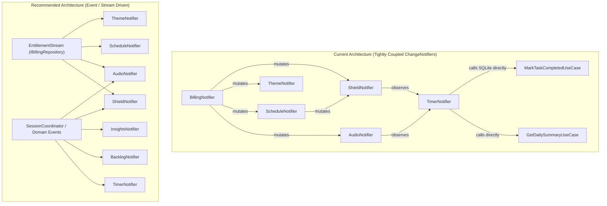

# Focusmaxxing — Comprehensive Repository Audit Report

This document catalogs **bugs & implementation flaws**, **quick wins**, **architectural updates**, and **possible enhancements** identified across the Dart/Flutter layers (`lib/`, `test/`, `integration_test/`) and native platform layers (`android/`, `ios/`).

---

## 1. Critical Bugs & Implementation Flaws

> [!CAUTION]
> Several high-severity issues affect core app functionality on real devices: SQLite transaction nesting in `MigrationRunner`, Pro accent settings being wiped on startup due to an async initialization race, and background scheduled Auto-Shield alarms failing when the app process is not alive.

### 1.1 Core Infrastructure, Database & Startup

1. **[CRITICAL] Nested SQLite Transaction in [`MigrationRunner.run`](lib/core/database/migrations/migration_runner.dart)**
   - **Location**: `lib/core/database/migrations/migration_runner.dart:18-22`, called from `DatabaseHelper._onCreate` (`lib/core/database/database_helper.dart:87-89`) and `DatabaseHelper._onUpgrade` (`lib/core/database/database_helper.dart:91-93`).
   - **Flaw**: `sqflite` automatically wraps `onCreate` and `onUpgrade` callbacks inside an exclusive SQLite transaction. Inside `MigrationRunner.run()`, calling `await db.transaction((txn) async { await migration.up(txn); })` issues a nested transaction inside `onCreate`/`onUpgrade`, which can deadlock or throw `SqfliteDatabaseException: DatabaseException(cannot start a transaction within a transaction)` on native Android/iOS SQLite drivers.

2. **[CRITICAL] Race Condition Wipes Out Saved Pro Accent Color on Every App Launch**
   - **Locations**:
     - `lib/main.dart:186-200` & `lib/main.dart:305-313`
     - `lib/features/billing/presentation/notifiers/billing_notifier.dart:95-106`
     - `lib/core/theme/theme_notifier.dart:54-61`
   - **Flaw**: `ThemeNotifier` synchronously loads the user's saved Pro accent (e.g., `hyper_violet`) from `SharedPreferences` in its constructor. However, `BillingNotifier` loads cached Pro entitlement **asynchronously** in `initialize()`, where `_unlockStatus` starts as `ProUnlockStatusEntity.locked`. When `attachThemeNotifier(themeNotifier)` runs synchronously during startup (and inside `ChangeNotifierProxyProvider4.update`), `if (!_unlockStatus.isUnlocked)` evaluates to `true` **before** `initialize()` finishes reading the local cache—immediately calling `themeNotifier.validateProAccess(isLifetimePro: false)`, which resets the theme to `neonLime` and **deletes `theme_accent_color` from `SharedPreferences`**.

3. **[HIGH] Lazy Initialization in [`ThemeNotifier._getPrefs`](lib/core/theme/theme_notifier.dart) Overwrites In-Memory State**
   - **Location**: `lib/core/theme/theme_notifier.dart:19-50`
   - **Flaw**: When `ThemeNotifier` is constructed without an injected `SharedPreferences` instance (`_prefs == null`), calling `setAccent(variant, isLifetimePro: true)` sets `_currentAccent = variant` on line 47, and then awaits `_getPrefs()` on line 48. `_getPrefs()` calls `_loadAccent()`, which reads the **old** accent from `SharedPreferences` and overwrites `_currentAccent` back to the old value before line 49 writes the new `variant.id` to disk.

4. **[MEDIUM] Permanent Singleton Failure After Database Close & `close()` Race in [`DatabaseHelper`](lib/core/database/database_helper.dart)**
   - **Locations**: `lib/core/database/database_helper.dart:43-59` and `lib/core/database/database_helper.dart:95-102`
   - **Flaw**:
     1. If `_database != null` and `!currentDb.isOpen`, `DatabaseHelper.instance.database` throws `DatabaseException('Database is closed')` without resetting `_database = null` or `_initFuture = null`, permanently breaking all subsequent DB calls in the isolate.
     2. If `close()` is called while `_initDatabase()` is still awaiting `factory.openDatabase(...)`, the in-flight `await _initFuture` completes afterward and assigns the newly opened `Database` back to `_database`.

---

### 1.2 Native Android Bridge, Shield & Schedule Features

5. **[CRITICAL] Background Schedule Alarms Fail When App Is Killed (`MissingPluginException`)**
   - **Locations**:
     - `lib/features/schedule/data/datasources/schedule_alarm_data_source.dart:10-46`
     - `android/app/src/main/kotlin/com/bmrkiewicz/focusmaxxing/focusmaxxing/MainActivity.kt:44-49`
   - **Flaw**: `android_alarm_manager_plus` executes `autoShieldStartAlarmCallback` and `autoShieldEndAlarmCallback` in a background headless `FlutterEngine`. However, the `com.focusmaxxing/shield` `MethodChannel` is only registered in `MainActivity.configureFlutterEngine()`. When the user swipes the app away or the OS reclaims `MainActivity`, `channel.invokeMethod('startShield', ...)` in the background isolate throws `MissingPluginException`, which is silently swallowed by `catch (_) {}`. Scheduled auto-shielding therefore never starts or stops unless `MainActivity` is alive.

6. **[HIGH] [`AutoShieldAlarmReceiver.kt`](android/app/src/main/kotlin/com/bmrkiewicz/focusmaxxing/focusmaxxing/shield/AutoShieldAlarmReceiver.kt) Is Unwired & Parses `SharedPreferences` StringLists Incorrectly**
   - **Locations**:
     - `android/app/src/main/kotlin/com/bmrkiewicz/focusmaxxing/focusmaxxing/shield/AutoShieldAlarmReceiver.kt:40-63`
     - `android/app/src/main/AndroidManifest.xml:83-90`
   - **Flaw**:
     1. Nothing in Kotlin or Dart schedules `PendingIntent` broadcasts for `com.bmrkiewicz.focusmaxxing.START_AUTO_SHIELD` / `STOP_AUTO_SHIELD`.
     2. Lines 40–63 call `prefs.getString("flutter.scheduled_auto_shield_active_days", null)` and pass it to `JSONArray(raw)`. Flutter's `shared_preferences` plugin on Android does **not** store `setStringList` as a JSON array—it stores a base64-encoded Java `ObjectOutputStream` prefixed with `VGhpcyBpcyB0aGUgcHJlZml4IGZvciBhIGxpc3Qu` (or a `StringSet`), so `JSONArray(raw)` will always throw `JSONException`.

7. **[HIGH] Reboot Alarm Rescheduling Disabled & Android 12–14+ Exact Alarm Permission Unhandled**
   - **Locations**:
     - `android/app/src/main/AndroidManifest.xml:13` & `android/app/src/main/AndroidManifest.xml:75-81`
     - `lib/features/schedule/data/datasources/schedule_alarm_data_source.dart:123-141`
   - **Flaw**:
     1. `dev.fluttercommunity.plus.androidalarmmanager.RebootBroadcastReceiver` is declared with `android:enabled="false"` in `AndroidManifest.xml`, so `rescheduleOnReboot: true` never runs after a device reboot.
     2. On Android 13/14+ (API 33/34+), `SCHEDULE_EXACT_ALARM` is denied by default on install. Calling `AndroidAlarmManager.periodic(..., exact: true)` without checking `canScheduleExactAlarms()` or declaring `USE_EXACT_ALARM` throws a `SecurityException`.
     3. `AndroidAlarmManager.periodic(const Duration(days: 1), ...)` uses a fixed 24-hour millisecond interval rather than a wall-clock calendar alarm, causing the schedule to drift by 1 hour across Daylight Saving Time (DST) transitions.

8. **[HIGH] Scheduled Auto-Shield Notification & Overlay Display Fake 25:00 Pomodoro Timer**
   - **Locations**:
     - `lib/features/shield/presentation/notifiers/shield_notifier.dart:346-353`
     - `lib/features/shield/data/datasources/shield_native_bridge_source.dart:124-141`
     - `android/app/src/main/kotlin/com/bmrkiewicz/focusmaxxing/focusmaxxing/shield/FocusShieldService.kt:59` & `266-276`
     - `lib/features/shield/presentation/overlay/overlay_main.dart:90-99`
   - **Flaw**:
     1. `ShieldNotifier.startShieldForSchedule({required String timeRange})` accepts `timeRange` but **never passes it** to `repository.startShieldService(activePackages)`, and `ShieldNativeBridgeSourceImpl.startShield` only sends `{'packages': blockedPackages}` (omitting `isScheduled` and `timeRange`). Even `autoShieldStartAlarmCallback` passes `'isScheduled': true` without `'timeRange'`. Because `FocusShieldService.kt:267` checks `if (isScheduled && !scheduleTimeRange.isNullOrEmpty())`, the foreground service notification always falls back to `"Lock In (Deep Work) · 25:00 remaining"`.
     2. When a user opens a blocked app during a scheduled window (with no active Pomodoro timer), `FocusShieldService` sends its default `currentRemainingSeconds = 1500` (25:00) to `HardLockOverlayWidget`, which ticks a fake local 25:00 countdown that resets to 25:00 every time the overlay is dismissed and re-triggered.

9. **[HIGH] Overnight Schedule Validation Conflict & Post-Midnight Weekday Bug**
   - **Locations**:
     - `lib/features/schedule/domain/entities/schedule_config_entity.dart:40-54` & `77-88`
     - `lib/features/schedule/presentation/notifiers/schedule_notifier.dart:136-168`
   - **Flaw**:
     1. `ScheduleConfigEntity.isValid` allows overnight schedules where `startTotalMinutes > endTotalMinutes` (e.g., `22:00 - 06:00`), but `ScheduleNotifier.setStartTime` (`newStartMinutes >= _schedule.endTotalMinutes`) and `setEndTime` (`_schedule.startTotalMinutes >= newEndMinutes`) reject them with `'Start time must precede end time'`.
     2. In `ScheduleConfigEntity.isWithinSchedule(DateTime dateTime)`, when `startTotalMinutes > endTotalMinutes` (e.g., Monday `22:00 - 06:00`), it checks `isActiveOn(dateTime.weekday)` using the current day's weekday for both the `[22:00..23:59]` segment and the `[00:00..06:00]` segment. This makes Monday `02:30 AM` falsely active (before Monday night has started) and Tuesday `02:30 AM` falsely inactive (4.5 hours into Monday night's window).
     3. `autoShieldEndAlarmCallback` unconditionally stops `FocusShieldService` at schedule end even if the user is in the middle of an active manual Pomodoro focus session.

10. **[MEDIUM] Android 10+ Background Activity Launch (BAL) Ordering in [`FocusShieldService.dismissOverlayAndReturnToApp`](android/app/src/main/kotlin/com/bmrkiewicz/focusmaxxing/focusmaxxing/shield/FocusShieldService.kt)**
    - **Location**: `android/app/src/main/kotlin/com/bmrkiewicz/focusmaxxing/focusmaxxing/shield/FocusShieldService.kt:203-225`
    - **Flaw**: `dismissOverlayOnly(appContext)` removes the `SYSTEM_ALERT_WINDOW` view on line 203 **before** calling `appContext.startActivity(launchIntent)` on line 223. On Android 10–14+, a background service is only exempted from Background Activity Launch restrictions while it actively has a visible overlay window; removing the overlay first revokes that exemption before `startActivity` executes.

---

### 1.3 Timer, Audio, Backlog & Insights Features

11. **[HIGH] [`AndroidAudioFocusGainType.none`](lib/features/audio/data/datasources/audio_player_engine.dart) Actually Requests `gainTransient` Audio Focus**
    - **Location**: `lib/features/audio/data/datasources/audio_player_engine.dart:8-22` & `70-71`
    - **Flaw**: `AndroidAudioFocusGainType.none` is defined as `AndroidAudioFocusGainType(audio_session.AndroidAudioFocusGainType.gainTransient)`. On Android, `AUDIOFOCUS_GAIN_TRANSIENT` forces other media apps (Spotify, YouTube Music, podcasts) to pause when focus soundscapes start, contradicting the comment that it mixes ambiently without interrupting other audio.

12. **[HIGH] Backlog Badge & Task List Out-of-Sync on Startup and After Session Check-In**
    - **Locations**:
      - `lib/main.dart:136-141`
      - `lib/features/timer/presentation/notifiers/timer_notifier.dart:333-342`
      - `lib/features/backlog/presentation/widgets/backlog_modal_sheet.dart:60-80`
    - **Flaw**:
      1. `BacklogNotifier.loadPendingTasks()` is never called on startup in `main.dart`, so the `TimerPage` inbox badge always displays `0` until the user opens the backlog sheet.
      2. When a session with a linked task completes, `TimerNotifier.checkInSession` calls `markTaskCompletedUseCase` directly against SQLite without notifying `BacklogNotifier`, leaving the completed task in `BacklogNotifier.pendingTasks` and the `TimerPage` badge count stale.
      3. Conversely, if a user deletes a task in `BacklogModalSheet` while it is linked to `TimerNotifier`, `TimerNotifier.linkedBacklogTaskId` is not cleared, causing `checkInSession` to fail with `DatabaseException('No task found to complete with ID $id')`.

13. **[MEDIUM] [`InsightsRepositoryImpl.getDailySummary`](lib/features/insights/data/repositories/insights_repository_impl.dart) Silently Swallows Database Failures From `calculateStreak`**
    - **Location**: `lib/features/insights/data/repositories/insights_repository_impl.dart:45-53`
    - **Flaw**: `streakResult.fold((failure) => 0, (streak) => streak)` silently converts any `DatabaseFailure` during streak calculation into a `0` streak instead of returning `Left(failure)`.

14. **[MEDIUM] [`InsightsPage`](lib/features/insights/presentation/pages/insights_page.dart) Renders Static `"LIFETIME PRO: ACTIVE"` Banner When `BillingNotifier` Is Absent**
    - **Location**: `lib/features/insights/presentation/pages/insights_page.dart:260-271` & `455-506`
    - **Flaw**: When `context.watch<BillingNotifier?>()` is `null`, `_ProSection` falls back to `_ProBanner`, which hardcodes `'LIFETIME PRO: ACTIVE'`.

15. **[MEDIUM] [`TimerNotifier`](lib/features/timer/presentation/notifiers/timer_notifier.dart) Session & Break Edge Cases**
    - **Locations**:
      - `startFocusSession` (`lib/features/timer/presentation/notifiers/timer_notifier.dart:132-159`): Mutates `_currentTaskGoal`, cancels the active break ticker, and caches the goal to `SharedPreferences` **before** `startSessionUseCase` validates the goal length (`<= 60` chars) and duration (`> 0`).
      - `checkInSession` (`lib/features/timer/presentation/notifiers/timer_notifier.dart:309-365`): Does not pass the user's `includeWeekendsInStreak` preference to `summaryUseCase(DateTime.now())` when syncing the home widget, and does not schedule a background notification when starting the 5-minute break timer (`TimerStatus.breakRunning`).
      - `TimerDialWidget` (`lib/features/timer/presentation/widgets/timer_dial_widget.dart:34-61`): Divides `totalSeconds / 3600.0`, capping dial progress and drag gestures at 60 minutes even though custom durations support up to 120 minutes.

---

### 1.4 Billing & Store Integration

16. **[HIGH] 8-Second UI Hang on `restorePurchases()` When User Has Zero Prior Purchases**
    - **Location**: `lib/features/billing/data/repositories/billing_repository_impl.dart:164-189` & `202-266`
    - **Flaw**: When a user with no prior purchases taps "Restore Purchases", Google Play Billing emits an empty list `[]` onto `purchaseStream`. In `_handlePurchaseUpdates`, the `for (final purchase in purchaseDetailsList)` loop does not run on an empty list, so `_completePendingRestore` is never called and the UI hangs for the full 8-second `restoreTimeout`.

17. **[HIGH] Synthetic `ProductDetails` Fallback Crashes Native Store Plugins with `TypeError`**
    - **Location**: `lib/features/billing/data/repositories/billing_repository_impl.dart:126-149`
    - **Flaw**: If `queryProductDetails` returns no matching product from Play Store / App Store, `purchaseLifetimePro()` constructs a base `ProductDetails(...)` object and passes it to `buyNonConsumable()`. On Android and iOS, `in_app_purchase_android` casts the argument to `GooglePlayProductDetails`, throwing an uncaught `TypeError` (since `InAppPurchaseClientImpl` only catches `PlatformException` and `MissingPluginException`).

18. **[HIGH] Plaintext `SharedPreferences` Pro Bypass & Free Unlock Fallback on `ShieldPage`**
    - **Locations**:
      - `lib/features/billing/data/datasources/billing_local_cache_source.dart:54-75`
      - `lib/features/shield/presentation/notifiers/shield_notifier.dart:51`
      - `lib/features/schedule/presentation/notifiers/schedule_notifier.dart:43`
      - `lib/features/shield/presentation/pages/shield_page.dart:90-95`
    - **Flaw**: Even though `BillingLocalCacheSourceImpl` verifies an obfuscated receipt (`billing_encrypted_receipt_v1`), `ShieldNotifier`, `ScheduleNotifier`, and `AudioNotifier` read the raw boolean `prefs.getBool('is_lifetime_pro')` directly from `SharedPreferences`, and `BillingNotifier` never resets those notifiers to `false` when receipt verification fails. Furthermore, in `ShieldPage:90-95`, if `billingNotifier == null`, tapping the upgrade button calls `notifier.unlockLifetimePro()` directly without a purchase.

---

### 1.5 iOS Platform Parity

19. **[HIGH] Missing iOS Native Implementations & URL Scheme Registration**
    - **Locations**: `ios/Runner/AppDelegate.swift`, `ios/Runner/Info.plist`, `lib/features/shield/data/datasources/shield_native_bridge_source.dart:47`
    - **Flaw**:
      - `ios/Runner/Info.plist` does not register `CFBundleURLTypes` for `focusmaxxing://lockin`.
      - `ShieldNativeBridgeSourceImpl` and `ScheduleAlarmDataSourceImpl` silently return `true` / `allGranted()` on iOS with no native implementation, so the UI tells iOS users that app shielding and schedules are active when nothing is happening natively.

---

## 2. Prioritized Quick Wins

The table below lists high-impact, low-effort fixes that can each be completed in under 15–30 minutes:

| # | Quick Win | File(s) | Effort | Impact |
| :- | :--- | :--- | :---: | :---: |
| **1** | **Fix `MigrationRunner` nested transaction**: Accept `DatabaseExecutor` and don't call `db.transaction()` inside `onCreate`/`onUpgrade`. | `lib/core/database/migrations/migration_runner.dart` | 5 min | Prevents SQLite transaction crash on Android/iOS |
| **2** | **Fix Pro Accent reset race on startup**: Only call `themeNotifier.validateProAccess` *after* `BillingNotifier.initialize()` has loaded `cachedStatus`, and remove `_loadAccent()` from `ThemeNotifier._getPrefs()`. | `lib/features/billing/presentation/notifiers/billing_notifier.dart`, `lib/core/theme/theme_notifier.dart` | 10 min | Fixes saved Pro accents being wiped on app launch |
| **3** | **Stop per-second notification IPC spam**: In `TimerNotifier._onTick`, skip calling `notificationService.showOngoingTimer` every second when Android's native countdown chronometer (`useNativeChronometer`) is active. | `lib/features/timer/presentation/notifiers/timer_notifier.dart` | 10 min | Cuts 1,500+ platform channel calls per 25m session |
| **4** | **Pass `isScheduled` and `timeRange` through Shield bridge**: Thread `isScheduled` and `timeRange` from `ShieldNotifier.startShieldForSchedule` and `autoShieldStartAlarmCallback` to `MainActivity.kt`. | `lib/features/shield/presentation/notifiers/shield_notifier.dart`, `lib/features/shield/data/datasources/shield_native_bridge_source.dart` | 15 min | Fixes scheduled shield notification showing fake 25:00 timer |
| **5** | **Fix `AndroidAudioFocusGainType.none`**: Use `gainTransientMayDuck` or omit audio focus request so ambient soundscapes don't pause the user's music player. | `lib/features/audio/data/datasources/audio_player_engine.dart` | 5 min | Prevents ambient noise from killing Spotify/Music |
| **6** | **Load backlog tasks on app startup**: Call `..loadPendingTasks()` on `BacklogNotifier` in `main.dart` and refresh after `checkInSession`. | `lib/main.dart`, `lib/features/timer/presentation/notifiers/timer_notifier.dart` | 10 min | Fixes `TimerPage` inbox badge showing `0` on launch |
| **7** | **Fix 8s hang on empty `restorePurchases()`**: Complete `_pendingRestoreCompleter` when `purchaseDetailsList` is empty in `_handlePurchaseUpdates`. | `lib/features/billing/data/repositories/billing_repository_impl.dart` | 5 min | Eliminates 8-second spinner when restoring with 0 purchases |
| **8** | **Remove dead `_ProBanner` in `InsightsPage`**: Use `LifetimeProBanner` directly instead of the fallback `_ProBanner` that hardcodes `"LIFETIME PRO: ACTIVE"`. | `lib/features/insights/presentation/pages/insights_page.dart` | 5 min | Removes false Pro status display & 50 lines of dead code |
| **9** | **Remove `onChanged: (_) => setState(() {})` in `GoalInputDialog`**: Nothing in `build()` depends on `_controller.text`. | `lib/features/timer/presentation/widgets/goal_input_dialog.dart` | 2 min | Stops rebuilding dialog on every keystroke |
| **10** | **Run `InsightsNotifier.loadInsights` queries in parallel**: Use `Future.wait` for `getDailySummaryUseCase` and `getRecentSessionsUseCase` and check `_isDisposed`. | `lib/features/insights/presentation/notifiers/insights_notifier.dart` | 5 min | Halves Insights tab DB load latency |
| **11** | **Fix `integration_test/focus_flow_test.dart` migrations**: Register `MigrationV2()` and `targetVersion: 2` alongside `MigrationV1()`. | `integration_test/focus_flow_test.dart` | 2 min | Prevents `no such table: shielded_apps` in integration tests |
| **12** | **Deduplicate `ScheduleConstants` & add `try/catch` in `NotificationService`**: Reference `ScheduleConstants` and wrap cancel/schedule methods in `try/catch`. | `lib/core/notifications/notification_service.dart` | 10 min | Prevents unhandled `PlatformException`s |
| **13** | **Adjust `pubspec.yaml` Dart SDK constraint**: Lower `sdk: ^3.13.2` to match current stable Flutter Dart SDK (e.g. `^3.5.0` or `^3.7.0`) and install `libsqlite3-dev` in `.github/workflows/ci.yml`. | `pubspec.yaml`, `.github/workflows/ci.yml` | 5 min | Ensures GitHub Actions CI passes on `ubuntu-latest` |

---

## 3. Architectural Updates

### 3.1 Decouple Cross-Notifier Spaghetti & Centralize Dependency Injection

Currently, `lib/main.dart` is 454 lines long and maintains **two divergent dependency graphs**:
1. `main()` (lines 87–213), which injects `SharedPreferences` and initializes services.
2. `FocusmaxxingApp._createDefault*Notifier()` (lines 338–451), which omits `SharedPreferences`, omits `CheckScheduleActiveNowUseCase`, and creates uninitialized `NotificationService()` instances.

Furthermore, presentation `ChangeNotifier`s hold direct mutable references to each other via `attach*Notifier()` setters, and `FocusmaxxingApp` uses `ChangeNotifierProvider.value` (which never disposes any of the notifiers when unmounted).

**Recommended Refactoring**:
- **Single Composition Root**: Extract DI creation into `lib/core/di/app_dependencies.dart` so both `main()` and widget/integration tests use a single, consistent factory graph with proper disposal.
- **Reactive Entitlement Stream**: Instead of `BillingNotifier` holding direct references to 4 sibling `ChangeNotifier`s and each notifier reading raw `SharedPreferences` keys (`is_lifetime_pro` vs `is_pro_unlocked`), expose a verified `Stream<ProUnlockStatusEntity>` from `IBillingRepository` (or a single `EntitlementService`) that dependent features subscribe to.
- **Session Completion Coordinator**: Extract session check-in side effects (marking the linked backlog task completed, refreshing `BacklogNotifier`, recalculating daily summary/streak with `includeWeekendsInStreak`, and syncing the home widget) out of `TimerNotifier.checkInSession` into a coordinator use case or domain event stream.

---

### 3.2 Replace Headless Dart Alarm Callbacks with Native Android `AlarmManager` + `AutoShieldAlarmReceiver`

> [!IMPORTANT]
> Today, scheduling an Auto-Shield window uses `android_alarm_manager_plus` to boot a background Flutter isolate just to invoke a `MethodChannel` back into Kotlin to start `FocusShieldService`—which fails when `MainActivity` is not running.

**Recommended Refactoring**:
1. Wire up the existing `AutoShieldAlarmReceiver.kt` natively through the `com.focusmaxxing/shield` `MethodChannel` in `MainActivity.kt`.
2. Store schedule parameters (`enabled`, `startMinutes`, `endMinutes`, `activeDays`, `blockedPackages`) in a dedicated native SharedPreferences file or JSON string so Kotlin never has to parse Flutter's base64 `ObjectOutputStream` `StringList` format.
3. Schedule exact wall-clock alarms in Kotlin using `AlarmManager.setExactAndAllowWhileIdle` (chaining the next day's alarm inside `AutoShieldAlarmReceiver.onReceive`), and register `ACTION_BOOT_COMPLETED` / `ACTION_TIMEZONE_CHANGED` / `ACTION_TIME_CHANGED` on `AutoShieldAlarmReceiver` to reschedule automatically across reboots and DST changes.
4. Remove the `android_alarm_manager_plus` dependency from `pubspec.yaml`.

---

### 3.3 Standardize Error Handling & Replace Unmaintained `dartz` with Dart 3 Sealed `Result<T>`

- **Current State**:
  - `timer`, `backlog`, `insights`, `shield`, and `schedule` return `Either<Failure, T>` from `package:dartz`, whereas `billing` throws raw `BillingFailureException` (`lib/features/billing/domain/repositories/i_billing_repository.dart`) and `audio` swallows exceptions into boolean returns.
  - Meanwhile, `lib/core/errors/failures.dart` already uses a modern Dart 3 `sealed class Failure`.
- **Recommendation**:
  - Replace `package:dartz` (`^0.10.1`, unmaintained since 2021) with a 15-line native Dart 3 `sealed class Result<T>` (`Success<T>` / `Err<T>(Failure)`) in `lib/core/errors/result.dart` and unify `IBillingRepository` and `IAudioRepository` to return `Result<T>`.

---

### 3.4 Decompose `TimerPage` & Scope `Consumer<TimerNotifier>` Rebuilds

- `TimerPage` (`lib/features/timer/presentation/pages/timer_page.dart`) is currently **1,112 lines** containing 9 private widget classes (`_ActiveLockInBanner`, `_GoalAnchorPill`, `_SoundscapePill`, `_MaximumFocusPill`, `_DurationPresets`, `_PresetChip`, `_CustomPresetChip`, `_BreakInfoCard`, `_HoldToGiveUpButton`) and wraps its entire body in a single `Consumer<TimerNotifier>`.
- Every 1-second tick of `TimerNotifier` rebuilds the entire page tree.
- **Recommendation**:
  - Use `Selector<TimerNotifier, ({int remaining, int target, TimerStatus status})>` around `TimerDialWidget` so 1-second ticks only repaint the dial and countdown text.
  - Extract the sub-widgets in `timer_page.dart` into separate files under `lib/features/timer/presentation/widgets/`.

---

## 4. Possible Enhancements

### 4.1 Crash & Process-Death Recovery for Active Focus Sessions
- **Current Limitation**: `StartSessionUseCase` writes new sessions to SQLite with `status = 'CANCELLED'` and `actual_duration_seconds = 0`, while `TimerNotifier` holds `_activeSessionId` and `_targetEndTime` strictly in memory. If Android kills the backgrounded app process during a 60-minute focus session, reopening the app resets the timer to idle (`25:00`) and leaves the session permanently marked `CANCELLED`, even though the scheduled completion notification still fires.
- **Enhancement**: Persist active session metadata (`active_session_id`, `target_end_epoch_ms`, `target_duration_seconds`, `task_goal`, `linked_backlog_task_id`, `timer_status`) in `SharedPreferences` (or introduce an `IN_PROGRESS` status in SQLite) and restore the session in `TimerNotifier` on cold start.

### 4.2 Distinguish Scheduled Auto-Shield from Active Timer in `HardLockOverlayWidget`
- **Current Limitation**: `HardLockOverlayWidget` (`lib/features/shield/presentation/overlay/overlay_main.dart`) always displays a countdown timer (`MM:SS`) and `"CURRENT GOAL"`.
- **Enhancement**: Pass `isScheduled` and `scheduleTimeRange` in the overlay state map from `FocusShieldService.kt` so that when triggered by a schedule, the overlay displays `"SCHEDULED AUTO-SHIELD"` and `"Active window: 09:00 – 17:00"` instead of a fake `25:00` countdown.

### 4.3 Direct Upgrade Flow from Locked Pro Soundscapes
- **Current Limitation**: Tapping a locked Pro accent in `ProAccentColorSection` opens a bottom sheet with `LifetimeProBanner`, whereas tapping a locked Pro soundscape in `SoundscapeConfigTile` only shows a static red error message with no way to upgrade.
- **Enhancement**: Open the upgrade bottom sheet (or add an `"UPGRADE"` CTA button to the banner) when tapping a locked soundscape.

### 4.4 Live Home Screen Widget Updates During Active Sessions
- **Current Limitation**: `WidgetSyncServiceImpl` only syncs after session completion or when opening Insights.
- **Enhancement**: Sync active session state (`isLockedIn`, `currentGoal`, `targetEndTimeEpochMs`) to `GlanceableDialWidgetProvider` and `QuickLockInWidgetProvider` when a session starts or ends so the home screen widget reflects live lock-in status.

### 4.5 Richer Insights Visualizations & Backlog History
- Add a 7-day focus minutes bar chart and completion-rate metric (`Locked In` vs `Derailed` vs `Cancelled`) to `InsightsPage`.
- Display completed backlog tasks linked via `completed_session_id` inside `SessionHistoryList`.

### 4.6 Test Suite & CI/CD Hardening
- **Consolidate Test Directory Structure**: Move the 4 files in `test/presentation/{audio,billing,insights,schedule}/` into `test/features/<feature>/presentation/` so the test hierarchy mirrors `lib/features/` 1:1.
- **Extract Shared Test Fakes**: Deduplicate `_FakeSessionRepo`, `_FakeBacklogRepo`, `_FakeInsightsRepo`, and `_FakeNotificationService` across `test/main_scaffold_test.dart`, `test/features/widget/widget_deep_link_test.dart`, and `integration_test/focus_flow_test.dart` into `test/helpers/fakes.dart`.
- **Add Missing Unit Tests**: Add unit tests for `DeleteBacklogTaskUseCase`, `GetPendingTasksUseCase`, `MarkTaskCompletedUseCase`, `JustAudioPlayerEngine`, and `AppTheme.buildDarkTheme`.
