# Focusmaxxing: Technical & Product Documentation Hub

**Repository:** `Focusmaxxing` (`C:\Users\darkn\IdeaProjects\focusmaxxing`)  
**Standard:** Production-Grade Open Source Architecture & Product Specifications  
**Audience:** Core Maintainers, System Architects, Mobile Engineers & Open-Source Contributors

---

## 1. Documentation Suite Architecture

The Focusmaxxing documentation suite follows a modular, versioned, and domain-decoupled structure:

```mermaid
flowchart TD
    Hub["docs/README.md\n(Master Hub & Sitemap)"] --> Master["CODEBASE_REVIEW_EXHAUSTIVE_REPORT.md\n(Canonical Code Review & 50-Item Remediation Ledger)"]
    Hub --> Design["design_system_and_wireframes.md\n(Material 3 / OLED Design Tokens & Wireframes)"]
    
    Hub --> Product["docs/product/\n(Modular Living Product Specifications)"]
    Hub --> Arch["docs/architecture/\n(Deep Architecture & Tradeoff Analyses)"]
    Hub --> Future["docs/future_work/\n(Approved Specs, Roadmaps & Engineering Hardening)"]
    Hub --> Archive["docs/archive/\n(Preserved Historical MVP 1.0 & Sprint Documents)"]

    Product --> P1["overview.md"]
    Product --> P2["timer_and_lock_in.md"]
    Product --> P3["shield_and_interception.md"]
    Product --> P4["audio_soundscapes.md"]
    Product --> P5["billing_and_security.md"]
    Product --> P6["scheduled_shield.md"]
    Product --> P7["widgets_and_reminders.md"]
    Product --> P8["insights_and_backlog.md"]

    Arch --> A1["system_overview.md"]
    Arch --> A2["native_android_subsystems.md"]
    Arch --> A3["state_and_concurrency.md"]
    Arch --> A4["database_and_migrations.md"]
    Arch --> A5["technical_decisions_and_tradeoffs.md"]

    Future --> F1["insights_v3_spec.md"]
    Future --> F2["deferred_features_roadmap.md"]
    Future --> F3["technical_debt_and_hardening.md"]
    Future --> F4["future_work/README.md"]
```

---

## 2. Master Sitemap & Document Index

### 2.1 Canonical Master Audit Report
- [`docs/CODEBASE_REVIEW_EXHAUSTIVE_REPORT.md`](file:///C:/Users/darkn/IdeaProjects/focusmaxxing/docs/CODEBASE_REVIEW_EXHAUSTIVE_REPORT.md): **The definitive, living master review report**. Details all 50 discovered bugs and architectural vulnerabilities, organized into a 4-phase remediation roadmap:
  - `Phase 1 (Critical Fixes & Crash Prevention)`: Shipped in commit `c4a6a21`.
  - `Phase 2 (Infrastructure, Alarm & Database Hardening)`: Shipped in commit `3d09b6b`.
  - `Phase 3 (Architecture Decoupling & Notifier Decomposition)`: Shipped in commit `b93952e`.
  - `Phase 4 (Tombstone Crash Recovery & Test Resilience)`: Shipped in commit `1134f4e`.

### 2.2 Design System & Wireframes
- [`docs/design_system_and_wireframes.md`](file:///C:/Users/darkn/IdeaProjects/focusmaxxing/docs/design_system_and_wireframes.md): Material 3 color tokens (`surface_midnight`, `accent_lock_in`, `accent_rest_mode`, `accent_hard_lock`, `accent_streak_gold`), typography scales, tactile feedback patterns, and screen wireframes.

---

### 2.3 Product Specifications (`docs/product/`)

| Document | Core Functional Scope | Key Codebase Symbols |
| :--- | :--- | :--- |
| [`docs/product/overview.md`](file:///C:/Users/darkn/IdeaProjects/focusmaxxing/docs/product/overview.md) | Executive vision, ADHD "Artisanal Digital Instrument" philosophy, 3-tab navigation hierarchy, Material 3 tokens, personas, and feature index. | [`AppColors`](file:///C:/Users/darkn/IdeaProjects/focusmaxxing/lib/core/theme/app_colors.dart), [`TimerPage`](file:///C:/Users/darkn/IdeaProjects/focusmaxxing/lib/features/timer/presentation/pages/timer_page.dart), [`ShieldPage`](file:///C:/Users/darkn/IdeaProjects/focusmaxxing/lib/features/shield/presentation/pages/shield_page.dart), [`InsightsPage`](file:///C:/Users/darkn/IdeaProjects/focusmaxxing/lib/features/insights/presentation/pages/insights_page.dart) |
| [`docs/product/timer_and_lock_in.md`](file:///C:/Users/darkn/IdeaProjects/focusmaxxing/docs/product/timer_and_lock_in.md) | 1-tap direct start, radial dial scrubbing, single session mode, 5s hold-to-cancel safeguard, victory fanfare sheet, break card, and active session crash recovery. | [`GoalInputDialog`](file:///C:/Users/darkn/IdeaProjects/focusmaxxing/lib/features/timer/presentation/widgets/goal_input_dialog.dart), [`HoldToCancelButton`](file:///C:/Users/darkn/IdeaProjects/focusmaxxing/lib/features/timer/presentation/widgets/hold_to_cancel_button.dart), [`CelebrationSparkSheet`](file:///C:/Users/darkn/IdeaProjects/focusmaxxing/lib/features/timer/presentation/widgets/celebration_spark_sheet.dart), [`ActiveSessionTombstoneEntity`](file:///C:/Users/darkn/IdeaProjects/focusmaxxing/lib/features/timer/domain/entities/active_session_tombstone_entity.dart) |
| [`docs/product/shield_and_interception.md`](file:///C:/Users/darkn/IdeaProjects/focusmaxxing/docs/product/shield_and_interception.md) | Brainrot shield interception loop, 2-app free tier limit, Maximum Focus phone lock, 60s box breathing emergency breather, permission gate, and secondary overlay engine. | [`FocusShieldService.kt`](file:///C:/Users/darkn/IdeaProjects/focusmaxxing/android/app/src/main/kotlin/com/bmrkiewicz/focusmaxxing/focusmaxxing/shield/FocusShieldService.kt), [`OverlayController`](file:///C:/Users/darkn/IdeaProjects/focusmaxxing/lib/features/shield/presentation/overlay/overlay_controller.dart), [`BoxBreathingExercise`](file:///C:/Users/darkn/IdeaProjects/focusmaxxing/lib/features/shield/presentation/overlay/widgets/overlay_breather_view.dart) |
| [`docs/product/audio_soundscapes.md`](file:///C:/Users/darkn/IdeaProjects/focusmaxxing/docs/product/audio_soundscapes.md) | Bundled offline OGG audio loops (Brown Noise free starter tier, 40Hz binaural beats, Rain, Chime), non-ducking Android audio session, active mini-player, and Pro gating. | [`AudioNotifier`](file:///C:/Users/darkn/IdeaProjects/focusmaxxing/lib/features/audio/presentation/notifiers/audio_notifier.dart), [`AudioPlayerEngine`](file:///C:/Users/darkn/IdeaProjects/focusmaxxing/lib/features/audio/data/datasources/audio_player_engine.dart), [`ActiveAudioMiniPlayer`](file:///C:/Users/darkn/IdeaProjects/focusmaxxing/lib/features/timer/presentation/widgets/active_audio_mini_player.dart) |
| [`docs/product/billing_and_security.md`](file:///C:/Users/darkn/IdeaProjects/focusmaxxing/docs/product/billing_and_security.md) | $9.99 Lifetime Pro in-app billing, local cryptographic RSA receipt signature verification, AES-encrypted cache, Pro accent themes, and entitlement stream decoupling. | [`BillingNotifier`](file:///C:/Users/darkn/IdeaProjects/focusmaxxing/lib/features/billing/presentation/notifiers/billing_notifier.dart), [`ProReceiptVerifier`](file:///C:/Users/darkn/IdeaProjects/focusmaxxing/lib/core/security/pro_receipt_verifier.dart), [`BillingLocalCacheSource`](file:///C:/Users/darkn/IdeaProjects/focusmaxxing/lib/features/billing/data/datasources/billing_local_cache_source.dart) |
| [`docs/product/scheduled_shield.md`](file:///C:/Users/darkn/IdeaProjects/focusmaxxing/docs/product/scheduled_shield.md) | Scheduled Auto-Shield engine, native `AlarmManager` broadcast execution, overnight schedules (22:00 to 06:00), baseline priority arbiter, and UI configuration section. | [`AutoShieldAlarmReceiver.kt`](file:///C:/Users/darkn/IdeaProjects/focusmaxxing/android/app/src/main/kotlin/com/bmrkiewicz/focusmaxxing/focusmaxxing/shield/AutoShieldAlarmReceiver.kt), [`ScheduleConfigEntity`](file:///C:/Users/darkn/IdeaProjects/focusmaxxing/lib/features/schedule/domain/entities/schedule_config_entity.dart), [`ScheduleConfigSection`](file:///C:/Users/darkn/IdeaProjects/focusmaxxing/lib/features/schedule/presentation/widgets/schedule_config_section.dart) |
| [`docs/product/widgets_and_reminders.md`](file:///C:/Users/darkn/IdeaProjects/focusmaxxing/docs/product/widgets_and_reminders.md) | Android AppWidgets (`GlanceableDialWidgetProvider`, `QuickLockInWidgetProvider`), native Android `RemoteViews.setChronometer` live countdown, daily reminders, and deep links. | [`GlanceableDialWidgetProvider.kt`](file:///C:/Users/darkn/IdeaProjects/focusmaxxing/android/app/src/main/kotlin/com/bmrkiewicz/focusmaxxing/focusmaxxing/widget/GlanceableDialWidgetProvider.kt), [`NotificationService`](file:///C:/Users/darkn/IdeaProjects/focusmaxxing/lib/core/notifications/notification_service.dart) |
| [`docs/product/insights_and_backlog.md`](file:///C:/Users/darkn/IdeaProjects/focusmaxxing/docs/product/insights_and_backlog.md) | Daily focus metrics, streak tracking with 1-day weekly auto-freeze resilience, binary session check-in, ADHD backlog scratchpad, and in-session stray thought quick capture. | [`InsightsRepositoryImpl`](file:///C:/Users/darkn/IdeaProjects/focusmaxxing/lib/features/insights/data/repositories/insights_repository_impl.dart), [`BacklogNotifier`](file:///C:/Users/darkn/IdeaProjects/focusmaxxing/lib/features/backlog/presentation/notifiers/backlog_notifier.dart), [`InSessionQuickCaptureSheet`](file:///C:/Users/darkn/IdeaProjects/focusmaxxing/lib/features/backlog/presentation/widgets/in_session_quick_capture.dart) |

---

### 2.4 Architecture Documentation (`docs/architecture/`)

| Document | Architectural Focus | Key Subsystems & Deliverables |
| :--- | :--- | :--- |
| [`docs/architecture/system_overview.md`](file:///C:/Users/darkn/IdeaProjects/focusmaxxing/docs/architecture/system_overview.md) | System architecture overview, Clean Architecture layer structure, dual Flutter engine entry points, component hierarchy, and cross-subsystem flow sequence diagrams. | Main Engine ([`lib/main.dart`](file:///C:/Users/darkn/IdeaProjects/focusmaxxing/lib/main.dart)), Secondary Engine ([`overlay_main.dart`](file:///C:/Users/darkn/IdeaProjects/focusmaxxing/lib/features/shield/presentation/overlay/overlay_main.dart)), Dependency Injection |
| [`docs/architecture/native_android_subsystems.md`](file:///C:/Users/darkn/IdeaProjects/focusmaxxing/docs/architecture/native_android_subsystems.md) | Native Kotlin subsystems, foreground service lifecycle, 500ms sliding window poller, `WindowManager` overlay fallback, `AlarmManager` broadcasts, and Android 10–15 BAL mitigation. | [`FocusShieldService.kt`](file:///C:/Users/darkn/IdeaProjects/focusmaxxing/android/app/src/main/kotlin/com/bmrkiewicz/focusmaxxing/focusmaxxing/shield/FocusShieldService.kt), [`AutoShieldAlarmReceiver.kt`](file:///C:/Users/darkn/IdeaProjects/focusmaxxing/android/app/src/main/kotlin/com/bmrkiewicz/focusmaxxing/focusmaxxing/shield/AutoShieldAlarmReceiver.kt), [`MainActivity.kt`](file:///C:/Users/darkn/IdeaProjects/focusmaxxing/android/app/src/main/kotlin/com/bmrkiewicz/focusmaxxing/focusmaxxing/MainActivity.kt) |
| [`docs/architecture/state_and_concurrency.md`](file:///C:/Users/darkn/IdeaProjects/focusmaxxing/docs/architecture/state_and_concurrency.md) | Provider-based state management, notifier decomposition, domain usecase decoupling, free-tier toggle mutex locks, wall-clock delta sync, and tombstone active session crash recovery. | [`TimerNotifier`](file:///C:/Users/darkn/IdeaProjects/focusmaxxing/lib/features/timer/presentation/notifiers/timer_notifier.dart), [`ShieldNotifier`](file:///C:/Users/darkn/IdeaProjects/focusmaxxing/lib/features/shield/presentation/notifiers/shield_notifier.dart), [`RecoverActiveSessionUseCase`](file:///C:/Users/darkn/IdeaProjects/focusmaxxing/lib/features/timer/domain/usecases/recover_active_session_usecase.dart) |
| [`docs/architecture/database_and_migrations.md`](file:///C:/Users/darkn/IdeaProjects/focusmaxxing/docs/architecture/database_and_migrations.md) | SQLite schema architecture, migration runner pipeline (`MigrationV1`, `MigrationV2`, upcoming `MigrationV3`), table schemas, ACID transaction guarantees, and in-memory FFI testing harness. | [`DatabaseHelper`](file:///C:/Users/darkn/IdeaProjects/focusmaxxing/lib/core/database/database_helper.dart), [`MigrationRunner`](file:///C:/Users/darkn/IdeaProjects/focusmaxxing/lib/core/database/migrations/migration_runner.dart), `sqflite_common_ffi` |
| [`docs/architecture/technical_decisions_and_tradeoffs.md`](file:///C:/Users/darkn/IdeaProjects/focusmaxxing/docs/architecture/technical_decisions_and_tradeoffs.md) | Deep evaluation of 7 critical engineering tradeoffs: Dual Flutter Engines vs XML Overlays, Native `AlarmManager` vs Headless Isolate, Provider vs BLoC, SQLite vs NoSQL, Local RSA vs Backend, Audio Mixing, and Wall-Clock Deltas. | Tradeoff matrices, context, pros/cons, and long-term architectural verdicts |

---

### 2.5 Future Work & Engineering Backlogs (`docs/future_work/`)

| Document | Purpose | Key Content |
| :--- | :--- | :--- |
| [`docs/future_work/README.md`](file:///C:/Users/darkn/IdeaProjects/focusmaxxing/docs/future_work/README.md) | Future Work Hub & Prioritized Backlog Matrix | Cross-milestone roadmap matrix, priority rankings (P0–P2), and execution dependency graph. |
| [`docs/future_work/insights_v3_spec.md`](file:///C:/Users/darkn/IdeaProjects/focusmaxxing/docs/future_work/insights_v3_spec.md) | Approved Insights V3 Milestone Specification | Strict Binary Attribution ("Lock In or Bust"), SQLite `MigrationV3` (`daily_focus_metrics`), 24h hourly distribution JSON, 7D/30D/1Y SQL aggregations, `FocusTrendCard` with "Could've Locked In" ghost bars, and `InsightsHighlightsGrid`. |
| [`docs/future_work/deferred_features_roadmap.md`](file:///C:/Users/darkn/IdeaProjects/focusmaxxing/docs/future_work/deferred_features_roadmap.md) | Deferred Features Roadmap (MVP 2.1+) | Concrete engineering specs and acceptance criteria for: E4 (Streak Shield 24h grace window), E5 (1-tap widget auto-start), E8 (15s audio previews), E13 (Daily target ring & sparkline), E14 (Clockface radial detents & presets), E15 (Shield category filter chips). |
| [`docs/future_work/technical_debt_and_hardening.md`](file:///C:/Users/darkn/IdeaProjects/focusmaxxing/docs/future_work/technical_debt_and_hardening.md) | Engineering Hardening & Reliability Tasks | Single notification channel unification, native Android instrumented tests (`connectedAndroidTest`), screen-off poller throttling for overnight battery preservation ($< 1.5\%$ drain), ProGuard/R8 release verification. |

---

### 2.6 Historical & Archived Documents (`docs/archive/`)

| Archived Document | Original Version / Milestone | Superceded By | Reason for Archival |
| :--- | :---: | :--- | :--- |
| [`docs/archive/requirements_v3.1.0.md`](file:///C:/Users/darkn/IdeaProjects/focusmaxxing/docs/archive/requirements_v3.1.0.md) | PRD v3.1.0 (14/10/26) | [`docs/product/`](file:///C:/Users/darkn/IdeaProjects/focusmaxxing/docs/product) | MVP 1.0 foundation PRD. Contradicts MVP 2.0 ADHD mechanics (2-step start, no audio on timer, punitive streaks). |
| [`docs/archive/technical_scoping_v1.1.0.md`](file:///C:/Users/darkn/IdeaProjects/focusmaxxing/docs/archive/technical_scoping_v1.1.0.md) | Architecture v1.1.0 (14/10/26) | [`docs/architecture/`](file:///C:/Users/darkn/IdeaProjects/focusmaxxing/docs/architecture) | Early technical scoping. Omits `schedule`, `widget`, `core/security/`, `MigrationRunner`, and native Android alarm receivers. |
| [`docs/archive/mvp_2.0_product_requirements_document.md`](file:///C:/Users/darkn/IdeaProjects/focusmaxxing/docs/archive/mvp_2.0_product_requirements_document.md) | PRD v2.0.0 (21/10/26) | [`docs/product/`](file:///C:/Users/darkn/IdeaProjects/focusmaxxing/docs/product) & [`docs/future_work/deferred_features_roadmap.md`](file:///C:/Users/darkn/IdeaProjects/focusmaxxing/docs/future_work/deferred_features_roadmap.md) | Historical release PRD. Shipped features are now maintained modularly in `docs/product/`; deferred features tracked in `docs/future_work/`. |
| [`docs/archive/codebase_review_report_v1.0.md`](file:///C:/Users/darkn/IdeaProjects/focusmaxxing/docs/archive/codebase_review_report_v1.0.md) | Review v1.0.0 (16/10/26) | [`docs/CODEBASE_REVIEW_EXHAUSTIVE_REPORT.md`](file:///C:/Users/darkn/IdeaProjects/focusmaxxing/docs/CODEBASE_REVIEW_EXHAUSTIVE_REPORT.md) | Early 24-issue code review draft. Superseded by the definitive 50-issue master audit report. |
| [`docs/archive/milestone_1_scope.md`](file:///C:/Users/darkn/IdeaProjects/focusmaxxing/docs/archive/milestone_1_scope.md) | Sprint 1 (14/10/26) | Implemented in commits `4a39ae1` $\rightarrow$ `191cc4b` | Core timing loop and task anchor MVP checklist. 100% completed. |
| [`docs/archive/milestone_2_scope.md`](file:///C:/Users/darkn/IdeaProjects/focusmaxxing/docs/archive/milestone_2_scope.md) | Sprint 2 (14/10/26) | Implemented in commits `ed859dd` $\rightarrow$ `edce0fe` | Brainrot shield and overlay architecture checklist. 100% completed. |
| [`docs/archive/milestone_3_scope.md`](file:///C:/Users/darkn/IdeaProjects/focusmaxxing/docs/archive/milestone_3_scope.md) | Sprint 3 (14/10/26) | Implemented in commits `5559c8c` $\rightarrow$ `2ac1a8a` | Audio, billing, scheduled auto-shield, and widget checklist. 100% completed. |
| [`docs/archive/ux_and_feature_improvement_plan.md`](file:///C:/Users/darkn/IdeaProjects/focusmaxxing/docs/archive/ux_and_feature_improvement_plan.md) | Sprint Tactical (16/10/26) | Implemented in commits `2daff53` $\rightarrow$ `daf84c2` | Tactical quick-wins checklist. ~95% completed and rolled into MVP 2.0. |

---

## 3. Documentation Maintenance Standard

When authoring or modifying documentation in this repository:
1. **Zero Speculative "TODOs"**: Every document must represent verified codebase reality or an approved engineering specification with explicit schemas and acceptance criteria.
2. **Canonical Links**: All source file and symbol references must use clickable `file:///` URIs with forward slashes (e.g., [`FocusShieldService.kt`](file:///C:/Users/darkn/IdeaProjects/focusmaxxing/android/app/src/main/kotlin/com/bmrkiewicz/focusmaxxing/focusmaxxing/shield/FocusShieldService.kt)).
3. **Diagrams**: All architecture flowcharts and state machines must use valid GitHub-compatible Mermaid (`graph TD`, `sequenceDiagram`, `stateDiagram-v2`) with quoted node labels.
4. **Directory Invariance**: Never alter source code in `lib/`, `android/`, or `test/` when updating documentation.
