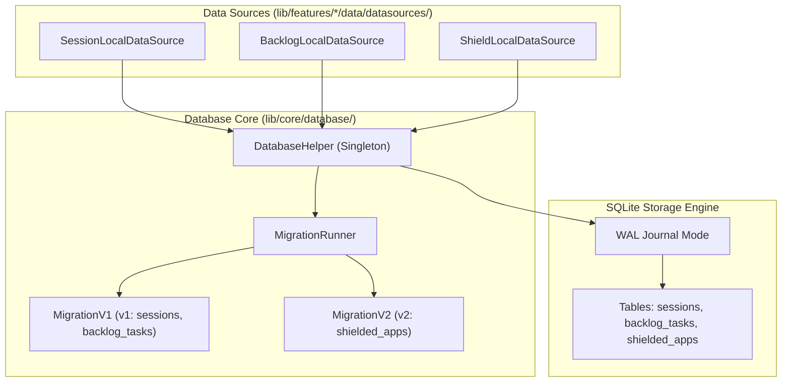
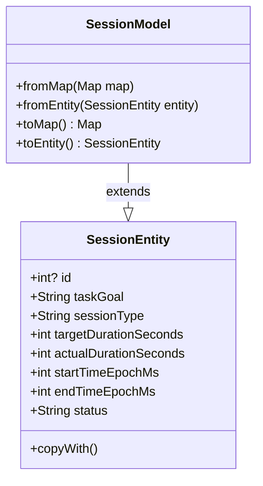

# Database Architecture & Migration Engine

## 1. Overview & Engine Specification

Focusmaxxing uses an embedded relational database powered by **SQLite** managed via the `sqflite` plugin on Android/iOS and `sqflite_common_ffi` during desktop/host testing. The persistence layer is designed for ACID compliance, zero-corruption crash resistance, atomic schema upgrades, and deterministic in-memory testability.



---

## 2. Relational Schema Specifications

### 2.1 Table: `sessions` ([`MigrationV1.dart`](file:///C:/Users/darkn/IdeaProjects/focusmaxxing/lib/core/database/migrations/migration_v1.dart#L10-L22))
Stores completed, derailed, and cancelled focus blocks and break periods.

```sql
CREATE TABLE sessions (
  id INTEGER PRIMARY KEY AUTOINCREMENT,
  task_goal TEXT NOT NULL,
  session_type TEXT NOT NULL,
  target_duration_seconds INTEGER NOT NULL,
  actual_duration_seconds INTEGER NOT NULL,
  start_time_epoch_ms INTEGER NOT NULL,
  end_time_epoch_ms INTEGER NOT NULL,
  status TEXT NOT NULL,
  created_at TIMESTAMP DEFAULT CURRENT_TIMESTAMP
);
```

* **Constraints & Types**:
  * `session_type`: Enumerated string (`'FOCUS'`, `'SHORT_BREAK'`).
  * `status`: Enumerated string (`'LOCKED_IN'`, `'DERAILED'`, `'CANCELLED'`).
  * `target_duration_seconds` / `actual_duration_seconds`: Integer values measuring planned vs delivered focus duration.
* **Indexes**:
  * `CREATE INDEX idx_sessions_start_time ON sessions (start_time_epoch_ms DESC);`: Optimizes timeline querying and daily streak aggregation.
  * `CREATE INDEX idx_sessions_type_status_time ON sessions (session_type, status, start_time_epoch_ms DESC);`: Optimizes filtered analytics (e.g. counting only completed focus blocks).

### 2.2 Table: `backlog_tasks` ([`MigrationV1.dart`](file:///C:/Users/darkn/IdeaProjects/focusmaxxing/lib/core/database/migrations/migration_v1.dart#L24-L34))
Stores intrusive thought tasks captured during focus blocks.

```sql
CREATE TABLE backlog_tasks (
  id INTEGER PRIMARY KEY AUTOINCREMENT,
  title TEXT NOT NULL,
  is_completed INTEGER NOT NULL DEFAULT 0,
  completed_session_id INTEGER,
  created_at TIMESTAMP DEFAULT CURRENT_TIMESTAMP,
  completed_at TIMESTAMP,
  FOREIGN KEY(completed_session_id) REFERENCES sessions(id) ON DELETE SET NULL
);
```

* **Foreign Key**: `completed_session_id` references `sessions(id)`. If a session record is pruned or deleted, the task's link is nullified (`ON DELETE SET NULL`) without deleting the user's backlog task.
* **Indexes**:
  * `CREATE INDEX idx_backlog_tasks_is_completed ON backlog_tasks (is_completed, id DESC);`: Powers fast rendering of active pending tasks.
  * `CREATE INDEX idx_backlog_tasks_completed_session ON backlog_tasks (completed_session_id);`: Speeds up reverse lookups of tasks completed during a specific session.

### 2.3 Table: `shielded_apps` ([`MigrationV2.dart`](file:///C:/Users/darkn/IdeaProjects/focusmaxxing/lib/core/database/migrations/migration_v2.dart#L10-L18))
Tracks installed Android applications configured for Brainrot Shield blocking.

```sql
CREATE TABLE IF NOT EXISTS shielded_apps (
  package_name TEXT PRIMARY KEY,
  app_name TEXT NOT NULL,
  is_active INTEGER NOT NULL DEFAULT 1,
  is_preset INTEGER NOT NULL DEFAULT 0,
  created_at TIMESTAMP DEFAULT CURRENT_TIMESTAMP
);
```

* **Primary Key**: `package_name` (e.g., `com.instagram.android`), ensuring idempotent upsert operations.
* **Index**:
  * `CREATE INDEX IF NOT EXISTS idx_shielded_apps_is_active ON shielded_apps (is_active);`: Rapidly extracts active package sets during service initialization.

---

## 3. Entity-Model Mapping Pattern

The database layer isolates SQL schema representations (`Map<String, dynamic>`) from domain logic using model-entity duality:



1. **Inheritance & Immutability**: [`SessionModel`](file:///C:/Users/darkn/IdeaProjects/focusmaxxing/lib/features/timer/data/models/session_model.dart) extends [`SessionEntity`](file:///C:/Users/darkn/IdeaProjects/focusmaxxing/lib/features/timer/domain/entities/session_entity.dart). Domain entities never import SQLite packages.
2. **Safe Serialization (`fromMap`)**: Converts nullable SQL records with defensive type coercion:
   ```dart
   factory SessionModel.fromMap(Map<String, dynamic> map) {
     return SessionModel(
       id: (map['id'] as num?)?.toInt(),
       taskGoal: map['task_goal']?.toString() ?? 'Deep Work',
       sessionType: map['session_type']?.toString() ?? SessionType.focus,
       targetDurationSeconds: (map['target_duration_seconds'] as num?)?.toInt() ?? 0,
       actualDurationSeconds: (map['actual_duration_seconds'] as num?)?.toInt() ?? 0,
       startTimeEpochMs: (map['start_time_epoch_ms'] as num?)?.toInt() ?? 0,
       endTimeEpochMs: (map['end_time_epoch_ms'] as num?)?.toInt() ?? 0,
       status: map['status']?.toString() ?? SessionStatus.cancelled,
     );
   }
   ```
3. Models for other tables follow the identical pattern: [`BacklogTaskModel`](file:///C:/Users/darkn/IdeaProjects/focusmaxxing/lib/features/backlog/data/models/backlog_task_model.dart) and [`ShieldedAppModel`](file:///C:/Users/darkn/IdeaProjects/focusmaxxing/lib/features/shield/data/models/shielded_app_model.dart).

---

## 4. Migration Architecture & Transaction Safety

Database upgrades are governed by [`MigrationRunner`](file:///C:/Users/darkn/IdeaProjects/focusmaxxing/lib/core/database/migrations/migration_runner.dart) and abstract [`Migration`](file:///C:/Users/darkn/IdeaProjects/focusmaxxing/lib/core/database/migrations/migration.dart) instances.

### 4.1 Atomic Migration Execution
* **Sequential Discovery**: `MigrationRunner` sorts registered migrations by `version`. It identifies all migrations where `m.version > oldVersion && m.version <= targetVersion` ([lines 19-21](file:///C:/Users/darkn/IdeaProjects/focusmaxxing/lib/core/database/migrations/migration_runner.dart#L19-L21)).
* **Transaction Rollback**: When upgrading an open database (`useTransaction: true`), all pending migrations execute inside an atomic SQLite transaction:
  ```dart
  if (db is Database && useTransaction) {
    await db.transaction((txn) async {
      for (final migration in pending) {
        await migration.up(txn);
      }
    });
  }
  ```
  If any DDL statement fails, SQLite rolls back all executed statements in the batch, leaving the database at its previous clean schema version.

### 4.2 SQLite Pragmas & Configuration ([`DatabaseHelper._onConfigure`](file:///C:/Users/darkn/IdeaProjects/focusmaxxing/lib/core/database/database_helper.dart#L92-L99))
On every connection open:
1. `PRAGMA foreign_keys = ON;`: Enforces relational integrity across foreign key constraints.
2. `PRAGMA journal_mode = WAL;`: Enables Write-Ahead Logging. WAL permits simultaneous concurrent readers while a write operation is active, eliminating UI thread lock contention during background session check-ins.

---

## 5. Connection Lifecycle & Closed-State Recovery

In Android environments, background services and process terminations can lead to stale database handles. [`DatabaseHelper`](file:///C:/Users/darkn/IdeaProjects/focusmaxxing/lib/core/database/database_helper.dart) guarantees idempotent connection recovery:

```dart
Future<Database> get database async {
  final currentDb = _database;
  if (currentDb != null) {
    if (currentDb.isOpen) {
      return currentDb;
    }
    _database = null;
    _initFuture = null;
  }
  final future = _initFuture ??= _initDatabase();
  try {
    final db = await future;
    _database = db;
    if (db.isOpen) return db;
    throw const DatabaseException('Database failed to initialize');
  } catch (_) {
    if (_initFuture == future) {
      _database = null;
      _initFuture = null;
    }
    rethrow;
  }
}
```

* **Re-open Protection**: If an existing handle is closed, the reference is discarded and a fresh initialization future is spawned.
* **Initialization De-duplication**: Concurrent queries arriving while the database is opening await the same `_initFuture`, preventing multiple SQLite connection attempts to the same database file.

---

## 6. Deterministic In-Memory SQLite FFI Testing Harness

To execute unit and integration tests without an Android emulator, Focusmaxxing uses pure in-memory SQLite FFI via `sqflite_common_ffi`.

### 6.1 Test Harness Configuration ([`test/core/database/database_helper_test.dart`](file:///C:/Users/darkn/IdeaProjects/focusmaxxing/test/core/database/database_helper_test.dart))
1. In `setUpAll()`, registers FFI drivers:
   ```dart
   setUpAll(sqfliteFfiInit);
   ```
2. In `setUp()`, opens an isolated in-memory database:
   ```dart
   final db = await databaseFactoryFfi.openDatabase(inMemoryDatabasePath);
   ```
3. Injects mock instances using [`DatabaseHelper.setMockDatabase()`](file:///C:/Users/darkn/IdeaProjects/focusmaxxing/lib/core/database/database_helper.dart#L25-L35).
4. Tests execute in microseconds directly on the host JVM/Dart VM, validating DDL migrations, transactions, indexes, and queries with bit-for-bit parity to production SQLite on Android.
