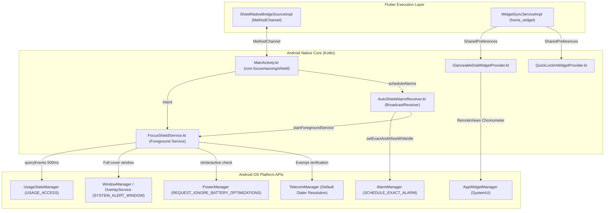

# Native Android Subsystems

## 1. Overview & Android Subsystem Topology

Focusmaxxing integrates a native Android subsystem written in Kotlin located in [`android/app/src/main/kotlin/com/bmrkiewicz/focusmaxxing/focusmaxxing/`](file:///C:/Users/darkn/IdeaProjects/focusmaxxing/android/app/src/main/kotlin/com/bmrkiewicz/focusmaxxing/focusmaxxing/). This subsystem is responsible for operating-system-level app monitoring, background schedule triggers, OS-level window overlay display, and home-screen widget rendering.



---

## 2. [`FocusShieldService.kt`](file:///C:/Users/darkn/IdeaProjects/focusmaxxing/android/app/src/main/kotlin/com/bmrkiewicz/focusmaxxing/focusmaxxing/shield/FocusShieldService.kt)

### 2.1 Lifecycle and Process Execution
* **Service Type**: Started Foreground Service (`START_STICKY`) declaring `foregroundServiceType="specialUse"` in [`AndroidManifest.xml`](file:///C:/Users/darkn/IdeaProjects/focusmaxxing/android/app/src/main/AndroidManifest.xml#L58-L64) with `PROPERTY_SPECIAL_USE_FGS_SUBTYPE` set to `"Background application interception and usage monitoring during focus sessions"`.
* **Threading & Coroutine Scope**: Executes on a dedicated `CoroutineScope(Dispatchers.Default + SupervisorJob())` ([line 363](file:///C:/Users/darkn/IdeaProjects/focusmaxxing/android/app/src/main/kotlin/com/bmrkiewicz/focusmaxxing/focusmaxxing/shield/FocusShieldService.kt#L363)).
* **Clean Destruction**: In `onDestroy()` ([lines 822-848](file:///C:/Users/darkn/IdeaProjects/focusmaxxing/android/app/src/main/kotlin/com/bmrkiewicz/focusmaxxing/focusmaxxing/shield/FocusShieldService.kt#L822-L848)), cancels the coroutine scope, unregisters screen broadcast receivers, dismisses active overlays, removes foreground notification via `stopForeground(STOP_FOREGROUND_REMOVE)` (API 24+), and nullifies its static singleton instance.

### 2.2 500ms Sliding Window UsageStats Polling
The polling engine ([lines 523-702](file:///C:/Users/darkn/IdeaProjects/focusmaxxing/android/app/src/main/kotlin/com/bmrkiewicz/focusmaxxing/focusmaxxing/shield/FocusShieldService.kt#L523-L702)) detects package switches by querying `UsageStatsManager.queryEvents`:
1. **Sliding Lookback Window**: The query interval starts at `maxOf(lastProcessedEventTime - 250L, now - 60_000L)` and ends at `now`. The 250ms overlap prevents dropping events delayed by Linux kernel scheduler jitter.
2. **Event Parsing**: Iterates through `UsageEvents.Event`, filtering for `UsageEvents.Event.ACTIVITY_RESUMED` ([lines 597-604](file:///C:/Users/darkn/IdeaProjects/focusmaxxing/android/app/src/main/kotlin/com/bmrkiewicz/focusmaxxing/focusmaxxing/shield/FocusShieldService.kt#L597-L604)). Tracks the highest timestamp observed and updates `lastProcessedEventTime` monotonically.
3. **Screen-Off Optimization**: Registers a dynamic `BroadcastReceiver` ([lines 370-408](file:///C:/Users/darkn/IdeaProjects/focusmaxxing/android/app/src/main/kotlin/com/bmrkiewicz/focusmaxxing/focusmaxxing/shield/FocusShieldService.kt#L370-L408)) for `ACTION_SCREEN_OFF`, `ACTION_SCREEN_ON`, and `ACTION_USER_PRESENT`. While the screen is unpowered, the polling loop suspends on `screenInteractiveFlow.first { it }` ([lines 531-534](file:///C:/Users/darkn/IdeaProjects/focusmaxxing/android/app/src/main/kotlin/com/bmrkiewicz/focusmaxxing/focusmaxxing/shield/FocusShieldService.kt#L531-L534)), consuming zero CPU cycles.

### 2.3 Emergency Dialer & System Whitelist Detection
Focusmaxxing prevents locking users out of emergency services:
* **Static Whitelist**: Exempts packages in `EXEMPT_PACKAGES` ([lines 121-133](file:///C:/Users/darkn/IdeaProjects/focusmaxxing/android/app/src/main/kotlin/com/bmrkiewicz/focusmaxxing/focusmaxxing/shield/FocusShieldService.kt#L121-L133)): Android/Google/Samsung dialers, in-call UIs, emergency safety hub (`com.google.android.apps.safetyhub`), and desk clocks.
* **Dynamic Resolution**: `isExemptPackage()` ([lines 140-162](file:///C:/Users/darkn/IdeaProjects/focusmaxxing/android/app/src/main/kotlin/com/bmrkiewicz/focusmaxxing/focusmaxxing/shield/FocusShieldService.kt#L140-L162)) queries `TelecomManager.defaultDialerPackage` and resolves `Intent(Intent.ACTION_DIAL)` through `PackageManager.queryIntentActivities`. Results are cached for 60 seconds.
* **Immediate De-escalation**: If an exempt package is brought to the foreground during Maximum Focus, the service immediately invokes `dismissOverlayOnly()` ([lines 614-618](file:///C:/Users/darkn/IdeaProjects/focusmaxxing/android/app/src/main/kotlin/com/bmrkiewicz/focusmaxxing/focusmaxxing/shield/FocusShieldService.kt#L614-L618)).

### 2.4 Grace Period & Emergency Pass Countdowns
1. **Return-to-App Grace Period**: When a user returns to Focusmaxxing via the overlay button, `dismissOverlayAndReturnToApp()` ([lines 341-360](file:///C:/Users/darkn/IdeaProjects/focusmaxxing/android/app/src/main/kotlin/com/bmrkiewicz/focusmaxxing/focusmaxxing/shield/FocusShieldService.kt#L341-L360)) sets `dismissGraceUntilMs = now + 4000L` with a 1200ms debounce. This 4-second immunity allows the Android activity launch transition to complete without the poller re-triggering the overlay.
2. **Emergency 2-Minute Pass**: `grantEmergencyPass()` ([lines 73-82](file:///C:/Users/darkn/IdeaProjects/focusmaxxing/android/app/src/main/kotlin/com/bmrkiewicz/focusmaxxing/focusmaxxing/shield/FocusShieldService.kt#L73-L82)) verifies availability (`isEmergencyPassAvailable()`, restricted to once per calendar day via SharedPreferences). If valid, sets `emergencyPassUntilMs = now + 120_000L` (2 minutes). When the 120 seconds elapse, if a blocked app remains in the foreground, the service triggers the overlay lock again ([lines 547-555](file:///C:/Users/darkn/IdeaProjects/focusmaxxing/android/app/src/main/kotlin/com/bmrkiewicz/focusmaxxing/focusmaxxing/shield/FocusShieldService.kt#L547-L555)).

### 2.5 Headless Expiration Synchronization
To prevent stale locks if the main Flutter engine is background-throttled:
* In `startPollingLoop()` ([lines 561-583](file:///C:/Users/darkn/IdeaProjects/focusmaxxing/android/app/src/main/kotlin/com/bmrkiewicz/focusmaxxing/focusmaxxing/shield/FocusShieldService.kt#L561-L583)), the native service inspects `targetEndTimeEpochMs`.
* When `System.currentTimeMillis() >= targetEndTimeEpochMs`, native Kotlin automatically zeros `currentRemainingSeconds`, disables `currentIsMaximumFocus`, dismisses the overlay, and updates the foreground notification.

---

## 3. [`AutoShieldAlarmReceiver.kt`](file:///C:/Users/darkn/IdeaProjects/focusmaxxing/android/app/src/main/kotlin/com/bmrkiewicz/focusmaxxing/focusmaxxing/shield/AutoShieldAlarmReceiver.kt)

### 3.1 Headless Schedule Execution
`AutoShieldAlarmReceiver` is an exported `BroadcastReceiver` that executes background schedule events without launching the Flutter engine:
1. **Direct SharedPreferences Access**: Reads directly from Android's private `FlutterSharedPreferences.xml` ([lines 39-51](file:///C:/Users/darkn/IdeaProjects/focusmaxxing/android/app/src/main/kotlin/com/bmrkiewicz/focusmaxxing/focusmaxxing/shield/AutoShieldAlarmReceiver.kt#L39-L51)) using `getFlutterStringList()`, parsing JSON strings (`flutter.scheduled_auto_shield_config`) and package arrays (`flutter.scheduled_auto_shield_packages`).
2. **Overnight Midnight-Crossing Windows**:
   In `isWithinScheduleWindow()` ([lines 66-94](file:///C:/Users/darkn/IdeaProjects/focusmaxxing/android/app/src/main/kotlin/com/bmrkiewicz/focusmaxxing/focusmaxxing/shield/AutoShieldAlarmReceiver.kt#L66-L94)):
   * Standard schedules (`start < end`): Window checks `todayWeekday in activeDays && currentMinutes in start until end`.
   * Overnight schedules (`start > end`, e.g. 22:00 to 06:00):
     * If `currentMinutes >= start`: evaluates today's weekday against `activeDays`.
     * If `currentMinutes < end`: evaluates the *previous* weekday against `activeDays` (wrapping Sunday=7 to Monday=1).

### 3.2 Exact Alarm Permissions & API 31+ Compliance
Android 12 (API 31) introduced strict restrictions on exact alarms. In `scheduleAlarm()` ([lines 96-157](file:///C:/Users/darkn/IdeaProjects/focusmaxxing/android/app/src/main/kotlin/com/bmrkiewicz/focusmaxxing/focusmaxxing/shield/AutoShieldAlarmReceiver.kt#L96-L157)):
1. Checks `Build.VERSION.SDK_INT >= Build.VERSION_CODES.S`.
2. Inspects `alarmManager.canScheduleExactAlarms()`.
3. If permitted, calls `alarmManager.setExactAndAllowWhileIdle(AlarmManager.RTC_WAKEUP, triggerTimeMs, pendingIntent)`.
4. If permission is revoked, catches `SecurityException` and degrades gracefully to `alarmManager.setAndAllowWhileIdle()`.
5. Targets are automatically projected 24 hours forward if the calculated alarm time for today has already elapsed ([lines 117-119](file:///C:/Users/darkn/IdeaProjects/focusmaxxing/android/app/src/main/kotlin/com/bmrkiewicz/focusmaxxing/focusmaxxing/shield/AutoShieldAlarmReceiver.kt#L117-L119)).

### 3.3 System Intent Handlers
Registered in [`AndroidManifest.xml`](file:///C:/Users/darkn/IdeaProjects/focusmaxxing/android/app/src/main/AndroidManifest.xml#L83-L93) for:
* `ACTION_BOOT_COMPLETED`
* `ACTION_MY_PACKAGE_REPLACED`
* `ACTION_TIMEZONE_CHANGED`
* `ACTION_TIME_SET`

Upon receipt of any system time or reboot event ([lines 278-308](file:///C:/Users/darkn/IdeaProjects/focusmaxxing/android/app/src/main/kotlin/com/bmrkiewicz/focusmaxxing/focusmaxxing/shield/AutoShieldAlarmReceiver.kt#L278-L308)), alarms are rescheduled and, if the device currently falls inside the active schedule window, `FocusShieldService` is started immediately via `ContextCompat.startForegroundService`.

---

## 4. AppWidget Providers & Live Android Chronometer

Focusmaxxing provides two native home-screen widgets implemented via `home_widget`:

### 4.1 [`GlanceableDialWidgetProvider.kt`](file:///C:/Users/darkn/IdeaProjects/focusmaxxing/android/app/src/main/kotlin/com/bmrkiewicz/focusmaxxing/focusmaxxing/widget/GlanceableDialWidgetProvider.kt)
* **Active State**: Displays current streak (`widget_active_streak`), task goal (`widget_task_goal`), and a live countdown timer.
* **Battery-Free Chronometer Architecture**: Rather than waking the Flutter runtime or firing Android alarms every second to update a TextView, it binds an Android native `android.widget.Chronometer` in `RemoteViews` ([lines 40-42](file:///C:/Users/darkn/IdeaProjects/focusmaxxing/android/app/src/main/kotlin/com/bmrkiewicz/focusmaxxing/focusmaxxing/widget/GlanceableDialWidgetProvider.kt#L40-L42)):
  ```kotlin
  val baseRealtime = SystemClock.elapsedRealtime() + remainingMs
  setChronometer(R.id.widget_chronometer, baseRealtime, null, true)
  setChronometerCountDown(R.id.widget_chronometer, true)
  ```
  The countdown runs completely in Android `SystemUI` memory using hardware clocks (`elapsedRealtime`). The application process can be terminated by Android low-memory killer (LMK), and the home widget will continue ticking down with 100% precision.
* **Idle State**: Hides active container, displays completed focus minutes for today (`widget_today_minutes`), and resets chronometer to 0 ([lines 47-54](file:///C:/Users/darkn/IdeaProjects/focusmaxxing/android/app/src/main/kotlin/com/bmrkiewicz/focusmaxxing/focusmaxxing/widget/GlanceableDialWidgetProvider.kt#L47-L54)).

### 4.2 [`QuickLockInWidgetProvider.kt`](file:///C:/Users/darkn/IdeaProjects/focusmaxxing/android/app/src/main/kotlin/com/bmrkiewicz/focusmaxxing/focusmaxxing/widget/QuickLockInWidgetProvider.kt)
* 1x1 compact quick-launch widget.
* Attaches a direct deep-link `PendingIntent` with `focusmaxxing://lockin` URI targeting `MainActivity`.

---

## 5. [`MainActivity.kt`](file:///C:/Users/darkn/IdeaProjects/focusmaxxing/android/app/src/main/kotlin/com/bmrkiewicz/focusmaxxing/focusmaxxing/MainActivity.kt) & Platform Channel Architecture

### 5.1 Platform MethodChannel (`com.focusmaxxing/shield`)
Configured in `configureFlutterEngine()` ([lines 48-58](file:///C:/Users/darkn/IdeaProjects/focusmaxxing/android/app/src/main/kotlin/com/bmrkiewicz/focusmaxxing/focusmaxxing/MainActivity.kt#L48-L58)):
* `startShield`: Puts blocked packages, scheduled flags, and time ranges into an explicit Intent and invokes `ContextCompat.startForegroundService()` ([lines 68-82](file:///C:/Users/darkn/IdeaProjects/focusmaxxing/android/app/src/main/kotlin/com/bmrkiewicz/focusmaxxing/focusmaxxing/MainActivity.kt#L68-L82)).
* `stopShield`: Handles manual cancellation vs schedule expiration. If a manual session ends while a background schedule is active, it calls `active.restoreScheduledBaseline()` instead of terminating the service ([lines 84-126](file:///C:/Users/darkn/IdeaProjects/focusmaxxing/android/app/src/main/kotlin/com/bmrkiewicz/focusmaxxing/focusmaxxing/MainActivity.kt#L84-L126)).
* `syncOverlayData`: Updates shared memory in `FocusShieldService` with current remaining seconds, goal, break state, and Maximum Focus flags ([lines 128-145](file:///C:/Users/darkn/IdeaProjects/focusmaxxing/android/app/src/main/kotlin/com/bmrkiewicz/focusmaxxing/focusmaxxing/MainActivity.kt#L128-L145)).
* `checkPermissions`: Checks `AppOpsManager.OPSTR_GET_USAGE_STATS` (using `unsafeCheckOpNoThrow` on Android 10+), `Settings.canDrawOverlays()`, and `PowerManager.isIgnoringBatteryOptimizations()` ([lines 151-159](file:///C:/Users/darkn/IdeaProjects/focusmaxxing/android/app/src/main/kotlin/com/bmrkiewicz/focusmaxxing/focusmaxxing/MainActivity.kt#L151-L159)).
* `requestUsageStatsPermission`, `requestOverlayPermission`, `requestIgnoreBatteryOptimizations`: Explicit Intent dispatchers opening exact Android OS settings screens ([lines 161-213](file:///C:/Users/darkn/IdeaProjects/focusmaxxing/android/app/src/main/kotlin/com/bmrkiewicz/focusmaxxing/focusmaxxing/MainActivity.kt#L161-L213)).

---

## 6. Background Activity Launch (BAL) & Trampoline Restrictions

### 6.1 Android 10–15 BAL Restrictions
Starting in Android 10 (API 29), background services cannot launch activities directly via `startActivity()`. Focusmaxxing complies with this boundary:
1. **Window Overlay Fallback**: Instead of attempting to launch `MainActivity` to block an app, `FocusShieldService` displays a system window overlay using `SYSTEM_ALERT_WINDOW` permissions via `OverlayService`.
2. **User-Initiated Bring-to-Foreground**: When the user taps "Return to Focusmaxxing" or "Take a Breather" inside the overlay, the interaction originates from an active UI window. Calling `startActivity()` with `FLAG_ACTIVITY_NEW_TASK | FLAG_ACTIVITY_REORDER_TO_FRONT | FLAG_ACTIVITY_SINGLE_TOP` succeeds because it is triggered by immediate user touch input.

### 6.2 Android 12+ Notification & Widget Trampoline Ban
Android 12 (API 31) prohibits notification trampolines (launching an activity indirectly from a Service or BroadcastReceiver triggered by a notification tap):
* All notifications generated by `FocusShieldService` ([lines 779-811](file:///C:/Users/darkn/IdeaProjects/focusmaxxing/android/app/src/main/kotlin/com/bmrkiewicz/focusmaxxing/focusmaxxing/shield/FocusShieldService.kt#L779-L811)) use `PendingIntent.getActivity()` bound directly to `MainActivity::class.java` with `FLAG_IMMUTABLE`.
* All AppWidget click actions ([`GlanceableDialWidgetProvider.kt`](file:///C:/Users/darkn/IdeaProjects/focusmaxxing/android/app/src/main/kotlin/com/bmrkiewicz/focusmaxxing/focusmaxxing/widget/GlanceableDialWidgetProvider.kt#L56-L62)) use `HomeWidgetLaunchIntent.getActivity()` directly targeting `MainActivity`.
