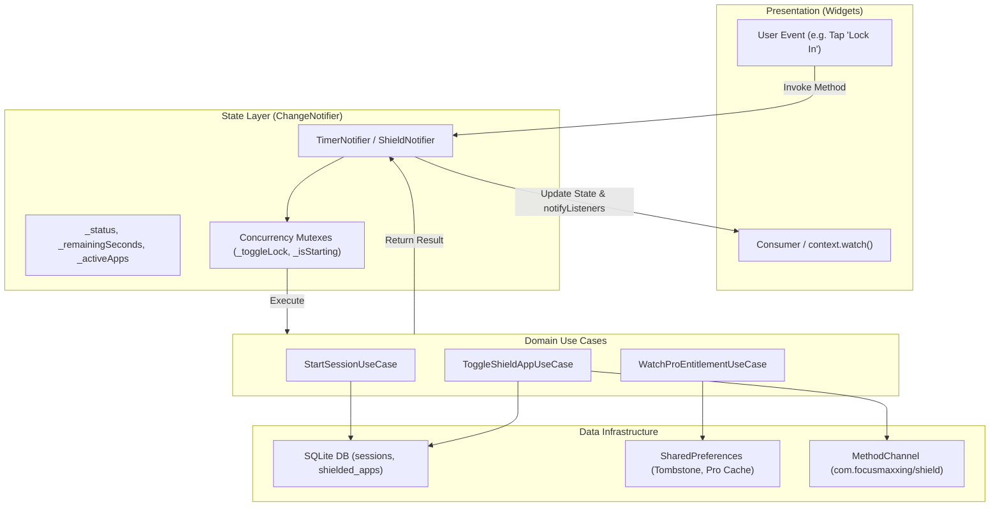
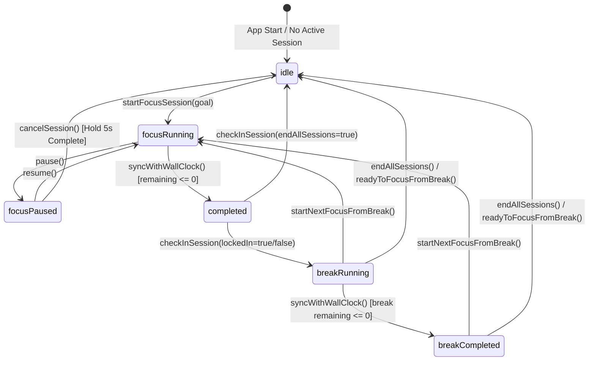
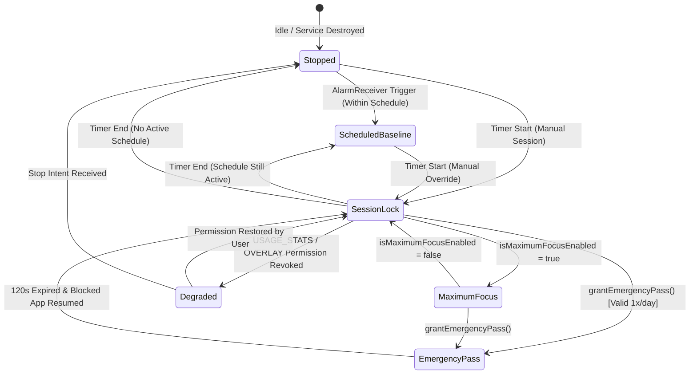

# State Management & Concurrency Architecture

## 1. State Management Architecture

Focusmaxxing uses the **Provider (`ChangeNotifier`)** pattern with unidirectional data flow and strict Clean Architecture decoupling. State is encapsulated within domain-scoped notifiers, exposing immutable getters to the Flutter presentation layer while mutating internal state exclusively via Domain Use Cases.



---

## 2. Decoupled Cross-Notifier Coordination

To avoid tight coupling where notifiers hold hard references to each other, Focusmaxxing employs two patterns:

### 2.1 Reactive Entitlement Distribution ([`WatchProEntitlementUseCase`](file:///C:/Users/darkn/IdeaProjects/focusmaxxing/lib/features/billing/domain/usecases/watch_pro_entitlement_usecase.dart))
Neither [`ShieldNotifier`](file:///C:/Users/darkn/IdeaProjects/focusmaxxing/lib/features/shield/presentation/notifiers/shield_notifier.dart), [`AudioNotifier`](file:///C:/Users/darkn/IdeaProjects/focusmaxxing/lib/features/audio/presentation/notifiers/audio_notifier.dart), [`ScheduleNotifier`](file:///C:/Users/darkn/IdeaProjects/focusmaxxing/lib/features/schedule/presentation/notifiers/schedule_notifier.dart), nor [`ThemeNotifier`](file:///C:/Users/darkn/IdeaProjects/focusmaxxing/lib/core/theme/theme_notifier.dart) depend on [`BillingNotifier`](file:///C:/Users/darkn/IdeaProjects/focusmaxxing/lib/features/billing/presentation/notifiers/billing_notifier.dart). Instead, all features subscribe to the domain stream exposed by [`WatchProEntitlementUseCase`](file:///C:/Users/darkn/IdeaProjects/focusmaxxing/lib/features/billing/domain/usecases/watch_pro_entitlement_usecase.dart):
* `BillingNotifier.buyLifetimePro()` executes [`PurchaseLifetimeProUseCase`](file:///C:/Users/darkn/IdeaProjects/focusmaxxing/lib/features/billing/domain/usecases/purchase_lifetime_pro_usecase.dart).
* Upon purchase success, the billing repository emits an updated [`ProUnlockStatusEntity`](file:///C:/Users/darkn/IdeaProjects/focusmaxxing/lib/features/billing/domain/entities/pro_unlock_status_entity.dart) to the reactive stream.
* `ShieldNotifier._bindEntitlementStream()` ([lines 573-585](file:///C:/Users/darkn/IdeaProjects/focusmaxxing/lib/features/shield/presentation/notifiers/shield_notifier.dart#L573-L585)) receives the event, unlocks pro features locally, and clears upgrade prompts without coupling to billing UI widgets.

### 2.2 Coordinated Proxy Linking
When high-frequency temporal events occur (e.g., [`TimerNotifier`](file:///C:/Users/darkn/IdeaProjects/focusmaxxing/lib/features/timer/presentation/notifiers/timer_notifier.dart) ticks requiring overlay time sync in [`ShieldNotifier`](file:///C:/Users/darkn/IdeaProjects/focusmaxxing/lib/features/shield/presentation/notifiers/shield_notifier.dart)), linkage is established at bootstrap via `attachTimerNotifier()` ([lines 166-174](file:///C:/Users/darkn/IdeaProjects/focusmaxxing/lib/features/shield/presentation/notifiers/shield_notifier.dart#L166-L174)) or `ChangeNotifierProxyProvider` in [`lib/main.dart`](file:///C:/Users/darkn/IdeaProjects/focusmaxxing/lib/main.dart#L302-L315). State updates are guarded by dirty checks (`_lastSyncedRemainingSeconds`, `_lastSyncedStatus`) to prevent duplicate IPC calls.

---

## 3. Concurrency Safeguards & Mutex Locks

Mobile user interfaces are prone to rapid asynchronous user taps that can induce race conditions. Focusmaxxing enforces strict concurrency locks:

### 3.1 Free-Tier App Cap Mutex Queue ([`ShieldNotifier._toggleLock`](file:///C:/Users/darkn/IdeaProjects/focusmaxxing/lib/features/shield/presentation/notifiers/shield_notifier.dart#L253-L274))
The free tier allows locking a maximum of 2 apps (`freeTierAppCap = 2`). A rapid double-tap on two unselected apps could evaluate `activeAppCount < 2` concurrently on both taps, bypassing the paywall.
* **Mechanism**: An asynchronous FIFO queue constructed using a `Completer<void>` chain:
  ```dart
  Future<ShieldToggleResult> toggleApp({ ... }) async {
    final previousLock = _toggleLock;
    final completer = Completer<void>();
    _toggleLock = completer.future;

    try {
      await previousLock;
      return await _toggleAppInternal( ... );
    } finally {
      completer.complete();
    }
  }
  ```
* Every toggle awaits the completion of all preceding toggle operations. The second tap executes only after the first has completed its SQLite write and updated `activePackageNames`, guaranteeing that `activeAppCount >= freeTierAppCap` evaluates accurately.

### 3.2 State Mutation Mutexes in [`TimerNotifier`](file:///C:/Users/darkn/IdeaProjects/focusmaxxing/lib/features/timer/presentation/notifiers/timer_notifier.dart)
Boolean gates guard against re-entrant user operations:
* `_isStarting`: Prevents launching concurrent sessions if the user double-taps the start button ([line 171](file:///C:/Users/darkn/IdeaProjects/focusmaxxing/lib/features/timer/presentation/notifiers/timer_notifier.dart#L171)).
* `_isCancelling`: Re-entrant guard for hold-to-cancel operations ([line 353](file:///C:/Users/darkn/IdeaProjects/focusmaxxing/lib/features/timer/presentation/notifiers/timer_notifier.dart#L353)).
* `_isCheckingIn`: Prevents double completion and duplicate database insertions during session check-in ([line 411](file:///C:/Users/darkn/IdeaProjects/focusmaxxing/lib/features/timer/presentation/notifiers/timer_notifier.dart#L411)).

---

## 4. Wall-Clock State Synchronization

When an Android application moves into the background, the Linux kernel and Android OS throttle or suspend the Dart isolate. As a result, relying on monotonic Dart `Timer.periodic` events causes timers to drift or halt entirely.

Focusmaxxing uses **Target-End Wall-Clock Arithmetic**:
1. When a session starts, [`TimerNotifier`](file:///C:/Users/darkn/IdeaProjects/focusmaxxing/lib/features/timer/presentation/notifiers/timer_notifier.dart#L200) computes an absolute wall-clock deadline:
   $$\text{targetEndTime} = \text{DateTime.now()} + \text{targetDuration}$$
2. On every periodic tick (200ms) and whenever the application transitions to the foreground or resumes, [`syncWithWallClock()`](file:///C:/Users/darkn/IdeaProjects/focusmaxxing/lib/features/timer/presentation/notifiers/timer_notifier.dart#L634-L703) calculates:
   $$\text{remainingDuration} = \text{targetEndTime} - \text{DateTime.now()}$$
3. **Completion Detection**: If `remainingDuration <= 0`:
   * Cancels the periodic ticker.
   * Updates state to `TimerStatus.completed`.
   * Invokes [`CompleteSessionUseCase`](file:///C:/Users/darkn/IdeaProjects/focusmaxxing/lib/features/timer/domain/usecases/complete_session_usecase.dart) marking the database record as `LOCKED_IN`.
   * Triggers haptic impact and clears foreground notifications.

---

## 5. Tombstone Crash Recovery

To preserve session integrity across unexpected app terminations (OS Low Memory Killer kills, device reboot, or crash), Focusmaxxing maintains an atomic JSON **tombstone** in `SharedPreferences` under key `active_session_tombstone_v1`.

### 5.1 Tombstone Schema ([`ActiveSessionTombstoneEntity`](file:///C:/Users/darkn/IdeaProjects/focusmaxxing/lib/features/timer/domain/entities/active_session_tombstone_entity.dart))
```json
{
  "sessionId": 42,
  "status": "running",
  "taskGoal": "Refactor Architecture Docs",
  "linkedBacklogTaskId": 12,
  "focusDurationSeconds": 1500,
  "targetDurationSeconds": 1500,
  "remainingSeconds": 842,
  "targetEndTimeEpochMs": 1729000000000,
  "savedAtEpochMs": 1728999158000
}
```

### 5.2 Recovery Pipeline ([`TimerNotifier.recoverActiveSession`](file:///C:/Users/darkn/IdeaProjects/focusmaxxing/lib/features/timer/presentation/notifiers/timer_notifier.dart#L707-L752))
During startup in `lib/main.dart`:
1. Reads `sessionTombstoneKey` from `SharedPreferences`.
2. If absent, falls back to [`RecoverActiveSessionUseCase`](file:///C:/Users/darkn/IdeaProjects/focusmaxxing/lib/features/timer/domain/usecases/recover_active_session_usecase.dart) querying SQLite for unfinalized sessions (`status = 'LOCKED_IN' AND actual_duration_seconds = 0`).
3. Evaluates `now` vs `targetEndTimeEpochMs`:
   * **Deadline Expired in Background**: If $\text{now} \ge \text{targetEndTimeEpochMs}$, marks the session as `completed`, commits `LOCKED_IN` with full duration to SQLite, and transitions to the completed screen so the user receives credit for their focus block.
   * **Deadline Still Active**: Recalculates remaining duration, re-initializes `_targetEndTime`, re-starts the 200ms ticker, reschedules notification, and resumes the timer seamlessly.
4. When a session is cancelled or checked in, `_clearTombstone()` ([lines 946-952](file:///C:/Users/darkn/IdeaProjects/focusmaxxing/lib/features/timer/presentation/notifiers/timer_notifier.dart#L946-L952)) wipes the key.

---

## 6. State Machine Specifications

### 6.1 Timer Lifecycle State Machine



### 6.2 Shield Native Service State Machine


