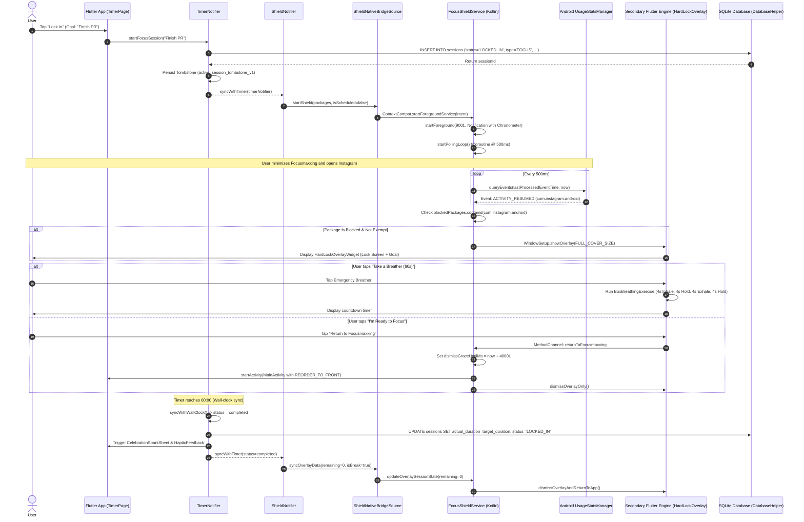

# System Overview & Architecture

## 1. Architectural Philosophy & Principles

Focusmaxxing is engineered as an extreme-focus and dopamine-regulation utility for Android, built using **Flutter 3.24+ (Dart 3.5+)** coupled to a specialized **Kotlin native subsystem**. The application enforces strict digital boundaries by intercepting distracting applications at the Android OS level, presenting full-screen non-dismissible lockouts, synthesizing ambient audio soundscapes, and providing glanceable home-screen chronometers.

The codebase strictly adheres to **Clean Architecture** as formulated by Robert C. Martin, organized into decoupled feature packages with strict dependency inversion boundaries.

```mermaid
graph TD
    subgraph Presentation_Layer["Presentation Layer (Flutter UI & State)"]
        UI["Widgets & Pages (TimerPage, ShieldPage)"]
        Notifiers["ChangeNotifiers (TimerNotifier, ShieldNotifier)"]
        OverlayUI["Overlay Engine (HardLockOverlayWidget)"]
    end

    subgraph Domain_Layer["Domain Layer (Enterprise Business Rules)"]
        UseCases["Use Cases (StartSessionUseCase, SwapShieldAppUseCase)"]
        Entities["Entities (SessionEntity, ShieldedAppEntity)"]
        RepoInterfaces["Repository Interfaces (ISessionRepository, IShieldRepository)"]
    end

    subgraph Data_Layer["Data Layer (Data Access & Infrastructure)"]
        Repos["Repository Implementations (SessionRepositoryImpl)"]
        DataSources["Data Sources (SQLite, SharedPreferences, MethodChannels)"]
        Models["Models (SessionModel, ShieldedAppModel)"]
    end

    subgraph Native_Layer["Android Native Subsystems (Kotlin)"]
        FSS["FocusShieldService (Foreground Service)"]
        AlarmRec["AutoShieldAlarmReceiver (AlarmManager)"]
        Widgets["AppWidgetProviders (GlanceableDialWidgetProvider)"]
        MainAct["MainActivity (MethodChannel & Permissions)"]
    end

    UI --> Notifiers
    Notifiers --> UseCases
    OverlayUI --> UseCases
    UseCases --> RepoInterfaces
    UseCases --> Entities
    Repos ..|> RepoInterfaces
    Repos --> DataSources
    Repos --> Models
    Models --|> Entities
    DataSources --> Native_Layer
```

### 1.1 The Dependency Inversion Rule
1. **The Domain Layer is Pure Dart**: The domain layer ([`lib/features/*/domain`](file:///C:/Users/darkn/IdeaProjects/focusmaxxing/lib)) has zero external dependencies on Flutter widgets, SQLite, or third-party packages. It contains only business entities, repository abstractions, and use case interactors.
2. **Inward Dependency Direction**: Inner layers know nothing about outer layers. Domain declares abstract interfaces ([`ISessionRepository`](file:///C:/Users/darkn/IdeaProjects/focusmaxxing/lib/features/timer/domain/repositories/i_session_repository.dart), [`IShieldRepository`](file:///C:/Users/darkn/IdeaProjects/focusmaxxing/lib/features/shield/domain/repositories/i_shield_repository.dart)). The data layer implements these interfaces ([`SessionRepositoryImpl`](file:///C:/Users/darkn/IdeaProjects/focusmaxxing/lib/features/timer/data/repositories/session_repository_impl.dart), [`ShieldRepositoryImpl`](file:///C:/Users/darkn/IdeaProjects/focusmaxxing/lib/features/shield/data/repositories/shield_repository_impl.dart)) and converts low-level database records or platform maps into immutable domain entities.
3. **Decoupled Cross-Feature Communication**: Features do not import each other's data sources or repositories. When cross-feature coordination is required (e.g. checking Pro status in [`ShieldNotifier`](file:///C:/Users/darkn/IdeaProjects/focusmaxxing/lib/features/shield/presentation/notifiers/shield_notifier.dart) or [`AudioNotifier`](file:///C:/Users/darkn/IdeaProjects/focusmaxxing/lib/features/audio/presentation/notifiers/audio_notifier.dart)), it occurs strictly via domain use cases ([`WatchProEntitlementUseCase`](file:///C:/Users/darkn/IdeaProjects/focusmaxxing/lib/features/billing/domain/usecases/watch_pro_entitlement_usecase.dart)) or listener subscriptions, never by direct notifier-to-notifier mutation.

---

## 2. Directory Layout & Layer Decomposition

The codebase is organized into a modular structure under [`lib/`](file:///C:/Users/darkn/IdeaProjects/focusmaxxing/lib):

```
lib/
├── main.dart                                    # Primary application bootstrap & DI root
├── main_scaffold.dart                           # Bottom navigation shell & tab controller
├── core/                                        # Shared foundational infrastructure
│   ├── constants/                               # System constants & SharedPreferences keys
│   ├── database/                                # SQLite DatabaseHelper & MigrationRunner
│   │   └── migrations/                          # MigrationV1, MigrationV2, abstract Migration
│   ├── errors/                                  # Domain Failures & infrastructure Exceptions
│   ├── notifications/                           # NotificationService (flutter_local_notifications)
│   ├── security/                                # ProReceiptVerifier (HMAC-SHA256 & FNV-1a signer)
│   ├── theme/                                   # AppTheme, AppColors, ProAccentVariant, ThemeNotifier
│   └── utils/                                   # DateUtils, TimeFormatter, HapticFeedbackHelper
└── features/                                    # Feature slices
    ├── audio/                                   # Ambient audio loopers & completion chimes
    ├── backlog/                                 # Intrusive thought task capture & backlog
    ├── billing/                                 # In-app purchase & offline cryptographic receipts
    ├── insights/                                # Streak calculation, session history & metrics
    ├── schedule/                                # Scheduled Auto-Shield configuration & alarms
    ├── shield/                                  # App interception, permissions & overlay lock
    ├── timer/                                   # Pomodoro dial, ticker engine & tombstone recovery
    └── widget/                                  # Home widget synchronization service
```

Each feature slice contains three sub-layers:
* **`data/`**:
  * `datasources/`: Local SQLite queries ([`SessionLocalDataSource`](file:///C:/Users/darkn/IdeaProjects/focusmaxxing/lib/features/timer/data/datasources/session_local_data_source.dart)), platform channel bridges ([`ShieldNativeBridgeSourceImpl`](file:///C:/Users/darkn/IdeaProjects/focusmaxxing/lib/features/shield/data/datasources/shield_native_bridge_source.dart)), Android AlarmManager bridges ([`ScheduleAlarmDataSourceImpl`](file:///C:/Users/darkn/IdeaProjects/focusmaxxing/lib/features/schedule/data/datasources/schedule_alarm_data_source.dart)), or audio engines ([`JustAudioPlayerEngine`](file:///C:/Users/darkn/IdeaProjects/focusmaxxing/lib/features/audio/data/datasources/audio_player_engine.dart)).
  * `models/`: Data transfer objects ([`SessionModel`](file:///C:/Users/darkn/IdeaProjects/focusmaxxing/lib/features/timer/data/models/session_model.dart), [`ShieldedAppModel`](file:///C:/Users/darkn/IdeaProjects/focusmaxxing/lib/features/shield/data/models/shielded_app_model.dart)) extending domain entities with serialization methods (`fromMap`, `toMap`, `fromEntity`).
  * `repositories/`: Repository implementations fulfilling domain contracts.
* **`domain/`**:
  * `entities/`: Immutable business entities ([`SessionEntity`](file:///C:/Users/darkn/IdeaProjects/focusmaxxing/lib/features/timer/domain/entities/session_entity.dart), [`ShieldedAppEntity`](file:///C:/Users/darkn/IdeaProjects/focusmaxxing/lib/features/shield/domain/entities/shielded_app_entity.dart), [`ActiveSessionTombstoneEntity`](file:///C:/Users/darkn/IdeaProjects/focusmaxxing/lib/features/timer/domain/entities/active_session_tombstone_entity.dart)).
  * `repositories/`: Pure abstract interfaces ([`ISessionRepository`](file:///C:/Users/darkn/IdeaProjects/focusmaxxing/lib/features/timer/domain/repositories/i_session_repository.dart), [`IShieldRepository`](file:///C:/Users/darkn/IdeaProjects/focusmaxxing/lib/features/shield/domain/repositories/i_shield_repository.dart)).
  * `usecases/`: Single-responsibility command/query interactors returning `dartz` `Either<Failure, T>` or strongly typed entities.
* **`presentation/`**:
  * `notifiers/`: [`ChangeNotifier`](file:///C:/Users/darkn/IdeaProjects/focusmaxxing/lib/features/timer/presentation/notifiers/timer_notifier.dart) classes holding view state and invoking use cases.
  * `pages/`: Top-level screens ([`TimerPage`](file:///C:/Users/darkn/IdeaProjects/focusmaxxing/lib/features/timer/presentation/pages/timer_page.dart), [`ShieldPage`](file:///C:/Users/darkn/IdeaProjects/focusmaxxing/lib/features/shield/presentation/pages/shield_page.dart), [`InsightsPage`](file:///C:/Users/darkn/IdeaProjects/focusmaxxing/lib/features/insights/presentation/pages/insights_page.dart)).
  * `widgets/`: Reusable, atomic UI components (e.g., [`TimerDialWidget`](file:///C:/Users/darkn/IdeaProjects/focusmaxxing/lib/features/timer/presentation/widgets/timer_dial_widget.dart), [`HoldToCancelButton`](file:///C:/Users/darkn/IdeaProjects/focusmaxxing/lib/features/timer/presentation/widgets/hold_to_cancel_button.dart)).
  * `overlay/`: Secondary Flutter UI entry point for system overlays ([`overlay_main.dart`](file:///C:/Users/darkn/IdeaProjects/focusmaxxing/lib/features/shield/presentation/overlay/overlay_main.dart)).

---

## 3. Application Entry Points & Dual Engine Architecture

A critical architectural characteristic of Focusmaxxing is its **Dual Flutter Engine** topology.

```mermaid
graph LR
    subgraph OS["Android Operating System"]
        Launcher["User Launch / App Icon"] --> MainProcess["Main Process: Activity"]
        FGS["FocusShieldService (Foreground)"] --> EngineGroup["FlutterEngineGroup"]
    end

    subgraph Flutter_Primary["Primary Flutter Engine"]
        MainProcess --> MainDart["lib/main.dart: main()"]
        MainDart --> AppScaffold["FocusmaxxingApp -> MainScaffold"]
    end

    subgraph Flutter_Secondary["Secondary Overlay Engine (flutter_overlay_window)"]
        EngineGroup --> OverlayDart["overlay_main.dart: overlayMain()"]
        OverlayDart --> OverlayScaffold["HardLockOverlayWidget"]
    end

    MainDart -. MethodChannel: com.focusmaxxing/shield .-> FSS
    OverlayDart -. MethodChannel: com.focusmaxxing/overlay_bridge .-> FSS
```

### 3.1 Primary Entry Point: [`lib/main.dart`](file:///C:/Users/darkn/IdeaProjects/focusmaxxing/lib/main.dart#L76-L244)
* **Function**: `void main() async`
* **Responsibilities**:
  1. Calls `WidgetsFlutterBinding.ensureInitialized()` ([line 77](file:///C:/Users/darkn/IdeaProjects/focusmaxxing/lib/main.dart#L77)).
  2. Bootstraps SQLite FFI via `sqfliteFfiInit()` when executing in desktop test environments ([lines 79-82](file:///C:/Users/darkn/IdeaProjects/focusmaxxing/lib/main.dart#L79-L82)).
  3. Initializes [`NotificationService`](file:///C:/Users/darkn/IdeaProjects/focusmaxxing/lib/core/notifications/notification_service.dart#L25) for high-priority timer foreground alerts ([lines 84-89](file:///C:/Users/darkn/IdeaProjects/focusmaxxing/lib/main.dart#L84-L89)).
  4. Initializes `AndroidAlarmManager` on Android for headless background schedule execution ([lines 93-97](file:///C:/Users/darkn/IdeaProjects/focusmaxxing/lib/main.dart#L93-L97)).
  5. Instantiates singletons for Data Sources, Repositories, and Use Cases ([lines 99-148](file:///C:/Users/darkn/IdeaProjects/focusmaxxing/lib/main.dart#L99-L148)).
  6. Restores persistent session state via [`TimerNotifier.recoverActiveSession()`](file:///C:/Users/darkn/IdeaProjects/focusmaxxing/lib/features/timer/presentation/notifiers/timer_notifier.dart#L707) ([lines 204-208](file:///C:/Users/darkn/IdeaProjects/focusmaxxing/lib/main.dart#L204-L208)).
  7. Cross-links dependent notifiers: attaches [`BacklogNotifier`](file:///C:/Users/darkn/IdeaProjects/focusmaxxing/lib/features/backlog/presentation/notifiers/backlog_notifier.dart) to [`TimerNotifier`](file:///C:/Users/darkn/IdeaProjects/focusmaxxing/lib/features/timer/presentation/notifiers/timer_notifier.dart#L62), attaches [`TimerNotifier`](file:///C:/Users/darkn/IdeaProjects/focusmaxxing/lib/features/timer/presentation/notifiers/timer_notifier.dart) to [`ShieldNotifier`](file:///C:/Users/darkn/IdeaProjects/focusmaxxing/lib/features/shield/presentation/notifiers/shield_notifier.dart#L166) and [`AudioNotifier`](file:///C:/Users/darkn/IdeaProjects/focusmaxxing/lib/features/audio/presentation/notifiers/audio_notifier.dart#L131).
  8. Mounts [`FocusmaxxingApp`](file:///C:/Users/darkn/IdeaProjects/focusmaxxing/lib/main.dart#L246) wrapped in `MultiProvider` with dynamic Material 3 color harmonisation ([lines 368-386](file:///C:/Users/darkn/IdeaProjects/focusmaxxing/lib/main.dart#L368-L386)).

### 3.2 Secondary Entry Point: [`overlayMain`](file:///C:/Users/darkn/IdeaProjects/focusmaxxing/lib/features/shield/presentation/overlay/overlay_main.dart#L9-L18)
* **Function**: `@pragma('vm:entry-point') void overlayMain()`
* **Responsibilities**:
  1. Designated as an AOT entry point using `@pragma('vm:entry-point')` so the Dart AOT compiler will not tree-shake it during release builds.
  2. Spun up inside an independent `FlutterEngineGroup` managed by native Android ([`FocusShieldService.kt`](file:///C:/Users/darkn/IdeaProjects/focusmaxxing/android/app/src/main/kotlin/com/bmrkiewicz/focusmaxxing/focusmaxxing/shield/FocusShieldService.kt#L176-L191)) and the `flutter_overlay_window` plugin.
  3. Mounts [`HardLockOverlayWidget`](file:///C:/Users/darkn/IdeaProjects/focusmaxxing/lib/features/shield/presentation/overlay/overlay_main.dart#L20-L54) in a standalone `MaterialApp` with an immutable dark theme.
  4. Operates in a distinct Dart isolate with its own memory heap. Communication between the main isolate and the overlay isolate occurs via native MethodChannels (`com.focusmaxxing/overlay_bridge`) and SharedPreferences.

---

## 4. Component Mapping Across Features

The table below catalogs every feature module, detailing its domain use cases, repository implementations, data sources, and state notifiers:

| Feature | Primary Notifier | Key Domain Use Cases | Repository Implementation | Data Sources |
|---|---|---|---|---|
| **Timer** | [`TimerNotifier`](file:///C:/Users/darkn/IdeaProjects/focusmaxxing/lib/features/timer/presentation/notifiers/timer_notifier.dart) | [`StartSessionUseCase`](file:///C:/Users/darkn/IdeaProjects/focusmaxxing/lib/features/timer/domain/usecases/start_session_usecase.dart)<br>[`CompleteSessionUseCase`](file:///C:/Users/darkn/IdeaProjects/focusmaxxing/lib/features/timer/domain/usecases/complete_session_usecase.dart)<br>[`CancelSessionUseCase`](file:///C:/Users/darkn/IdeaProjects/focusmaxxing/lib/features/timer/domain/usecases/cancel_session_usecase.dart)<br>[`RecoverActiveSessionUseCase`](file:///C:/Users/darkn/IdeaProjects/focusmaxxing/lib/features/timer/domain/usecases/recover_active_session_usecase.dart) | [`SessionRepositoryImpl`](file:///C:/Users/darkn/IdeaProjects/focusmaxxing/lib/features/timer/data/repositories/session_repository_impl.dart) | [`SessionLocalDataSource`](file:///C:/Users/darkn/IdeaProjects/focusmaxxing/lib/features/timer/data/datasources/session_local_data_source.dart) (SQLite `sessions` table) |
| **Shield** | [`ShieldNotifier`](file:///C:/Users/darkn/IdeaProjects/focusmaxxing/lib/features/shield/presentation/notifiers/shield_notifier.dart) | [`GetShieldedAppsUseCase`](file:///C:/Users/darkn/IdeaProjects/focusmaxxing/lib/features/shield/domain/usecases/get_shielded_apps_usecase.dart)<br>[`ToggleShieldAppUseCase`](file:///C:/Users/darkn/IdeaProjects/focusmaxxing/lib/features/shield/domain/usecases/toggle_shield_app_usecase.dart)<br>[`SwapShieldAppUseCase`](file:///C:/Users/darkn/IdeaProjects/focusmaxxing/lib/features/shield/domain/usecases/swap_shield_app_usecase.dart)<br>[`StartShieldServiceUseCase`](file:///C:/Users/darkn/IdeaProjects/focusmaxxing/lib/features/shield/domain/usecases/start_shield_service_usecase.dart)<br>[`SyncShieldWithOverlayUseCase`](file:///C:/Users/darkn/IdeaProjects/focusmaxxing/lib/features/shield/domain/usecases/sync_shield_with_overlay_usecase.dart) | [`ShieldRepositoryImpl`](file:///C:/Users/darkn/IdeaProjects/focusmaxxing/lib/features/shield/data/repositories/shield_repository_impl.dart) | [`ShieldLocalDataSource`](file:///C:/Users/darkn/IdeaProjects/focusmaxxing/lib/features/shield/data/datasources/shield_local_data_source.dart) (SQLite `shielded_apps`)<br>[`ShieldInstalledAppsSourceImpl`](file:///C:/Users/darkn/IdeaProjects/focusmaxxing/lib/features/shield/data/datasources/shield_installed_apps_source.dart) (`installed_apps`)<br>[`ShieldNativeBridgeSourceImpl`](file:///C:/Users/darkn/IdeaProjects/focusmaxxing/lib/features/shield/data/datasources/shield_native_bridge_source.dart) (`com.focusmaxxing/shield`) |
| **Audio** | [`AudioNotifier`](file:///C:/Users/darkn/IdeaProjects/focusmaxxing/lib/features/audio/presentation/notifiers/audio_notifier.dart) | [`PlaySoundscapeUseCase`](file:///C:/Users/darkn/IdeaProjects/focusmaxxing/lib/features/audio/domain/usecases/play_soundscape_usecase.dart)<br>[`StopSoundscapeUseCase`](file:///C:/Users/darkn/IdeaProjects/focusmaxxing/lib/features/audio/domain/usecases/stop_soundscape_usecase.dart)<br>[`SetAudioVolumeUseCase`](file:///C:/Users/darkn/IdeaProjects/focusmaxxing/lib/features/audio/domain/usecases/set_audio_volume_usecase.dart)<br>[`PlayChimeUseCase`](file:///C:/Users/darkn/IdeaProjects/focusmaxxing/lib/features/audio/domain/usecases/play_chime_usecase.dart) | [`AudioRepositoryImpl`](file:///C:/Users/darkn/IdeaProjects/focusmaxxing/lib/features/audio/data/repositories/audio_repository_impl.dart) | [`JustAudioPlayerEngine`](file:///C:/Users/darkn/IdeaProjects/focusmaxxing/lib/features/audio/data/datasources/audio_player_engine.dart) (`just_audio` & `audio_session`) |
| **Backlog** | [`BacklogNotifier`](file:///C:/Users/darkn/IdeaProjects/focusmaxxing/lib/features/backlog/presentation/notifiers/backlog_notifier.dart) | [`GetPendingTasksUseCase`](file:///C:/Users/darkn/IdeaProjects/focusmaxxing/lib/features/backlog/domain/usecases/get_pending_tasks_usecase.dart)<br>[`AddBacklogTaskUseCase`](file:///C:/Users/darkn/IdeaProjects/focusmaxxing/lib/features/backlog/domain/usecases/add_backlog_task_usecase.dart)<br>[`MarkTaskCompletedUseCase`](file:///C:/Users/darkn/IdeaProjects/focusmaxxing/lib/features/backlog/domain/usecases/mark_task_completed_usecase.dart)<br>[`DeleteBacklogTaskUseCase`](file:///C:/Users/darkn/IdeaProjects/focusmaxxing/lib/features/backlog/domain/usecases/delete_backlog_task_usecase.dart) | [`BacklogRepositoryImpl`](file:///C:/Users/darkn/IdeaProjects/focusmaxxing/lib/features/backlog/data/repositories/backlog_repository_impl.dart) | [`BacklogLocalDataSource`](file:///C:/Users/darkn/IdeaProjects/focusmaxxing/lib/features/backlog/data/datasources/backlog_local_data_source.dart) (SQLite `backlog_tasks` table) |
| **Insights** | [`InsightsNotifier`](file:///C:/Users/darkn/IdeaProjects/focusmaxxing/lib/features/insights/presentation/notifiers/insights_notifier.dart) | [`GetDailySummaryUseCase`](file:///C:/Users/darkn/IdeaProjects/focusmaxxing/lib/features/insights/domain/usecases/get_daily_summary_usecase.dart)<br>[`GetRecentSessionsUseCase`](file:///C:/Users/darkn/IdeaProjects/focusmaxxing/lib/features/insights/domain/usecases/get_recent_sessions_usecase.dart) | [`InsightsRepositoryImpl`](file:///C:/Users/darkn/IdeaProjects/focusmaxxing/lib/features/insights/data/repositories/insights_repository_impl.dart) | [`SessionLocalDataSource`](file:///C:/Users/darkn/IdeaProjects/focusmaxxing/lib/features/timer/data/datasources/session_local_data_source.dart) (Aggregation queries) |
| **Schedule** | [`ScheduleNotifier`](file:///C:/Users/darkn/IdeaProjects/focusmaxxing/lib/features/schedule/presentation/notifiers/schedule_notifier.dart) | [`GetScheduleUseCase`](file:///C:/Users/darkn/IdeaProjects/focusmaxxing/lib/features/schedule/domain/usecases/get_schedule_usecase.dart)<br>[`SaveScheduleUseCase`](file:///C:/Users/darkn/IdeaProjects/focusmaxxing/lib/features/schedule/domain/usecases/save_schedule_usecase.dart)<br>[`ToggleAutoShieldUseCase`](file:///C:/Users/darkn/IdeaProjects/focusmaxxing/lib/features/schedule/domain/usecases/toggle_auto_shield_usecase.dart)<br>[`CheckScheduleActiveNowUseCase`](file:///C:/Users/darkn/IdeaProjects/focusmaxxing/lib/features/schedule/domain/usecases/check_schedule_active_now_usecase.dart) | [`ScheduleRepositoryImpl`](file:///C:/Users/darkn/IdeaProjects/focusmaxxing/lib/features/schedule/data/repositories/schedule_repository_impl.dart) | [`ScheduleLocalDataSourceImpl`](file:///C:/Users/darkn/IdeaProjects/focusmaxxing/lib/features/schedule/data/datasources/schedule_local_data_source.dart) (`SharedPreferences`)<br>[`ScheduleAlarmDataSourceImpl`](file:///C:/Users/darkn/IdeaProjects/focusmaxxing/lib/features/schedule/data/datasources/schedule_alarm_data_source.dart) (`MethodChannel` & `android_alarm_manager_plus`) |
| **Billing** | [`BillingNotifier`](file:///C:/Users/darkn/IdeaProjects/focusmaxxing/lib/features/billing/presentation/notifiers/billing_notifier.dart) | [`GetProductDetailsUseCase`](file:///C:/Users/darkn/IdeaProjects/focusmaxxing/lib/features/billing/domain/usecases/get_product_details_usecase.dart)<br>[`PurchaseLifetimeProUseCase`](file:///C:/Users/darkn/IdeaProjects/focusmaxxing/lib/features/billing/domain/usecases/purchase_lifetime_pro_usecase.dart)<br>[`RestorePurchasesUseCase`](file:///C:/Users/darkn/IdeaProjects/focusmaxxing/lib/features/billing/domain/usecases/restore_purchases_usecase.dart)<br>[`WatchProEntitlementUseCase`](file:///C:/Users/darkn/IdeaProjects/focusmaxxing/lib/features/billing/domain/usecases/watch_pro_entitlement_usecase.dart) | [`BillingRepositoryImpl`](file:///C:/Users/darkn/IdeaProjects/focusmaxxing/lib/features/billing/data/repositories/billing_repository_impl.dart) | [`InAppPurchaseClientImpl`](file:///C:/Users/darkn/IdeaProjects/focusmaxxing/lib/features/billing/data/datasources/in_app_purchase_client.dart) (`in_app_purchase`)<br>[`BillingLocalCacheSourceImpl`](file:///C:/Users/darkn/IdeaProjects/focusmaxxing/lib/features/billing/data/datasources/billing_local_cache_source.dart) ([`ProReceiptVerifier`](file:///C:/Users/darkn/IdeaProjects/focusmaxxing/lib/core/security/pro_receipt_verifier.dart)) |
| **Widget** | Integrated into Notifiers | N/A (Service abstraction) | N/A | [`WidgetSyncServiceImpl`](file:///C:/Users/darkn/IdeaProjects/focusmaxxing/lib/features/widget/data/services/widget_sync_service_impl.dart) (`home_widget`) |

---

## 5. End-to-End Interception Sequence Flow

The sequence diagram below visualizes the entire execution lifecycle: from the user tapping "Lock In" on the Flutter UI, through background native monitoring, app interception, urge-surfing breathing exercise, to session completion and database persistence.



---

## 6. Structural Boundaries & Verification

To preserve Clean Architecture invariants during development:
1. **Repository Boundary**: Concrete repositories under `lib/features/*/data/repositories/` must implement abstract interfaces defined in `lib/features/*/domain/repositories/`. No presentation component may import a repository implementation directly; all data operations must be requested through Domain Use Cases.
2. **Entity Immutability**: All domain entities inherit from `Equatable` and declare fields as `final`. State modification must occur strictly through `copyWith` methods creating new immutable instances.
3. **Zone Safety**: Asynchronous platform futures that stay pending across loop playback (such as `just_audio` `play()`) or detached background tasks must attach `.catchError((Object _) {})` or `unawaited(...)` to prevent uncaught Zone errors from bubbling up to the Flutter framework error handlers.
