# Focusmaxxing: Exhaustive Codebase & Architectural Review

> [!WARNING]
> **SUPERSEDED & ARCHIVED REPORT (v1.0.0)**  
> This early architectural review report is **superseded** by the comprehensive, master audit report:  
> [`docs/CODEBASE_REVIEW_EXHAUSTIVE_REPORT.md`](file:///C:/Users/darkn/IdeaProjects/focusmaxxing/docs/CODEBASE_REVIEW_EXHAUSTIVE_REPORT.md).  
> All remediation phases (Phases 1 through 4) and living technical roadmap tracking reside in the canonical master report.

**Conducted by:** 10x Principal Flutter & Android Systems Engineer  
**Document Version:** 1.0.0 (Archived)  
**Status:** Superseded by [`docs/CODEBASE_REVIEW_EXHAUSTIVE_REPORT.md`](file:///C:/Users/darkn/IdeaProjects/focusmaxxing/docs/CODEBASE_REVIEW_EXHAUSTIVE_REPORT.md)  
**Target Project:** Focusmaxxing (`C:\Users\darkn\IdeaProjects\focusmaxxing`)  
**Specification Baseline:**
- [`docs/requirements.md`](file:///C:/Users/darkn/IdeaProjects/focusmaxxing/docs/requirements.md) (PRD v3.1.0)
- [`docs/technical_scoping.md`](file:///C:/Users/darkn/IdeaProjects/focusmaxxing/docs/technical_scoping.md) (Architecture v1.1.0)
- [`docs/milestone_1_scope.md`](file:///C:/Users/darkn/IdeaProjects/focusmaxxing/docs/milestone_1_scope.md) (Core Loop MVP)
- [`docs/milestone_2_scope.md`](file:///C:/Users/darkn/IdeaProjects/focusmaxxing/docs/milestone_2_scope.md) (Brainrot Shield & App Blocker)
- [`docs/milestone_3_scope.md`](file:///C:/Users/darkn/IdeaProjects/focusmaxxing/docs/milestone_3_scope.md) (Audio, Pro Billing, Schedule, Widgets)

---

## 1. Executive Summary & Architecture Scorecard

The **Focusmaxxing** codebase exhibits impressive discipline: a strict **Clean Architecture** directory hierarchy (`core/`, `features/{timer, shield, backlog, insights, schedule, audio, billing, widget}/{data, domain, presentation}`), `sqflite` persistence with versioned migrations, strong lint rules (`strict-casts`, `strict-inference`, `strict-raw-types`), Material 3 dynamic theming, and an extensive test suite (250 unit and widget tests passing).

However, an exhaustive engineering review reveals **critical background failure modes**, **break-guard enforcement loopholes**, **data corruption / streak poisoning**, **monetization bypasses**, and **severe native Android battery-drain characteristics**.

### Architectural Health Scorecard

| Domain / Subsystem | Score | Status | Primary Risks |
| :--- | :---: | :---: | :--- |
| **Timer & State Machine** | 7.0 / 10 | ⚠️ Needs Work | Initial session state poisoning, break guard drop upon "Ready to Focus", 50ms rebuild storm |
| **Brainrot Shield & Overlay** | 6.5 / 10 | 🚨 Critical | 2-second UsageStats blindspot, 3-second bypass cooldown, missing `PopScope` on overlay, unclosed overlay on destroy |
| **Background Auto-Shield Alarms** | 3.5 / 10 | 🚨 Broken | Headless isolate lacks MethodChannel handler; `MissingPluginException` silently swallowed; alarms never arm |
| **Audio Engine (`just_audio`)** | 6.5 / 10 | ⚠️ High Risk | Soundscape selection lacks Pro check (free audio leak); `gainTransientMayDuck` permanently ducks user's music |
| **Billing & Anti-Tampering** | 6.5 / 10 | ⚠️ High Risk | Plaintext `is_lifetime_pro` prefs bypasses XOR/checksum; rapid-tap concurrency bypasses 2-app free cap |
| **Database & Migrations** | 8.0 / 10 | ⚠️ Needs Fixes | Missing `isOpen` check; `close()` race condition; SQLite WAL mode disabled |
| **Notifications & Timezones** | 6.0 / 10 | 🚨 Critical | `tz.local` defaults to UTC (reminders fire off by 4–9 hours); adaptive icon renders as solid white square |
| **Platform Permissions & Manifest** | 6.0 / 10 | 🚨 Store Risk | `USE_EXACT_ALARM` causes Google Play rejection; Android 14+ `canScheduleExactAlarms()` missing |

---

## 2. Alignment with Project Documentation & Goals

| Feature / Goal | Specification Source | Code Implementation | Status & Audit Finding |
| :--- | :--- | :--- | :--- |
| **Restorative Break Guard** | `requirements.md` §3.3: *"Blocked apps remain locked past 00:00 until next session lock-in"* | `timer_notifier.dart:344`, `shield_notifier.dart:369` | 🚨 **Severe Gap**: Clicking "I'm Ready to Focus" immediately drops state to `TimerStatus.idle`, stopping `FocusShieldService` before the user starts the next session. |
| **Hold-to-Cancel Outcome** | `requirements.md` §3.2: *"Logs session as CANCELLED (differentiated from DERAILED 💀)"* vs. §5 US-4: *"marks it as Derailed 💀"* | `timer_notifier.dart:253`, `cancel_session_usecase.dart:17` | ⚠️ **Spec Contradiction**: Code marks `CANCELLED`. PRD US-4 says `Derailed 💀`. `CANCELLED` is the superior design, but documentation is self-contradictory. |
| **Pro Audio Loops Gating** | `requirements.md` §4.1: *"Lifetime Pro includes All Neurodivergent Ambient Audio Loops"* | `audio_notifier.dart:167`, `soundscape_config_tile.dart:50` | 🚨 **Monetization Leak**: Padlock icons are cosmetic. Any free user can tap and play all Pro loops indefinitely. |
| **Scheduled Auto-Shield** | `technical_scoping.md` §9, `milestone_3_scope.md` §4 | `schedule_alarm_data_source.dart:24-35` | 🚨 **Deadlock / Failure**: Background isolate has no MethodChannel registered; fails silently with `MissingPluginException`. |
| **Audio Mixing** | `requirements.md` §3.4: *"Mixes seamlessly with other active audio without interrupting"* | `audio_player_engine.dart:51` | ⚠️ **UX Flaw**: Uses `gainTransientMayDuck` which permanently ducks third-party music (Spotify) by 75% for 60 minutes. |
| **Web Browser Presets** | `milestone_2_scope.md` §7.4: *"Lock down all web browsers"* | `shielded_app_entity.dart:42` | ⚠️ **Coverage Deficit**: Quick preset only blocks Google Chrome (`com.android.chrome`), ignoring Firefox, Brave, Samsung Internet, Edge. |

---

## 3. Critical Severity Findings

### [CRIT-01] Scheduled Auto-Shield Background Alarm Silently Fails via Headless `MethodChannel` Missing Plugin
- **Files Affected:**
  - [`lib/features/schedule/data/datasources/schedule_alarm_data_source.dart:24-36`](file:///C:/Users/darkn/IdeaProjects/focusmaxxing/lib/features/schedule/data/datasources/schedule_alarm_data_source.dart#L24-L36)
  - [`android/app/src/main/kotlin/com/bmrkiewicz/focusmaxxing/focusmaxxing/MainActivity.kt:27-34`](file:///C:/Users/darkn/IdeaProjects/focusmaxxing/android/app/src/main/kotlin/com/bmrkiewicz/focusmaxxing/focusmaxxing/MainActivity.kt#L27-L34)
  - [`android/app/src/main/kotlin/com/bmrkiewicz/focusmaxxing/focusmaxxing/shield/AutoShieldAlarmReceiver.kt:11-94`](file:///C:/Users/darkn/IdeaProjects/focusmaxxing/android/app/src/main/kotlin/com/bmrkiewicz/focusmaxxing/focusmaxxing/shield/AutoShieldAlarmReceiver.kt#L11-L94)
- **Root Cause Analysis:**
  When `android_alarm_manager_plus` fires in the background, it creates an isolated headless `FlutterEngine`. In that isolate, `autoShieldStartAlarmCallback()` runs:
  ```dart
  const channel = MethodChannel('com.focusmaxxing/shield');
  await channel.invokeMethod<bool>('startShield', {
    'packages': blockedPackages,
    'isScheduled': true,
  });
  ```
  However, `MainActivity.configureFlutterEngine()` is **only called when `MainActivity` is created in the foreground**. The background headless engine has **no handler** registered for `'com.focusmaxxing/shield'`. The call throws `MissingPluginException(No implementation found for method startShield on channel com.focusmaxxing/shield)`, which is swallowed by `catch (_) {}`.
  
  Meanwhile, `AutoShieldAlarmReceiver.kt` was implemented in native Kotlin to start `FocusShieldService` directly from `FlutterSharedPreferences`, but Dart never triggers this receiver. As a result, **Scheduled Auto-Shield never turns on in the background when the app is closed**.
- **Remediation Recommendation:**
  Eliminate the headless Flutter isolate entirely. Schedule native alarms via Android `AlarmManager` with `PendingIntent.getBroadcast` directly targeting `AutoShieldAlarmReceiver.ACTION_START_AUTO_SHIELD` and `ACTION_STOP_AUTO_SHIELD`. This guarantees 100% background alarm reliability with zero Dart VM startup delay.

---

### [CRIT-02] Restorative Break Guard Breach: "I'M READY TO FOCUS" Disarms Shield Before Session Starts
- **Files Affected:**
  - [`lib/features/timer/presentation/pages/timer_page.dart:442-466`](file:///C:/Users/darkn/IdeaProjects/focusmaxxing/lib/features/timer/presentation/pages/timer_page.dart#L442-L466)
  - [`lib/features/timer/presentation/notifiers/timer_notifier.dart:344-354`](file:///C:/Users/darkn/IdeaProjects/focusmaxxing/lib/features/timer/presentation/notifiers/timer_notifier.dart#L344-L354)
  - [`lib/features/shield/presentation/notifiers/shield_notifier.dart:369-382`](file:///C:/Users/darkn/IdeaProjects/focusmaxxing/lib/features/shield/presentation/notifiers/shield_notifier.dart#L369-L382)
- **Root Cause Analysis:**
  PRD §3.3 explicitly mandates that when a break finishes, apps remain blocked until the user actually taps **[ Lock In ]** for the next focus block.
  However, in `TimerPage`:
  - When `status == TimerStatus.breakCompleted`, the primary button displays `'I\'M READY TO FOCUS'`.
  - Tapping this calls `timerNotifier.readyToFocusFromBreak()`, which sets `_status = TimerStatus.idle`.
  - In `ShieldNotifier.syncWithTimer()`:
    ```dart
    if (status == TimerStatus.idle) {
      ...
      await repository.stopShieldService(); // SHIELD TERMINATED!
    }
    ```
  The user is now back on the idle Timer page with the Brainrot Shield completely disabled. They can minimize Focusmaxxing and doomscroll on Instagram or TikTok indefinitely without ever locking into a new session.
- **Remediation Recommendation:**
  Do not transition to `TimerStatus.idle`. Instead, keep the shield active in a new state (`TimerStatus.breakAwaitingFocus`), and have `'I\'M READY TO FOCUS'` immediately open `GoalInputDialog.show()`. Maintain the native shield active until `startFocusSession()` is successfully confirmed.

---

### [CRIT-03] Device Local Timezone Not Initialized (`tz.local` Defaults to UTC) in `NotificationService`
- **Files Affected:**
  - [`lib/core/notifications/notification_service.dart:47, 123-131, 155-166`](file:///C:/Users/darkn/IdeaProjects/focusmaxxing/lib/core/notifications/notification_service.dart#L47)
- **Root Cause Analysis:**
  Line 47 executes `tz.initializeTimeZones()`, but **`tz.setLocalLocation(...)` is never called**.
  In `package:timezone`, `tz.local` defaults to `UTC`.
  When `_nextInstanceOfTime(hour, minute)` computes:
  ```dart
  final now = tz.TZDateTime.now(tz.local);
  var scheduledDate = tz.TZDateTime(tz.local, now.year, now.month, now.day, hour, minute);
  ```
  Daily focus reminders set for 09:00 AM are scheduled at **09:00 AM UTC**:
  - New York (EST, UTC-5): Fires at **04:00 AM local time** (waking users up).
  - Los Angeles (PST, UTC-8): Fires at **01:00 AM local time**.
  - Berlin / Paris (CET, UTC+1): Fires at **10:00 AM local time**.
- **Remediation Recommendation:**
  Add `flutter_timezone` dependency to `pubspec.yaml` and initialize `tz.local` in `NotificationService.init()`:
  ```dart
  tz.initializeTimeZones();
  if (!kIsWeb && (Platform.isAndroid || Platform.isIOS || Platform.isMacOS)) {
    final String timeZoneName = await FlutterTimezone.getLocalTimezone();
    tz.setLocalLocation(tz.getLocation(timeZoneName));
  }
  ```

---

### [CRIT-04] Severe Battery Drain & CPU Overhead from 500ms `UsageStatsManager` Binder IPC
- **Files Affected:**
  - [`android/app/src/main/kotlin/com/bmrkiewicz/focusmaxxing/focusmaxxing/shield/FocusShieldService.kt:108-169`](file:///C:/Users/darkn/IdeaProjects/focusmaxxing/android/app/src/main/kotlin/com/bmrkiewicz/focusmaxxing/focusmaxxing/shield/FocusShieldService.kt#L108-L169)
- **Root Cause Analysis:**
  `FocusShieldService` runs an infinite loop querying `UsageStatsManager.queryEvents(now - 2000, now)` with `delay(500)`.
  1. **Constant Binder IPC:** Every 500ms, the service executes a synchronous Binder IPC to Android `system_server`. In a 60-minute session, that is **7,200 cross-process transactions**, preventing the CPU from dropping into low-power C-states.
  2. **Screen-Off Polling:** The loop continues polling every 500ms even when the phone screen is turned off (`PowerManager.isInteractive == false`). Users cannot doomscroll while the display is powered down; polling while the phone is in a pocket is pure battery waste.
- **Remediation Recommendation:**
  Check `(getSystemService(Context.POWER_SERVICE) as PowerManager).isInteractive`. When `isInteractive == false`, delay for 2000ms. When active, increase delay to 750–1000ms and verify `resumedPackage != packageName` before launching the overlay.

---

### [CRIT-05] Initial Session State Poisoning (Aborted Sessions Count as "Locked In" Streaks)
- **Files Affected:**
  - [`lib/features/timer/domain/usecases/start_session_usecase.dart:31-39`](file:///C:/Users/darkn/IdeaProjects/focusmaxxing/lib/features/timer/domain/usecases/start_session_usecase.dart#L31-L39)
  - [`lib/features/insights/data/repositories/insights_repository_impl.dart:104-108`](file:///C:/Users/darkn/IdeaProjects/focusmaxxing/lib/features/insights/data/repositories/insights_repository_impl.dart#L104-L108)
- **Root Cause Analysis:**
  When a focus session starts, `StartSessionUseCase` creates the database record with `status: SessionStatus.lockedIn`:
  ```dart
  final session = SessionEntity(
    taskGoal: effectiveGoal,
    sessionType: sessionType,
    targetDurationSeconds: targetDurationSeconds,
    actualDurationSeconds: 0,
    startTimeEpochMs: now,
    endTimeEpochMs: now + (targetDurationSeconds * 1000),
    status: SessionStatus.lockedIn, // POISONED DEFAULT
  );
  ```
  If the app is killed by the OS low-memory killer, device reboot, or crash, the session record permanently remains in SQLite as `'LOCKED_IN'`.
  When `InsightsRepositoryImpl.calculateStreak()` runs:
  ```dart
  where: 'session_type = ? AND status = ?',
  whereArgs: ['FOCUS', 'LOCKED_IN'],
  ```
  The killed/abandoned session is counted as a successfully completed focus block, falsely advancing user streaks and polluting daily focus metrics.
- **Remediation Recommendation:**
  Introduce `SessionStatus.inProgress = 'IN_PROGRESS'` or default to `SessionStatus.cancelled`. Only `CompleteSessionUseCase` upon explicit check-in should promote the session to `'LOCKED_IN'`.

---

## 4. High Severity Findings

### [HIGH-01] Missing Programmatic Pro Gating in `AudioNotifier` (Monetization Leak)
- **Files Affected:**
  - [`lib/features/audio/presentation/notifiers/audio_notifier.dart:167-200`](file:///C:/Users/darkn/IdeaProjects/focusmaxxing/lib/features/audio/presentation/notifiers/audio_notifier.dart#L167-L200)
  - [`lib/features/audio/presentation/widgets/soundscape_config_tile.dart:50-73`](file:///C:/Users/darkn/IdeaProjects/focusmaxxing/lib/features/audio/presentation/widgets/soundscape_config_tile.dart#L50-L73)
- **Root Cause Analysis:**
  `SoundscapeConfigTile` renders padlock badges on Pro soundscapes, but its `onTap` callback directly invokes `audioNotifier.selectSoundscape(soundscape.id)` without checking `isProUnlocked`.
  In `AudioNotifier.selectSoundscapeEntity()`, there is **no check for `_isProUnlocked`**:
  ```dart
  Future<void> selectSoundscapeEntity(SoundscapeEntity soundscape) async {
    ...
    _activeSoundscape = soundscape;
    await _startActiveSoundscape(token); // Plays Pro audio immediately!
  }
  ```
  Free tier users can select, preview, and play all three premium neurodivergent soundscapes (Brown Noise, 40Hz Gamma, Rain) without ever purchasing Lifetime Pro.
- **Remediation Recommendation:**
  In `AudioNotifier.selectSoundscapeEntity()`, verify `_isProUnlocked` before switching soundscapes. If locked, set `_errorMessage` and trigger `UpgradeModalSheet.show(context)`.

---

### [HIGH-02] 3-Second Detection Bypass Window & 2-Second Sliding Window Blindspot
- **Files Affected:**
  - [`android/app/src/main/kotlin/com/bmrkiewicz/focusmaxxing/focusmaxxing/shield/FocusShieldService.kt:47-50, 127-148`](file:///C:/Users/darkn/IdeaProjects/focusmaxxing/android/app/src/main/kotlin/com/bmrkiewicz/focusmaxxing/focusmaxxing/shield/FocusShieldService.kt#L47-L50)
- **Root Cause Analysis:**
  1. **Cooldown Loophole:** `FocusShieldService.setDismissCooldown(3000L)` sets `cooldownUntilMs = now + 3000L`. During these 3 seconds, all detection is skipped. A user can tap "Return", press Home, and open Instagram for 3 seconds of unrestricted scrolling.
  2. **Sliding Window Blindspot:** `queryEvents(now - 2000, now)` only catches `ACTIVITY_RESUMED` events. If the user stays inside a blocked app without switching apps, no new `ACTIVITY_RESUMED` event is generated after the 3-second cooldown expires. `resumedPackage` remains `null`, allowing indefinite unblocked scrolling.
- **Remediation Recommendation:**
  Remove the arbitrary 3000ms cooldown. Instead, check `if (resumedPackage == packageName) continue`. Track the active foreground package across ticks so persistent presence in a blocked app keeps the overlay triggered.

---

### [HIGH-03] Android 14+ `SecurityException` & Google Play Rejection on `USE_EXACT_ALARM`
- **Files Affected:**
  - [`android/app/src/main/AndroidManifest.xml:13-14`](file:///C:/Users/darkn/IdeaProjects/focusmaxxing/android/app/src/main/AndroidManifest.xml#L13-L14)
  - [`lib/features/schedule/data/datasources/schedule_alarm_data_source.dart:128-141`](file:///C:/Users/darkn/IdeaProjects/focusmaxxing/lib/features/schedule/data/datasources/schedule_alarm_data_source.dart#L128-L141)
- **Root Cause Analysis:**
  1. `AndroidManifest.xml` declares `<uses-permission android:name="android.permission.USE_EXACT_ALARM" />`. Google Play policy strictly restricts this permission to alarm clock apps. App blockers submitted with this permission are rejected during Play Store review.
  2. For `SCHEDULE_EXACT_ALARM`, on Android 14+ (API 34), this permission is not granted by default. Calling `AndroidAlarmManager.periodic(exact: true)` without checking `alarmManager.canScheduleExactAlarms()` throws an uncaught `java.lang.SecurityException` and crashes the app.
- **Remediation Recommendation:**
  Remove `USE_EXACT_ALARM`. Check `canScheduleExactAlarms()` before requesting exact scheduling, or fallback to windowed/inexact alarms (`exact: false`).

---

### [HIGH-04] Hardware Back Button / Gesture Dismisses `HardLockOverlayWidget`
- **Files Affected:**
  - [`lib/features/shield/presentation/overlay/overlay_main.dart:123-199`](file:///C:/Users/darkn/IdeaProjects/focusmaxxing/lib/features/shield/presentation/overlay/overlay_main.dart#L123-L199)
- **Root Cause Analysis:**
  `HardLockOverlayWidget` renders a `Scaffold` inside `MaterialApp` without `PopScope(canPop: false)`. On devices using Android edge-swipe gesture navigation or hardware back buttons, swiping Back calls `Navigator.pop()`, destroying the overlay widget and leaving the blocked app accessible underneath.
- **Remediation Recommendation:**
  Wrap the overlay widget body in `PopScope(canPop: false, onPopInvokedWithResult: (didPop, _) {})` to intercept and discard all system back navigation.

---

### [HIGH-05] Overnight Schedule Rejection Bug (22:00 -> 06:00 Fails Validation)
- **Files Affected:**
  - [`lib/features/schedule/domain/entities/schedule_config_entity.dart:40-54, 80-83`](file:///C:/Users/darkn/IdeaProjects/focusmaxxing/lib/features/schedule/domain/entities/schedule_config_entity.dart#L40-L54)
  - [`lib/features/schedule/data/datasources/schedule_alarm_data_source.dart:80-82`](file:///C:/Users/darkn/IdeaProjects/focusmaxxing/lib/features/schedule/data/datasources/schedule_alarm_data_source.dart#L80-L82)
- **Root Cause Analysis:**
  `ScheduleConfigEntity.isValid` enforces `startTotalMinutes < endTotalMinutes`. Night owl or night shift focus hours spanning across midnight (e.g. 22:00 to 06:00) fail validation, throw runtime `ScheduleException`, and cannot be saved.
- **Remediation Recommendation:**
  Allow `startTotalMinutes != endTotalMinutes`. In `isWithinSchedule()`:
  ```dart
  if (startTotalMinutes < endTotalMinutes) {
    return currentMinutes >= startTotalMinutes && currentMinutes < endTotalMinutes;
  } else {
    // Overnight: 22:00 (1320) to 06:00 (360)
    return currentMinutes >= startTotalMinutes || currentMinutes < endTotalMinutes;
  }
  ```

---

### [HIGH-06] Plaintext `SharedPreferences` Bypasses IAP XOR Anti-Tampering
- **Files Affected:**
  - [`lib/features/billing/data/datasources/billing_local_cache_source.dart:69-80`](file:///C:/Users/darkn/IdeaProjects/focusmaxxing/lib/features/billing/data/datasources/billing_local_cache_source.dart#L69-L80)
  - [`lib/features/shield/presentation/notifiers/shield_notifier.dart:26, 50, 429`](file:///C:/Users/darkn/IdeaProjects/focusmaxxing/lib/features/shield/presentation/notifiers/shield_notifier.dart#L26)
  - [`lib/features/schedule/presentation/notifiers/schedule_notifier.dart:14, 243`](file:///C:/Users/darkn/IdeaProjects/focusmaxxing/lib/features/schedule/presentation/notifiers/schedule_notifier.dart#L14)
  - [`lib/features/audio/presentation/notifiers/audio_notifier.dart:20-21`](file:///C:/Users/darkn/IdeaProjects/focusmaxxing/lib/features/audio/presentation/notifiers/audio_notifier.dart#L20-L21)
- **Root Cause Analysis:**
  `BillingLocalCacheSourceImpl` obfuscates receipts with an XOR signature, but lines 69-79 contain a legacy fallback:
  ```dart
  final isUnlockedFlag = (prefs.getBool(proUnlockedPrefsKey) ?? false) ||
                         (prefs.getBool(lifetimeProLegacyPrefsKey) ?? false);
  if (isUnlockedFlag) return ProUnlockStatusEntity(isUnlocked: true);
  ```
  Furthermore, `ShieldNotifier`, `ScheduleNotifier`, and `AudioNotifier` read `prefs.getBool('is_lifetime_pro')` directly. Any user editing XML files on a rooted device or via ADB can set `"flutter.is_lifetime_pro": true` and permanently unlock Pro.
- **Remediation Recommendation:**
  Remove the plaintext fallback. Have all notifiers verify entitlement through `BillingRepository` using `flutter_secure_storage` or receipt validation.

---

## 5. Medium Severity Findings

### [MED-01] Audio Focus Permanently Ducks Third-Party Music Playback
- **File:** [`lib/features/audio/data/datasources/audio_player_engine.dart:51`](file:///C:/Users/darkn/IdeaProjects/focusmaxxing/lib/features/audio/data/datasources/audio_player_engine.dart#L51)
- **Analysis:** `androidAudioFocusGainType` is set to `gainTransientMayDuck`. On Android, this signals the OS that a short alert is playing, which ducks Spotify/music volume by 75%. Because focus sessions last 25–60 minutes, the user's music remains ducked and muffled for the entire hour.
- **Fix:** Set `androidAudioFocusGainType: AndroidAudioFocusGainType.none` (or omit focus request) with `mixWithOthers` so ambient soundscapes layer cleanly over background music.

### [MED-02] 50ms Rebuild Storm in `HoldToCancelButton`
- **File:** [`lib/features/timer/presentation/notifiers/timer_notifier.dart:193-215`](file:///C:/Users/darkn/IdeaProjects/focusmaxxing/lib/features/timer/presentation/notifiers/timer_notifier.dart#L193-L215), [`timer_page.dart:207-242`](file:///C:/Users/darkn/IdeaProjects/focusmaxxing/lib/features/timer/presentation/pages/timer_page.dart#L207-L242)
- **Analysis:** During the 5-second Hold-to-Cancel gesture, `TimerNotifier` fires `notifyListeners()` every 50ms. Because `TimerPage` wraps its entire body in a monolithic `Consumer<TimerNotifier>`, the entire screen (including `TimerDialWidget`, layout builders, custom painter, presets, and goal pills) rebuilds 20 times per second.
- **Fix:** Manage cancel progress locally inside `HoldToCancelButton` via `ValueNotifier<double>` or isolate it with a scoped `Selector<TimerNotifier, double>`.

### [MED-03] Backlog Task Completed on Derailed Session
- **File:** [`lib/features/timer/presentation/notifiers/timer_notifier.dart:297-306`](file:///C:/Users/darkn/IdeaProjects/focusmaxxing/lib/features/timer/presentation/notifiers/timer_notifier.dart#L297-L306)
- **Analysis:** When a session check-in occurs, the linked backlog task is marked completed in SQLite regardless of whether the session was `LOCKED_IN` or `DERAILED 💀`. If a user gets distracted and logs `DERAILED`, the task is incorrectly struck off as done.
- **Fix:** Only invoke `markTaskCompletedUseCase` when `lockedIn == true`.

### [MED-04] SQLite WAL Mode Disabled & DatabaseHelper `isOpen` Concurrency Bug
- **File:** [`lib/core/database/database_helper.dart:42-56, 74-76`](file:///C:/Users/darkn/IdeaProjects/focusmaxxing/lib/core/database/database_helper.dart#L42-L56)
- **Analysis:** WAL mode is not enabled (`PRAGMA journal_mode = WAL;`), leading to database lock contention during concurrent background syncs and UI reads. Furthermore, `get database` does not verify `currentDb.isOpen`, risking crashes if the connection was dropped.

### [MED-05] Concurrency Race Condition Bypasses 2-App Free Cap
- **File:** [`lib/features/shield/presentation/notifiers/shield_notifier.dart:224-270`](file:///C:/Users/darkn/IdeaProjects/focusmaxxing/lib/features/shield/presentation/notifiers/shield_notifier.dart#L224-L270)
- **Analysis:** `toggleApp` is asynchronous. Rapidly tapping three preset cards in quick succession checks `activeAppCount` before previous async database writes resolve, allowing three apps to be shielded simultaneously on the free tier.
- **Fix:** Use optimistic local list reservation or an async lock (`package:synchronized`).

### [MED-06] `OverlayService` Remains Stuck on Screen on `FocusShieldService.onDestroy()`
- **File:** [`android/app/src/main/kotlin/com/bmrkiewicz/focusmaxxing/focusmaxxing/shield/FocusShieldService.kt:264-277`](file:///C:/Users/darkn/IdeaProjects/focusmaxxing/android/app/src/main/kotlin/com/bmrkiewicz/focusmaxxing/focusmaxxing/shield/FocusShieldService.kt#L264-L277)
- **Analysis:** When the service is killed, it fails to stop `OverlayService`. If an overlay was active, it remains frozen over all apps.
- **Fix:** Add `if (OverlayService.isRunning) stopService(Intent(this, OverlayService::class.java))` in `onDestroy()`.

---

## 6. Low Severity Findings, Accessibility & Polish

- **[LOW-01] WCAG Touch Target Violation on Goal Anchor:** [`lib/features/timer/presentation/pages/timer_page.dart:257-304`](file:///C:/Users/darkn/IdeaProjects/focusmaxxing/lib/features/timer/presentation/pages/timer_page.dart#L257-L304)  
  Goal pill height is ~32px, failing WCAG 2.5.5 minimum 48x48px requirement (`kMinInteractiveDimension`).
- **[LOW-02] Incomplete TalkBack Semantics on Timer Dial:** [`lib/features/timer/presentation/widgets/timer_dial_widget.dart:41-43`](file:///C:/Users/darkn/IdeaProjects/focusmaxxing/lib/features/timer/presentation/widgets/timer_dial_widget.dart#L41-L43)  
  `Semantics` label announces only remaining seconds, omitting whether the user is in Rest Mode or Focus Mode and omitting the active goal anchor text.
- **[LOW-03] Tap-Cancel Gesture Sensitivity:** [`lib/features/timer/presentation/widgets/hold_to_cancel_button.dart:141-146`](file:///C:/Users/darkn/IdeaProjects/focusmaxxing/lib/features/timer/presentation/widgets/hold_to_cancel_button.dart#L141-L146)  
  `GestureDetector.onTapCancel` fires on slight finger rolls (<15px slop), prematurely aborting 5-second hold gestures. Use `onLongPressStart`/`onLongPressEnd` or `Listener`.
- **[LOW-04] Fake Audio Preloading:** [`lib/features/audio/data/repositories/audio_repository_impl.dart:110-124`](file:///C:/Users/darkn/IdeaProjects/focusmaxxing/lib/features/audio/data/repositories/audio_repository_impl.dart#L110-L124)  
  Calling `setAsset` in a loop repeatedly overwrites the single player instance, retaining only the final asset in cache.
- **[LOW-05] White Square Notification Small Icon:** [`lib/core/notifications/notification_service.dart:50`](file:///C:/Users/darkn/IdeaProjects/focusmaxxing/lib/core/notifications/notification_service.dart#L50)  
  Passing `@mipmap/ic_launcher` (adaptive full-color icon) causes Android 8–14+ to render a solid white square. Requires a flat monochrome silhouette drawable.

---

## 7. Architectural Debt & Code Smells

### [ARCH-01] Presentation Controller Inter-Coupling & `ProxyProvider4` Cascade
- **File:** [`lib/main.dart:302-314`](file:///C:/Users/darkn/IdeaProjects/focusmaxxing/lib/main.dart#L302-L314), [`lib/features/billing/presentation/notifiers/billing_notifier.dart:30-33`](file:///C:/Users/darkn/IdeaProjects/focusmaxxing/lib/features/billing/presentation/notifiers/billing_notifier.dart#L30-L33)
- **Problem:** `BillingNotifier` holds direct references to `ShieldNotifier`, `AudioNotifier`, `ScheduleNotifier`, and `ThemeNotifier`. When any of them notifies listeners, `ProxyProvider4` executes re-entrantly.
- **Solution:** Presentation controllers should not depend on other presentation controllers. Expose a reactive domain stream `IBillingRepository.purchaseStatusStream` and have feature notifiers subscribe to it independently.

### [ARCH-02] Wasteful 1-Second Overlay IPC Push During Active Sessions
- **File:** [`lib/features/shield/presentation/notifiers/shield_notifier.dart:401-414`](file:///C:/Users/darkn/IdeaProjects/focusmaxxing/lib/features/shield/presentation/notifiers/shield_notifier.dart#L401-L414)
- **Problem:** Every second of every focus block, `ShieldNotifier` serializes JSON and calls `FlutterOverlayWindow.shareData()`, even when the overlay window is not active or displayed.
- **Solution:** Check if overlay is active before pushing IPC, or push initial state on demand when the overlay attaches.

---

## 8. Prioritized Remediation Roadmap

```mermaid
flowchart TD
    A["Remediation Plan"] --> B["Phase 1: Critical Reliability & Alarms (Immediate)"]
    A --> C["Phase 2: Break Guard & State Machine Integrity"]
    A --> D["Phase 3: Security & Monetization Fortification"]
    A --> E["Phase 4: Performance, UX & Store Polish"]

    B --> B1["Replace headless alarm isolate with AutoShieldAlarmReceiver PendingIntent"]
    B --> B2["Initialize tz.local via flutter_timezone in NotificationService.init()"]
    B --> B3["Add screen-off check and null checks in FocusShieldService"]

    C --> C1["Prevent TimerStatus.idle from dropping shield on 'Ready to Focus'"]
    C --> C2["Default new sessions to IN_PROGRESS instead of LOCKED_IN"]
    C --> C3["Fix overnight ScheduleConfig validation (< vs > minutes)"]

    D --> D1["Enforce _isProUnlocked in AudioNotifier.selectSoundscapeEntity"]
    D --> D2["Eliminate plaintext SharedPreferences Pro bypass in all notifiers"]
    D --> D3["Wrap HardLockOverlayWidget in PopScope(canPop: false)"]

    E --> E1["Localize HoldToCancelButton progress to stop 50ms TimerPage rebuild storm"]
    E --> E2["Switch audio focus from gainTransientMayDuck to none (mixWithOthers)"]
    E --> E3["Remove USE_EXACT_ALARM to avoid Google Play Store rejection"]
```



### Sprint 1: Critical Bugs & Crashes
1. **Fix Scheduled Auto-Shield:** Wire `ScheduleAlarmDataSourceImpl` directly to native `AutoShieldAlarmReceiver` using Android `AlarmManager` PendingIntents.
2. **Fix Timezone Offset:** Add `flutter_timezone` and initialize `tz.setLocalLocation(tz.getLocation(localTz))`.
3. **Plug Break Guard Leak:** Keep `FocusShieldService` active on break completion until `startFocusSession()` confirms.
4. **Fix Initial Session State Poisoning:** Insert new sessions as `'IN_PROGRESS'` so crashed/killed sessions don't advance streaks.
5. **Add `PopScope(canPop: false)`:** Prevent Android gestures/back button from dismissing `HardLockOverlayWidget`.

### Sprint 2: Monetization & Native Optimizations
1. **Gate Pro Audio:** Verify `_isProUnlocked` in `AudioNotifier.selectSoundscapeEntity()`.
2. **Eliminate Background IPC Battery Drain:** Throttle polling to 2s when `PowerManager.isInteractive == false`.
3. **Fix Audio Focus Ducking:** Use `AndroidAudioFocusGainType.none` so Spotify/music streams aren't ducked by 75%.
4. **Remove `USE_EXACT_ALARM`:** Prevent automated Google Play submission rejection.
5. **Overnight Schedule Fix:** Support schedules spanning across midnight (22:00 to 06:00).

---

## 9. Conclusion

Focusmaxxing has high code readability, clean repository patterns, and impressive test volume. However, the identified issues—particularly the **Scheduled Auto-Shield background failure**, the **Restorative Break Guard loophole**, the **initial session streak poisoning**, the **audio monetization bypass**, and the **notification timezone offset**—directly threaten core product promises and revenue. Implementing the targeted fixes above will ensure Focusmaxxing operates as the uncompromising, rock-solid ADHD "lock-in" engine intended by the PRD.
