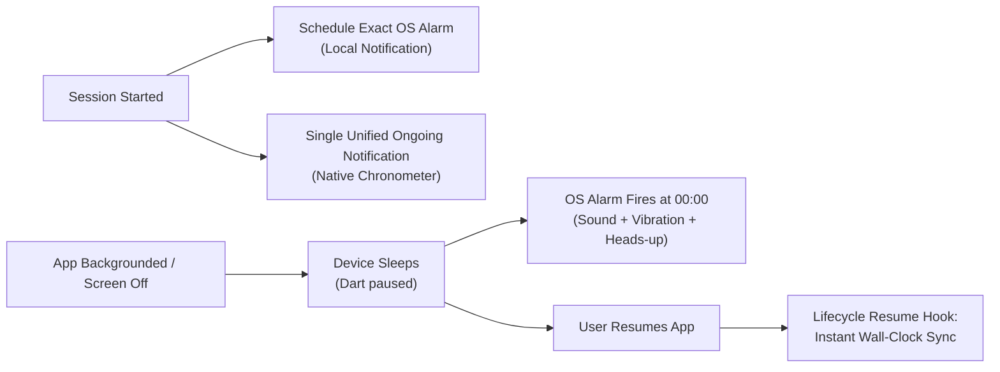
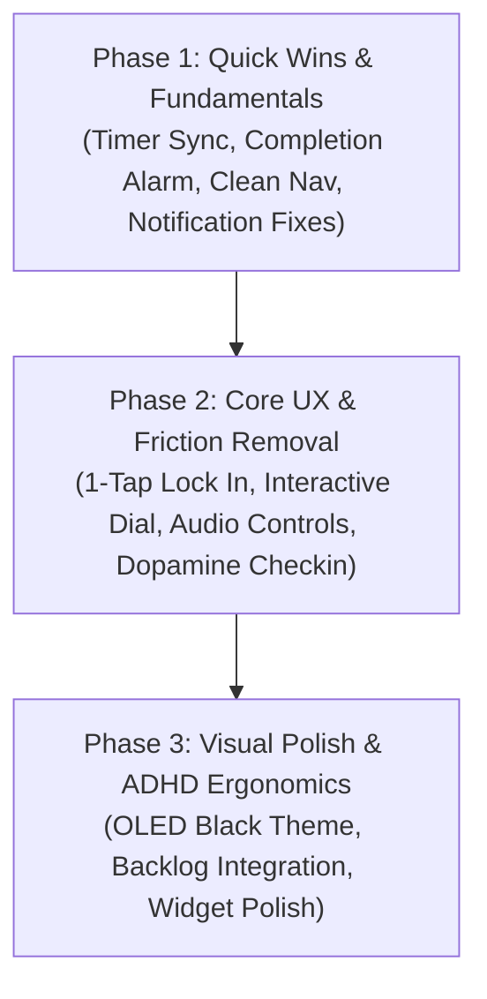

# Focusmaxxing: UX & Feature Improvement Plan

> **Executive Summary:**  
> A surgical, prioritized roadmap to transform Focusmaxxing from an awkward, clunky utility into a delightful, fluid, and rock-solid ADHD focus experience. Focuses on **fixing broken timer/notification fundamentals**, **eliminating architectural "junk drawer" UX**, and **delivering tactile, dopamine-driven polish**.

---

## 1. Problem Diagnosis: Why the App Feels "Off"

| Area | Current Symptom | Root Cause in Codebase |
| :--- | :--- | :--- |
| **Timer Inaccuracy** | Timer feels drifted, freezes in background, or finishes late | `TimerNotifier` relies on in-memory `Timer.periodic(200ms)`. When Android/iOS sleeps, the Dart isolate suspends. Resuming the app does not trigger an immediate wall-clock reconciliation in `didChangeAppLifecycleState`. |
| **Notifications** | Ongoing notification title stays stuck at `🚀 25:00 Remaining` forever | `NotificationService.showOngoingTimer` is called only on start/pause/resume; the title is never updated during timer ticks. |
| **Vanishing Completion** | No alarm or heads-up alert when timer finishes | At 00:00, `cancelTimerNotification()` simply kills the notification. No scheduled OS alarm, sound, vibration, or heads-up alert is ever fired if the screen is locked. |
| **Duplicate Notifications** | Two ongoing notifications cluttering the Android shade | `FocusShieldService` (native Kotlin) posts *"Focus session in progress"*, while `NotificationService` (Dart) posts *"🚀 25:00 Remaining"*. They clash and confuse users. |
| **Junk Drawer Navigation** | Audio soundscapes & shield scheduling are buried in Analytics | `SoundscapeConfigTile` and `ScheduleConfigSection` are dumped at line 450 of `insights_page.dart`. The user cannot access ambient audio from the Timer, nor schedule the Shield from the Shield tab. |
| **Clunky Goal Prompt** | Starting a timer forces a modal bottom sheet every time | Tapping "🚀 LOCK IN" without a pre-set anchor forces `GoalInputDialog` even if the user just wants a standard 25m pomodoro block. |
| **Crude Custom Duration** | Ugly raw `AlertDialog` with text input | Tapping "Custom" opens an unstyled system dialog asking to type a number between 1 and 180 in a raw `TextField`. |
| **Static Timer Dial** | Timer dial cannot be dragged or adjusted interactively | `TimerDialWidget` is a static CustomPaint ring with no gesture detector or sweep physics. |

---

## 2. Priority Phase 1: Quick Wins (Fundamentals & Accuracy)
*Estimated Implementation: 1–2 Days • High Impact, Low Risk*

### 1.1 Rock-Solid Timer Accuracy & Wall-Clock Sync on Resume
- **File:** [`lib/main_scaffold.dart`](file:///C:/Users/darkn/IdeaProjects/focusmaxxing/lib/main_scaffold.dart), [`lib/features/timer/presentation/notifiers/timer_notifier.dart`](file:///C:/Users/darkn/IdeaProjects/focusmaxxing/lib/features/timer/presentation/notifiers/timer_notifier.dart)
- **Changes:**
  1. Add `timerNotifier.syncWithWallClock()` call inside `didChangeAppLifecycleState(AppLifecycleState.resumed)`.
  2. In `TimerNotifier`: When app resumes, immediately calculate `DateTime.now()` against `_targetEndTime`. If expired while suspended, immediately transition to `TimerStatus.completed` and trigger completion feedback. If running, jump directly to the exact remaining second with zero lag.

### 1.2 Session Completion Alarm & Heads-Up Notification
- **File:** [`lib/core/notifications/notification_service.dart`](file:///C:/Users/darkn/IdeaProjects/focusmaxxing/lib/core/notifications/notification_service.dart), [`lib/features/timer/presentation/notifiers/timer_notifier.dart`](file:///C:/Users/darkn/IdeaProjects/focusmaxxing/lib/features/timer/presentation/notifiers/timer_notifier.dart)
- **Changes:**
  1. Add `scheduleSessionCompletionNotification({required DateTime targetEndTime, required String goal})`:
     - Uses `zonedSchedule` with `AndroidNotificationDetails(importance: Importance.max, priority: Priority.high, sound: ..., fullScreenIntent: true)` scheduled at `targetEndTime`.
     - When the timer reaches 0, even if the device is in deep sleep or Focusmaxxing process was suspended, Android/iOS fires a chime, strong vibration pattern, and heads-up banner: *"🎉 Focus Block Complete! Great job locking in. Tap to start your 5m break."*
  2. If the user cancels or pauses, cancel the scheduled completion alarm.
  3. If completed in the foreground, trigger heavy haptic feedback (`HapticFeedback.heavyImpact()`).

### 1.3 Fix Ongoing Notification & Eliminate Dual Notifications
- **File:** [`lib/core/notifications/notification_service.dart`](file:///C:/Users/darkn/IdeaProjects/focusmaxxing/lib/core/notifications/notification_service.dart), [`FocusShieldService.kt`](file:///C:/Users/darkn/IdeaProjects/focusmaxxing/android/app/src/main/kotlin/com/bmrkiewicz/focusmaxxing/focusmaxxing/shield/FocusShieldService.kt)
- **Changes:**
  1. Unify notification channels or suppress redundant Dart notification when native `FocusShieldService` is active.
  2. In `NotificationService.showOngoingTimer`: Ensure Android chronometer countdown countdowns natively on the lock screen, or update the notification title periodically (e.g. at 1-minute milestones) so the user doesn't see a frozen `25:00 Remaining` when 1 minute is left.

### 1.4 Reorganize Information Architecture (Eliminate Junk Drawer)
- **Soundscapes → Timer Screen:**
  - Move ambient audio controls to `TimerPage`. Place a compact floating pill or chip below the dial: `🎧 Brown Noise (Tap to switch)`.
  - Tapping opens a sleek modal sheet to select soundscapes, adjust volume, and preview tracks.
- **Scheduled Auto-Shield → Shield Screen:**
  - Move `ScheduleConfigSection` to `ShieldPage`. Add a segmented control at the top of Shield: `[ Apps (3) ] | [ Schedule (09:00 - 17:00) ]`.
- **Clean Up Insights Screen:**
  - Remove soundscape tile, schedule config, and hardcoded dummy `Timer Intervals` tile from `insights_page.dart`. Keep Insights dedicated exclusively to streaks, focus analytics, session logs, and Pro unlock.

### 1.5 Replace Raw Custom Duration Dialog with Sleek Wheel/Slider
- **File:** [`lib/features/timer/presentation/pages/timer_page.dart`](file:///C:/Users/darkn/IdeaProjects/focusmaxxing/lib/features/timer/presentation/pages/timer_page.dart)
- **Changes:**
  - Replace the crude `AlertDialog` with a modern Bottom Sheet featuring quick adjustment chips (`-5m`, `+5m`, `+15m`, `+30m`) and a smooth slider from 5 to 120 minutes with haptic feedback on each tick.

---

## 3. Priority Phase 2: Core UX & Frictionless Interaction
*Estimated Implementation: 2–3 Days • High Impact*

### 2.1 Frictionless 1-Tap Lock In
- **Current Problem:** Clicking "🚀 LOCK IN" when no goal is entered opens a full-screen bottom sheet, adding cognitive friction when the user just wants to start focusing.
- **Solution:**
  1. Default the goal anchor to a crisp default (e.g. *"Deep Work"*) with an inline editable field right on the timer card.
  2. Allow 1-tap start. Tapping the anchor pill allows editing, but if the user just taps **[ 🚀 LOCK IN ]**, it starts immediately without an interrupting modal barrier.
  3. Include 3 recent goal chips directly below the anchor pill for quick 1-tap switching.

### 2.2 Interactive Scrubbing Dial
- **File:** [`lib/features/timer/presentation/widgets/timer_dial_widget.dart`](file:///C:/Users/darkn/IdeaProjects/focusmaxxing/lib/features/timer/presentation/widgets/timer_dial_widget.dart)
- **Solution:**
  - Wrap the dial with `GestureDetector(onPanUpdate: ...)` to allow circular drag-to-set.
  - As the user sweeps around the ring:
    - Compute angle `atan2(y, x)` to set time in 5-minute increments (5m to 90m).
    - Provide `HapticFeedback.selectionClick()` on every 5-minute detent.
    - Animate smooth spring snap to nearest preset.

### 2.3 Audio Mini-Player on Active Timer
- When a focus session is running and an ambient soundscape is active:
  - Display a subtle pulsating audio indicator inside the timer dial.
  - Add a floating mini-player button: quick volume slider and mute/play toggle without leaving the screen.

### 2.4 Dopamine Check-in & Break Transition
- When checking in:
  - Add celebratory confetti or micro-animation when the user taps *"YES, I LOCKED IN 🚀"*.
  - Show streak counter bump (+1 day with flame effect).
  - Smoothly slide into the 5-minute Restorative Break with soothing color transition (from intense focus accent to calm sage/cyan break accent).

---

## 4. Priority Phase 3: Visual Polish & ADHD Ergonomics
*Estimated Implementation: 2 Days • Medium Impact*

### 3.1 ADHD Ergonomic Themes & Accents
- Provide high-contrast focus modes:
  - **OLED Pure Black** (infinite battery savings, distraction-free monochrome).
  - **Cyberpunk Amber / Neon Mint** (high stimulation mode for ADHD momentum).
- Smooth animated state transitions between `idle` → `running` → `paused` → `breakRunning`.

### 3.2 Backlog Scratchpad Integration
- Replace the hidden `Icons.inbox_outlined` AppBar icon with a visible *"Active Task / Backlog"* pill at the top of the timer.
- Tapping allows swiping through pending backlog tasks and picking one to lock in on in 1 tap.

### 3.3 Quick Lock-In Widget Polish
- Ensure the Android home screen widget updates glanceable minutes and reflects active/break state with zero lag using `HomeWidget.updateWidget()`.

---

## 5. Recommended Implementation Sequence

1. **Step 1:** Wall-clock sync in `didChangeAppLifecycleState` + Scheduled completion notification with sound/vibration.
2. **Step 2:** Relocate `SoundscapeConfigTile` to `TimerPage` & `ScheduleConfigSection` to `ShieldPage`.
3. **Step 3:** Consolidate/fix ongoing notification title updates.
4. **Step 4:** Replace raw duration dialog with bottom sheet duration picker.
5. **Step 5:** 1-tap lock-in with inline goal editing and interactive dial scrubbing.
