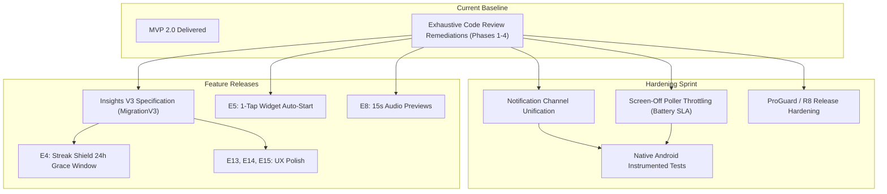

# Focusmaxxing: Future Work & Engineering Backlog Hub

**Directory:** [`docs/future_work/`](file:///C:/Users/darkn/IdeaProjects/focusmaxxing/docs/future_work)  
**Status:** Living Engineering Roadmap  
**Repository Standard:** Pure engineering specifications with zero speculation, explicit acceptance criteria, and schema definitions.

---

## 1. Master Backlog & Roadmap Matrix

| Milestone / Stream | Specification File | Engineering Scope | Architectural Impact | Complexity | Priority |
| :--- | :--- | :--- | :--- | :---: | :---: |
| **Insights V3** | [`insights_v3_spec.md`](file:///C:/Users/darkn/IdeaProjects/focusmaxxing/docs/future_work/insights_v3_spec.md) | Strict Binary Lock-In ("Lock In or Bust"), 24h hourly distribution JSON, 7D/30D/1Y SQL aggregations, `FocusTrendCard` with "Could've Locked In" ghost bars, `InsightsHighlightsGrid` | SQLite `MigrationV3` (`daily_focus_metrics`), ACID transaction sync in `SessionLocalDataSource` | High | **P0** (Next Milestone) |
| **Deferred MVP 2.0 Features** | [`deferred_features_roadmap.md`](file:///C:/Users/darkn/IdeaProjects/focusmaxxing/docs/future_work/deferred_features_roadmap.md) | E4 (Streak Shield 24h grace window), E5 (1-tap widget deep link auto-start), E8 (15s audio teaser previews), E13 (Daily target ring & 7D sparkline), E14 (Clockface radial detents & 30m/90m presets), E15 (Shield category filter chips) | `SharedPreferences` flags, `AudioNotifier` preview state machine, Android `Intent` routing, `CustomPainter` detent snapping | Medium | **P1** (MVP 2.1) |
| **Technical Debt & Hardening** | [`technical_debt_and_hardening.md`](file:///C:/Users/darkn/IdeaProjects/focusmaxxing/docs/future_work/technical_debt_and_hardening.md) | Single notification channel unification, native Android instrumented tests (`connectedAndroidTest`), screen-off poller throttling for overnight battery preservation, ProGuard/R8 rule audit | Native Kotlin `FocusShieldService.kt`, `AutoShieldAlarmReceiver.kt`, `proguard-rules.pro` | High | **P1** (Hardening Sprint) |

---

## 2. Milestone Breakdown & Navigation

### 2.1 Insights V3 Milestone
- **Document:** [`docs/future_work/insights_v3_spec.md`](file:///C:/Users/darkn/IdeaProjects/focusmaxxing/docs/future_work/insights_v3_spec.md)
- **Approved Architecture**:
  1. **Strict Binary Attribution**: Only `LOCKED_IN` focus sessions contribute to metrics and streaks. `DERAILED` and cancelled sessions earn 0 minutes.
  2. **Ghost Bars**: Surrendered focus potential from derailed sessions is aggregated as `unclaimed_seconds` and visualized as translucent ghost extensions.
  3. **Rollup Table (`MigrationV3`)**: Introduces `daily_focus_metrics` table with pre-aggregated metrics and 24-hour hourly JSON (`hourly_focus_seconds_json`).
  4. **Multi-Horizon Touch Charts**: Wide tappable `7D`, touch-scrubbable `30D` with 5-day step labels, `< 1ms` SQLite `1Y` monthly rollups.

### 2.2 Deferred Features Roadmap (MVP 2.1)
- **Document:** [`docs/future_work/deferred_features_roadmap.md`](file:///C:/Users/darkn/IdeaProjects/focusmaxxing/docs/future_work/deferred_features_roadmap.md)
- **Feature Ledger**:
  - **E4**: 24-hour recovery grace window allowing a 20-minute focus session today to repair a broken streak.
  - **E5**: 1-tap widget auto-start bypassing input dialogs and resolving top backlog task or default `"Deep Work"`.
  - **E8**: 15-second teaser audio preview with smooth fade-out and paywall trigger for locked soundscapes.
  - **E13**: Daily momentum target ring with custom painter arc and 7-day consistency sparkline dots.
  - **E14**: Radial clockface detents with magnetic 5-minute snap and extended presets (`30m`, `90m`).
  - **E15**: Shield category filter chips (`[All]`, `[Shielded]`, `[Social]`, `[Browsers]`) with haptic response.

### 2.3 Technical Debt & Engineering Hardening
- **Document:** [`docs/future_work/technical_debt_and_hardening.md`](file:///C:/Users/darkn/IdeaProjects/focusmaxxing/docs/future_work/technical_debt_and_hardening.md)
- **Hardening Initiatives**:
  - **Single Notification Channel Unification**: Unify Kotlin service notification (`ID 9001`) and Dart chronometer (`ID 1001`) into a single persistent Android channel.
  - **E2E Native Android Testing**: Automated tests for `AutoShieldAlarmReceiver.kt` and `FocusShieldService.kt` under Android 14+ background activity restrictions.
  - **Screen-State Aware Overnight Polling**: Pause 500ms `UsageStatsManager` polling when screen is off during bedtime schedules to guarantee $< 1.5\%$ overnight battery drain.
  - **ProGuard / R8 Release Verification**: Prevent reflection stripping for `sqflite`, `just_audio`, and broadcast receivers in minified release APKs.

---

## 3. Execution Dependency Graph

