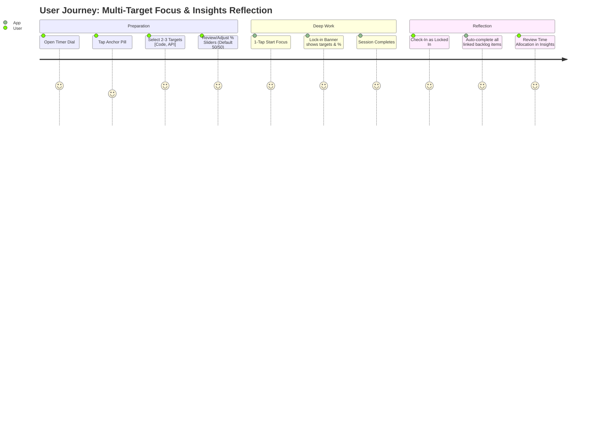
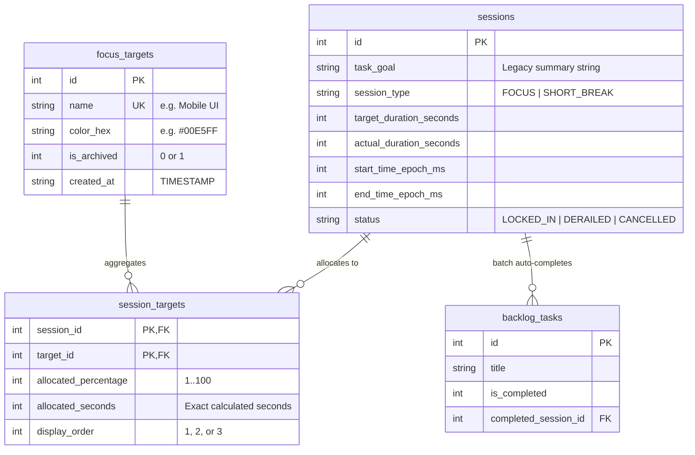

# Product Plan & Architectural Specification: Multi-Target Lock-In & Granular Focus Insights

> **Document Type:** Feature Enhancement Specification & Product Requirements Document (PRD)  
> **Status:** Finalized Specification (Aligned with User Feedback)  
> **Target Subsystems:** [`lib/features/timer/`](file:///C:/Users/darkn/IdeaProjects/focusmaxxing/lib/features/timer), [`lib/features/insights/`](file:///C:/Users/darkn/IdeaProjects/focusmaxxing/lib/features/insights), [`lib/features/backlog/`](file:///C:/Users/darkn/IdeaProjects/focusmaxxing/lib/features/backlog), [`lib/core/database/`](file:///C:/Users/darkn/IdeaProjects/focusmaxxing/lib/core/database)  
> **Database Impact:** SQLite `MigrationV4` (introduces `focus_targets` and `session_targets` with `allocated_percentage` and `allocated_seconds`)  
> **Monetization Alignment:** Core multi-target selection and 7-day breakdown are free; extended horizons (`30D`, `1Y`, `ALL`) and deep target drilldowns are gated under Lifetime Pro.

---

## 1. Executive Summary & Problem Statement

### 1.1 Context & Background
In **Focusmaxxing**, users enter deep work by initiating a focus timer tied to a single text anchor (e.g. `"Deep Work"`), managed via [`GoalAnchorPill`](file:///C:/Users/darkn/IdeaProjects/focusmaxxing/lib/features/timer/presentation/widgets/goal_anchor_pill.dart) and [`GoalInputDialog`](file:///C:/Users/darkn/IdeaProjects/focusmaxxing/lib/features/timer/presentation/widgets/goal_input_dialog.dart). When a session finishes, it persists to the `sessions` SQLite table with a single `task_goal` column. 

Today's [`InsightsPage`](file:///C:/Users/darkn/IdeaProjects/focusmaxxing/lib/features/insights/presentation/pages/insights_page.dart) reports aggregate minutes and streaks, but provides **zero attribution breakdown**. Users cannot evaluate how their time was partitioned across real-world priorities (e.g., coding vs writing, client projects, or coursework).

Furthermore, deep work blocks often advance multiple related tasks simultaneously. Forcing a single label creates unnecessary initiation friction and loses accounting fidelity.

### 1.2 Core Value Proposition & Confirmed Decisions
1. **Multi-Target Lock-In (Up to 3 Anchors)**: Users can select or tag between **1 and 3 targets** for any focus block (from past targets, freeform input, or pending backlog items).
2. **Default Equal Distribution with Slider Customization**: Focus time is divided **equally by default** (100% for 1 target, 50/50% for 2 targets, 33/33/34% for 3 targets). Users have interactive **linked percentage sliders** to manually redistribute the weighting (e.g. 70% Feature X / 30% Bugfix Y).
3. **Automatic Batch Backlog Completion**: All linked backlog tasks are marked completed automatically upon a successful `LOCKED_IN` check-in—eliminating post-session micromanagement.
4. **Granular Insights Allocation**: Visual time-allocation breakdown (Today, 7D, 30D, 1Y, Lifetime) displaying where time was invested, completion rates per target, and historical trends.

---

## 2. Target Personas & Jobs-to-be-Done (JTBD)



### 2.1 Personas
* **The Software Engineer / Builder (Alex)**: Works in 50-minute blocks. A single block touches `"Frontend UI"`, `"API Refactor"`, and closes 2 specific backlog bugs. Alex can allocate 70% to Frontend and 30% to API, and have both backlog bugs automatically marked completed.
* **The University Student (Maya)**: Studying for finals. Maya studies `"Cell Biology"` and `"Organic Chemistry"`. A 60m session defaults to 30m each, maintaining equal progress towards her weekly study goals.
* **The Solo Founder (Jordan)**: Balances `"Client A"`, `"Client B"`, and `"Marketing"`. Jordan adjusts sliders to reflect actual billable focus distribution without tedious external logging.

### 2.2 Core Jobs-to-be-Done
* **JTBD 1 (Multi-Facet Initiation)**: *"When I sit down for a focus block, I want to select 1 to 3 targets with zero fuss, so that I can capture the full scope of my session."*
* **JTBD 2 (Flexible Weighting Without Tedium)**: *"When a block is heavily skewed toward one goal, I want simple sliders to tune the percentage split, while enjoying equal 50/50 distribution when I don't care to tune."*
* **JTBD 3 (Zero-Friction Completion)**: *"When I check in a completed session, I want all linked backlog items cleared automatically without extra clicks or popups."*
* **JTBD 4 (Clear Time Accounting)**: *"When I open Insights, I want an exact breakdown of hours spent per target across 7D/30D/1Y, with math that strictly matches my total clock time."*

---

## 3. Detailed Feature Specifications

### 3.1 Target Selection & Multi-Anchor Modal (`MultiTargetPickerSheet`)
Replaces [`GoalInputDialog`](file:///C:/Users/darkn/IdeaProjects/focusmaxxing/lib/features/timer/presentation/widgets/goal_input_dialog.dart) with an enhanced, low-friction modal:

1. **Multi-Select Chip Rack**:
   * Renders recent and frequent targets as selectable chips with color indicators.
   * Tapping toggles selection (up to the strict cap of 3).
2. **Rapid Freeform Input**:
   * Text field allowing on-the-fly creation. Hitting `Enter` creates and selects the target immediately.
3. **Backlog Task Picker**:
   * Pending backlog tasks are displayed below the chip rack. Selecting a task automatically adds its title as an active anchor and links the task ID for auto-completion.
4. **Strict Cap of 3 Targets**:
   * Selecting a 4th target is prevented with haptic feedback and a subtle warning: *"Max 3 anchors to protect focus depth"*.
5. **Interactive Percentage Sliders**:
   * When 2 or 3 targets are selected, an inline distribution card expands:
     * **1 Target**: 100% (slider hidden).
     * **2 Targets**: Default `50% / 50%`. Dragging Slider 1 to `70%` automatically adjusts Slider 2 to `30%`.
     * **3 Targets**: Default `33% / 33% / 34%`. Dragging any slider proportionally rebalances the other two to ensure $\sum \% \equiv 100\%$.
     * **"Reset to Equal" Button**: 1-tap reset to uniform split.
6. **1-Tap Launch**:
   * Primary button: `"START FOCUS · 25m [3 Targets]"`.

```
+---------------------------------------------------+
|  🎯 What are you locking in on? (Max 3)           |
|                                                   |
|  [+ Create new target...]                         |
|                                                   |
|  Recent: [✓ Mobile UI] [✓ API Refactor] [Design]  |
|                                                   |
|  TIME ALLOCATION                                  |
|  Mobile UI     [========-------] 60% (15m)        |
|  API Refactor  [====-----------] 40% (10m)        |
|  [ ↺ Equalize Split ]                             |
|                                                   |
|  From Backlog:                                    |
|  [✓] #12 Fix auth token refresh                   |
|                                                   |
|  [        LOCK IN ON 2 TARGETS · 25 MIN        ]  |
+---------------------------------------------------+
```

### 3.2 In-Session Presentation
* **Idle State ([`GoalAnchorPill`](file:///C:/Users/darkn/IdeaProjects/focusmaxxing/lib/features/timer/presentation/widgets/goal_anchor_pill.dart))**:
  * 1 Target: `"🎯 Mobile UI"`
  * 2 Targets: `"🎯 Mobile UI (60%) • API Refactor (40%)"`
  * 3 Targets: `"🎯 Mobile UI • +2 targets"`
* **Running State ([`ActiveLockInBanner`](file:///C:/Users/darkn/IdeaProjects/focusmaxxing/lib/features/timer/presentation/widgets/active_lock_in_banner.dart))**:
  * Displays pills for each active target with percentage chips.

### 3.3 Check-In & Auto-Completion Flow
* **Session Completion**:
  * Timer rings; [`SessionCheckinDialog`](file:///C:/Users/darkn/IdeaProjects/focusmaxxing/lib/features/timer/presentation/widgets/session_checkin_dialog.dart) asks: `"Did you lock in?"`
  * Optional: Small accordion to tweak final % sliders if actual work deviated from the plan (pre-filled with the starting split).
* **Binary Check-In Execution**:
  * Tapping **"LOCKED IN 🚀"**:
    1. Persists session with `SessionStatus.lockedIn`.
    2. Calculates and writes `allocated_seconds = actualDuration * (percentage / 100)` for each target into `session_targets`.
    3. **Batch Auto-Completion**: Every linked backlog task is immediately updated to `is_completed = 1` with `completed_session_id = sessionId`.
  * Tapping **"DERAILED 💀"**:
    * Session marked derailed; 0 focus minutes credited; linked backlog tasks remain pending.

---

## 4. Time Attribution & Mathematical Accounting

### 4.1 Proportional Percentage Attribution Formulation
For a session with $N \in \{1, 2, 3\}$ targets, actual duration $S$ seconds, and user-specified percentages $P_1, \dots, P_N$ where $\sum_{i=1}^N P_i = 100$:

$$\text{AllocatedSeconds}_i = \left\lfloor S \times \frac{P_i}{100} \right\rfloor$$

To eliminate rounding drift (e.g. 25 minutes = 1500s split 33/33/34 yielding $495 + 495 + 510 = 1500$s):
$$\text{Remainder} = S - \sum_{i=1}^N \text{AllocatedSeconds}_i$$
The remainder (always $< N$ seconds) is added to the primary target ($i=1$), ensuring:
$$\sum_{i=1}^N \text{AllocatedSeconds}_i \equiv S$$

### 4.2 Proportional Sliders Auto-Balancing Algorithm
When user drags target $k$ to a new percentage $P_k^{\text{new}}$:
1. Available remainder for other targets:
   $$R = 100 - P_k^{\text{new}}$$
2. Current sum of other targets:
   $$S_{\text{other}} = \sum_{j \neq k} P_j^{\text{old}}$$
3. If $S_{\text{other}} > 0$:
   $$P_j^{\text{new}} = \text{round}\left(R \times \frac{P_j^{\text{old}}}{S_{\text{other}}}\right) \quad \forall j \neq k$$
   *(Adjusting last element so the final sum strictly equals 100)*.
4. If $S_{\text{other}} == 0$ (all others were 0):
   $$P_j^{\text{new}} = \left\lfloor \frac{R}{N - 1} \right\rfloor$$

---

## 5. Database Schema & Migration (`MigrationV4`)



### 5.1 SQLite DDL (`lib/core/database/migrations/migration_v4.dart`)
```sql
CREATE TABLE IF NOT EXISTS focus_targets (
    id INTEGER PRIMARY KEY AUTOINCREMENT,
    name TEXT NOT NULL COLLATE NOCASE UNIQUE,
    color_hex TEXT NOT NULL DEFAULT '#00E5FF',
    is_archived INTEGER NOT NULL DEFAULT 0,
    created_at TIMESTAMP DEFAULT CURRENT_TIMESTAMP
);

CREATE TABLE IF NOT EXISTS session_targets (
    session_id INTEGER NOT NULL,
    target_id INTEGER NOT NULL,
    allocated_percentage INTEGER NOT NULL DEFAULT 100,
    allocated_seconds INTEGER NOT NULL DEFAULT 0,
    display_order INTEGER NOT NULL DEFAULT 1,
    PRIMARY KEY (session_id, target_id),
    FOREIGN KEY (session_id) REFERENCES sessions(id) ON DELETE CASCADE,
    FOREIGN KEY (target_id) REFERENCES focus_targets(id) ON DELETE CASCADE
);

CREATE INDEX IF NOT EXISTS idx_session_targets_target_id 
ON session_targets (target_id, session_id);

CREATE INDEX IF NOT EXISTS idx_focus_targets_archived 
ON focus_targets (is_archived, name);
```

### 5.2 Automated Historical Backfill
* During migration execution, historical distinct `task_goal` values from `sessions` are inserted into `focus_targets`.
* Corresponding `session_targets` records are inserted with `allocated_percentage = 100` and `allocated_seconds = actual_duration_seconds`.
* Existing session records remain intact and backward compatible.

---

## 6. Insights & Analytics Presentation Architecture

### 6.1 Focus Allocation Breakdown Card (`FocusAllocationCard`)
Located on [`InsightsPage`](file:///C:/Users/darkn/IdeaProjects/focusmaxxing/lib/features/insights/presentation/pages/insights_page.dart):

1. **Segmented Progress Bar**:
   * Horizontal bar showing top targets colored according to their palette, sized proportionally to their allocated focus time.
2. **Ranked Target List**:
   * Shows target name, total hours/minutes, percentage of total focus time, and session count.
   * e.g.,
     * **Mobile UI**: `8h 20m` · `45%` (12 sessions)
     * **API Refactor**: `6h 10m` · `33%` (8 sessions)
     * **Documentation**: `4h 00m` · `22%` (5 sessions)
3. **Multi-Horizon Support**:
   * `Today`, `7D`, `30D`, `1Y`, `ALL`.
   * Standard SQL aggregation query:
     ```sql
     SELECT 
       ft.id,
       ft.name, 
       ft.color_hex, 
       SUM(st.allocated_seconds) as total_seconds,
       COUNT(DISTINCT st.session_id) as session_count
     FROM session_targets st
     JOIN focus_targets ft ON ft.id = st.target_id
     JOIN sessions s ON s.id = st.session_id
     WHERE s.status = 'LOCKED_IN' 
       AND s.start_time_epoch_ms >= ? AND s.start_time_epoch_ms <= ?
     GROUP BY ft.id
     ORDER BY total_seconds DESC;
     ```

### 6.2 Pro Monetization Tier Gating
* **Free Tier**: Today and Rolling 7-Day (`7D`) Focus Allocation Breakdown.
* **Lifetime Pro ($9.99)**:
  * Extended Horizons (`30D`, `1Y`, `ALL`).
  * Target Detail Drilldown (session history, streak per target, peak hours per target).
  * Target Color Customization & CSV Export.

---

## 7. Clean Architecture Implementation Blueprint

```
lib/
├── core/
│   └── database/
│       └── migrations/
│           └── migration_v4.dart               <-- DB schema & backfill
├── features/
│   ├── timer/
│   │   ├── domain/
│   │   │   └── entities/
│   │   │       ├── focus_target_entity.dart
│   │   │       ├── session_target_allocation.dart  <-- target + percentage
│   │   │       └── session_entity.dart         <-- List<SessionTargetAllocation>
│   │   └── presentation/
│   │       ├── notifiers/
│   │       │   └── timer_notifier.dart         <-- Multi-target & backlog batch complete
│   │       └── widgets/
│   │           ├── goal_anchor_pill.dart       <-- Multi-anchor display
│   │           ├── multi_target_picker_sheet.dart <-- Chips + Linked Sliders
│   │           └── target_percentage_slider.dart  <-- Auto-balancing slider widget
│   └── insights/
│       ├── domain/
│       │   ├── entities/
│       │   │   └── target_allocation_entity.dart
│       │   └── usecases/
│       │       └── get_target_allocations_usecase.dart
│       └── presentation/
│           ├── notifiers/
│           │   └── insights_notifier.dart
│           └── widgets/
│               ├── focus_allocation_card.dart  <-- Ring / Segment bar + ranked targets
│               └── target_detail_sheet.dart    <-- Pro drilldown
```

---

## 8. MoSCoW Phased Roadmap

### Phase 1: Must Have (Core Engine & Sliders)
* SQLite `MigrationV4` with `focus_targets` and `session_targets`.
* `MultiTargetPickerSheet` with max 3 target cap and auto-balancing linked sliders (default equal split).
* Proportional time math in [`SessionLocalDataSource`](file:///C:/Users/darkn/IdeaProjects/focusmaxxing/lib/features/timer/data/datasources/session_local_data_source.dart).
* Batch auto-completion of all linked backlog tasks upon `LOCKED_IN` check-in.
* Multi-anchor display in [`GoalAnchorPill`](file:///C:/Users/darkn/IdeaProjects/focusmaxxing/lib/features/timer/presentation/widgets/goal_anchor_pill.dart) and [`ActiveLockInBanner`](file:///C:/Users/darkn/IdeaProjects/focusmaxxing/lib/features/timer/presentation/widgets/active_lock_in_banner.dart).

### Phase 2: Should Have (Insights Allocation V1)
* `FocusAllocationCard` in [`InsightsPage`](file:///C:/Users/darkn/IdeaProjects/focusmaxxing/lib/features/insights/presentation/pages/insights_page.dart) with segmented bar & target leaderboard (Today & 7D).
* "Reset to Equal" 1-tap button on sliders.
* Color palette picker for custom targets.

### Phase 3: Could Have (Deep Insights & Pro)
* Extended horizons (`30D`, `1Y`, `ALL`) for Pro users.
* Target drilldown modal showing focus history per target.
* Target archiving (hide unused targets without deleting past data).
