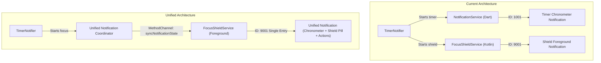

# Focusmaxxing: Technical Debt & Engineering Hardening Roadmap

**Status:** Approved Engineering Backlog  
**Target Milestone:** Hardening & Performance Sprint (Post-Phase 4)  
**Parent Architecture:** [System Architecture Overview](file:///C:/Users/darkn/IdeaProjects/focusmaxxing/docs/architecture/system_overview.md)  
**Native Android Reference:** [Native Android Subsystems](file:///C:/Users/darkn/IdeaProjects/focusmaxxing/docs/architecture/native_android_subsystems.md)

---

## 1. Technical Debt & Hardening Matrix

| Initiative | Core Subsystem | Risk Level | Target Performance / Reliability SLA | Target Files |
| :--- | :--- | :---: | :--- | :--- |
| **Notification Channel Unification** | Native Kotlin / Dart Service | Low | Single persistent notification entry in shade; zero notification flicker | [`FocusShieldService.kt`](file:///C:/Users/darkn/IdeaProjects/focusmaxxing/android/app/src/main/kotlin/com/bmrkiewicz/focusmaxxing/focusmaxxing/shield/FocusShieldService.kt), [`notification_service.dart`](file:///C:/Users/darkn/IdeaProjects/focusmaxxing/lib/core/notifications/notification_service.dart) |
| **E2E Native Android Test Harness** | CI / Native Integration | Medium | 100% automated pass on headless Android emulator; zero flake on overlays | [`integration_test/`](file:///C:/Users/darkn/IdeaProjects/focusmaxxing/integration_test), [`AutoShieldAlarmReceiver.kt`](file:///C:/Users/darkn/IdeaProjects/focusmaxxing/android/app/src/main/kotlin/com/bmrkiewicz/focusmaxxing/focusmaxxing/shield/AutoShieldAlarmReceiver.kt) |
| **Overnight Battery & Wake-Lock Hardening** | Native Foreground Poller | High | $< 1.5\%$ battery drain over 8h overnight schedule; CPU deep sleep preserved | [`FocusShieldService.kt`](file:///C:/Users/darkn/IdeaProjects/focusmaxxing/android/app/src/main/kotlin/com/bmrkiewicz/focusmaxxing/focusmaxxing/shield/FocusShieldService.kt) |
| **ProGuard / R8 Release Build Verification** | Android Toolchain / Security | High | Zero `ClassNotFoundException` on obfuscated release APK with `isMinifyEnabled = true` | [`proguard-rules.pro`](file:///C:/Users/darkn/IdeaProjects/focusmaxxing/android/app/proguard-rules.pro), `keep.xml` |

---

## 2. Hardening Initiative Specifications

### 2.1 Single Notification Channel Unification

#### Architectural Conflict
Currently, two independent foreground notification subsystems run concurrently when a focus session starts with an active shield:
1. **Native Kotlin Service (`FocusShieldService.kt`)**: Calls `startForeground(NOTIFICATION_ID = 9001, ...)` on channel `"focus_shield_service_channel"`, displaying a static or text-updated notification (`"Brainrot Shield Active · 2 Apps Blocked"`).
2. **Dart Notification Service (`notification_service.dart`)**: Posts an ongoing notification (ID `1001`) on channel `"focusmaxxing_timer_silent_channel"` featuring an animated or ticking live chronometer (`"Locked In: Deep Work · 24:18"`).

This dual-notification pattern clutters the Android notification shade, produces competing tray icons, and fragments user focus.



#### Engineering Specification
1. **Channel Consolidation**:
   - Establish a single master foreground channel:
     - ID: `"focusmaxxing_active_session_channel"`
     - Name: `"Active Focus & Shield"`
     - Importance: `NotificationManager.IMPORTANCE_LOW` (silent, persistent).
2. **Notification Ownership**:
   - `FocusShieldService.kt` retains ownership of `startForeground` using ID `9001`.
   - When a focus session begins, Dart sends session metadata via `MethodChannel("com.bmrkiewicz.focusmaxxing/notification")`:
     ```json
     {
       "taskGoal": "Deep Work",
       "targetEndTimeEpochMs": 1730467800000,
       "isPaused": false,
       "isShieldActive": true,
       "shieldedAppCount": 2
     }
     ```
   - `FocusShieldService.kt` constructs the `NotificationCompat.Builder`:
     - Uses `setChronometer(targetEndTimeEpochMs - System.currentTimeMillis(), true)` in countdown mode.
     - Title: `taskGoal` (e.g., `"Locked In: Finish Q4 Report"`).
     - Subtext / Content: `"${shieldedAppCount} Apps Shielded"`.
     - Actions: Direct PendingIntent buttons for `[ PAUSE ]` and `[ CANCEL ]`.
3. **Stand-Alone Timer Fallback**:
   - If the user starts a session without any shielded apps (shield service not running), Dart `NotificationService` adopts ID `9001` on the same channel, guaranteeing identical visual layout without duplicate cards.

#### Acceptance Criteria & Test Plan
- [ ] Only one notification appears in the Android shade during active sessions with shield.
- [ ] Notification updates live countdown without redraw flicker or chime sounds.
- [ ] Stopping either timer or shield cleanly removes or transitions the single notification card.

---

### 2.2 End-to-End Native Android Integration Tests

#### Current Testing Gap
Unit tests in [`test/`](file:///C:/Users/darkn/IdeaProjects/focusmaxxing/test) utilize in-memory SQLite (`sqflite_common_ffi`) and mocked platform channels (`TestDefaultBinaryMessengerBinding`). While [`integration_test/focus_flow_test.dart`](file:///C:/Users/darkn/IdeaProjects/focusmaxxing/integration_test/focus_flow_test.dart) tests end-to-end Flutter UI logic, true native Android subsystems remain untested in continuous integration:
- Real `AutoShieldAlarmReceiver.kt` intent delivery via Android `AlarmManager`.
- System Alert Window overlay inflation via `flutter_overlay_window` and `WindowManager` fallback under restrictive Android 14+ background activity launch (BAL) rules.
- Native `RemoteViews` updates for [`GlanceableDialWidgetProvider.kt`](file:///C:/Users/darkn/IdeaProjects/focusmaxxing/android/app/src/main/kotlin/com/bmrkiewicz/focusmaxxing/focusmaxxing/widget/GlanceableDialWidgetProvider.kt).

#### Test Suite Implementation Plan
1. **Test Module Structure**:
   - Add native instrumentation tests in `android/app/src/androidTest/kotlin/com/bmrkiewicz/focusmaxxing/`:
     - `AutoShieldAlarmReceiverTest.kt`: Enqueues an exact alarm using `AlarmManager`, triggers broadcast via `am broadcast`, and asserts that `FocusShieldService` starts as a foreground service.
     - `FocusShieldServiceInterceptionTest.kt`: Simulates mock `UsageEvents` injection to verify the 500ms poller triggers overlay launch within 600ms of a blacklisted package entering foreground.
     - `AppWidgetChronometerTest.kt`: Pushes widget state via `HomeWidgetGlanceableSync` and verifies `RemoteViews` contains valid `Chronometer` base timestamps.
2. **CI Pipeline Integration**:
   - Configure GitHub Actions workflow running on `macos-latest` with Android API 34 hardware acceleration:
     ```yaml
     - name: Run Android Instrumented Tests
       uses: reactivecircus/android-emulator-runner@v2
       with:
         api-level: 34
         script: ./gradlew connectedAndroidTest
     ```

#### Acceptance Criteria
- [ ] Automated headless test validates alarm receiver wake-up without security exceptions.
- [ ] Service start and overlay trigger verified on Android 12, 13, and 14 emulators.

---

### 2.3 Battery Profiling & Wake-Lock Analysis for Overnight Schedules

#### Technical Risk Analysis
[`FocusShieldService.kt`](file:///C:/Users/darkn/IdeaProjects/focusmaxxing/android/app/src/main/kotlin/com/bmrkiewicz/focusmaxxing/focusmaxxing/shield/FocusShieldService.kt) operates a continuous polling loop:
```kotlin
private val pollerRunnable = object : Runnable {
    override fun run() {
        checkForegroundApp()
        handler.postDelayed(this, 500L)
    }
}
```
During an overnight bedtime schedule (e.g., 22:00 to 06:00, 8 hours), this poller executes $8 \times 3600 \times 2 = 57,600$ iterations. If the device screen is OFF:
- Apps cannot be actively used by the user.
- Polling `UsageStatsManager.queryEvents` every 500ms prevents the CPU from entering deep low-power sleep states (Doze mode), leading to measurable overnight battery drain (estimated 6%–12%).

#### Engineering Mitigation: Screen-State Aware Polling
1. **Dynamic Broadcast Registration**:
   - In `FocusShieldService.onCreate()`, dynamically register a `BroadcastReceiver` for display events:
     ```kotlin
     val screenFilter = IntentFilter().apply {
         addAction(Intent.ACTION_SCREEN_OFF)
         addAction(Intent.ACTION_SCREEN_ON)
         addAction(Intent.ACTION_USER_PRESENT)
     }
     registerReceiver(screenStateReceiver, screenFilter)
     ```
2. **Adaptive Polling Logic**:
   - `onReceive(Intent.ACTION_SCREEN_OFF)`:
     - Remove pending callbacks: `handler.removeCallbacks(pollerRunnable)`.
     - Log state transition: `"Screen OFF: Pausing 500ms poller; entering deep sleep"`.
   - `onReceive(Intent.ACTION_SCREEN_ON)` / `ACTION_USER_PRESENT`:
     - Immediately invoke `checkForegroundApp()`.
     - Re-attach `pollerRunnable` to resume 500ms evaluation.
3. **Zero Wake-Lock Verification**:
   - Audit all Kotlin files to verify zero persistent `PowerManager.PARTIAL_WAKE_LOCK` acquisitions exist. Ensure `WakeLock` is only held transiently ($< 2\text{ seconds}$) inside `AutoShieldAlarmReceiver.kt` during intent handoff to `startForegroundService`.

#### Performance SLA
- [ ] Battery consumption across an 8-hour overnight schedule must not exceed $1.5\%$ of total battery capacity on a standard 4000mAh device.
- [ ] Battery Historian profile confirms uninterrupted Android Doze sleep windows when screen is off.

---

### 2.4 ProGuard / R8 Minification Rule Verification for Release Builds

#### Current Risk Profile
In [`android/app/proguard-rules.pro`](file:///C:/Users/darkn/IdeaProjects/focusmaxxing/android/app/proguard-rules.pro), rules currently protect:
- `flutter.overlay.window.**`
- `com.ryanheise.just_audio.**`
- `com.android.vending.billing.**`
- `es.antonborri.home_widget.**`
- `com.bmrkiewicz.focusmaxxing.focusmaxxing.widget.**`
- `com.bmrkiewicz.focusmaxxing.focusmaxxing.shield.**`

However, several critical reflection boundaries and native JNI bindings require explicit keep directives to prevent silent runtime failure in release builds (`isMinifyEnabled = true`, `isShrinkResources = true`).

#### Required Rule Hardening
Add the following explicit rules to [`android/app/proguard-rules.pro`](file:///C:/Users/darkn/IdeaProjects/focusmaxxing/android/app/proguard-rules.pro):

```proguard
# SQLite FFI & Database Plugins
-keep class com.tekartik.sqflite.** { *; }

# AlarmManager Broadcast Receivers (invoked via Android OS intent reflection)
-keep class com.bmrkiewicz.focusmaxxing.focusmaxxing.shield.AutoShieldAlarmReceiver { *; }

# Security & Receipt Verification
-keepclassmembers class * {
    native <methods>;
}
-keep class java.security.Signature { *; }
-keep class java.security.spec.X509EncodedKeySpec { *; }

# Flutter Overlay Window Engine Bridge
-keep class io.flutter.embedding.engine.FlutterEngine { *; }
-keep class io.flutter.plugin.common.MethodChannel { *; }
```

#### Automated Verification Pipeline
1. Run `./gradlew assembleRelease` with R8 shrinking enabled.
2. Decompile DEX output via `baksmali` or `apkanalyzer` to verify:
   - `AutoShieldAlarmReceiver` class and parameterless constructor are present.
   - Native JNI method signatures in `sqflite` and `just_audio` are unmangled.
3. Automated smoke test: Install release APK on a physical Android device or emulator, verify initial database migration execution (`MigrationRunner`), soundscape playback, and overlay trigger.

#### Acceptance Criteria
- [ ] Release APK builds cleanly with zero R8 unresolved reference warnings.
- [ ] Release APK smoke test verifies 100% operational fidelity across billing, audio, database, and overlay windows.
