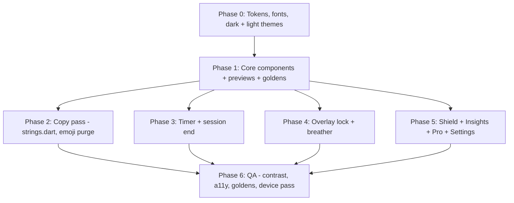

# UI Redesign Plan — "The Instrument"

**Document Type:** Design & Engineering Spec
**Status:** Proposed (Future Work)
**Priority:** P1 (brand/credibility; blocks paid-tier launch polish)
**Target Subsystems:** `lib/core/theme/`, all `presentation/` layers, Android overlay (`overlay_main.dart`)
**Database Impact:** None

---

## 1. Problem Statement

The app works, but it *reads* as AI-generated. Users judge trustworthiness in seconds, and for a tool that asks them to surrender control of their phone, "looks like slop" directly hurts conversion and retention.

The tells, from the codebase audit:

| Tell | Where | Why it reads as "AI" |
|---|---|---|
| 52 emojis glued to CTAs and statuses (`🚀 LOCK IN`, `DERAILED 💀`, `COMPLETE CHECK-IN 🎉`) | `session_checkin_dialog.dart`, `celebration_spark_sheet.dart`, `timer_control_actions.dart` | Emoji-as-decoration is the #1 LLM UI signature |
| Glowing rocket in a 72×72 circle + `Icons.bolt_rounded` | `celebration_spark_sheet.dart` L112–126 | Generic "success" trope |
| Hustle/pseudo-therapy copy ("MOMENTUM SECURED", "Dopamine spikes peak at 60 seconds") | `celebration_spark_sheet.dart`, `overlay_controller.dart`, `overlay_breather_view.dart`, `insights_page.dart` | Over-dramatic and vague; no human writes like that |
| Neon palette (`#00E676`, `#38B6FF`, `#B388FF`, "cyberAmber", "hyperViolet") | `app_colors.dart`, `pro_accent_variant.dart` | Default "dark mode tech" palette; four competing accents |
| Same 16dp radius, same `#222631` hairline on every card | Everywhere | Bento-card monotony; no hierarchy |
| Everything centred: big icon → big heading → italic quote → pill button | `OverlayLockView`, `CelebrationSparkSheet`, `SessionCheckInDialog` | Template layout |
| ALL-CAPS on every button, 1.2 letter-spaced micro-labels everywhere | Global | Shouting; no typographic voice |
| Timer dial cluttered with a `Wrap` of pills + mini-player | `timer_page.dart` L368–397 | Breaks the product's own "sacred minimal timer" rule |
| No custom typeface (platform Roboto) | `app_theme.dart` | Nothing distinctive |

## 2. Design Direction

### 2.1 Concept: a physical instrument, not an app

The PRD already calls this an "Artisanal Digital Instrument." The redesign takes that literally. The references are hardware and print: Braun/Dieter Rams timers, Teenage Engineering, analogue stopwatches, Swiss railway clocks, field notebooks.

**Principles**

1. **One signal colour.** Colour carries meaning, so it's never decoration. Everything else is greyscale.
2. **Type does the work.** Hierarchy comes from size, weight and spacing, not boxes, glows or emoji.
3. **Fewer containers.** Use rules (lines) and whitespace in place of cards. Only use a card when content can actually be moved or tapped as a unit.
4. **Left-aligned and anchored.** Content sits on a grid. Only the dial is centred.
5. **Plain, specific copy.** Write like a calm, competent person. Use numbers rather than hype.
6. **Mechanical motion.** Short, damped and purposeful, like a detent clicking, never bouncy.

### 2.2 Before → After at a glance

| Aspect | Before | After |
|---|---|---|
| Accent | Neon green + blue + red + gold + violet | **Brass** only (user-selectable finish); red reserved for destructive |
| Surfaces | Blue-black `#090A0D` | Warm graphite `#121110` |
| Type | Roboto, ALL CAPS | Inter Tight (UI) + JetBrains Mono (numerals/labels), sentence case |
| Containers | Rounded bordered cards everywhere | Hairline dividers, sections, 4–8dp radii |
| Celebration | Glowing 🚀, "MOMENTUM SECURED" | A ruled receipt: "25 min · Thesis draft · Logged" |
| Emoji | 52 | 0 in UI chrome (users may still type them in goals) |

## 3. Design Tokens

All tokens live in `lib/core/theme/`.

### 3.1 Colour (dark, the default)

| Token | Hex | Use |
|---|---|---|
| `bg` | `#121110` | App background (warm graphite, not blue-black) |
| `surface` | `#1A1917` | Sheets, dialogs |
| `surfaceSunken` | `#0D0C0B` | Dial face, input wells |
| `rule` | `#2A2825` | Hairlines and dividers (1dp) |
| `ruleStrong` | `#3A3733` | Focused outlines, dial ticks |
| `ink` | `#EDE9E3` | Primary text (warm off-white, ~14:1) |
| `inkMuted` | `#9A948B` | Secondary text (≥ 4.5:1 on `bg`) |
| `inkFaint` | `#5E5A54` | Disabled, tick labels (large text only) |
| `accent` | `#C9A227` | **The** accent (default finish: Brass): active session, primary CTA, dial sweep |
| `accentInk` | `#121110` | Text on `accent` |
| `danger` | `#E5484D` | Destructive/abort only |
| `ok` | `#7FB685` | Muted sage, used sparingly for "completed" ticks in history |

**Removed:** `accentRestMode`, `accentStreakGold`, every `pro_accent_variant` option (`electricEmerald`, `cyberAmber`, `hyperViolet`, `glacierBlue`).
**Rest mode** stops being a colour change. It becomes the same UI with `accent` dropped to `inkMuted` and the label "Break". Calm because it's quiet, not because it's blue.

**Accent finishes (kept as a user choice / Pro perk):** *physical* finishes replace the neon variants. Each finish swaps only the `accent` token (dark / light values):

| Finish | Dark | Light | Notes |
|---|---|---|---|
| **Brass** (default) | `#C9A227` | `#8A6A0E` | Free tier |
| Signal | `#FF5A1F` | `#C2410C` | Pro |
| Ink | `#8FA3BF` | `#3E5675` | Pro |
| Moss | `#8DA67A` | `#4F6B3C` | Pro |

All dark values are tuned to similar perceived lightness and all light values meet = 4.5:1 on paper, so switching finish never changes the layout's character. `accentInk` is `#121110` on dark and `#FFFFFF` on light for every finish. The picker lives in Settings as four 32dp swatches with mono labels.

### 3.2 Light theme (ships with the redesign)

`bg #F4F1EC` (paper), `surface #FFFFFF`, `rule #E2DDD5`, `ink #1A1917`, `inkMuted #6B665E`, `surfaceSunken #EAE6DF`, `ruleStrong #CFC8BD`, `inkFaint #9A948B`, `accent` per finish table above, `danger #C62F35`, `ok #4F7A55`. Theme follows system by default, with an override (System / Dark / Light) in Settings via `theme_notifier.dart`. Every golden test runs in both themes.

### 3.3 Typography

Bundle the fonts locally (`assets/fonts/`, no runtime `google_fonts` fetch, so it works offline and in the overlay).

- **Inter Tight** (UI text): tight, neutral, professional.
- **JetBrains Mono** (numerals, timestamps, tags, micro-labels): gives the "instrument readout" voice. Use `tabularFigures` everywhere.

| Role | Font | Size / Line / Weight | Notes |
|---|---|---|---|
| `display` (countdown) | JetBrains Mono | 72 / 72 / 300 | Light weight; huge numbers look refined, not shouty |
| `headline` | Inter Tight | 24 / 30 / 600 | Screen titles, sentence case |
| `title` | Inter Tight | 17 / 24 / 600 | Section headings |
| `body` | Inter Tight | 15 / 22 / 400 | Default |
| `bodyMuted` | Inter Tight | 15 / 22 / 400 `inkMuted` | Secondary |
| `label` | JetBrains Mono | 11 / 14 / 500, +0.6 tracking, UPPERCASE | **Only** place caps are allowed (e.g. `SESSION 03`, `TODAY`) |
| `button` | Inter Tight | 16 / 20 / 600 | **Sentence case**: "Start session", not "🚀 LOCK IN" |

### 3.4 Shape, spacing, elevation

- **Spacing:** 4pt base: `4, 8, 12, 16, 24, 32, 48, 64`. Screen gutters 20dp.
- **Radius:** `r0 = 0` (rules, list rows), `r1 = 4` (chips, inputs), `r2 = 8` (buttons, sheets' inner cards), `r3 = 16` (bottom-sheet top corners only). Kill the 20–28dp pill buttons.
- **Elevation:** none. Separate layers with `rule` lines and `surface` vs `bg` tone. No shadows, no blur, no glow (remove `MaskFilter.blur` in `timer_dial_widget.dart` L260 and the text shadow in `celebration_spark_sheet.dart` L119).
- **Icons:** keep Material Symbols but switch to the **Outlined, weight 300, grade 0** variant at 20/24dp for a consistent thin-stroke look. Never put an icon next to a label that already says the same thing.

### 3.5 Motion

| Token | Duration | Curve | Use |
|---|---|---|---|
| `tick` | 90ms | `Curves.easeOut` | Press states, detents |
| `move` | 200ms | `Cubic(0.2, 0, 0, 1)` | Sheets, tab content |
| `settle` | 320ms | `Cubic(0.3, 0, 0, 1)` | Dial sweep reset, receipt reveal |

Banned: `easeOutBack`/elastic/bounce, scale-pop entrances, confetti. Pair the dial detents (E14) and hold-to-cancel with `HapticFeedback.selectionClick()`. Respect `MediaQuery.disableAnimations`.

## 4. Voice & Copy Guidelines

Rules: sentence case · no emoji · no exclamation marks · use numbers rather than adjectives · say what happened, then what's next · never moralise about the user's brain.

| Before | After |
|---|---|
| `🚀 LOCK IN` | `Start session` |
| `DERAILED 💀` | `Didn't finish` |
| `COMPLETE CHECK-IN 🎉` | `Save` |
| `ROLL INTO NEXT BLOCK 🚀` | `Start another 25 min` |
| `TAKE A 5M BREATHER ☕` | `5 min break` |
| `+25m MOMENTUM SECURED` | `25 min logged` |
| `Flow state recorded · Every lock-in builds stamina` | `Thesis draft · 14:05–14:30` |
| `⚡ Caught you scrolling. Reclaim your focus.` | `Instagram is blocked until 14:30.` |
| `Dopamine spikes peak at 60 seconds and dissipate. Breathe.` | `The urge usually passes in about a minute. Breathe with the square.` |
| `Loading momentum...` | *(skeleton; no text)* |
| "Brainrot Shield" | Kept as the name. Write it in Title Case with no shield emoji and use it consistently (tab label, screen title, overlay) |

Create `lib/core/copy/strings.dart` (or ARB if localisation lands) so all copy lives in one reviewable place.

## 5. Component System

Build these in `lib/core/ui/` and migrate every screen to them. Each gets a widget preview (`flutter-add-widget-preview`) and a golden test.

| Component | Spec | Replaces |
|---|---|---|
| `InstrumentButton.primary` | `accent` fill, `accentInk` text, r2, 52dp tall, full width in thumb zone | Pill CTAs with emoji |
| `InstrumentButton.secondary` | 1dp `ruleStrong` outline, `ink` text | Tonal pills |
| `InstrumentButton.text` | `inkMuted`, no container | Ghost buttons |
| `HoldButton` | Secondary style; progress fills **left→right as a 2dp `danger` underline** plus a mono countdown "Hold 3…2…1". Unify the two existing implementations | `HoldToCancelButton`, `OverlayHoldToCancelButton` |
| `SectionHeader` | Mono `label` + optional trailing text action, 1dp rule beneath | Bold 10–12pt caps headers |
| `ReadoutRow` | Left: body label; right: mono value. Rule-separated | Stat cards |
| `ListRow` | 56dp, leading 20dp icon/app-icon, title + muted subtitle, trailing control, no card | `InstalledAppTile`, history cards |
| `Tag` | Mono 12pt, r1, 1dp rule outline; selected = `ink` fill, `bg` text | `RecentGoalChips`, `GoalAnchorPill` |
| `Sheet` | `surface`, r3 top, 4×32dp grabber in `ruleStrong`, left-aligned title | All modal sheets |
| `Skeleton` | Static `rule`-coloured blocks with a 1.2s opacity pulse | Spinners and "Loading…" |
| `Dial` | See §6.1 | `timer_dial_widget.dart` |

## 6. Screen-by-Screen Redesign

### 6.1 Timer (`timer_page.dart`): the hero

```
┌──────────────────────────────────┐
│ SESSION 03          TUE 1 NOV    │  ← mono labels, left/right
│                                  │
│          ╭─ ─ ─ ─ ─ ─╮           │
│        ·               ·         │  ← 60 minute ticks, every 5th longer
│       ·    24:59        ·        │  ← mono 72/300
│       ·   Thesis draft  ·        │  ← body muted
│        ·               ·         │
│          ╰─ ─ ─ ─ ─ ─╯           │  ← signal arc = remaining, no glow
│                                  │
│  Instagram, YouTube +3 blocked   │  ← one muted line, tap → Brainrot Shield
│                                  │
│  ┌────────────────────────────┐  │
│  │       Start session        │  │  ← primary, thumb zone
│  └────────────────────────────┘  │
│  Sound: Off   ·   Strict: On     │  ← text toggles, not pills
└──────────────────────────────────┘
```

- **Dial:** `surfaceSunken` face, 60 hairline ticks (`ruleStrong`, every 5th 12dp long with mono numerals 0/5/10…), 3dp `accent` arc with butt caps, a 2dp needle in place of the blurred dot. Drag to set with detents (ties in E14 radial clock detents).
- **Remove the pill `Wrap`** (L368–397). Soundscape, Maximum Focus and Single Session collapse into one muted text row; tapping one opens a `Sheet`. During an active session the row is hidden entirely, which restores the "sacred timer" rule.
- **Active audio mini-player:** reduce to a single mono line `♪ Rain · 0:42` above the tab bar, or move it into the sound sheet.
- **Running state:** the start button becomes `HoldButton` "Hold to stop". The goal and blocked-apps line stay visible and everything else fades to `inkFaint`.

### 6.2 Goal input / multi-target picker

- Full-height `Sheet`, left-aligned: title "What are you working on?", a single large text field (no box, just a 1dp `ruleStrong` underline), then `SectionHeader` "RECENT" with `Tag`s.
- Multi-target (1–3 anchors): numbered rows `01 / 02 / 03` in mono with linked sliders rendered as thin rules with a `accent` thumb, and minutes shown as mono readouts on the right.

### 6.3 Session end: check-in + celebration (merged)

Replace the centred glowing rocket with a **receipt**:

```
 SESSION 03 — COMPLETE
 ─────────────────────────────
 Thesis draft          25:00
 Started               14:05
 Blocked attempts          4
 Today total         1h 40m
 ─────────────────────────────
 How did it go?
 [ Focused ] [ Mixed ] [ Didn't finish ]

 [        Start another 25 min       ]
   5 min break          Done
```

- Left-aligned, rule-separated `ReadoutRow`s. The receipt slides up with `settle`. No scale pop, no emoji.
- The check-in becomes a 3-option segmented `Tag` row. That merges `session_checkin_dialog.dart` and `celebration_spark_sheet.dart` into one sheet, which also cuts a tap.

### 6.4 Brainrot Shield (`shield_page.dart`)

- Title "Brainrot Shield", then `SectionHeader` "PRESETS". Presets render as a horizontal row of `Tag`-style outlined chips with counts (`Social · 6`), replacing `QuickPresetCard`s.
- `SectionHeader` "APPS · 5 BLOCKED", then an alphabetical `ListRow` list with real app icons (desaturated to 80% when not blocked) and a trailing checkbox, not a switch. Searching is a sticky underline field.
- Schedule: `ReadoutRow`s (`Weekdays  09:00–12:00`) with chevrons, no card.
- Permissions: a single inline `danger`-ruled notice row "Accessibility permission needed → Fix", in place of a big modal by default.

### 6.5 Android overlay lock (`overlay_lock_view.dart`, `overlay_breather_view.dart`)

This screen gets the most views and carries the most emotional weight. Make it feel like a **calm, final** wall.

```
 ┌──────────────────────────────┐
 │ BLOCKED                      │
 │                              │
 │ Instagram                    │  ← headline, left
 │ is blocked until 14:30.      │
 │                              │
 │ You're working on            │  ← muted
 │ Thesis draft — 12 min left.  │
 │                              │
 │                              │
 │ [   Back to work           ] │  ← primary → launches app
 │   Breathe for a minute       │  ← text button → breather
 │   Hold to end session        │  ← HoldButton, danger underline
 └──────────────────────────────┘
```

- Left-aligned, top-anchored copy, actions in the thumb zone, `bg` fully opaque.
- **Breather:** a single square traced by a 2dp `accent` line (4s per side), with "In / Hold / Out / Hold" in mono beneath. No scaling blob. Drop the dopamine copy.
- Move `overlay_theme.dart` onto the shared tokens. The overlay entrypoint can't reach Provider, so expose tokens as `const` statics.

### 6.6 Insights & Settings (`insights_page.dart`)

- Split visually into **Insights** (top) and **Settings** (below a `SectionHeader` "SETTINGS"), or move Settings behind a gear icon in the app bar (preferred).
- Header readouts in mono, large: `Today 1h 40m` · `This week 9h 05m` · `Streak 6 days`. Streak gets no flame and no gold. The number is enough.
- **Chart:** 7-day bar chart drawn with `CustomPainter`. Bars are `ink` at 0.8 opacity, today's bar is `accent`, there's a 1dp baseline rule, and day labels are mono `M T W T F S S`. No gridlines, no gradient fills. (Coordinate with `insights_v3_spec.md` 7D/30D/1Y rollups: one segmented control `7D 30D 1Y` in mono.)
- `SessionHistoryList` becomes `ListRow`s grouped by day under mono date headers: `14:05  Thesis draft   25:00  ✓`.
- `StreakCard` is removed and folded into the readouts.

### 6.7 Pro upgrade (`upgrade_modal_sheet.dart`, `lifetime_pro_banner.dart`)

- No stars and no "BEST VALUE 🔥". Use a plain, confident spec sheet: headline "Focusmaxxing Pro", a `ReadoutRow` list of what you get, a price in mono, one primary button "Buy once — $X", and a muted line "One-time purchase. No subscription." with Restore Purchases as a text button.
- `ProSupporterBadge` becomes a mono `PRO` tag with a 1dp `accent` outline.
- `LifetimeProBanner`: stop showing it on the Timer tab. It should only appear in Settings.

### 6.8 Main scaffold & navigation (`main_scaffold.dart`)

- Bottom bar: `bg` background, top 1dp `rule`, three 24dp outlined icons + 11pt Inter Tight labels (`Timer`, `Shield`, `Insights`; short label for fit, full name as the screen title). Active = `ink` icon + a 2dp `accent` bar above it. No Material 3 pill indicator.
- During an active session the bar dims to `inkFaint` (still usable), so the timer stays the focus.

### 6.9 Responsive, tablet & foldable

Layout depends only on window width from `MediaQuery.sizeOf(context)` / `LayoutBuilder`. Never use device-type checks or orientation locks. There are two size classes: **Compact (< 600dp)** and **Expanded (≥ 600dp)**.

| Surface | Compact | Expanded (tablet / unfolded) |
|---|---|---|
| Timer | Stacked: dial, then goal and blocked line, then thumb-zone CTA | Two columns: dial on the left (max 340dp); goal, blocked apps and actions on the right |
| Brainrot Shield | Single list, sticky search | Two columns, max 720dp wide: presets and schedule on the left, app list on the right |
| Insights | Readouts, then chart, then history | Two columns: readouts and chart on the left, scrolling history on the right |
| Sheets | Bottom `Sheet`, r3 top corners | Centred dialog, max 520dp wide, scrim behind |
| Overlay lock | Full-screen column | Content centred, max 440dp wide |

**Landscape on phones** (height < 500dp): the Timer switches to the two-column layout with a 180dp dial, so nothing clips and the controls stay reachable without scrolling.
## 7. Implementation Plan



| Phase | Scope | Key files | Est. |
|---|---|---|---|
| 0 | Replace `app_colors.dart` with an `InstrumentTokens` `ThemeExtension` (colour/space/radius/motion, see §7.1), bundle fonts, rebuild `AppTheme.buildDarkTheme` with a full `ColorScheme` + `TextTheme` + component themes (`FilledButtonTheme`, `NavigationBarTheme`, `BottomSheetTheme`, `DividerTheme`) | `lib/core/theme/*`, `pubspec.yaml` | 1d |
| 1 | Build §5 components in `lib/core/ui/`, with widget previews and golden tests | new | 2d |
| 2 | Centralise copy, remove all emoji from UI strings, apply §4 table | all `presentation/`, `overlay_controller.dart` | 1d |
| 3 | New dial, de-clutter timer, merged receipt sheet | `timer_page.dart`, `timer_dial_widget.dart`, `celebration_spark_sheet.dart`, `session_checkin_dialog.dart`, `timer_control_actions.dart` | 2–3d |
| 4 | Overlay lock and breather | `overlay_*` | 1d |
| 5 | Brainrot Shield, Insights (chart) with Settings behind gear icon, finish picker, Pro, scaffold | `shield_page.dart`, `insights_page.dart`, billing widgets, `main_scaffold.dart` | 2–3d |
| 6 | QA (see §9) | — | 1d |

**Rollout:** the whole redesign ships in a single release. Old `AppColors` and the neon variants are deleted outright. `pro_accent_variant` stored preferences map to the new finishes: emerald → Signal, amber → Brass, violet → Ink, glacier → Moss. Users with no stored preference get Brass.

### 7.1 Flutter implementation notes

- **Theming:** tokens are a `ThemeExtension<InstrumentTokens>` registered on both the dark and light `ThemeData`, so changing finish or theme rebuilds the UI at runtime. The overlay entrypoint (no Provider) gets a `const` copy of the tokens.
- **Dial performance:** split it into a static tick-face painter and a live arc/needle painter, wrapped in a `RepaintBoundary`. Drive the per-second updates through a narrow `Selector<TimerNotifier, int>` so only the readout and arc rebuild.
- **`const` everywhere** on rules, section headers and text styles. The card-less layout is deeper, so this stops rebuilds cascading on every timer tick.
- **Accessibility:** the dial exposes `Semantics` with `onIncrease`/`onDecrease` (±5 min steps). `HoldButton` gives TalkBack users a semantic tap action, so no hold gesture is required.
- **Text scaling:** the countdown sits in a `FittedBox`. Buttons use a 52dp *minimum* height that grows with text, so nothing clips at 1.3× and above.

## 8. Acceptance Criteria

- [ ] Zero emoji in UI chrome and system copy.
- [ ] Only `accent` and `danger` appear as chromatic colours on any screen; `ok` appears only in history ticks.
- [ ] All text meets WCAG AA (4.5:1 body, 3:1 large); `inkFaint` is only used for ≥ 18pt or non-essential text.
- [ ] No `BoxShadow`, `MaskFilter.blur`, text `Shadow`, gradient, or `easeOutBack` anywhere in `lib/`.
- [ ] Inter Tight + JetBrains Mono are bundled and render in the overlay entrypoint, including offline.
- [ ] Timer screen in an active session shows only: labels, dial, goal, blocked-apps line, hold-to-stop.
- [ ] Check-in and celebration are merged into one receipt sheet (one less tap to finish a session).
- [ ] No clipping or overflow at 2.0× text scale; dial and hold actions work with TalkBack.
- [ ] Timer, Shield, Insights and sheets use the Expanded layouts at ≥ 600dp and phone landscape is usable.
- [ ] All tappable targets are ≥ 48×48dp; primary actions sit in the bottom 35% of the screen.
- [ ] Animations respect `disableAnimations`; hold buttons give haptic ticks.
- [ ] Golden tests for all core components and the 6 key screens.
- [ ] Blind check: 5 people shown before/after screenshots, and a majority pick "after" as "made by a professional team."

## 9. Decisions (resolved 2026-11-01)

| # | Question | Decision |
|---|---|---|
| 1 | Default accent | **Brass** `#C9A227` (light: `#8A6A0E`) |
| 2 | Accent choice | **Kept.** Four physical finishes (Brass, Signal, Ink, Moss) replace the neon variants |
| 3 | Naming | **Keep "Brainrot Shield"**: Title Case, no emoji |
| 4 | Light theme | **Ships with the redesign** (Phase 0 tokens, goldens in both themes) |
| 5 | Settings location | **Gear icon in the Insights app bar**, opening a Settings page |