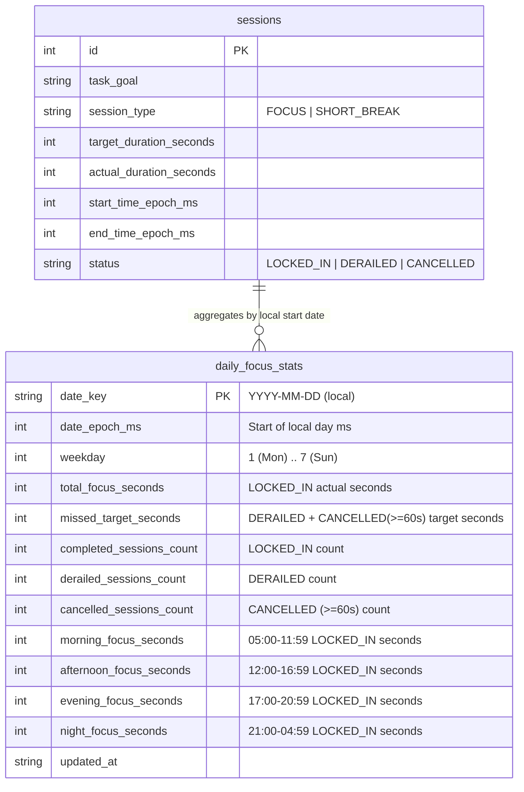

# Focusmaxxing Enhancement Specification: Actionable Focus Insights

**Status:** Approved & Finalized via Design Interview (`/grill-me`)  
**Target Area:** `lib/core/database/`, `lib/features/timer/data/`, `lib/features/insights/`  
**Database Impact:** SQLite Migration V3 (`DatabaseHelper.databaseVersion = 3` — new `daily_focus_stats` rollup table with automated backfill from `sessions`)

---

## 1. Executive Summary & Core Decisions

### Problem Statement
Currently, [`InsightsPage`](file:///C:/Users/darkn/IdeaProjects/focusmaxxing/lib/features/insights/presentation/pages/insights_page.dart#L194-L275) only displays today's raw focus minutes, today's completed session count, the current streak, and a flat 7-day session log. Users cannot see which days they focused the most, their daily/active averages across `7D`, `30D`, `1Y`, or `All-Time`, their session completion quality (`Locked In` vs `Derailed` vs `Cancelled`), how much focus time they left on the table ("Could've Locked In"), or their peak productivity patterns.

### Key Architectural & Product Decisions
1. **Materialized Daily Rollup Table (`MigrationV3` — `daily_focus_stats`)**:
   - Pre-aggregates daily focus metrics in SQLite (`tableDailyFocusStats = 'daily_focus_stats'`), populated via a one-time migration backfill from `sessions` on upgrade to v3 and idempotently re-synced for the target day whenever a session's status is updated.
2. **Strict Focus Attribution & `< 60s` Quick-Cancel Filter**:
   - Only `LOCKED_IN` `FOCUS` sessions contribute to `total_focus_seconds` and Peak Day records.
   - Accidental quick-cancels (`status == 'CANCELLED' && actual_duration_seconds < 60`, which also covers newly initialized `0s` rows) are excluded from `cancelled_sessions_count`, `missed_target_seconds`, and the `RECENT SESSIONS` list.
   - Every `DERAILED` focus session and every valid `CANCELLED` focus session (`actual_duration_seconds >= 60`) adds its full planned `target_duration_seconds` to `missed_target_seconds` (**"Could've Locked In" / Unclaimed Focus Time**).
3. **Visual Ghost Bars for "Could've Locked In" Time Across `7D | 30D | 1Y | ALL`**:
   - The Trend Bar Chart (`FocusTrendCard`) supports four selectable time horizons: **`7D`**, **`30D`**, **`1Y`**, and **`ALL`**.
   - Each bar renders actual `focusMinutes` as a solid lower bar and stacks a translucent/ghost extension on top representing `unclaimedMinutes` (`missed_target_seconds`), showing visually what the user *could* have hit. Tapping any bar inspects both numbers and the bucket's `🚀 / 💀 / ⏹️` session counts.
4. **Adaptive Chart Bucketing & Time Horizon Semantics (`7D | 30D | 1Y | ALL`)**:
   - **Chart Granularity**:
     - `7D`: 7 **daily** bars (rolling last 7 calendar days).
     - `30D`: 30 **daily** bars (rolling last 30 calendar days).
     - `1Y`: 12 **monthly** bars (trailing 12 calendar months ending at `referenceDate.month`, e.g., `Nov '25 .. Oct '26`), so bars remain wide, legible, and easily tappable.
     - `ALL`: Adaptive bucketing from the user's earliest recorded day (`firstRecordDate`) through `referenceDate`:
       - If total history span `<= 30` days: renders **daily** bars (minimum 7 bars up to 30 bars).
       - If total history span `> 30` days: renders **monthly** bars from the first recorded month to `referenceDate` (or yearly bars if span exceeds 24 months).
   - **Period-Responsive Cards (`7D | 30D | 1Y | ALL`)**: `FocusTrendCard` (Bar Chart), `Daily Average` card, and `Session Outcomes & Unclaimed Focus` card all update to the selected horizon.
   - **Strictly All-Time Personal Records**: `Most Focused Day` card, `Powerhouse Pattern` (Best Weekday & Peak Time Window) card, and `Best Streak` badge in `StreakCard` always display all-time records regardless of the selected chart filter.
   - **Independent**: `RECENT SESSIONS` (`SessionHistoryList`) always displays the last 7 days of valid sessions.
5. **Lifetime Pro Gating (`$9.99` Tier)**:
   - `7D` is free for all users; **`30D`**, **`1Y`**, **`ALL`**, and the **`Powerhouse Pattern` card** are gated behind `BillingNotifier.isProUnlocked`.
   - Non-Pro users see a gold `PRO` badge (`AppColors.accentStreakGold`) on the extended period toggles (`30D`, `1Y`, `ALL`) and a locked teaser state on the `Powerhouse Pattern` card; tapping any locked item opens `LifetimeProBanner` in a modal bottom sheet (matching [`ProAccentColorSection`](file:///C:/Users/darkn/IdeaProjects/focusmaxxing/lib/features/insights/presentation/widgets/pro_accent_color_section.dart#L80-L98)).

---

## 2. Database Schema & Migration V3 Design



### 2.1 `MigrationV3` Table Definition (`lib/core/database/migrations/migration_v3.dart`)
```sql
CREATE TABLE IF NOT EXISTS daily_focus_stats (
  date_key TEXT PRIMARY KEY,
  date_epoch_ms INTEGER NOT NULL,
  weekday INTEGER NOT NULL,
  total_focus_seconds INTEGER NOT NULL DEFAULT 0,
  missed_target_seconds INTEGER NOT NULL DEFAULT 0,
  completed_sessions_count INTEGER NOT NULL DEFAULT 0,
  derailed_sessions_count INTEGER NOT NULL DEFAULT 0,
  cancelled_sessions_count INTEGER NOT NULL DEFAULT 0,
  morning_focus_seconds INTEGER NOT NULL DEFAULT 0,
  afternoon_focus_seconds INTEGER NOT NULL DEFAULT 0,
  evening_focus_seconds INTEGER NOT NULL DEFAULT 0,
  night_focus_seconds INTEGER NOT NULL DEFAULT 0,
  updated_at TIMESTAMP DEFAULT CURRENT_TIMESTAMP
);

CREATE INDEX IF NOT EXISTS idx_daily_focus_stats_epoch
  ON daily_focus_stats (date_epoch_ms DESC);

CREATE INDEX IF NOT EXISTS idx_daily_focus_stats_peak
  ON daily_focus_stats (total_focus_seconds DESC, date_epoch_ms DESC);
```

### 2.2 Backfill & Idempotent Single-Day Sync Logic
1. **Shared Aggregation Helper (`DailyStatsAggregator`)**:
   - Given a local calendar `DateTime dayStart` (`00:00:00.000`) and a list of `SessionModel` rows whose `start_time_epoch_ms` falls within that local calendar day:
     - Ignore any row where `sessionType != 'FOCUS'`.
     - Ignore any row where `status == 'CANCELLED' && actualDurationSeconds < 60`.
     - For `status == 'LOCKED_IN'`:
       - Clamp `actualDurationSeconds` to `0..86400`.
       - Add to `total_focus_seconds` and increment `completed_sessions_count`.
       - Inspect `DateTime.fromMillisecondsSinceEpoch(startTimeEpochMs).hour`:
         - `5..11` → add to `morning_focus_seconds`
         - `12..16` → add to `afternoon_focus_seconds`
         - `17..20` → add to `evening_focus_seconds`
         - `21..23` or `0..4` → add to `night_focus_seconds`
     - For `status == 'DERAILED'`:
       - Clamp `targetDurationSeconds` to `0..86400`.
       - Add `targetDurationSeconds` to `missed_target_seconds` and increment `derailed_sessions_count`.
     - For `status == 'CANCELLED'` (with `actualDurationSeconds >= 60`):
       - Clamp `targetDurationSeconds` to `0..86400`.
       - Add `targetDurationSeconds` to `missed_target_seconds` and increment `cancelled_sessions_count`.
2. **Migration V3 Backfill**:
   - In `MigrationV3.up(Database db)`, query all rows from `sessions WHERE session_type = 'FOCUS'`, group by local start-of-day, run `DailyStatsAggregator`, and batch-insert into `daily_focus_stats` with `ConflictAlgorithm.replace`.
3. **Runtime Sync on `updateSessionStatus`**:
   - In [`SessionLocalDataSource.updateSessionStatus`](file:///C:/Users/darkn/IdeaProjects/focusmaxxing/lib/features/timer/data/datasources/session_local_data_source.dart#L41-L66), after updating the `sessions` row, read that session's `start_time_epoch_ms`, query all `FOCUS` sessions for that local calendar day (`startOfDay` to `endOfDay`), compute the `DailyFocusStatsModel` via `DailyStatsAggregator`, and `INSERT OR REPLACE` into `daily_focus_stats`.

---

## 3. Domain Entities & Calculation Specifications

### 3.1 Domain Entities (`lib/features/insights/domain/entities/`)

#### 1. `InsightsPeriod` enum (`focus_insights_entity.dart`)
- `days7` (`id: '7d'`, `shortLabel: '7D'`, `isProOnly: false`)
- `days30` (`id: '30d'`, `shortLabel: '30D'`, `isProOnly: true`)
- `year1` (`id: '1y'`, `shortLabel: '1Y'`, `isProOnly: true`)
- `allTime` (`id: 'all'`, `shortLabel: 'ALL'`, `isProOnly: true`)

#### 2. `DailyFocusBucketEntity` (`daily_focus_bucket_entity.dart`)
Represents either a single calendar day (for `7D`, `30D`, and `< 30d` `ALL`) or an aggregated calendar month/year bucket (for `1Y` and multi-month `ALL`):
- `final String bucketKey` (`YYYY-MM-DD` for daily buckets, `YYYY-MM` for monthly buckets, `YYYY` for yearly buckets)
- `final DateTime startDate` (local start of bucket)
- `final DateTime endDate` (local end of bucket)
- `final String shortLabel` (e.g., `'M'`, `'14'`, `'Oct'`, `'2026'`)
- `final String fullLabel` (e.g., `'Tue, Oct 20'`, `'Oct 2026'`, `'2026'`)
- `final int focusMinutes` (`(totalFocusSeconds / 60).round()`)
- `final int unclaimedMinutes` (`(missedTargetSeconds / 60).round()`)
- `final int potentialMinutes` (`focusMinutes + unclaimedMinutes`)
- `final int completedSessionsCount` (`LOCKED_IN`)
- `final int derailedSessionsCount` (`DERAILED`)
- `final int cancelledSessionsCount` (`CANCELLED` `>= 60s`)
- `final int attemptedSessionsCount` (`completed + derailed + cancelled`)
- `final bool isPeakInPeriod` (`true` for the single bucket in the window with the highest `focusMinutes > 0`, breaking ties by most recent `startDate`)

#### 3. `FocusTimeWindow` enum (`focus_insights_entity.dart`)
- `morning` (`05:00–11:59`, label: `'Morning'`)
- `afternoon` (`12:00–16:59`, label: `'Afternoon'`)
- `evening` (`17:00–20:59`, label: `'Evening'`)
- `night` (`21:00–04:59`, label: `'Late Night'`)

#### 4. `FocusInsightsEntity` (`focus_insights_entity.dart`)
- **Period-Scoped Fields (`7D`, `30D`, `1Y`, or `ALL`)**:
  - `final InsightsPeriod period`
  - `final int calendarDaysInPeriod` (`7` for `7D`, `30` for `30D`, `365` for `1Y`, and inclusive days from earliest recorded session date to `referenceDate` for `ALL` — minimum `1`)
  - `final List<DailyFocusBucketEntity> chartBuckets` (ordered oldest → `referenceDate`: 7 daily buckets for `7D`, 30 daily buckets for `30D`, 12 monthly buckets for `1Y`, and adaptive daily/monthly/yearly buckets for `ALL`)
  - `final int periodFocusMinutes` (sum of `focusMinutes` across all days in the period)
  - `final int periodUnclaimedMinutes` (sum of `unclaimedMinutes` across all days in the period)
  - `final int periodPotentialMinutes` (`periodFocusMinutes + periodUnclaimedMinutes`)
  - `final int periodCompletedSessions`
  - `final int periodDerailedSessions`
  - `final int periodCancelledSessions`
  - `final int periodAttemptedSessions` (`completed + derailed + cancelled`)
  - `final int dailyAverageMinutes` (`(periodFocusMinutes / calendarDaysInPeriod).round()`)
  - `final int activeDayAverageMinutes` (`activeDaysCount > 0 ? (periodFocusMinutes / activeDaysCount).round() : 0`)
  - `final int activeDaysCount` (number of calendar days in the period with `focusMinutes > 0`)
  - `final int? lockInRatePercent` (`periodAttemptedSessions > 0 ? ((periodCompletedSessions / periodAttemptedSessions) * 100).round() : null`)
  - `final int averageSessionMinutes` (`periodCompletedSessions > 0 ? (periodTotalFocusSeconds / periodCompletedSessions / 60).round() : 0`)
  - `final DailyFocusBucketEntity? periodPeakBucket`
- **All-Time Personal Record Fields**:
  - `final DailyFocusBucketEntity? allTimePeakDay` (queried from `daily_focus_stats WHERE total_focus_seconds > 0 ORDER BY total_focus_seconds DESC, date_epoch_ms DESC LIMIT 1`)
  - `final int longestStreakDays` (all-time best streak across all active days in `daily_focus_stats`, respecting `includeWeekendsInStreak` and the 1-day-per-7-day Streak Shield)
  - `final int? bestWeekday` (`1` = Mon .. `7` = Sun; null if all-time `completed_sessions_count < 3`)
  - `final int bestWeekdayAverageMinutes` (average `focusMinutes` across active days on `bestWeekday`)
  - `final FocusTimeWindow? peakTimeWindow` (window with highest all-time focus seconds; null if all-time `completed_sessions_count < 3`)

---

## 4. Edge Cases & Canonical Rules Matrix

| # | Edge Case | Canonical Rule |
|---|---|---|
| **EC-1** | **Accidental Quick-Cancels (`< 60s`) & In-Progress Rows** | Any `FOCUS` session with `status == 'CANCELLED'` and `actual_duration_seconds < 60` is ignored in `daily_focus_stats` (`cancelled_sessions_count` and `missed_target_seconds`) AND filtered out of `getRecentSessions` so misclicks and active in-progress sessions never pollute stats or session history. |
| **EC-2** | **Midnight-Crossing Sessions** | Sessions are always bucketed into `daily_focus_stats` by the local calendar day of `start_time_epoch_ms` (`AppDateUtils.getStartOfDay`). This matches `calculateStreak` so daily bars and streaks never disagree. |
| **EC-3** | **Seconds-to-Minutes Rounding Consistency** | Each day's `focusMinutes = (total_focus_seconds / 60).round()` and `unclaimedMinutes = (missed_target_seconds / 60).round()`. Monthly/yearly chart buckets and period totals (`periodFocusMinutes`, `periodUnclaimedMinutes`) sum those daily rounded minutes so chart bars and summary cards always match to the exact minute. |
| **EC-4** | **Zero-Data / Brand-New User State** | When no sessions exist: `dailyAverageMinutes = 0`, `activeDayAverageMinutes = 0`, `lockInRatePercent = null` (UI displays `"--"`), `allTimePeakDay = null` (UI displays `"No record yet"`), `bestWeekday = null` & `peakTimeWindow = null` (UI displays `"Lock in 3x to unlock"`). Never divide by zero or render `NaN`. |
| **EC-5** | **Ties for Peak Bucket & All-Time Peak Day** | When multiple buckets/days tie for highest `focusMinutes > 0`, the **most recent date** (`date_epoch_ms DESC`) wins deterministically. |
| **EC-6** | **Sample Threshold & Ties for Powerhouse Pattern** | Require `>= 3` all-time `LOCKED_IN` focus sessions before returning non-null `bestWeekday` or `peakTimeWindow`. Rank `bestWeekday` by highest average focus minutes per active day on that weekday (tie-breaker: highest total focus seconds on that weekday, then Monday `1` → Sunday `7`). Rank `peakTimeWindow` by highest all-time seconds across `morning`, `afternoon`, `evening`, `night` (tie-breaker in that order). |
| **EC-7** | **DST (Daylight Saving Time) Safe Date Stepping** | Never step dates by subtracting `Duration(days: 1)` or `86400000` ms. Always use local calendar constructors `DateTime(y, m, d - offset)` / `DateTime(y, m - offset, 1)` and `AppDateUtils.getStartOfDay`. |
| **EC-8** | **`1Y` and `ALL` Bucketing & Denominators** | For `1Y`, `calendarDaysInPeriod = 365` (rolling `refDate - 364 days .. refDate`) and `chartBuckets` contains the 12 trailing calendar months (`DateTime(ref.year, ref.month - 11 + i, 1)`). For `ALL`, `calendarDaysInPeriod` is `max(1, calendarDaysBetween(earliestDay, refDate) + 1)`; `chartBuckets` uses daily bars if `calendarDaysInPeriod <= 30`, monthly bars if `<= 730` (24 months), and yearly bars if `> 730`. In monthly/yearly views, the daily goal dashed line scales to `dailyGoalMinutes * daysInMonth` (or hides in favour of peak scaling) so bar proportions remain accurate. |
| **EC-9** | **Break Sessions (`SHORT_BREAK`) & Pro Gating Transitions** | `SHORT_BREAK` rows are completely excluded from `daily_focus_stats`. If a user unlocks Lifetime Pro while on `InsightsPage`, `BillingNotifier` notifies listeners and `30D`, `1Y`, `ALL`, and `Powerhouse Pattern` immediately unlock without requiring an app restart. |
| **EC-10** | **Deterministic `referenceDate` Injection** | All repository and use case methods (`getFocusInsights`, `getRecentSessions`, `getDailySummary`) accept `DateTime? referenceDate` so unit and widget tests can assert exact multi-day/multi-month windows deterministically. |

---

## 5. UI Layout & Component Blueprint

```
┌──────────────────────────────────────────────────────────┐
│ AppBar: Insights & Settings              [PRO SUPPORTER] │
├──────────────────────────────────────────────────────────┤
│ TODAY'S MOMENTUM                                         │
│ ┌─────────────────────────┐  ┌─────────────────────────┐ │
│ │ 45 / 60 MINS      [75%] │  │ 2                       │ │
│ │ ▓▓▓▓▓▓▓▓▓▓▓▓░░░░        │  │ Sessions Finished       │ │
│ │ Locked In Today         │  │ +12m vs daily avg       │ │
│ └─────────────────────────┘  └─────────────────────────┘ │
│                                                          │
│ FOCUS TRENDS            [ 7D | 30D🔒 | 1Y🔒 | ALL🔒 ]  │
│ ┌──────────────────────────────────────────────────────┐ │
│ │ Tue, Oct 20 • 95m Locked In · +25m Unclaimed  🏆 PEAK│ │
│ │ 3 🚀 Locked In · 1 💀 Derailed · 0 ⏹️ Cancelled      │ │
│ │                                                      │ │
│ │       👑                                             │ │
│ │       ░░ (Ghost: +25m unclaimed)                     │ │
│ │       ██          ░░                                 │ │
│ │  -- --██-- -- -- -██- -- -- (60m Goal Line)          │ │
│ │  ██   ██   ██     ██   ██                            │ │
│ │  M    T    W   T   F    S   S                        │ │
│ └──────────────────────────────────────────────────────┘ │
│                                                          │
│ PERFORMANCE HIGHLIGHTS                                   │
│ ┌─────────────────────────┐  ┌─────────────────────────┐ │
│ │ 📊 DAILY AVERAGE (7D)   │  │ 🏆 MOST FOCUSED DAY     │ │
│ │ 52 MINS                 │  │ 120 MINS     [ALL-TIME] │ │
│ │ 68m/day on 5 active days│  │ Oct 14, 2026 · 4 sess   │ │
│ └─────────────────────────┘  └─────────────────────────┘ │
│ ┌─────────────────────────┐  ┌─────────────────────────┐ │
│ │ 🎯 SESSION OUTCOMES (7D)│  │ ⚡ POWERHOUSE    [PRO]  │ │
│ │ 75% LOCKED IN           │  │ TUESDAYS (or 🔒 Teaser) │ │
│ │ 6🚀 1💀 1⏹️ · +50m left │  │ Avg 85m · Morning peak  │ │
│ └─────────────────────────┘  └─────────────────────────┘ │
│                                                          │
│ CURRENT STREAK                                           │
│ ┌──────────────────────────────────────────────────────┐ │
│ │ 🔥 CURRENT STREAK: 5 DAYS           [🏆 BEST: 14D]  │ │
│ │ 🛡️ Weekly Streak Shield Active                      │ │
│ │ [x] Streak Tracking                                  │ │
│ │ [ ] Include Weekends in Streak                       │ │
│ └──────────────────────────────────────────────────────┘ │
│                                                          │
│ RECENT SESSIONS                                          │
│ ┌──────────────────────────────────────────────────────┐ │
│ │ 🚀 Write architecture RFC            25m · Locked In │ │
│ └──────────────────────────────────────────────────────┘ │
│                                                          │
│ CONFIG & PREFERENCES                                     │
│ ┌──────────────────────────────────────────────────────┐ │
│ │ 🎯 Daily Focus Goal             [ 30m 60m 90m 120m ] │ │
│ │ 🔔 Daily Focus Reminder                        [Off] │ │
│ │ 🎨 Focus Accent Color                                │ │
│ └──────────────────────────────────────────────────────┘ │
└──────────────────────────────────────────────────────────┘
```

---

## 6. Agent Execution Plan (Modular Work Packages)

Work is partitioned into **5 sequential, self-contained work packages (WP1–WP5)**.

### WP1: SQLite Migration V3 (`daily_focus_stats`), Backfill & Data Source Sync
- **Objective**: Create `MigrationV3` with automated backfill from `sessions`, bump `DatabaseHelper.databaseVersion` to `3`, and keep `daily_focus_stats` synced in `SessionLocalDataSource`.
- **Files to Create / Modify**:
  1. **Create** `lib/features/insights/data/models/daily_focus_stats_model.dart`:
     - Fields matching `daily_focus_stats` columns + `fromMap`, `toMap`, and `DailyStatsAggregator.aggregateDay(DateTime dayStart, List<SessionModel> daySessions)` implementing the `< 60s` quick-cancel filter and time-of-day window bucketing.
  2. **Create** `lib/core/database/migrations/migration_v3.dart`:
     - Create `daily_focus_stats` table and indexes (`idx_daily_focus_stats_epoch`, `idx_daily_focus_stats_peak`).
     - Query existing `FOCUS` rows from `sessions`, group by local start-of-day, aggregate via `DailyStatsAggregator.aggregateDay`, and batch-insert into `daily_focus_stats`.
  3. **Modify** [`lib/core/database/database_helper.dart`](file:///C:/Users/darkn/IdeaProjects/focusmaxxing/lib/core/database/database_helper.dart):
     - Bump `databaseVersion = 3`, add `tableDailyFocusStats = 'daily_focus_stats'`, call `MigrationV3.up(db)` in `_onCreate` and inside `_onUpgrade` when `oldVersion < 3`.
  4. **Modify** [`lib/features/timer/data/datasources/session_local_data_source.dart`](file:///C:/Users/darkn/IdeaProjects/focusmaxxing/lib/features/timer/data/datasources/session_local_data_source.dart):
     - In `updateSessionStatus`, recompute that session's calendar day via `DailyStatsAggregator` and upsert into `daily_focus_stats`.
     - Add `Future<List<DailyFocusStatsModel>> getDailyStatsForDateRange(int startEpochMs, int endEpochMs)` and `Future<List<DailyFocusStatsModel>> getAllDailyStats()` to `ISessionLocalDataSource` and `SessionLocalDataSource`.
  5. **Create** `test/core/database/migration_v3_and_daily_stats_test.dart`:
     - Verify v2 → v3 migration backfill, `< 60s` cancelled session exclusion, `DERAILED` + `>= 60s` `CANCELLED` `missed_target_seconds` calculation, time-of-day bucketing, and idempotent `updateSessionStatus` day re-sync.
- **Verification**: `flutter test test/core/database/migration_v3_and_daily_stats_test.dart` passes 100%.

---

### WP2: Domain Entities, Repository Implementation & Edge-Case Unit Tests
- **Objective**: Build the Insights domain layer (`InsightsPeriod`: `7D`, `30D`, `1Y`, `ALL`) and implement `InsightsRepositoryImpl` backed by `daily_focus_stats`.
- **Files to Create / Modify**:
  1. **Create** `lib/features/insights/domain/entities/daily_focus_bucket_entity.dart` and `lib/features/insights/domain/entities/focus_insights_entity.dart` (including `enum InsightsPeriod { days7, days30, year1, allTime }`).
  2. **Modify** [`lib/features/insights/domain/repositories/i_insights_repository.dart`](file:///C:/Users/darkn/IdeaProjects/focusmaxxing/lib/features/insights/domain/repositories/i_insights_repository.dart):
     - Add `Future<Either<Failure, FocusInsightsEntity>> getFocusInsights({InsightsPeriod period = InsightsPeriod.days7, DateTime? referenceDate, bool includeWeekendsInStreak = false})`.
     - Add optional `DateTime? referenceDate` to `getRecentSessions({int days = 7, DateTime? referenceDate})`.
  3. **Create** `lib/features/insights/domain/usecases/get_focus_insights_usecase.dart` and update [`get_recent_sessions_usecase.dart`](file:///C:/Users/darkn/IdeaProjects/focusmaxxing/lib/features/insights/domain/usecases/get_recent_sessions_usecase.dart).
  4. **Modify** [`lib/features/insights/data/repositories/insights_repository_impl.dart`](file:///C:/Users/darkn/IdeaProjects/focusmaxxing/lib/features/insights/data/repositories/insights_repository_impl.dart):
     - Filter out accidental quick-cancels (`status == SessionStatus.cancelled && actualDurationSeconds < 60`) in `getRecentSessions`.
     - Implement `getFocusInsights` using `localDataSource.getAllDailyStats()`, supporting `InsightsPeriod.days7` (7 daily buckets), `InsightsPeriod.days30` (30 daily buckets), `InsightsPeriod.year1` (365-day totals + 12 trailing monthly buckets), and `InsightsPeriod.allTime` (lifetime totals from first recorded day + adaptive daily/monthly/yearly buckets), alongside `allTimePeakDay`, `longestStreakDays`, `bestWeekday`, and `peakTimeWindow`.
  5. **Modify** [`test/features/insights/data/insights_repository_impl_test.dart`](file:///C:/Users/darkn/IdeaProjects/focusmaxxing/test/features/insights/data/insights_repository_impl_test.dart):
     - Add comprehensive unit tests covering **EC-1 through EC-10**, including `7D`, `30D`, `1Y` monthly bucketing, and `ALL` adaptive bucketing and lifetime average denominators.
- **Verification**: `flutter test test/features/insights/data/insights_repository_impl_test.dart` passes 100%.

---

### WP3: State Management (`InsightsNotifier` & DI Wiring)
- **Objective**: Connect `GetFocusInsightsUseCase`, daily goal preferences, `InsightsPeriod` (`7D | 30D | 1Y | ALL`) selection, and best-streak high-water mark persistence in `InsightsNotifier` and `main.dart`.
- **Files to Modify**:
  1. **Modify** [`lib/features/insights/presentation/notifiers/insights_notifier.dart`](file:///C:/Users/darkn/IdeaProjects/focusmaxxing/lib/features/insights/presentation/notifiers/insights_notifier.dart):
     - Add `GetFocusInsightsUseCase? getFocusInsightsUseCase`.
     - Add `SharedPreferences` keys: `keyDailyGoalMinutes = 'insights_daily_goal_minutes'` (default `60`), `keySelectedPeriod = 'insights_selected_period'` (default `'7d'`), `keyLongestStreakRecord = 'insights_longest_streak_record'`.
     - Expose `focusInsights`, `dailyGoalMinutes`, `selectedPeriod` (`InsightsPeriod`), `bestStreakDays`, `setSelectedPeriod(InsightsPeriod period)`, and `setDailyGoalMinutes(int minutes)`.
  2. **Modify** [`lib/main.dart`](file:///C:/Users/darkn/IdeaProjects/focusmaxxing/lib/main.dart):
     - Wire `GetFocusInsightsUseCase` into `InsightsNotifier`.
  3. **Modify** [`test/features/insights/presentation/insights_notifier_test.dart`](file:///C:/Users/darkn/IdeaProjects/focusmaxxing/test/features/insights/presentation/insights_notifier_test.dart):
     - Test loading `focusInsights`, switching across `7D`, `30D`, `1Y`, and `ALL`, persisting `dailyGoalMinutes`, and updating `bestStreakDays`.
- **Verification**: `flutter test test/features/insights/presentation/insights_notifier_test.dart` passes 100%.

---

### WP4: UI Widgets (`FocusTrendCard`, `InsightsHighlightsGrid`, `StreakCard`, `InsightsPage`)
- **Objective**: Build the high-contrast UI components including the stacked ghost-bar chart with `7D | 30D | 1Y | ALL` selector, 2×2 highlights bento grid, Pro-gated `30D`/`1Y`/`ALL` & `Powerhouse Pattern` interactions, upgraded `_MomentumRow`, and `Daily Focus Goal` selector.
- **Files to Create / Modify**:
  1. **Create** `lib/features/insights/presentation/widgets/focus_trend_card.dart`:
     - Header inspector showing selected bucket's `Locked In` mins, `+Xm Unclaimed` mins, `🚀 / 💀 / ⏹️` counts, and `🏆 PEAK` badge.
     - 4-option period selector (`7D` | `30D` | `1Y` | `ALL`, showing a compact gold `PRO` badge on `30D`, `1Y`, and `ALL` when `!isProUnlocked`; tapping any Pro-locked period when `!isProUnlocked` opens `LifetimeProBanner` bottom sheet).
     - Stacked bar chart (`focusMinutes` solid lower bar + `unclaimedMinutes` translucent ghost top bar + dashed `dailyGoalMinutes` line for daily views).
  2. **Create** `lib/features/insights/presentation/widgets/insights_highlights_grid.dart`:
     - **Card 1 (`DAILY AVERAGE (<PERIOD>)`)**: `X MINS` + `"Ym/day on Z active days"`.
     - **Card 2 (`MOST FOCUSED DAY` - All-Time)**: `X MINS` in `AppColors.accentStreakGold` + date & session count.
     - **Card 3 (`SESSION OUTCOMES (<PERIOD>)`)**: `X% LOCKED IN` + `A🚀 B💀 C⏹️` + `"Could've hit Zm (+Ym left)"`.
     - **Card 4 (`POWERHOUSE PATTERN` - All-Time, Pro-Gated)**: When `isProUnlocked`, displays `bestWeekday` (e.g., `TUESDAYS`) + `"Avg Xm · Best in [Window]"`. When `!isProUnlocked`, renders gold `PRO` badge and `"🔒 Tap to unlock your Best Day & Peak Window"`, opening `LifetimeProBanner` bottom sheet on tap.
  3. **Modify** [`lib/features/insights/presentation/widgets/streak_card.dart`](file:///C:/Users/darkn/IdeaProjects/focusmaxxing/lib/features/insights/presentation/widgets/streak_card.dart):
     - Add `int bestStreakDays = 0` and display `"🏆 BEST: $bestStreakDays DAYS"` pill when streak tracking is enabled.
  4. **Modify** [`lib/features/insights/presentation/pages/insights_page.dart`](file:///C:/Users/darkn/IdeaProjects/focusmaxxing/lib/features/insights/presentation/pages/insights_page.dart):
     - Upgrade `_MomentumRow` with daily goal progress (`45 / 60 MINS`, progress bar, `TARGET HIT ⚡` badge) and delta vs. daily average.
     - Add `FocusTrendCard` and `InsightsHighlightsGrid` sections.
     - Add `Daily Focus Goal` choice chips (`30m`, `60m`, `90m`, `120m`, `180m`) to `_PreferencesCard`.

---

### WP5: Widget Tests & Full Regression Suite
- **Objective**: Add comprehensive widget tests for all new components, `7D | 30D | 1Y | ALL` period switching, Pro gating flows, and empty/populated states, and verify zero regressions across the entire repository.
- **Files to Modify**:
  1. **Modify** [`test/features/insights/presentation/insights_page_test.dart`](file:///C:/Users/darkn/IdeaProjects/focusmaxxing/test/features/insights/presentation/insights_page_test.dart):
     - Test `_MomentumRow` goal progress, `FocusTrendCard` bar rendering across `7D`, `30D`, `1Y`, and `ALL` + tap-to-inspect, ghost unclaimed bars, `InsightsHighlightsGrid` metrics & empty state placeholders, Pro-locked `30D`/`1Y`/`ALL` toggles and `Powerhouse Pattern` opening `LifetimeProBanner`, and Pro unlocked states.
  2. **Modify** [`test/features/insights/presentation/widgets/streak_card_test.dart`](file:///C:/Users/darkn/IdeaProjects/focusmaxxing/test/features/insights/presentation/widgets/streak_card_test.dart):
     - Verify `"🏆 BEST: X DAYS"` badge rendering.
- **Verification**:
  - `flutter analyze` (0 issues).
  - `flutter test` (100% pass across all unit and widget tests).
