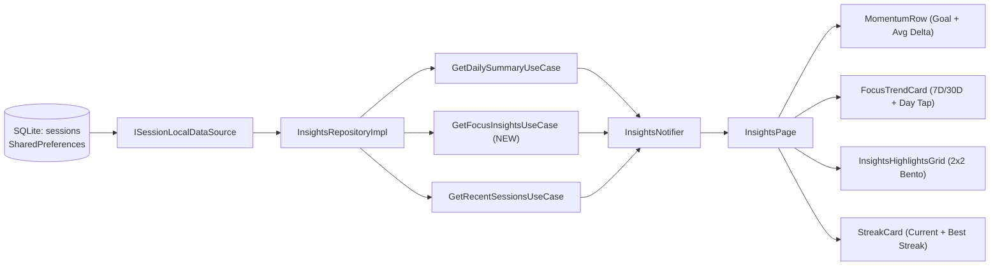

# Focusmaxxing Enhancement Specification: Actionable Focus Insights

**Status:** Draft Ready for Execution  
**Target Area:** `lib/features/insights/` (Domain, Data, Presentation)  
**Database Impact:** Zero schema migration required (`DatabaseHelper.databaseVersion = 2` compatible)

---

## 1. Executive Summary & Problem Statement

### Current State
In [`InsightsPage`](file:///C:/Users/darkn/IdeaProjects/focusmaxxing/lib/features/insights/presentation/pages/insights_page.dart#L194-L275), the user only sees:
1. **Today's Momentum (`_MomentumRow`)**: Two flat counters (`X MINS` Locked In Today and `Y` Sessions Finished) with no historical comparison or daily target context.
2. **Current Streak (`StreakCard`)**: Current streak days and toggle switches, with no record of their all-time longest streak.
3. **Recent Sessions (`SessionHistoryList`)**: A raw chronological list of sessions from the past 7 days.

### Problem
Users cannot answer high-value self-reflection questions:
- *"Which days did I lock in the hardest?"* (both recently and all-time)
- *"What is my daily focus average, and how does today compare?"*
- *"Which day of the week or time of day am I naturally most focused?"*
- *"How consistent am I at finishing the sessions I start?"*

### Design Philosophy (No Bloat, ADHD-First)
- **High Signal, Zero Clutter**: No third-party charting bloat, no multi-axis radar charts, and no guilt-inducing red failure walls.
- **Native Midnight Aesthetic**: All components use [`AppColors`](file:///C:/Users/darkn/IdeaProjects/focusmaxxing/lib/core/theme/app_colors.dart#L3-L16) (`surfaceRaised`, `surfaceHairline`, active `ProAccentVariant`, and `accentStreakGold` `#FFB800` for personal records) with `FontFeature.tabularFigures()`.
- **Zero SQLite Schema Migration**: All historical metrics are computed from the indexed `sessions` table ([`MigrationV1`](file:///C:/Users/darkn/IdeaProjects/focusmaxxing/lib/core/database/migrations/migration_v1.dart#L11-L40)) and user benchmarks/high-water marks are persisted in `SharedPreferences`.

---

## 2. Scoped Product Features (MoSCoW)

### Must Have (Core Scope)

1. **Today's Momentum + Daily Goal Benchmark (`_MomentumRow` Upgrade)**
   - **What it does**: Upgrades the "Locked In Today" card with a configurable daily focus goal (default `60m`, selectable `30m / 60m / 90m / 120m / 180m` in Preferences, stored in `SharedPreferences`).
   - **Display**:
     - Shows `45 / 60 MINS` with a sleek horizontal progress bar and percentage badge (`75%`). When `>= 100%`, displays a gold/accent pill: `"TARGET HIT ⚡"`.
     - Below "Sessions Finished", displays a comparison chip against the user's active daily average (e.g., `"+18m vs avg"` or `"Avg: 42m / day"`).

2. **Interactive Focus Trend Bar Chart (`7D` / `30D` Toggle & Day Inspector)**
   - **What it does**: A custom-built, lightweight Flutter bar chart (`FocusTrendCard`) displaying daily focused minutes across the rolling **Last 7 Days (`7D`)** or **Last 30 Days (`30D`)**.
   - **Visual Highlights**:
     - **Peak Day Highlight**: The highest focus day in the selected window (> 0 mins) is rendered in `AppColors.accentStreakGold` (`#FFB800`) with a subtle top indicator.
     - **Goal Completed Bars**: Days reaching `dailyFocusGoalMinutes` render in full primary accent (`colorScheme.primary`); partial active days render in `colorScheme.primary.withValues(alpha: 0.45)`; zero-minute days render as a `4px` hairline stub (`AppColors.surfaceHairline`).
     - **Interactive Day Selection**: Tapping any bar selects that day (defaults to the Peak Day or Today) and updates the card header summary: e.g., `"Tue, Oct 20 • 115 MINS (4 sessions) 🏆 Peak Day"`.

3. **Core Insights & Averages Grid (`InsightsHighlightsGrid`)**
   - A 2×2 high-contrast bento grid displaying four core metrics:
     1. **Daily Average (`7D` or `30D`)**:
        - Headline: **`X MINS / DAY`** (calendar average across the selected period).
        - Subtitle: **`Active-day avg: Ym (Z active days)`** — prevents discouragement when users take rest days or weekends off.
     2. **Most Focused Day (All-Time Peak Day)**:
        - Headline: **`X MINS`** (styled with `AppColors.accentStreakGold`).
        - Subtitle: Formatted date of the record (e.g., **`Oct 14, 2026 · 5 sessions`** or **`Today 🔥`** if set today).
     3. **Lock-In Rate & Avg Session Length**:
        - Headline: **`X% LOCKED IN`** (`LOCKED_IN` focus sessions ÷ total attempted `FOCUS` sessions in the selected period).
        - Subtitle: **`Avg session: Ym · Z completed`**.
     4. **Powerhouse Pattern (Best Weekday & Peak Window)**:
        - Headline: Most productive day of the week by total focused minutes (e.g., **`TUESDAYS`**).
        - Subtitle: Average focus on that weekday + peak time-of-day window (e.g., **`Avg 75m · Best in Morning`**).

4. **All-Time Longest Streak in `StreakCard`**
   - **What it does**: Adds a **`BEST: X DAYS 🏆`** badge to [`StreakCard`](file:///C:/Users/darkn/IdeaProjects/focusmaxxing/lib/features/insights/presentation/widgets/streak_card.dart#L5-L166) alongside the current streak, calculated from all-time completed session history and persisted as a high-water mark in `SharedPreferences`.

### Won't Have (Explicitly Out of Scope)
- Third-party chart packages (`fl_chart`, `syncfusion_flutter_charts`) — native Flutter `CustomPainter` / `LayoutBuilder` flex bars keep bundle size zero and match the exact theme.
- Task-tag taxonomy or multi-category pie charts (violates the 1-sentence zero-friction Lock-In rule).
- Cloud sync or cross-device leaderboards.
- Shaming metrics (e.g., "Total Time Wasted / Derailed Minutes" — never surface failure totals prominently).

---

## 3. Architecture & Data Model Design



### 3.1 Domain Entities (`lib/features/insights/domain/entities/`)

#### 1. `DailyFocusBucketEntity` (`daily_focus_bucket_entity.dart`)
Represents a single local calendar day (`00:00:00.000` to `23:59:59.999`):
- `final DateTime date` (normalized to start-of-day via `AppDateUtils.getStartOfDay`)
- `final int focusMinutes` (`(sumOfLockedInFocusSeconds / 60).round()`)
- `final int completedSessionsCount` (count of `FOCUS` + `LOCKED_IN` sessions)
- `final int attemptedSessionsCount` (count of `FOCUS` sessions of any status)
- `final bool isPeakInPeriod` (true for the single highest day in the window when `focusMinutes > 0`)

#### 2. `FocusTimeWindow` enum (`focus_insights_entity.dart`)
- `morning` (`05:00–11:59`, label: `'Morning'`)
- `afternoon` (`12:00–16:59`, label: `'Afternoon'`)
- `evening` (`17:00–20:59`, label: `'Evening'`)
- `night` (`21:00–04:59`, label: `'Late Night'`)

#### 3. `FocusInsightsEntity` (`focus_insights_entity.dart`)
Aggregated analytics payload returned for a selected window (`periodDays`: `7` or `30`):
- `final int periodDays` (`7` or `30`)
- `final List<DailyFocusBucketEntity> dailyBuckets` (chronological: oldest to `referenceDate`, length == `periodDays`)
- `final int periodTotalMinutes` (sum of `focusMinutes` across `dailyBuckets`)
- `final int periodCompletedSessions`
- `final int periodAttemptedSessions`
- `final int dailyAverageMinutes` (`(periodTotalMinutes / effectiveElapsedDays).round()`)
- `final int activeDayAverageMinutes` (`activeDaysCount > 0 ? (periodTotalMinutes / activeDaysCount).round() : 0`)
- `final int activeDaysCount` (number of days in `dailyBuckets` with `focusMinutes > 0`)
- `final int? lockInRatePercent` (`periodAttemptedSessions > 0 ? ((periodCompletedSessions / periodAttemptedSessions) * 100).round() : null`)
- `final int averageSessionMinutes` (`periodCompletedSessions > 0 ? (periodTotalSeconds / periodCompletedSessions / 60).round() : 0`)
- `final DailyFocusBucketEntity? periodPeakDay` (null if `periodTotalMinutes == 0`)
- `final DailyFocusBucketEntity? allTimePeakDay` (highest focus day across all recorded history; null if 0 completed sessions ever)
- `final int longestStreakDays` (all-time best streak respecting `includeWeekendsInStreak` and 7-day Streak Shield)
- `final int? bestWeekday` (`1` = Monday .. `7` = Sunday; null if total completed sessions across history `< 3`)
- `final int bestWeekdayAverageMinutes` (average focus minutes on active occurrences of `bestWeekday`)
- `final FocusTimeWindow? peakTimeWindow` (null if total completed sessions across history `< 3`)

### 3.2 Data Persistence (`SharedPreferences` + SQLite)
- **`SharedPreferences` Keys in `InsightsNotifier`**:
  - `insights_daily_goal_minutes` (`int`, default `60`, valid options: `30, 60, 90, 120, 180`)
  - `insights_selected_period_days` (`int`, default `7`, valid options: `7, 30`)
  - `insights_longest_streak_record` (`int`, high-water mark updated whenever `longestStreakDays` exceeds stored value)
  - `insights_best_day_minutes_record` (`int`, cached all-time peak day minutes)
  - `insights_best_day_date_ms` (`int`, epoch ms of all-time peak day start-of-day)
- **SQLite Query Addition in [`ISessionLocalDataSource`](file:///C:/Users/darkn/IdeaProjects/focusmaxxing/lib/features/timer/data/datasources/session_local_data_source.dart#L6-L15)**:
  - Add `Future<List<SessionModel>> getAllFocusSessions()`:
    Queries `sessions` where `session_type = 'FOCUS'` ordered by `start_time_epoch_ms ASC` (leverages `idx_sessions_type_status_time`).

---

## 4. Edge Cases & Canonical Calculation Rules

> [!IMPORTANT]
> Every coding agent implementing or testing this specification **must** enforce the following 10 edge-case rules to prevent off-by-one bugs, division-by-zero crashes, and DST drift.

| # | Edge Case | Canonical Rule |
|---|---|---|
| **EC-1** | **Midnight-Crossing Sessions** (e.g., started `23:45` Mon, finished `00:10` Tue) | Always attribute a session to the local calendar day of its **`start_time_epoch_ms`** via `AppDateUtils.getStartOfDay(DateTime.fromMillisecondsSinceEpoch(s.startTimeEpochMs))`. This matches `calculateStreak` ([`insights_repository_impl.dart:102-106`](file:///C:/Users/darkn/IdeaProjects/focusmaxxing/lib/features/insights/data/repositories/insights_repository_impl.dart#L102-L106)) so daily bars and streaks never conflict. |
| **EC-2** | **Rounding Drift Between Seconds & Minutes** | Within each calendar day, sum `actualDurationSeconds` of all `LOCKED_IN` `FOCUS` sessions first, then compute `dayMinutes = (dayTotalSeconds / 60).round()`. Compute `periodTotalMinutes` as the sum of `dayMinutes` across the buckets so bar heights and period totals always add up identically. |
| **EC-3** | **Brand-New User / Zero Sessions** | When no sessions exist: `dailyAverageMinutes = 0`, `activeDayAverageMinutes = 0`, `lockInRatePercent = null` (UI renders `"--"`), `allTimePeakDay = null` (UI renders `"No record yet"`), `bestWeekday = null` & `peakTimeWindow = null` (UI renders `"Lock in 3x to unlock"`). Never divide by zero or render `NaN%`. |
| **EC-4** | **New User History Shorter Than Window (`7D` / `30D`)** | If a user's very first session was 2 days ago (`firstSessionDay`), `dailyBuckets` still contains all 7 (or 30) calendar bars for visual layout consistency, and `dailyAverageMinutes` divides by `periodDays` while `activeDayAverageMinutes` divides by `activeDaysCount` (`2`). Displaying both prevents misleadingly low numbers on week 1. |
| **EC-5** | **Ties for Peak Day (Period or All-Time)** | When multiple days tie for the highest `focusMinutes` (`> 0`), break ties deterministically in favor of the **most recent date** (`b.date.isAfter(a.date)`). |
| **EC-6** | **Ties & Minimum Sample Size for Powerhouse Patterns** | Require at least **3 completed (`LOCKED_IN`) focus sessions** all-time before returning a non-null `bestWeekday` or `peakTimeWindow`. For `bestWeekday`, rank weekdays (`1..7`) by highest **average focus minutes per active day on that weekday**; break ties by highest total minutes on that weekday, then earliest weekday (`Monday` first). For `peakTimeWindow`, rank by total focused seconds in each window; break ties in order `morning -> afternoon -> evening -> night`. |
| **EC-7** | **Daylight Saving Time (DST) Transitions** | Never step dates using `Duration(days: 1)` or `86400000` ms subtraction, which shifts by 1 hour across spring/fall DST boundaries. Always construct local calendar dates via `DateTime(ref.year, ref.month, ref.day - offset)`. |
| **EC-8** | **Session Filtering (`SHORT_BREAK`, `DERAILED`, `CANCELLED`)** | `SHORT_BREAK` sessions are ignored across all Insights metrics. `DERAILED` and `CANCELLED` `FOCUS` sessions have `0` contribution to `focusMinutes`, `completedSessionsCount`, `allTimePeakDay`, and `bestWeekday`; they only increment `attemptedSessionsCount` (the denominator of `lockInRatePercent`). |
| **EC-9** | **Clock Skew / Corrupted Duration Values** | Clamp `s.actualDurationSeconds.clamp(0, 86400)` before summing so negative values from system clock adjustments cannot corrupt totals. |
| **EC-10** | **Deterministic `referenceDate` Injection** | All repository and use case methods (`getFocusInsights`, `getRecentSessions`) must accept `DateTime? referenceDate` (defaulting to `DateTime.now()` only when omitted) so unit and widget tests can assert exact multi-day windows deterministically. |

---

## 5. UI Layout & Component Blueprint

The updated [`InsightsPage`](file:///C:/Users/darkn/IdeaProjects/focusmaxxing/lib/features/insights/presentation/pages/insights_page.dart#L209-L273) `ListView` order:

```
┌──────────────────────────────────────────────────────────┐
│ AppBar: Insights & Settings              [PRO SUPPORTER] │
├──────────────────────────────────────────────────────────┤
│ TODAY'S MOMENTUM                                         │
│ ┌─────────────────────────┐  ┌─────────────────────────┐ │
│ │ 45 / 60 MINS      [75%] │  │ 2                       │ │
│ │ ▓▓▓▓▓▓▓▓▓▓▓▓░░░░        │  │ Sessions Finished       │ │
│ │ Locked In Today         │  │ +12m vs daily avg       │ │
│ └─────────────────────────┘  └─────────────────────────┘ │
│                                                          │
│ FOCUS TRENDS                          [ 7 DAYS | 30 D ]  │
│ ┌──────────────────────────────────────────────────────┐ │
│ │ Tue, Oct 20 • 95 MINS (3 sessions)      🏆 PEAK DAY │ │
│ │                                                      │ │
│ │       👑                                             │ │
│ │       ██          ██                                 │ │
│ │  -- --██-- -- -- -██- -- -- (60m Goal Line)          │ │
│ │  ██   ██   ██     ██   ██                            │ │
│ │  M    T    W   T   F    S   S                        │ │
│ └──────────────────────────────────────────────────────┘ │
│                                                          │
│ PERFORMANCE HIGHLIGHTS                                   │
│ ┌─────────────────────────┐  ┌─────────────────────────┐ │
│ │ 📊 DAILY AVERAGE (7D)   │  │ 🏆 MOST FOCUSED DAY     │ │
│ │ 52 MINS                 │  │ 120 MINS                │ │
│ │ 68m/day on 5 active days│  │ Oct 14, 2026 · 4 sess   │ │
│ └─────────────────────────┘  └─────────────────────────┘ │
│ ┌─────────────────────────┐  ┌─────────────────────────┐ │
│ │ 🎯 LOCK-IN RATE (7D)    │  │ ⚡ POWERHOUSE PATTERN   │ │
│ │ 86%                     │  │ TUESDAYS                │ │
│ │ Avg 28m · 6/7 locked in │  │ Avg 85m · Morning peak  │ │
│ └─────────────────────────┘  └─────────────────────────┘ │
│                                                          │
│ CURRENT STREAK                                           │
│ ┌──────────────────────────────────────────────────────┐ │
│ │ 🔥 CURRENT STREAK: 5 DAYS           [🏆 BEST: 14D]  │ │
│ │ 🛡️ Weekly Streak Shield Active                      │ │
│ │ [x] Streak Tracking                                  │ │
│ │ [ ] Include Weekends in Streak                       │ │
│ └──────────────────────────────────────────────────────┘ │
│                                                          │
│ RECENT SESSIONS                                          │
│ ┌──────────────────────────────────────────────────────┐ │
│ │ 🚀 Write architecture RFC            25m · Locked In │ │
│ └──────────────────────────────────────────────────────┘ │
│                                                          │
│ CONFIG & PREFERENCES                                     │
│ ┌──────────────────────────────────────────────────────┐ │
│ │ 🎯 Daily Focus Goal             [ 30m 60m 90m 120m ] │ │
│ │ 🔔 Daily Focus Reminder                        [Off] │ │
│ │ 🎨 Accent Theme                                      │ │
│ └──────────────────────────────────────────────────────┘ │
└──────────────────────────────────────────────────────────┘
```

---

## 6. Agent Execution Plan (Modular Work Packages)

To execute this enhancement cleanly without regressions, work is split into **5 sequential work packages (WP1–WP5)**. Each work package has strict boundaries, file targets, and verification commands.

### WP1: Domain Entities, Repository Contracts & UseCase
- **Objective**: Define the domain models and repository/use-case contracts for Focus Insights.
- **Files to Create / Modify**:
  1. **Create** `lib/features/insights/domain/entities/daily_focus_bucket_entity.dart`:
     - Implement `DailyFocusBucketEntity extends Equatable` with `date`, `focusMinutes`, `completedSessionsCount`, `attemptedSessionsCount`, `isPeakInPeriod`, and `copyWith`.
  2. **Create** `lib/features/insights/domain/entities/focus_insights_entity.dart`:
     - Implement `enum FocusTimeWindow` (`morning`, `afternoon`, `evening`, `night` with display labels) and `FocusInsightsEntity extends Equatable` containing all period and all-time metrics.
  3. **Modify** [`lib/features/insights/domain/repositories/i_insights_repository.dart`](file:///C:/Users/darkn/IdeaProjects/focusmaxxing/lib/features/insights/domain/repositories/i_insights_repository.dart):
     - Add `Future<Either<Failure, FocusInsightsEntity>> getFocusInsights({int periodDays = 7, DateTime? referenceDate, bool includeWeekendsInStreak = false});`
     - Add optional `DateTime? referenceDate` parameter to `getRecentSessions({int days = 7, DateTime? referenceDate})`.
  4. **Create** `lib/features/insights/domain/usecases/get_focus_insights_usecase.dart`:
     - Implement `GetFocusInsightsUseCase` delegating to `IInsightsRepository.getFocusInsights`.
  5. **Modify** [`lib/features/insights/domain/usecases/get_recent_sessions_usecase.dart`](file:///C:/Users/darkn/IdeaProjects/focusmaxxing/lib/features/insights/domain/usecases/get_recent_sessions_usecase.dart):
     - Forward optional `DateTime? referenceDate` to `repository.getRecentSessions`.
- **Verification**: `flutter analyze lib/features/insights/domain` passes with 0 issues.

---

### WP2: Data Source Query, Repository Aggregation & Edge-Case Unit Tests
- **Objective**: Implement `getAllFocusSessions()` in `SessionLocalDataSource` and full aggregation logic in `InsightsRepositoryImpl`, including longest-streak scan, peak day detection, averages, Lock-In rate, and powerhouse patterns.
- **Files to Modify / Create**:
  1. **Modify** [`lib/features/timer/data/datasources/session_local_data_source.dart`](file:///C:/Users/darkn/IdeaProjects/focusmaxxing/lib/features/timer/data/datasources/session_local_data_source.dart):
     - Add `Future<List<SessionModel>> getAllFocusSessions()` to `ISessionLocalDataSource` and `SessionLocalDataSource` (`WHERE session_type = 'FOCUS' ORDER BY start_time_epoch_ms ASC`).
  2. **Modify** [`lib/features/insights/data/repositories/insights_repository_impl.dart`](file:///C:/Users/darkn/IdeaProjects/focusmaxxing/lib/features/insights/data/repositories/insights_repository_impl.dart):
     - Update `getRecentSessions` to use `referenceDate ?? DateTime.now()`.
     - Implement `getFocusInsights({int periodDays = 7, DateTime? referenceDate, bool includeWeekendsInStreak = false})` enforcing **EC-1 through EC-10**.
     - Implement private helper `_calculateLongestStreak(Set<DateTime> completedDays, {required bool includeWeekends})` that evaluates historical streaks across `completedDays` with the 1-day-per-7-day Streak Shield rule.
  3. **Modify** [`test/features/insights/data/insights_repository_impl_test.dart`](file:///C:/Users/darkn/IdeaProjects/focusmaxxing/test/features/insights/data/insights_repository_impl_test.dart):
     - Update `_FakeSessionLocalDataSource` to implement `getAllFocusSessions()`.
     - Add unit tests covering:
       - Empty database (EC-3: nulls & zeros, no `NaN`).
       - 7D and 30D daily buckets, calendar vs. active-day average (EC-2, EC-4).
       - Peak day tie-breaking (EC-5: most recent wins).
       - Midnight-crossing session attribution (EC-1).
       - Lock-In rate with `LOCKED_IN`, `DERAILED`, `CANCELLED`, and `SHORT_BREAK` exclusion (EC-8).
       - Longest historical streak vs. current streak with weekend exemption & Streak Shield.
       - Best weekday and peak time-of-day window with `< 3` and `>= 3` sessions (EC-6).
- **Verification**: `flutter test test/features/insights/data/insights_repository_impl_test.dart` passes 100%.

---

### WP3: State Management (`InsightsNotifier` & DI Wiring)
- **Objective**: Expose `FocusInsightsEntity`, period selector (`7` vs `30` days), daily focus goal (`30..180` mins), and persisted high-water mark records in `InsightsNotifier`, and wire `GetFocusInsightsUseCase` in `main.dart`.
- **Files to Modify**:
  1. **Modify** [`lib/features/insights/presentation/notifiers/insights_notifier.dart`](file:///C:/Users/darkn/IdeaProjects/focusmaxxing/lib/features/insights/presentation/notifiers/insights_notifier.dart):
     - Add `GetFocusInsightsUseCase? getFocusInsightsUseCase` constructor parameter (optional or defaulted so existing call sites remain clean, wired in `main.dart`).
     - Add `SharedPreferences` keys: `keyDailyGoalMinutes = 'insights_daily_goal_minutes'`, `keySelectedPeriodDays = 'insights_selected_period_days'`, `keyLongestStreakRecord = 'insights_longest_streak_record'`.
     - Expose getters: `FocusInsightsEntity? focusInsights`, `int dailyGoalMinutes` (default `60`), `int selectedPeriodDays` (default `7`), `int bestStreakDays` (max of persisted record and `focusInsights?.longestStreakDays ?? dailySummary?.currentStreakDays ?? 0`).
     - Add methods:
       - `Future<void> setSelectedPeriodDays(int days)` (validates `7` or `30`, persists to `SharedPreferences`, reloads insights).
       - `Future<void> setDailyGoalMinutes(int minutes)` (clamps `15..360`, persists to `SharedPreferences`, notifies listeners).
     - Update `loadInsights({DateTime? targetDate})` to also fetch `getFocusInsightsUseCase` and reconcile `keyLongestStreakRecord`.
  2. **Modify** [`lib/main.dart`](file:///C:/Users/darkn/IdeaProjects/focusmaxxing/lib/main.dart):
     - Instantiate `GetFocusInsightsUseCase(repository: insightsRepository)` and inject into `InsightsNotifier`.
  3. **Modify** [`test/features/insights/presentation/insights_notifier_test.dart`](file:///C:/Users/darkn/IdeaProjects/focusmaxxing/test/features/insights/presentation/insights_notifier_test.dart):
     - Add tests for loading `focusInsights`, switching period (`7D` <-> `30D`), updating `dailyGoalMinutes`, and persisting `bestStreakDays`.
- **Verification**: `flutter test test/features/insights/presentation/insights_notifier_test.dart` passes 100%.

---

### WP4: UI Widgets (`FocusTrendCard`, `InsightsHighlightsGrid`, `StreakCard`, `InsightsPage`)
- **Objective**: Build the new visual components in the Midnight High-Contrast theme and integrate them into `InsightsPage`.
- **Files to Create / Modify**:
  1. **Create** `lib/features/insights/presentation/widgets/focus_trend_card.dart`:
     - Renders header with selected day details (`Date • X MINS (Y sessions)` + `🏆 PEAK DAY` badge when applicable) and `SegmentedButton` / pill toggle for `7D` vs `30D`.
     - Renders custom responsive bar chart (`140px` height) with dashed horizontal daily-goal line, gold peak bar (`AppColors.accentStreakGold`), emerald/accent target-met bars, and tap-to-inspect gesture on each bar.
  2. **Create** `lib/features/insights/presentation/widgets/insights_highlights_grid.dart`:
     - Renders the 2×2 responsive metric cards:
       1. `Daily Average` (`X MINS` + active-day average subtitle)
       2. `Most Focused Day` (`X MINS` in gold + date & session count subtitle)
       3. `Lock-In Rate` (`X%` + avg session length & `lockedIn/attempted` count)
       4. `Powerhouse Pattern` (`Best Weekday` + weekday avg & `Peak Time Window`)
  3. **Modify** [`lib/features/insights/presentation/widgets/streak_card.dart`](file:///C:/Users/darkn/IdeaProjects/focusmaxxing/lib/features/insights/presentation/widgets/streak_card.dart):
     - Accept `int bestStreakDays = 0` and display a gold-bordered pill `"🏆 BEST: $bestStreakDays DAYS"` in the header row when `_isStreakEnabled` is true.
  4. **Modify** [`lib/features/insights/presentation/pages/insights_page.dart`](file:///C:/Users/darkn/IdeaProjects/focusmaxxing/lib/features/insights/presentation/pages/insights_page.dart):
     - Upgrade `_MomentumRow` to accept `dailyGoalMinutes` and `dailyAverageMinutes`, rendering progress bar (`focusMinutes / dailyGoalMinutes`) and average comparison subtitle.
     - Insert `FOCUS TRENDS` (`FocusTrendCard`) and `PERFORMANCE HIGHLIGHTS` (`InsightsHighlightsGrid`) sections above `CURRENT STREAK`.
     - Add a `Daily Focus Goal` selector row (`30m`, `60m`, `90m`, `120m`, `180m` choice chips) inside `_PreferencesCard`.

---

### WP5: Widget Tests & Full Regression Suite
- **Objective**: Verify all UI states (empty state, populated 7D/30D state, bar tap selection, goal chip selection, and best streak badge) and ensure zero regressions across the entire test suite.
- **Files to Create / Modify**:
  1. **Modify** [`test/features/insights/presentation/insights_page_test.dart`](file:///C:/Users/darkn/IdeaProjects/focusmaxxing/test/features/insights/presentation/insights_page_test.dart):
     - Update `_FakeInsightsRepository` to implement `getFocusInsights`.
     - Add widget tests verifying:
       - `_MomentumRow` goal progress (`45 / 60 MINS`) and target-met badge.
       - `FocusTrendCard` renders 7 bars by default, switches to 30 bars on tapping `30D`, and updates header when tapping a specific day's bar.
       - `InsightsHighlightsGrid` displays Peak Day, Daily Average, Active-Day Average, Lock-In Rate, and Powerhouse Pattern (and graceful `"--"` empty states when no sessions exist).
       - `_PreferencesCard` updates `dailyGoalMinutes` when tapping a goal chip.
  2. **Modify** [`test/features/insights/presentation/widgets/streak_card_test.dart`](file:///C:/Users/darkn/IdeaProjects/focusmaxxing/test/features/insights/presentation/widgets/streak_card_test.dart):
     - Add test verifying `"🏆 BEST: X DAYS"` badge renders when streak tracking is enabled and hides when disabled.
- **Verification**:
  - Run `flutter analyze` (must report `No issues found!`).
  - Run `flutter test` across the full repository (all unit and widget tests pass).
