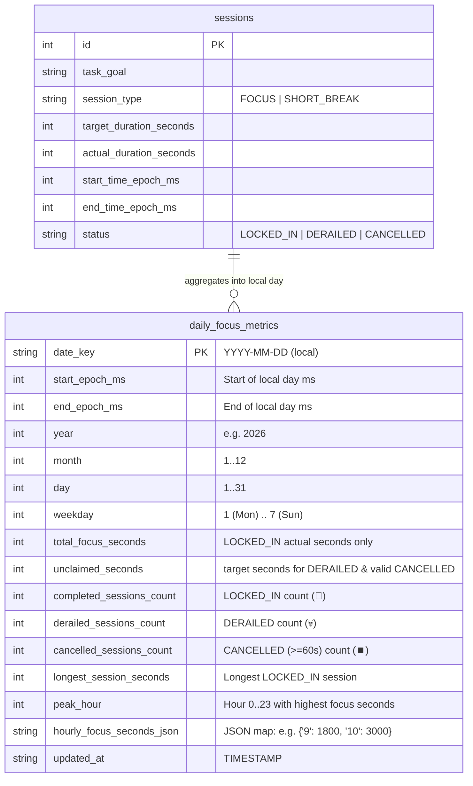

# Focusmaxxing Enhancement Specification: Granular Actionable Focus Insights (V3 Hardened)

**Status:** Approved & Finalized (Strict Binary Lock-In Architecture)  
**Target Area:** `lib/core/database/`, `lib/features/timer/data/`, `lib/features/insights/`  
**Database Impact:** SQLite `MigrationV3` (`DatabaseHelper.databaseVersion = 3` — introduces `daily_focus_metrics` with full 24-hour hourly breakdown, deep work records, and transactional synchronization)

---

## 1. Executive Summary & Core Decisions

### Problem Statement
Currently, [`InsightsPage`](file:///C:/Users/darkn/IdeaProjects/focusmaxxing/lib/features/insights/presentation/pages/insights_page.dart) only displays today's raw focus minutes, today's completed session count, the current streak, and a flat 7-day session log. Users have zero long-term visibility into their focus habits: no multi-day trends (`7D`, `30D`, `1Y`, `ALL`), no quality breakdown (`Locked In` vs `Derailed` vs `Cancelled`), no visibility into unclaimed time left on the table ("Could've Locked In"), and no granular data on when they actually perform best (peak hours and powerhouse days).

### Core Architectural Decisions: Strict Binary Lock-In

1. **Strict Binary Attribution ("Lock In or Bust" — Zero Partial Credit)**:
   - In alignment with Focusmaxxing's brand and ADHD behavioral psychology, **only `LOCKED_IN` focus sessions contribute to focus minutes, daily goals, and streaks**.
   - No participation trophies: If a user cancels early via Hold-to-Cancel or checks in as `DERAILED 💀 (Got Distracted)`, they earn **0 focus minutes**. 
   - Eliminating partial credit removes the moral hazard of quitting early (e.g. quitting at minute 18 of a 25-minute Pomodoro) and matches the existing codebase logic in [`InsightsRepositoryImpl`](file:///C:/Users/darkn/IdeaProjects/focusmaxxing/lib/features/insights/data/repositories/insights_repository_impl.dart#L31-L36).

2. **The "Could've Locked In" Ghost Bar (Unclaimed Focus Time)**:
   - Any `DERAILED` session and any valid `CANCELLED` session ($\ge 60$s) adds its **full planned `target_duration_seconds` to `unclaimed_seconds`**.
   - Visualized as a translucent "ghost extension" stacked above solid focus bars on the trend chart, confronting the user with the exact focus potential they surrendered to distraction or quitting.
   - Accidental starts and misclicks (`status == 'CANCELLED' && actual_duration_seconds < 60`, including `0s` initializations) are completely ignored.
   - Unclaimed ghost bars are visually scaled on the chart with a ceiling of `max(dailyGoalMinutes * 1.5, actualMinutes * 2)` to prevent repeated abandoned timers from distorting chart scales.

3. **Persistent `daily_focus_metrics` Rollup Table (`MigrationV3`)**:
   - Stores pre-aggregated daily summaries in SQLite: clean `total_focus_seconds`, `unclaimed_seconds`, session outcome counts (`completed`, `derailed`, `cancelled`), `longest_session_seconds`, and a full 24-hour hourly distribution JSON (`hourly_focus_seconds_json`).
   - Populated via an automated, transactional backfill from `sessions` during `MigrationV3.up`.

4. **Atomic Transactional Synchronization (Zero Desync)**:
   - When a session ends or updates in [`SessionLocalDataSource`](file:///C:/Users/darkn/IdeaProjects/focusmaxxing/lib/features/timer/data/datasources/session_local_data_source.dart), the update to `sessions` and the re-aggregation into `daily_focus_metrics` occur inside a single **SQLite transaction** (`db.transaction`).
   - Guarantees 100% ACID consistency: no partial writes, no dual-write desynchronization, and zero orphaned records.

5. **True Hourly Granularity (00:00 - 23:00)**:
   - Daily records store `hourly_focus_seconds_json` (e.g. `{"9": 1800, "10": 2700, "14": 1500}`).
   - Enables exact peak-hour identification (e.g. *"Peak Hour: 10:00 AM - 11:00 AM"*), dynamic morning/afternoon/evening/night rollups without schema limitations, and future productivity heatmaps.

6. **Mobile-First Chart UX & Scrubbable 30-Day View**:
   - **`7D`**: 7 daily bars (rolling 7 days), wide, legible, and directly tappable.
   - **`30D`**: 30 daily bars with **horizontal touch scrub interaction** (`onHorizontalDragUpdate` / `onTapDown` scrubber) and 5-day step labels (`1`, `5`, `10`, `15`, `20`, `25`, `30`), solving the physical limitation of tapping 7px bars with a human thumb.
   - **`1Y`**: 12 monthly bars querying `GROUP BY year, month` directly in SQLite in `< 1ms`.
   - **`ALL`**: Adaptive lifetime view (daily if $\le 30$ days, monthly if $> 30$ days).

7. **Statistically Sound "Powerhouse Pattern"**:
   - Requires $\ge 10$ completed focus sessions across $\ge 2$ distinct calendar weeks before unlocking `bestWeekday` and `peakTimeWindow`.
   - `bestWeekday` is ranked by **total focus volume** across all occurrences of that weekday (with frequency tie-breaker), preventing a single 1-off Sunday session from stealing the title from 20 productive Mondays.

8. **Lifetime Pro Gating ($9.99 Tier)**:
   - `7D` is free for all users. `30D`, `1Y`, `ALL`, and `Powerhouse Pattern` are gated behind `BillingNotifier.isProUnlocked`.
   - Non-Pro users see gold `PRO` badges on extended toggles and a locked teaser state on the `Powerhouse Pattern` card, opening `LifetimeProBanner` on tap.

---

## 2. Database Schema & Migration V3 Design



### 2.1 `MigrationV3` Table Definition (`lib/core/database/migrations/migration_v3.dart`)
```sql
CREATE TABLE IF NOT EXISTS daily_focus_metrics (
  date_key TEXT PRIMARY KEY,
  start_epoch_ms INTEGER NOT NULL,
  end_epoch_ms INTEGER NOT NULL,
  year INTEGER NOT NULL,
  month INTEGER NOT NULL,
  day INTEGER NOT NULL,
  weekday INTEGER NOT NULL,
  total_focus_seconds INTEGER NOT NULL DEFAULT 0,
  unclaimed_seconds INTEGER NOT NULL DEFAULT 0,
  completed_sessions_count INTEGER NOT NULL DEFAULT 0,
  derailed_sessions_count INTEGER NOT NULL DEFAULT 0,
  cancelled_sessions_count INTEGER NOT NULL DEFAULT 0,
  longest_session_seconds INTEGER NOT NULL DEFAULT 0,
  peak_hour INTEGER,
  hourly_focus_seconds_json TEXT NOT NULL DEFAULT '{}',
  updated_at TIMESTAMP DEFAULT CURRENT_TIMESTAMP
);

CREATE INDEX IF NOT EXISTS idx_daily_focus_metrics_epoch
  ON daily_focus_metrics (start_epoch_ms DESC);

CREATE INDEX IF NOT EXISTS idx_daily_focus_metrics_year_month
  ON daily_focus_metrics (year, month);

CREATE INDEX IF NOT EXISTS idx_daily_focus_metrics_weekday
  ON daily_focus_metrics (weekday, total_focus_seconds DESC);

CREATE INDEX IF NOT EXISTS idx_daily_focus_metrics_peak
  ON daily_focus_metrics (total_focus_seconds DESC, start_epoch_ms DESC);
```

### 2.2 Shared Aggregator & Transactional Sync
1. **`DailyMetricsAggregator.aggregateDay(DateTime dayStart, List<SessionModel> sessions)`**:
   - Filter out `SHORT_BREAK` sessions.
   - Filter out quick-cancels (`status == 'CANCELLED' && actualDurationSeconds < 60`).
   - For `status == 'LOCKED_IN'`:
     - Add `actualDurationSeconds` to `total_focus_seconds`.
     - Increment `completed_sessions_count`.
     - Update `longest_session_seconds = max(longest_session_seconds, actualDurationSeconds)`.
     - Add `actualDurationSeconds` to the session's local start hour (`0..23`) in the hourly distribution.
   - For `status == 'DERAILED'`:
     - Increment `derailed_sessions_count`.
     - Add `targetDurationSeconds` to `unclaimed_seconds`.
   - For `status == 'CANCELLED'` (with `actualDurationSeconds >= 60`):
     - Increment `cancelled_sessions_count`.
     - Add `targetDurationSeconds` to `unclaimed_seconds`.
   - Calculate `peak_hour` (hour with highest focus seconds, null if zero focus).
   - Serialize non-zero hourly slots to `hourly_focus_seconds_json`.
2. **Atomic Runtime Sync**:
   - In `SessionLocalDataSource.updateSessionStatus`, execute within `db.transaction((txn) async { ... })`:
     - Update the `sessions` row.
     - Query all `FOCUS` sessions for that local calendar day.
     - Compute `DailyFocusMetricsModel` via `DailyMetricsAggregator`.
     - Upsert (`ConflictAlgorithm.replace`) into `daily_focus_metrics`.
3. **Migration V3 Backfill**:
   - In `MigrationV3.up(db)`, query all existing `FOCUS` rows from `sessions`, group by local calendar day, run `DailyMetricsAggregator`, and batch-insert into `daily_focus_metrics`.

---

## 3. High-Performance Granular SQL Queries

Because metrics are persisted with structured calendar columns and indexed timestamps, long-range aggregations run directly in SQLite at sub-millisecond speeds:

### 3.1 7D / 30D Daily Buckets
```sql
SELECT * FROM daily_focus_metrics 
WHERE start_epoch_ms >= ? AND start_epoch_ms <= ?
ORDER BY start_epoch_ms ASC;
```

### 3.2 1Y Monthly Rollups (12 Aggregated Rows Instantaneously)
```sql
SELECT 
  year,
  month,
  SUM(total_focus_seconds) as total_focus_seconds,
  SUM(unclaimed_seconds) as unclaimed_seconds,
  SUM(completed_sessions_count) as completed_count,
  SUM(derailed_sessions_count) as derailed_count,
  SUM(cancelled_sessions_count) as cancelled_count,
  MAX(total_focus_seconds) as peak_day_seconds,
  COUNT(CASE WHEN total_focus_seconds > 0 THEN 1 END) as active_days_count
FROM daily_focus_metrics
WHERE start_epoch_ms >= ?
GROUP BY year, month
ORDER BY year ASC, month ASC;
```

### 3.3 Powerhouse Best Weekday (Weighted Volume & Consistency)
```sql
SELECT 
  weekday,
  SUM(total_focus_seconds) as total_focus_seconds,
  COUNT(CASE WHEN total_focus_seconds > 0 THEN 1 END) as active_days,
  SUM(completed_sessions_count) as completed_sessions
FROM daily_focus_metrics
WHERE total_focus_seconds > 0
GROUP BY weekday
ORDER BY total_focus_seconds DESC;
```

---

## 4. Domain Entities & Calculations

### 4.1 Domain Entities (`lib/features/insights/domain/entities/`)

#### 1. `InsightsPeriod` enum
- `days7` (`7D`, free)
- `days30` (`30D`, Pro)
- `year1` (`1Y`, Pro)
- `allTime` (`ALL`, Pro)

#### 2. `DailyFocusBucketEntity`
- `final String bucketKey` (`YYYY-MM-DD` or `YYYY-MM`)
- `final DateTime startDate`
- `final DateTime endDate`
- `final String shortLabel`
- `final String fullLabel`
- `final int focusMinutes` (`(totalFocusSeconds / 60).round()`)
- `final int unclaimedMinutes` (`(unclaimedSeconds / 60).round()`)
- `final int potentialMinutes` (`focusMinutes + unclaimedMinutes`)
- `final int completedSessionsCount` (🚀)
- `final int derailedSessionsCount` (💀)
- `final int cancelledSessionsCount` (⏹️)
- `final int attemptedSessionsCount` (`completed + derailed + cancelled`)
- `final int longestSessionMinutes`
- `final int? peakHour` (`0..23`)
- `final Map<int, int> hourlyFocusMinutes` (Hour $\rightarrow$ Minutes)
- `final bool isPeakInPeriod`

#### 3. `FocusTimeWindow` enum
- `morning` (`05:00–11:59`, label: `'Morning'`)
- `afternoon` (`12:00–16:59`, label: `'Afternoon'`)
- `evening` (`17:00–20:59`, label: `'Evening'`)
- `night` (`21:00–04:59`, label: `'Late Night'`)

#### 4. `FocusInsightsEntity`
- **Period-Scoped Metrics (`7D`, `30D`, `1Y`, `ALL`)**:
  - `final InsightsPeriod period`
  - `final int calendarDaysInPeriod`
  - `final List<DailyFocusBucketEntity> chartBuckets`
  - `final int periodFocusMinutes`
  - `final int periodUnclaimedMinutes`
  - `final int periodCompletedSessions`
  - `final int periodDerailedSessions`
  - `final int periodCancelledSessions`
  - `final int periodAttemptedSessions`
  - `final int dailyAverageMinutes`
  - `final int activeDayAverageMinutes`
  - `final int activeDaysCount`
  - `final int? lockInRatePercent` (`completed / attempted * 100`)
  - `final DailyFocusBucketEntity? periodPeakBucket`
- **All-Time Personal Records**:
  - `final DailyFocusBucketEntity? allTimePeakDay`
  - `final int longestStreakDays` (authoritative from session history + shield)
  - `final int? bestWeekday` (`1` = Mon .. `7` = Sun; null if $< 10$ sessions or $< 2$ weeks)
  - `final int bestWeekdayTotalMinutes`
  - `final FocusTimeWindow? peakTimeWindow` (null if $< 10$ sessions or $< 2$ weeks)
  - `final int? overallPeakHour` (most frequent all-time peak hour `0..23`)

---

## 5. Edge Cases & Canonical Rules Matrix

| # | Edge Case | Canonical Rule |
|---|---|---|
| **EC-1** | **Accidental Quick-Cancels (`< 60s`)** | Any `FOCUS` session with `status == 'CANCELLED'` and `actual_duration_seconds < 60` is completely excluded from database metrics and session history. |
| **EC-2** | **Strict Binary Lock-In (Zero Partial Credit)** | If a session is CANCELLED early or marked DERAILED at check-in, actual duration is not counted toward focus time (0 minutes credited). Instead, its full target duration becomes unclaimed time (ghost bar), preserving the hardcore accountability and commitment stakes of Focusmaxxing. |
| **EC-3** | **Ghost Bar Scale Capping** | Unclaimed minutes in UI charts are visually capped at `max(dailyGoalMinutes * 1.5, actualMinutes * 2)` to prevent abandoned timers from distorting the chart scale. |
| **EC-4** | **30D Mobile Scrubbing** | 30D renders 30 daily bars with horizontal drag scrub (`onHorizontalDragUpdate`) and 5-day step labels (`1, 5, 10, 15...`) so users inspect stats smoothly without tiny tap targets. |
| **EC-5** | **Powerhouse Sample Threshold** | Require $\ge 10$ completed focus sessions and $\ge 2$ distinct calendar weeks before displaying `bestWeekday` and `peakTimeWindow`. Rank `bestWeekday` by total focus minutes. |
| **EC-6** | **Midnight-Crossing Sessions** | Sessions are bucketed by the local calendar day of `start_time_epoch_ms` (`AppDateUtils.getStartOfDay`), matching streak calculation. |
| **EC-7** | **Zero-Data State** | Brand-new users see `dailyAverage = 0`, `lockInRate = null` (`"--"`), `allTimePeakDay = null` (`"No record yet"`), and `Powerhouse = null` (`"Complete 10 sessions to unlock"`). |
| **EC-8** | **Ties for Peak Bucket** | When multiple buckets tie for highest `focusMinutes > 0`, the most recent date wins deterministically. |
| **EC-9** | **DST-Safe Date Arithmetic** | Never step days by adding/subtracting `Duration(days: 1)`. Always use calendar constructors `DateTime(y, m, d + offset)`. |
| **EC-10** | **Deterministic Testing** | `getFocusInsights` accepts an optional `DateTime? referenceDate` for deterministic unit testing. |

---

## 6. UI Layout & Component Blueprint

```
┌──────────────────────────────────────────────────────────┐
│ AppBar: Insights & Settings              [PRO SUPPORTER] │
├──────────────────────────────────────────────────────────┤
│ TODAY'S MOMENTUM                                         │
│ ┌─────────────────────────┐  ┌─────────────────────────┐ │
│ │ 45 / 60 MINS      [75%] │  │ 2                       │ │
│ │ ▓▓▓▓▓▓▓▓▓▓▓▓░░░░        │  │ Sessions Finished       │ │
│ │ Locked In Today         │  │ +12m vs daily avg       │ │
│ └─────────────────────────┘  └─────────────────────────┘ │
│                                                          │
│ FOCUS TRENDS            [ 7D | 30D🔒 | 1Y🔒 | ALL🔒 ]  │
│ ┌──────────────────────────────────────────────────────┐ │
│ │ Tue, Oct 20 • 75m Locked In · +25m Unclaimed  🏆 PEAK│ │
│ │ 3 🚀 Locked In · 1 💀 Derailed · Peak: 10 AM (45m)   │ │
│ │                                                      │ │
│ │       👑                                             │ │
│ │       ░░ (Ghost: +25m unclaimed)                     │ │
│ │       ██          ░░                                 │ │
│ │  -- --██-- -- -- -██- -- -- (60m Goal Line)          │ │
│ │  ██   ██   ██     ██   ██                            │ │
│ │  M    T    W   T   F    S   S   (30D uses scrub bar) │ │
│ └──────────────────────────────────────────────────────┘ │
│                                                          │
│ PERFORMANCE HIGHLIGHTS                                   │
│ ┌─────────────────────────┐  ┌─────────────────────────┐ │
│ │ 📊 DAILY AVERAGE (7D)   │  │ 🏆 MOST FOCUSED DAY     │ │
│ │ 52 MINS                 │  │ 120 MINS     [ALL-TIME] │ │
│ │ 68m/day on 5 active days│  │ Oct 14, 2026 · 4 sess   │ │
│ └─────────────────────────┘  └─────────────────────────┘ │
│ ┌─────────────────────────┐  ┌─────────────────────────┐ │
│ │ 🎯 SESSION OUTCOMES (7D)│  │ ⚡ POWERHOUSE    [PRO]  │ │
│ │ 75% LOCKED IN           │  │ TUESDAYS (or 🔒 Teaser) │ │
│ │ 3🚀 1💀 0⏹️ · +25m left │  │ 420m total · 10 AM Peak │ │
│ └─────────────────────────┘  └─────────────────────────┘ │
│                                                          │
│ CURRENT STREAK                                           │
│ ┌──────────────────────────────────────────────────────┐ │
│ │ 🔥 CURRENT STREAK: 5 DAYS           [🏆 BEST: 14D]  │ │
│ │ 🛡️ Weekly Streak Shield Active                      │ │
│ │ [x] Streak Tracking                                  │ │
│ │ [ ] Include Weekends in Streak                       │ │
│ └──────────────────────────────────────────────────────┘ │
│                                                          │
│ RECENT SESSIONS                                          │
│ ┌──────────────────────────────────────────────────────┐ │
│ │ 🚀 Write architecture RFC            25m · Locked In │ │
│ └──────────────────────────────────────────────────────┘ │
│                                                          │
│ CONFIG & PREFERENCES                                     │
│ ┌──────────────────────────────────────────────────────┐ │
│ │ 🎯 Daily Focus Goal             [ 30m 60m 90m 120m ] │ │
│ │ 🔔 Daily Focus Reminder                        [Off] │ │
│ │ 🎨 Focus Accent Color                                │ │
│ └──────────────────────────────────────────────────────┘ │
└──────────────────────────────────────────────────────────┘
```

---

## 7. Agent Execution Plan (Modular Work Packages)

### WP1: SQLite `MigrationV3`, `daily_focus_metrics` Table & Transactional Sync
- **Objective**: Create `daily_focus_metrics` table with hourly breakdown JSON, bump `DatabaseHelper.databaseVersion = 3`, create `MigrationV3` with automated backfill, and wrap session status updates in atomic SQLite transactions.
- **Files to Create / Modify**:
  1. **Create** `lib/features/insights/data/models/daily_focus_metrics_model.dart`:
     - Model matching `daily_focus_metrics` schema with `fromMap`, `toMap`, and `DailyMetricsAggregator` enforcing strict binary attribution (only `LOCKED_IN` gets focus credit, `DERAILED` and valid `CANCELLED` populate `unclaimed_seconds`), 24-hour distribution, and peak hours.
  2. **Create** `lib/core/database/migrations/migration_v3.dart`:
     - Creates `daily_focus_metrics` and indexes.
     - Backfills all valid `FOCUS` sessions grouped by local calendar day inside the migration transaction.
  3. **Modify** [`lib/core/database/database_helper.dart`](file:///C:/Users/darkn/IdeaProjects/focusmaxxing/lib/core/database/database_helper.dart):
     - Bump `databaseVersion = 3`, add `tableDailyFocusMetrics = 'daily_focus_metrics'`, add `MigrationV3` to `MigrationRunner`.
  4. **Modify** [`lib/features/timer/data/datasources/session_local_data_source.dart`](file:///C:/Users/darkn/IdeaProjects/focusmaxxing/lib/features/timer/data/datasources/session_local_data_source.dart):
     - Wrap `updateSessionStatus` in `db.transaction`, recomputing that day's `daily_focus_metrics` and saving atomically.
     - Add `getMetricsForDateRange(int startMs, int endMs)` and `getAllMetrics()` query methods.
  5. **Create** `test/core/database/migration_v3_and_daily_metrics_test.dart`:
     - Verify v2 $\rightarrow$ v3 upgrade backfill, transactional single-day sync, zero partial credit for cancelled/derailed, 24-hour JSON map, and `< 60s` filter.
- **Verification**: `flutter test test/core/database/migration_v3_and_daily_metrics_test.dart` passes 100%.

---

### WP2: Domain Entities, Repository Implementation & Edge-Case Unit Tests
- **Objective**: Implement domain entities (`InsightsPeriod`, `DailyFocusBucketEntity`, `FocusInsightsEntity`) and implement `InsightsRepositoryImpl.getFocusInsights` using the granular database metrics.
- **Files to Create / Modify**:
  1. **Create** `lib/features/insights/domain/entities/daily_focus_bucket_entity.dart` and `lib/features/insights/domain/entities/focus_insights_entity.dart`.
  2. **Modify** [`lib/features/insights/domain/repositories/i_insights_repository.dart`](file:///C:/Users/darkn/IdeaProjects/focusmaxxing/lib/features/insights/domain/repositories/i_insights_repository.dart):
     - Add `Future<Either<Failure, FocusInsightsEntity>> getFocusInsights(...)` and optional `DateTime? referenceDate` to `getRecentSessions`.
  3. **Create** `lib/features/insights/domain/usecases/get_focus_insights_usecase.dart`.
  4. **Modify** [`lib/features/insights/data/repositories/insights_repository_impl.dart`](file:///C:/Users/darkn/IdeaProjects/focusmaxxing/lib/features/insights/data/repositories/insights_repository_impl.dart):
     - Query `daily_focus_metrics` for `7D`, `30D`, `1Y` (via SQL monthly aggregation), and `ALL`.
     - Filter accidental quick-cancels (`< 60s`) from `getRecentSessions`.
     - Compute `Powerhouse Pattern` (Best Weekday by total volume, Peak Time Window, and Peak Hour) with the $\ge 10$ sessions / $\ge 2$ weeks threshold.
  5. **Modify** [`test/features/insights/data/insights_repository_impl_test.dart`](file:///C:/Users/darkn/IdeaProjects/focusmaxxing/test/features/insights/data/insights_repository_impl_test.dart):
     - Full unit test coverage for EC-1 through EC-10.
- **Verification**: `flutter test test/features/insights/data/insights_repository_impl_test.dart` passes 100%.

---

### WP3: State Management (`InsightsNotifier` & DI Wiring)
- **Objective**: Wire `GetFocusInsightsUseCase`, `InsightsPeriod` state, and daily goal preferences into `InsightsNotifier` and `main.dart`.
- **Files to Modify**:
  1. **Modify** [`lib/features/insights/presentation/notifiers/insights_notifier.dart`](file:///C:/Users/darkn/IdeaProjects/focusmaxxing/lib/features/insights/presentation/notifiers/insights_notifier.dart):
     - Inject `GetFocusInsightsUseCase`.
     - Manage `selectedPeriod` (`InsightsPeriod`), `dailyGoalMinutes`, and `focusInsights`.
  2. **Modify** [`lib/main.dart`](file:///C:/Users/darkn/IdeaProjects/focusmaxxing/lib/main.dart):
     - Register `GetFocusInsightsUseCase` and wire into `InsightsNotifier`.
  3. **Modify** [`test/features/insights/presentation/insights_notifier_test.dart`](file:///C:/Users/darkn/IdeaProjects/focusmaxxing/test/features/insights/presentation/insights_notifier_test.dart).
- **Verification**: `flutter test test/features/insights/presentation/insights_notifier_test.dart` passes 100%.

---

### WP4: UI Widgets (`FocusTrendCard`, `InsightsHighlightsGrid`, `StreakCard`, `InsightsPage`)
- **Objective**: Build mobile-friendly chart widgets with touch scrub for 30D, highlights grid with peak hour insights, and Pro gating.
- **Files to Create / Modify**:
  1. **Create** `lib/features/insights/presentation/widgets/focus_trend_card.dart`:
     - 4-period selector (`7D | 30D | 1Y | ALL`) with Pro lock icons and bottom-sheet triggers.
     - Stacked bar chart with ghost unclaimed extensions and capped scaling.
     - Touch scrub interaction for 30D with floating/header inspector displaying locked in minutes, unclaimed minutes, and peak hour.
  2. **Create** `lib/features/insights/presentation/widgets/insights_highlights_grid.dart`:
     - 4 cards: `Daily Average`, `Most Focused Day`, `Session Outcomes`, and Pro-gated `Powerhouse Pattern` (Best Weekday + Peak Hour Window).
  3. **Modify** [`lib/features/insights/presentation/widgets/streak_card.dart`](file:///C:/Users/darkn/IdeaProjects/focusmaxxing/lib/features/insights/presentation/widgets/streak_card.dart):
     - Display `"🏆 BEST: X DAYS"` pill.
  4. **Modify** [`lib/features/insights/presentation/pages/insights_page.dart`](file:///C:/Users/darkn/IdeaProjects/focusmaxxing/lib/features/insights/presentation/pages/insights_page.dart):
     - Embed `FocusTrendCard`, `InsightsHighlightsGrid`, goal progress in `_MomentumRow`, and daily goal selector in preferences.

---

### WP5: Widget Tests & Regression Verification
- **Objective**: Full widget test coverage and zero regression verification.
- **Files to Modify**:
  1. [`test/features/insights/presentation/insights_page_test.dart`](file:///C:/Users/darkn/IdeaProjects/focusmaxxing/test/features/insights/presentation/insights_page_test.dart)
  2. [`test/features/insights/presentation/widgets/streak_card_test.dart`](file:///C:/Users/darkn/IdeaProjects/focusmaxxing/test/features/insights/presentation/widgets/streak_card_test.dart)
- **Verification**:
  - `flutter analyze` (0 issues).
  - `flutter test test/features/insights/` (100% pass).
