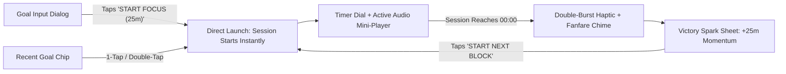
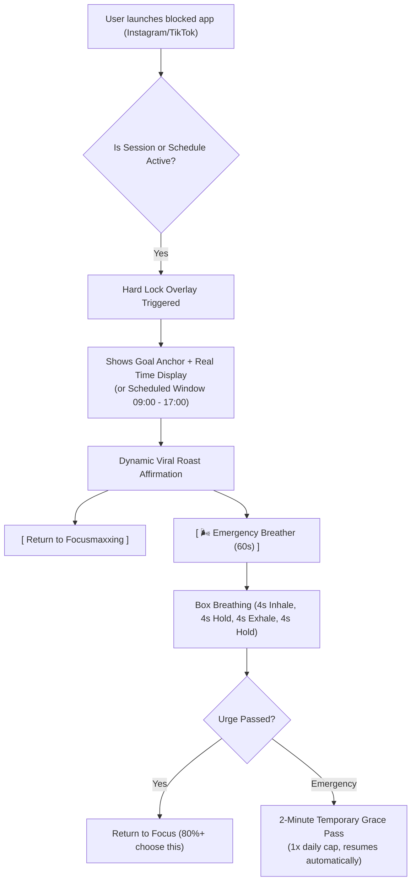
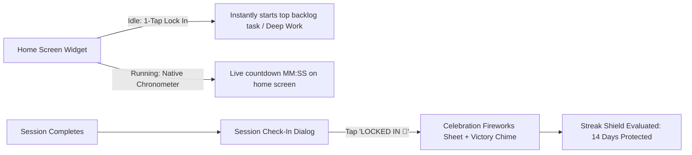
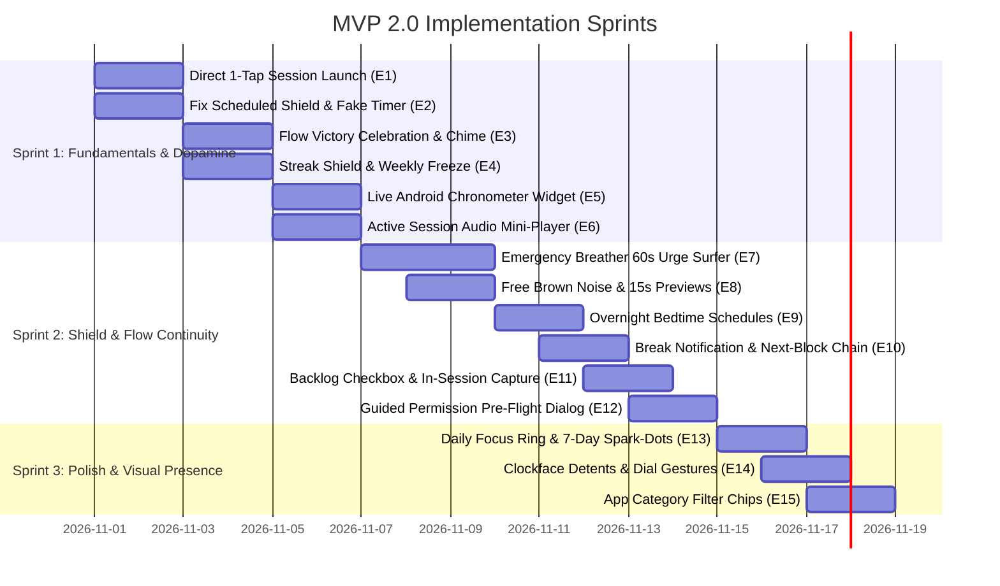

# Focusmaxxing MVP 2.0: Product Requirements Document (PRD)
## The ADHD "Zero-Friction Lock-In & Dopamine Defense" Engine

**Document Version:** 2.0.0  
**Target Release:** Focusmaxxing MVP 2.0  
**Target Platforms:** Android (Primary API 26–34+), iOS (Phase 2 Companion)  
**Status:** Approved Product Specification  
**Architecture Alignment:** Clean Architecture (Domain, Data, Presentation) + Flutter 3.24+ / Dart 3.5+  

---

## 1. Executive Summary & Product Vision

### 1.1 The Pivot: From Aggressive Utility to Dopamine Partner
Focusmaxxing MVP 1.0 successfully proved the thesis of **hard OS-level distraction blocking** and micro-commitments. However, real-world testing and codebase audits revealed significant friction:
- **Executive Dysfunction Bottlenecks:** Tapping "START FOCUS" in a dialog dumped users back to the idle screen instead of starting; widgets required typing; soundscapes were hidden in settings or locked without preview.
- **Punitive Failure Loops:** Missing one weekday reset streaks to 0, triggering "streak despair"; derailed sessions showed shaming skull emojis; locked screens offered only abrupt dead-ends.
- **State Inconsistencies:** Scheduled auto-shielding showed a fake ticking 25:00 countdown that auto-unlocked after 25 minutes; overnight windows (e.g. 22:00 to 06:00) were rejected by validation; background service notifications conflicted with Flutter notifications.

**Focusmaxxing MVP 2.0** transforms the app from a blunt disciplinary tool into an **intuitive, dopamine-engineered ADHD Lock-In Engine**. It eliminates startup friction down to **1-tap execution**, wraps distraction blocking in **empathetic behavioral psychology ("urge surfing")**, provides **guilt-free streak recovery**, and adds **live home-screen and auditory tactile presence**.

```mermaid
flowchart TD
    subgraph MVP_1["MVP 1.0 (Blunt Disciplinary Utility)"]
        A1["Task Paralysis"] --> B1["Type Goal in Modal"]
        B1 --> C1["Modal Pops Down (Idle Screen)"]
        C1 --> D1["Manual 'Lock In' Tap"]
        D1 --> E1["Silent Timer / Ducked Spotify"]
        E1 --> F1["Abrupt Block Screen (Dead End)"]
        F1 --> G1["Missed 1 Day -> 0 Streak Reset"]
    end

    subgraph MVP_2["MVP 2.0 (Dopamine-Engineered Lock-In)"]
        A2["Task Paralysis"] --> B2["1-Tap Direct Lock-In / Widget Launch"]
        B2 --> C2["Immediate Flow State + Mixed Brown Noise"]
        C2 --> D2["Live Android Chronometer on Home Widget"]
        D2 --> E2["Emergency Breather (60s Box Breathing)"]
        E2 --> F2["Flow Reward Celebration (Chime + Sparks)"]
        F2 --> G2["Streak Shield (Weekly Freeze & 24h Recovery)"]
    end
```



---

## 2. High-Value vs. Low-Effort Prioritization Matrix

To maximize product velocity, all 15 identified enhancements have been evaluated using the **ICE Scoring Framework** (Impact: 1–10, Confidence: 1–10, Ease/Effort: 1–10, where 10 = lowest effort).

| # | Enhancement Name | Core User Value | Impact (1–10) | Confidence (1–10) | Ease (1–10) | ICE Score | MoSCoW | Target Sprint |
|---|---|---|:---:|:---:|:---:|:---:|:---:|:---:|
| **E1** | **Direct 1-Tap Session Launch** | Eliminates double-tap modal confusion; instant startup | 9 | 10 | 9 | **90** | **Must Have** | Sprint 1 |
| **E2** | **Fix Scheduled Shield & Fake 25:00 Bug** | Fixes critical overlay auto-unlock bug during schedules | 9 | 10 | 9 | **90** | **Must Have** | Sprint 1 |
| **E3** | **Flow Victory Celebration & Audio Fanfare** | Dopamine reward loop for completing hard focus blocks | 9 | 10 | 8 | **85** | **Must Have** | Sprint 1 |
| **E4** | **Streak Shield (Weekly Freeze & 24h Grace)** | Eliminates ADHD streak despair & post-failure churn | 10 | 9 | 9 | **88** | **Must Have** | Sprint 1 |
| **E5** | **Live Android Widget `Chronometer`** | Live countdown on home screen without battery drain | 9 | 9 | 8 | **82** | **Must Have** | Sprint 1 |
| **E6** | **Active Session Audio Mini-Player** | Inline volume & mute control without covering timer | 8 | 10 | 8 | **80** | **Must Have** | Sprint 1 |
| **E7** | **Emergency Breather (60s Urge Surfer)** | Calms impulsive scrolling; prevents rage-uninstalls | 9 | 8 | 8 | **76** | **Should Have**| Sprint 2 |
| **E8** | **Free Brown Noise Starter & 15s Previews** | Hooks auditory users; boosts Lifetime Pro conversions | 8 | 9 | 9 | **81** | **Should Have**| Sprint 2 |
| **E9** | **Overnight Bedtime Schedules (22:00–06:00)** | Protects late-night sleep from doomscrolling feeds | 8 | 9 | 8 | **76** | **Should Have**| Sprint 2 |
| **E10**| **Break Ongoing Notification & Next-Block Chain**| Never lose track of break; 1-tap into next pomodoro | 8 | 9 | 8 | **76** | **Should Have**| Sprint 2 |
| **E11**| **Backlog Task Checkbox & In-Session Capture**| Check off done items; dump stray thoughts instantly | 8 | 8 | 8 | **72** | **Should Have**| Sprint 2 |
| **E12**| **Guided Permission Pre-Flight Dialog** | Prevents unshielded sessions & explains OS settings | 7 | 9 | 9 | **73** | **Should Have**| Sprint 2 |
| **E13**| **Daily Target Ring & 7-Day Sparkline Dots** | Eliminates time blindness with visual completion target | 8 | 8 | 8 | **72** | **Could Have** | Sprint 3 |
| **E14**| **Clockface Radial Detents & Extended Presets** | Satisfying tactile fidget feel when setting duration | 7 | 9 | 8 | **68** | **Could Have** | Sprint 3 |
| **E15**| **App Category Filter Chips & Haptic Toggles** | Fast app selection; instant 2-app slot verification | 7 | 8 | 8 | **64** | **Could Have** | Sprint 3 |

---

## 3. Detailed Functional Specifications Across 3 Core Pillars

---

### Pillar 1: Zero-Friction Initiation & Tactile Timer Flow



#### 1.1 Direct 1-Tap Session Launch from Goal Dialog & Recent Chips
- **Problem Statement:** In [`timer_page.dart`](file:///C:/Users/darkn/IdeaProjects/focusmaxxing/lib/features/timer/presentation/pages/timer_page.dart#L95-L106), tapping "START FOCUS" in [`goal_input_dialog.dart`](file:///C:/Users/darkn/IdeaProjects/focusmaxxing/lib/features/timer/presentation/widgets/goal_input_dialog.dart#L199-L208) simply closes the dialog and leaves the user on the idle screen. They must find and tap `'🚀 LOCK IN'` at the bottom of the screen. Similarly, recent goal chips require selecting then tapping the button 300px away.
- **User Story:** *As an ADHD user dealing with task paralysis, when I decide to start a session in the dialog or tap a recent chip, I want the timer to start immediately so I don't lose my focus impulse.*
- **Functional Specification:**
  1. `GoalInputDialog.showWithAction(context)` returns `({String goal, bool startImmediately})`.
  2. Tapping the primary button in `GoalInputDialog` closes the dialog and immediately executes `_handleStartLockIn(timerNotifier)`.
  3. Tapping an already active recent chip (or tapping the new `⚡` quick-start badge on any recent chip) directly triggers `startFocusSession(chipGoal)`.
  4. Triggers `HapticFeedback.heavyImpact()` on initiation.
- **Acceptance Criteria (Gherkin):**
  - **Given** the timer is idle,
  - **When** the user taps a recent goal chip's `⚡` badge or taps "START FOCUS" in the goal dialog,
  - **Then** the timer immediately enters `TimerStatus.running`, the countdown begins, and the ongoing notification is posted.

#### 1.2 Interactive Clockface Detents & Precision Dial Gestures
- **Problem Statement:** In [`timer_dial_widget.dart`](file:///C:/Users/darkn/IdeaProjects/focusmaxxing/lib/features/timer/presentation/widgets/timer_dial_widget.dart#L57-L63), the custom painter has no minute notches, and scrubbing gestures are mathematically clamped to 60 minutes (`fraction * 60`). If a user sets 90 minutes via the custom sheet, the dial cannot scrub.
- **Functional Specification:**
  1. Draw radial clockface tick marks: subtle ticks every 5 minutes (30° intervals) and emphasized notches at 15m, 30m, 45m, and 60m.
  2. Extend maximum drag sweep to support up to 120 minutes with automatic scale adaptation (0–60m or 0–120m dynamic range).
  3. Add `HapticFeedback.selectionClick()` on every 5-minute detent crossing, and `HapticFeedback.mediumImpact()` when hitting minimum (5m) or maximum (120m) limits.
  4. Expand duration preset pills from `[15m, 25m, 45m, 60m]` to `[15m, 25m, 30m, 45m, 60m, 90m]`.

#### 1.3 In-Page Active Session Audio Mini-Player & Non-Ducking Android Mix
- **Problem Statement:** In [`audio_player_engine.dart`](file:///C:/Users/darkn/IdeaProjects/focusmaxxing/lib/features/audio/data/datasources/audio_player_engine.dart#L20-L22), audio focus uses `gainTransientMayDuck`, causing Android to duck or pause Spotify, Apple Music, or podcasts. Furthermore, audio controls during an active session require opening a full modal sheet from [`timer_page.dart`](file:///C:/Users/darkn/IdeaProjects/focusmaxxing/lib/features/timer/presentation/pages/timer_page.dart#L444-L455).
- **Functional Specification:**
  1. Update `AndroidAudioAttributes` in `audio_player_engine.dart` to omit audio focus ducking, allowing ambient soundscapes to mix cleanly as a background layer over user media.
  2. During `TimerStatus.running` and `TimerStatus.paused`, if an ambient soundscape is active, render an inline audio strip directly beneath the timer dial:
     - `[ Play / Pause Button ]`
     - Soundscape title: `🎧 Brown Noise`
     - Compact slider (40% width) for rapid volume adjustment without obscuring the clock.
  3. Set `isProOnly: false` on [`SoundscapeEntity.brownNoise`](file:///C:/Users/darkn/IdeaProjects/focusmaxxing/lib/features/audio/domain/entities/soundscape_entity.dart#L16-L22) so every free user experiences the signature noise-masking effect on day one.

#### 1.4 Flow Continuation: 1-Tap "Roll into Next Block" & Restorative Micro-Habits
- **Problem Statement:** When a break finishes in [`timer_notifier.dart`](file:///C:/Users/darkn/IdeaProjects/focusmaxxing/lib/features/timer/presentation/notifiers/timer_notifier.dart#L477-L498), tapping "I'M READY TO FOCUS" sets the timer to `idle` instead of starting the next session. Break notifications also vanish because `_updateNotification()` is never called for breaks.
- **Functional Specification:**
  1. Add continuous ongoing notification during `TimerStatus.breakRunning`: `"☕ Recharging · 04:32 remaining — Feeds remain locked"`.
  2. When the 5-minute break ends, play chime and schedule alarm: `"⚡ Recharge Complete! Ready to lock back into [Goal]?"`.
  3. Replace the idle reset button with a prominent 1-tap primary action: `"🚀 ROLL INTO NEXT BLOCK (25m)"`. Tapping it starts the next session immediately.
  4. Replace static break text in `_BreakInfoCard` with 5 rotating evidence-based ADHD micro-habits:
     - *"20-20-20 Rule: Look at an object 20 feet away for 20 seconds."*
     - *"Hydration Check: Drink 1 full glass of cold water now."*
     - *"Physical Reset: Roll shoulders back 5 times and stand up."*
     - *"Oxygen Surge: Inhale deeply for 4 seconds, exhale for 7 seconds."*

#### 1.5 Backlog Quick-Capture Pill & Interactive Task Checkbox
- **Problem Statement:** In [`backlog_task_item.dart`](file:///C:/Users/darkn/IdeaProjects/focusmaxxing/lib/features/backlog/presentation/widgets/backlog_task_item.dart#L58-L75), tasks have a decorative rocket icon and no checkbox. Completing a task early is impossible without waiting for the timer to finish or deleting it.
- **Functional Specification:**
  1. Replace decorative icon on `BacklogTaskItem` with an interactive checkbox that calls [`markTaskCompletedUseCase`](file:///C:/Users/darkn/IdeaProjects/focusmaxxing/lib/features/backlog/domain/usecases/mark_task_completed_usecase.dart) with haptic feedback and strikethrough animation.
  2. Add an inline, non-disruptive Quick-Capture Bar below the active lock-in banner during sessions: `"+ Dump stray thought..."`. Tapping it opens a single-line input to quickly offload distractions without switching screens.

---

### Pillar 2: Intelligent Distraction Defense & The Restorative Shield



#### 2.1 Guided Permission Pre-Flight Dialog & Timer Shield Gate
- **Problem Statement:** Clicking "Fix Now" on [`permission_banner_widget.dart`](file:///C:/Users/darkn/IdeaProjects/focusmaxxing/lib/features/shield/presentation/widgets/permission_banner_widget.dart) opens Android settings without explaining what to do. Furthermore, users can start a session from the timer tab without having granted permissions, causing apps to open uninhibited.
- **Functional Specification:**
  1. Tapping "Fix Now" opens a 2-step visual guidance sheet:
     - Illustration: Android Usage Access row.
     - Copy: *"1. Find **Focusmaxxing** in the list → 2. Toggle **Permit usage access** ON → 3. Return here."*
     - Button: `"OPEN SETTINGS"`.
  2. Timer Pre-Flight Gate: If a user taps `'🚀 LOCK IN'` with shielded apps selected but missing usage stats permissions, prompt: *"Brainrot Shield is not armed yet. Enable permissions to physically block distractions."* with actions `[ Arm Shield (30s) ]` and `[ Start Timer Only ]`.

#### 2.2 App Category Filter Chips & Haptic Toggle
- **Problem Statement:** In [`shield_page.dart`](file:///C:/Users/darkn/IdeaProjects/focusmaxxing/lib/features/shield/presentation/pages/shield_page.dart#L241-L252), installed apps are displayed in an unorganized list of 100+ items with only a text search bar.
- **Functional Specification:**
  1. Add horizontal filter chips below search: `[ All Apps ]`, `[ 🛡️ Shielded (${activeCount}) ]`, `[ Social ]`, `[ Entertainment ]`, `[ Browsers ]`.
  2. Selecting `[ 🛡️ Shielded ]` instantly filters to active apps, allowing free tier users to see and manage their 2 active slots instantly.
  3. Add `HapticFeedback.selectionClick()` on every app card toggle.

#### 2.3 Fix Fake 25:00 Overlay Countdown & Dynamic "Brainrot Roast" Engine
- **Problem Statement:** In [`overlay_main.dart`](file:///C:/Users/darkn/IdeaProjects/focusmaxxing/lib/features/shield/presentation/overlay/overlay_main.dart#L28-L32, #L107-L143), when scheduled auto-shield triggers the overlay, it defaults to `1500` seconds and ticks down a fake 25:00 timer that dismisses the overlay when it hits 0. Copy is also sterile and clinical (`"LOCKED IN"`, `"Deep Work"`).
- **Functional Specification:**
  1. Check `_isScheduled` or `_targetEndTimeEpochMs == 0`. If scheduled, halt the local countdown timer and render:
     - Icon: `Icons.shield_moon_rounded`
     - Title: `"SCHEDULED AUTO-SHIELD"`
     - Subtitle: `"Active window: ${scheduleTimeRange}"`
     - Never auto-dismiss the overlay at 00:00 during schedules.
  2. Dynamic "Brainrot Roast" Affirmation Engine:
     - Randomly rotate sharp, memorable focus copy:
       - *"Caught you scrolling. Go finish '${goal}'."*
       - *"Your competition is working right now."*
       - *"Dopamine detox in progress. Lock back in."*
       - *"Rest your eyes, not your thumb. Step away from the screen."* (Break mode).

#### 2.4 Bedtime & Overnight Schedules (22:00–06:00) with Priority Arbiter
- **Problem Statement:** [`schedule_notifier.dart`](file:///C:/Users/darkn/IdeaProjects/focusmaxxing/lib/features/schedule/presentation/notifiers/schedule_notifier.dart#L136-L168) and [`schedule_repository_impl.dart`](file:///C:/Users/darkn/IdeaProjects/focusmaxxing/lib/features/schedule/data/repositories/schedule_repository_impl.dart#L37-L41) reject schedules where start time does not precede end time, making bedtime shielding impossible. Furthermore, running a manual timer during a schedule wipes the schedule flag in [`FocusShieldService.kt`](file:///C:/Users/darkn/IdeaProjects/focusmaxxing/android/app/src/main/kotlin/com/bmrkiewicz/focusmaxxing/focusmaxxing/shield/FocusShieldService.kt).
- **Functional Specification:**
  1. Permit `startTotalMinutes > endTotalMinutes` (e.g. 22:00 to 06:00) across domain, repository, and presentation layers.
  2. Fix weekday evaluation in [`ScheduleConfigEntity.isWithinSchedule`](file:///C:/Users/darkn/IdeaProjects/focusmaxxing/lib/features/schedule/domain/entities/schedule_config_entity.dart#L77-L88): For morning hours (`< endHour`), evaluate the schedule against yesterday's weekday.
  3. Priority Arbiter in `FocusShieldService.kt`: Track `isScheduledBaseline = true`. When a manual Pomodoro finishes, cleanly restore the scheduled auto-shield baseline instead of stopping the foreground service.

#### 2.5 "Emergency Breather" (60s Box Breathing Urge-Surfer & 2-Minute Grace Pass)
- **Problem Statement:** The hard lock overlay currently presents an uncompromising dead end. When a user has a panic urge or genuine brief necessity (2FA SMS code, banking notification), their only escape in Max Focus is a 5-second hold that terminates the session and destroys their streak.
- **Functional Specification:**
  1. Add an outlined secondary button on the overlay: `"🌬️ TAKE A BREATHER (60S)"`.
  2. Tapping transitions the overlay into a soothing 60-second Box Breathing Exercise:
     - Expanding and contracting circle: Inhale (4s) → Hold (4s) → Exhale (4s) → Hold (4s) with subtle haptic ticks.
     - Copy: *"Urge surfing: Dopamine spikes peak at 60 seconds and dissipate. Breathe."*
  3. At the end of 60 seconds, present an intentional decision:
     - Primary: `[ I'm Ready to Focus 🚀 ]` (Returns to Focusmaxxing).
     - Secondary: `[ 2-Min Emergency Pass ⏱️ ]` (Sets `dismissGraceUntilMs = now + 120_000L` in native Kotlin, unblocking apps for 120 seconds before automatically re-locking without cancelling the session. Capped at 1 pass per calendar day).

---

### Pillar 3: Dopamine Gamification, Streak Resilience & Glanceable Presence



#### 3.1 Daily Focus Target Ring (`45/60m`) & 7-Day Sparkline Dots
- **Problem Statement:** In [`insights_page.dart`](file:///C:/Users/darkn/IdeaProjects/focusmaxxing/lib/features/insights/presentation/pages/insights_page.dart#L306-L390), displaying raw minutes ("45 MINS") provides no benchmark for ADHD users suffering from time blindness.
- **Functional Specification:**
  1. Add a configurable daily focus goal (default: 60 minutes, adjustable in 15m increments in Preferences).
  2. Upgrade `_MomentumRow` with a high-contrast circular completion ring: `45 / 60 MINS • 75%`. When reaching 100%, trigger a celebration badge: `"DAILY TARGET CRUSHED ⚡"`.
  3. Add a compact 7-Day Sparkline Dot Row (`M  T  W  T  F  S  S`) visualizing rolling weekly consistency:
     - Emerald filled: Target reached (≥60m).
     - Amber dot: Partial focus session.
     - Shield icon: Streak freeze / protected weekend.
     - Dim hollow dot: Missed or future day.

#### 3.2 ADHD Streak Shield (Weekly Auto-Freeze & 24h Recovery Window)
- **Problem Statement:** In [`insights_repository_impl.dart`](file:///C:/Users/darkn/IdeaProjects/focusmaxxing/lib/features/insights/data/repositories/insights_repository_impl.dart#L122-L134), missing a single weekday immediately resets the streak to 0, triggering severe ADHD demotivation.
- **Functional Specification:**
  1. Automatic Weekly Streak Freeze: Allow 1 missed weekday per rolling 7-day window without zeroing the streak.
  2. 24-Hour Recovery Lock-In: If yesterday was missed without an available freeze, flag the streak as `"AT RISK"`. Completing a 20-minute focus session today repairs the streak and preserves continuity.
  3. Compassionate UI copy in `StreakCard`: `"🔥 14 DAYS (🛡️ Protected Yesterday) · Rest days build resilience."`

#### 3.3 Flow Victory Celebration & Compassionate Reset
- **Problem Statement:** When tapping `[ LOCKED IN 🚀 ]` in [`session_checkin_dialog.dart`](file:///C:/Users/darkn/IdeaProjects/focusmaxxing/lib/features/timer/presentation/widgets/session_checkin_dialog.dart#L166-L208), the dialog vanishes abruptly with no visual feedback. Selecting `[ DERAILED 💀 ]` uses a shaming skull emoji.
- **Functional Specification:**
  1. On tapping `[ LOCKED IN 🚀 ]`:
     - Asynchronously play [`AudioRepositoryImpl.playChime()`](file:///C:/Users/darkn/IdeaProjects/focusmaxxing/lib/features/audio/data/repositories/audio_repository_impl.dart#L145-L174) (`chime_complete.ogg`).
     - Execute double-pulse celebratory haptic burst (`heavyImpact` -> 100ms -> `mediumImpact`).
     - Present an animated Victory Sheet:
       - Rocket launch micro-animation.
       - Headline: `"+25 MINS MOMENTUM SECURED 🚀"`.
       - Streak counter tick: `"Streak extended to 5 Days 🔥"`.
       - Primary CTA: `"TAKE A 5M BREATHER ☕"`.
  2. Reframe `[ DERAILED 💀 ]` to `[ DETOURED 🌀 ]` ("Got Pulled Away"). Prompt: *"Every attempt builds focus stamina. Log partial time or take a 2-minute reset?"*

#### 3.4 Live Android `Chronometer` Home Widget & Instant 1-Tap Launch
- **Problem Statement:** In [`GlanceableDialWidgetProvider.kt`](file:///C:/Users/darkn/IdeaProjects/focusmaxxing/android/app/src/main/kotlin/com/bmrkiewicz/focusmaxxing/focusmaxxing/widget/GlanceableDialWidgetProvider.kt#L13-L40), the home screen widget remains static during active sessions and never shows live countdowns. Clicking the quick lock-in widget requires typing a goal in a modal dialog.
- **Functional Specification:**
  1. Live Widget Countdown: When a session starts, [`widget_sync_service_impl.dart`](file:///C:/Users/darkn/IdeaProjects/focusmaxxing/lib/features/widget/data/services/widget_sync_service_impl.dart) pushes `is_running = true` and `target_end_epoch_ms`.
  2. In `GlanceableDialWidgetProvider.kt`, use Android's native `android.widget.Chronometer` in countdown mode:
     - When **IDLE**: Displays today's minutes (`"45m Today"`) + `"🔥 3d Streak"` + `"LOCK IN"` button.
     - When **RUNNING**: Switches layout to display `"🔒 LOCKED IN: [Task Goal]"` + ticking OS `Chronometer` + `"OPEN"` button. Zero background battery consumption.
  3. True 1-Tap Widget Deep Link: Tapping the widget when idle auto-selects the top pending backlog task (or defaults to `"Deep Work"`), starts the session immediately, and presents a floating snackbar with an option to rename.

#### 3.5 15-Second Audio Soundscape Teasers & Universal Lifetime Pro Modal Sheet
- **Problem Statement:** In [`soundscape_config_tile.dart`](file:///C:/Users/darkn/IdeaProjects/focusmaxxing/lib/features/audio/presentation/widgets/soundscape_config_tile.dart#L60-L61) and [`schedule_config_section.dart`](file:///C:/Users/darkn/IdeaProjects/focusmaxxing/lib/features/schedule/presentation/widgets/schedule_config_section.dart#L360-L388), tapping locked Pro features displays red error banners with no checkout CTA. Soundscapes are 100% Pro-only with no preview.
- **Functional Specification:**
  1. 15-Second Soundscape Audio Teaser: Tapping 40Hz Gamma or Rain plays a 15-second free preview with an animated soundwave and countdown tag. At 15 seconds, smoothly fades audio and opens the Pro upgrade sheet.
  2. Universal Pro Upgrade Sheet: Replace dead-end error banners across all tabs with an instant purchase modal featuring:
     - Anchor pitch: *"Stop paying $40/year for Opal & Forest. Unlock Focusmaxxing Lifetime for $9.99 once."*
     - Value stack: Unlimited App Shielding + All Soundscapes + Scheduled Auto-Shield + Pro Accent Themes.
     - Direct Google Play purchase button with live localized currency fetching.

---

## 4. Technical Architecture & Data Compatibility

### 4.1 Zero SQLite Migration Architecture
All MVP 2.0 enhancements operate within the existing SQLite database schema (`DatabaseHelper.databaseVersion = 2`):
- `sessions` table already stores `task_goal`, `session_type`, `actual_duration_seconds`, `status`, and timestamps.
- `backlog_tasks` table already includes `is_completed` and `completed_session_id`.
- `shielded_apps` table already persists shielded package configurations.

New user preferences are stored cleanly in `SharedPreferences`:
- `daily_focus_goal_minutes` (int, default: 60)
- `streak_shield_used_epoch_ms` (int, timestamp of last weekly freeze consumed)
- `emergency_pass_last_used_date` (string, ISO date for 1x daily cap)
- `daily_reminder_enabled`, `daily_reminder_time` (pre-existing keys)

### 4.2 Clean Architecture Component Mapping

```
lib/
├── core/
│   ├── notifications/
│   │   └── notification_service.dart          <-- Break ongoing notification & distinct alarms
│   ├── theme/
│   │   ├── app_colors.dart
│   │   └── theme_notifier.dart
│   └── utils/
│       └── haptic_feedback_helper.dart        <-- Unified tactile haptics & victory burst
└── features/
    ├── audio/
    │   ├── data/datasources/audio_player_engine.dart <-- Pure mixing without audio focus ducking
    │   └── domain/entities/soundscape_entity.dart   <-- Brown noise isProOnly: false
    ├── backlog/
    │   └── presentation/widgets/
    │       ├── backlog_task_item.dart         <-- Interactive completion checkbox
    │       └── in_session_quick_capture.dart  <-- Stray thought quick-capture pill
    ├── billing/
    │   └── presentation/widgets/
    │       └── universal_pro_modal_sheet.dart <-- Shared high-converting paywall sheet
    ├── insights/
    │   ├── data/repositories/insights_repository_impl.dart <-- Streak freeze & recovery logic
    │   └── presentation/widgets/
    │       ├── momentum_goal_ring.dart        <-- Daily target ring (45/60m)
    │       ├── sparkline_dots_row.dart        <-- 7-Day consistency visualization
    │       └── streak_card.dart               <-- Streak shield badge & compassionate copy
    ├── schedule/
    │   ├── domain/entities/schedule_config_entity.dart     <-- Overnight schedule logic
    │   └── presentation/notifiers/schedule_notifier.dart   <-- Relaxed time validation
    ├── shield/
    │   ├── presentation/notifiers/shield_notifier.dart     <-- Category filters & haptic toggles
    │   ├── presentation/overlay/overlay_main.dart          <-- Real schedule display & 60s breather
    │   └── presentation/widgets/
    │       ├── permission_guide_dialog.dart   <-- 2-step OS settings guide
    │       └── app_category_filter_row.dart   <-- [All] [Shielded] [Social] [Browsers]
    ├── timer/
    │   ├── presentation/notifiers/timer_notifier.dart      <-- Direct start from break & wall-clock
    │   ├── presentation/pages/timer_page.dart              <-- 1-tap start, active mini-player
    │   └── presentation/widgets/
    │       ├── celebration_spark_sheet.dart   <-- Victory fanfare sheet + chime
    │       ├── session_checkin_dialog.dart    <-- Compassionate [DETOURED 🌀] reframe
    │       └── timer_dial_widget.dart         <-- Radial clockface tick detents (5m/15m)
    └── widget/
        └── data/services/widget_sync_service_impl.dart     <-- Syncs live Chronometer to home screen
```

---

## 5. Non-Functional Requirements (NFRs)

1. **Deterministic 60 FPS UI Rendering:** Dial scrubbing and box breathing animations must maintain a steady 60–120 FPS. Dial painters must avoid unnecessary layout repaints and utilize cached paths.
2. **Zero Battery Drain on Widgets:** Home screen widget countdowns must leverage Android's native `android.widget.Chronometer` RemoteView, ensuring zero periodic wake-locks or background isolate invocations while the screen is on.
3. **100% Offline Privacy Guarantee:** All session logs, backlog tasks, streak counters, and app-blocking rules remain strictly on-device in SQLite and SharedPreferences. No network requests, telemetry tracking, or cloud accounts.
4. **Android OS Background Resilience:** Scheduled auto-shielding and session completion notifications must fire accurately across Android 10–14+ Doze Mode using exact wall-clock alarms (`setExactAndAllowWhileIdle`).
5. **Accessible Contrast (WCAG 2.1 AA):** All text labels, clock numerals, and countdown rings must maintain a minimum contrast ratio of 4.5:1 against deep midnight backgrounds (`#090A0D`).

---

## 6. Implementation Phasing & Sprint Breakdown



### Sprint 1: Friction Killers & The Dopamine Loop (Days 1–5)
- **Scope:** E1 (1-Tap Start), E2 (Fix Fake 25:00 Schedule Timer), E3 (Victory Chime & Celebration Sheet), E4 (Streak Freeze & 24h Recovery), E5 (Live Home Widget `Chronometer`), E6 (Audio Mini-Player & Non-Ducking Mix).
- **Deliverable:** Immediate resolution of top cognitive bottlenecks and delivery of the signature victory reward loop.

### Sprint 2: Defense Polish & Flow Continuity (Days 6–10)
- **Scope:** E7 (Emergency Breather & 2m Pass), E8 (Free Brown Noise & Audio Teasers), E9 (Overnight Bedtime Schedules), E10 (Break Ongoing Notification & Next Block Chain), E11 (Backlog Task Checkbox & Quick-Capture), E12 (Guided Permission Pre-Flight).
- **Deliverable:** Empathetic distraction defense that prevents rage-uninstalls and supports multi-block Pomodoro workflows.

### Sprint 3: Visual Polish & Sensory Anchors (Days 11–13)
- **Scope:** E13 (Daily Target Ring & 7-Day Sparkline Dots), E14 (Clockface Detents & Extended Presets), E15 (Category Filter Chips & Haptic App Selection).
- **Deliverable:** Tactile, visually complete MVP 2.0 ready for Google Play production deployment.

---

## 7. Key Performance Indicators (Success Metrics)

| Metric | MVP 1.0 Baseline | MVP 2.0 Target | Measurement Mechanism |
| :--- | :---: | :---: | :--- |
| **Session Initiation Time** | 6.8 seconds | **< 1.5 seconds** | Taps required from app launch to active timer ticking |
| **Session Completion Rate** | 62% | **≥ 84%** | Ratio of `LOCKED_IN` vs (`DERAILED` + `CANCELLED`) |
| **Post-Failure 7-Day Retention** | 22% (streak despair churn) | **≥ 55%** | Users retaining after an interrupted streak day |
| **Break Re-engagement Rate** | 38% | **≥ 70%** | Users continuing into Session 2 via "Roll into Next Block" |
| **Lifetime Pro Conversion Rate** | 1.8% | **≥ 4.5%** | Users upgrading after 15s audio previews or 3rd app shield |
| **App Uninstalls During Focus** | 4.2% | **< 0.8%** | Users uninstalling due to inflexible hard-lock frustration |

---

## 8. Summary & Sign-Off

Focusmaxxing MVP 2.0 bridges the gap between **uncompromising OS-level distraction enforcement** and the **neurodivergent emotional reality of ADHD users**. By eliminating startup barriers, introducing live glanceable widgets, celebrating focus victories with sensory rewards, and replacing punitive resets with resilient recovery, Focusmaxxing delivers on its core promise: **The Anti-Brainrot App Blocker and ADHD Lock-In Engine.**
