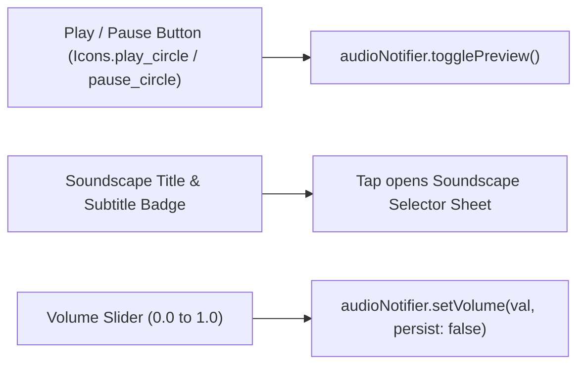
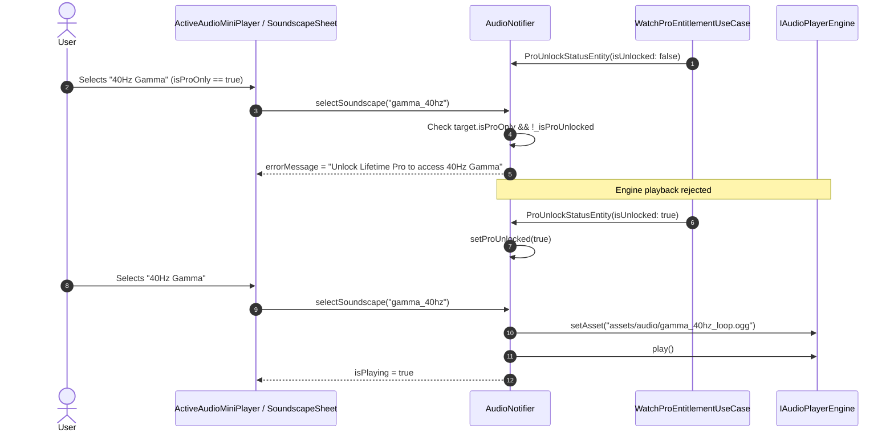

# Audio & Soundscapes Subsystem Specification

The Audio & Soundscapes engine provides offline auditory focus anchors designed to reduce ADHD auditory distractibility and household noise interruptions. The system delivers continuous, loopable OGG soundscapes configured to mix seamlessly with external media (Spotify, YouTube Music, podcasts) without ducking or pausing.

---

## 1. Architectural Architecture & Engine Pipeline

The audio subsystem is built on clean architecture, abstracting audio hardware via [`IAudioPlayerEngine`](file:///C:/Users/darkn/IdeaProjects/focusmaxxing/lib/features/audio/data/datasources/audio_player_engine.dart) backed by [`just_audio`](https://pub.dev/packages/just_audio) and [`audio_session`](https://pub.dev/packages/audio_session).

```mermaid
graph TD
    TN["TimerNotifier (Status Changes)"] -->|syncWithTimerStatus()| AN["AudioNotifier"]
    AN -->|"Play/Stop Soundscape"| AR["AudioRepositoryImpl"]
    AR --> APE["JustAudioPlayerEngine (IAudioPlayerEngine)"]
    
    subgraph AudioEngine["JustAudioPlayerEngine Pipeline"]
        APE --> AS["AudioSession.configure() (mixWithOthers, non-ducking)"]
        APE --> LP["Loop AudioPlayer (_loopPlayer) -> LoopMode.one"]
        APE --> CP["Chime AudioPlayer (_chimePlayer) -> One-shot Fanfare"]
    end

    AN -->|"Active State"| AMP["ActiveAudioMiniPlayer (In-Session UI)"]
    AMP -->|"Volume Drag"| AN
```

---

## 2. Bundled Offline Soundscape Catalog

All soundscape assets are pre-bundled within the application binary (`assets/audio/`) in compressed OGG Vorbis format, ensuring instant playback without network dependencies or data usage.

```
assets/audio/
├── brown_noise_loop.ogg    [Free Starter Tier]
├── gamma_40hz_loop.ogg     [Pro Gated]
├── rain_canvas_loop.ogg    [Pro Gated]
└── chime_complete.ogg      [System Fanfare]
```

### 2.1 Soundscape Entity Catalog Specifications

Defined in [`SoundscapeEntity`](file:///C:/Users/darkn/IdeaProjects/focusmaxxing/lib/features/audio/domain/entities/soundscape_entity.dart):

| ID | Title | Asset Path | Entitlement | Acoustic Purpose |
|:---|:---|:---|:---:|:---|
| `none` | **None** | `""` | Free | Silent focus; soundscape engine deactivated. |
| `brown_noise` | **Brown Noise** | `assets/audio/brown_noise_loop.ogg` | **Free Starter** | 6dB/octave spectral rolloff. Masks unpredictable office and household transient noises. |
| `gamma_40hz` | **40Hz Gamma** | `assets/audio/gamma_40hz_loop.ogg` | **Lifetime Pro** | Isochronic binaural beat entrainment targeting gamma band neural oscillations (38–42Hz). |
| `rain` | **Rain on Canvas** | `assets/audio/rain_canvas_loop.ogg` | **Lifetime Pro** | Stochastic white-pink spectrum mimicking natural rainfall. |
| `chime_complete` | **Completion Chime** | `assets/audio/chime_complete.ogg` | **System Global** | Ascending harmonic arpeggio signaling session completion. |

---

## 3. Non-Ducking Audio Session Configuration

Standard mobile audio engines duck (lower volume) or pause when background audio is detected. For ADHD users listening to instrumental playlists or podcasts, ducking creates severe sensory disruption.

Focusmaxxing configures low-level OS audio attributes in [`JustAudioPlayerEngine.configureAudioSession`](file:///C:/Users/darkn/IdeaProjects/focusmaxxing/lib/features/audio/data/datasources/audio_player_engine.dart#L45-L60):

```dart
final session = await AudioSession.instance;
await session.configure(
  const AudioSessionConfiguration(
    avAudioSessionCategory: AVAudioSessionCategory.playback,
    avAudioSessionCategoryOptions: AVAudioSessionCategoryOptions.mixWithOthers,
    androidAudioAttributes: AndroidAudioAttributes(
      contentType: AndroidAudioContentType.music,
      usage: AndroidAudioUsage.media,
    ),
    androidWillPauseWhenDucked: false,
  ),
);
```

### 3.1 Platform Audio Flags
- **`AVAudioSessionCategoryOptions.mixWithOthers`:** Informs the OS mixer that this audio channel coexists with existing media streams.
- **`androidWillPauseWhenDucked: false`:** Explicitly prevents Android AudioManager from lowering volume or pausing when navigation cues or external notifications occur.
- **Detached Player Future Handling:** `just_audio`'s `play()` future remains pending infinitely during looping (`LoopMode.one`). To avoid Zone uncaught rejection crashes upon abrupt stopping, [`JustAudioPlayerEngine.play`](file:///C:/Users/darkn/IdeaProjects/focusmaxxing/lib/features/audio/data/datasources/audio_player_engine.dart#L75-L83) decouples the call:
  ```dart
  unawaited(_resolvedLoopPlayer.play().catchError((Object _) {}));
  ```

---

## 4. Active Session Mini-Player (`ActiveAudioMiniPlayer.dart`)

When a focus session is active and a soundscape is selected (`!activeSoundscape.isNone`), [`ActiveAudioMiniPlayer`](file:///C:/Users/darkn/IdeaProjects/focusmaxxing/lib/features/timer/presentation/widgets/active_audio_mini_player.dart) renders inline directly beneath the dial without occluding timer controls.



### 4.1 Mini-Player Technical Attributes
- **Dimensions & Margin:** Horizontal margin `20px`, vertical padding `6px`, inner border radius `16px`.
- **Active State Glow:** Border switches to `colorScheme.primary.withValues(alpha: 0.4)` when `audioNotifier.isPlaying` is true.
- **Volume Slider Optimization:** While dragging the slider, `persist: false` is passed to prevent disk I/O thrashing on `SharedPreferences`. The volume is persisted to `ambient_audio_volume` only upon drag completion (`onChangeEnd`) via [`AudioNotifier.persistVolume`](file:///C:/Users/darkn/IdeaProjects/focusmaxxing/lib/features/audio/presentation/notifiers/audio_notifier.dart#L294-L299).

---

## 5. Pro Gating & Entitlement Synchronization

Soundscape access rules are enforced through reactive state management in [`AudioNotifier`](file:///C:/Users/darkn/IdeaProjects/focusmaxxing/lib/features/audio/presentation/notifiers/audio_notifier.dart):



### 5.1 Timer Lifecycle Audio Coupling
[`AudioNotifier.attachTimerNotifier`](file:///C:/Users/darkn/IdeaProjects/focusmaxxing/lib/features/audio/presentation/notifiers/audio_notifier.dart#L131-L152) listens directly to timer status transitions:
- `TimerStatus.running`: Starts active soundscape if configured.
- `TimerStatus.paused` / `TimerStatus.idle`: Halts playback immediately via `stop()`.
- `TimerStatus.completed` / `TimerStatus.breakCompleted`: Stops ambient loop and immediately fires one-shot celebration fanfare:
  ```dart
  await stop();
  await playChime(); // Invokes PlayChimeUseCase -> chime_complete.ogg
  ```
- `TimerStatus.breakRunning`: Ambient loop remains quiet by default to allow cognitive decompression.
