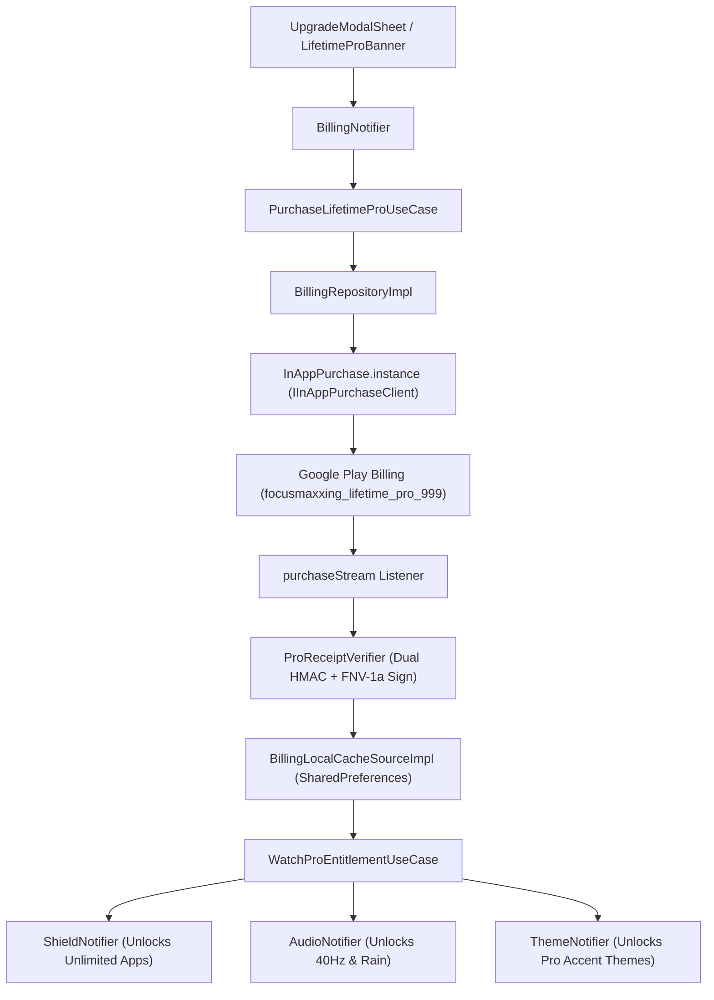
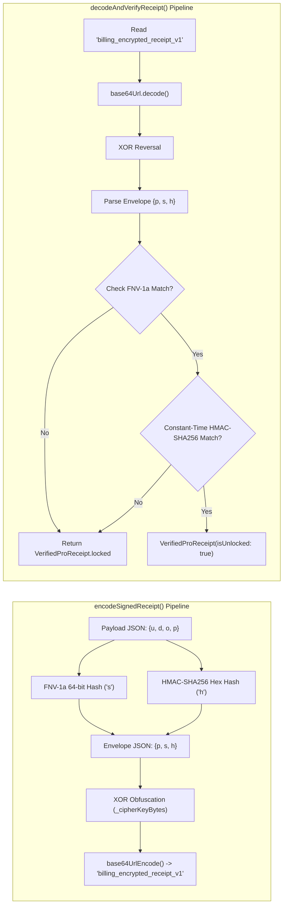
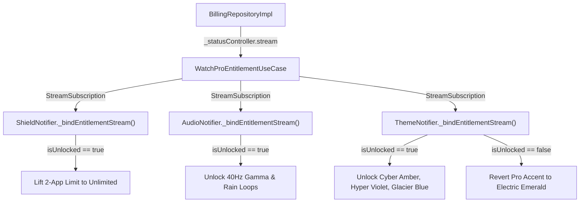

# Billing & Cryptographic Security Subsystem Specification

Focusmaxxing operates on an anti-predatory monetization model: a single, non-consumable **$9.99 Lifetime Pro** unlock. There are no recurring subscriptions, paywalled core timers, or telemetry paywalls. To protect the integrity of offline entitlement checks on rooted or tampered Android devices, the subsystem deploys dual-algorithm cryptographic receipt signing, XOR payload ciphering, and reactive entitlement streams.

---

## 1. Monetization Architecture & Product Contract

The in-app purchase system is implemented using the official Flutter [`in_app_purchase`](https://pub.dev/packages/in_app_purchase) plugin, interfacing with the Google Play Billing Library.



### 1.1 Product Specification
- **Product ID:** `focusmaxxing_lifetime_pro_999` ([`ProUnlockStatusEntity.lifetimeProProductId`](file:///C:/Users/darkn/IdeaProjects/focusmaxxing/lib/features/billing/domain/entities/pro_unlock_status_entity.dart#L7)).
- **Type:** Non-consumable in-app purchase.
- **Fallback Price:** `$9.99 USD` ([`ProProductDetailsEntity.fallback`](file:///C:/Users/darkn/IdeaProjects/focusmaxxing/lib/features/billing/domain/entities/pro_unlock_status_entity.dart#L104-L113)) used when Google Play Billing is initializing or offline.
- **Restore Support:** Handled via [`RestorePurchasesUseCase`](file:///C:/Users/darkn/IdeaProjects/focusmaxxing/lib/features/billing/domain/usecases/restore_purchases_usecase.dart) with an 8-second timeout guard to prevent UI lockups during network delays.

---

## 2. Cryptographic Receipt Verification (`ProReceiptVerifier.dart`)

On Android devices, users with root or memory-editing tools (e.g., Lucky Patcher, GameGuardian) frequently alter plaintext `SharedPreferences` boolean keys such as `is_pro_unlocked` or `is_lifetime_pro`.

Focusmaxxing ignores raw boolean values unless accompanied by a cryptographically valid, tamper-evident envelope verified by [`ProReceiptVerifier`](file:///C:/Users/darkn/IdeaProjects/focusmaxxing/lib/core/security/pro_receipt_verifier.dart).



### 2.1 Dual-Signature Algorithm Mechanics
1. **Payload Construction:** Contains unlock boolean `u`, purchase date epoch ms `d`, Google Play order ID `o`, and productId `p`:
   ```json
   {"u": true, "d": 1730462400000, "o": "GPA.1234-5678-9012-34567", "p": "focusmaxxing_lifetime_pro_999"}
   ```
2. **FNV-1a 64-bit Checksum:** Computes non-cryptographic fast integrity check:
   $$\text{hash} = (\text{hash} \oplus \text{byte}) \times 1099511628211$$
   Initialized with FNV offset basis `0xcbf29ce484222325`.
3. **HMAC-SHA256 Cryptographic Verification:** Computes 256-bit message authentication code using inner/outer padding ($ipad = 0x36$, $opad = 0x5C$) and a 24-byte embedded secret cipher key (`_cipherKeyBytes`).
4. **Constant-Time Comparison:** Prevents timing attacks when evaluating signatures via [`_constantTimeEquals`](file:///C:/Users/darkn/IdeaProjects/focusmaxxing/lib/core/security/pro_receipt_verifier.dart#L353-L364):
   ```dart
   static bool _constantTimeEquals(String a, String b) {
     if (a.length != b.length) return false;
     var result = 0;
     for (var i = 0; i < a.length; i++) {
       result |= a.codeUnitAt(i) ^ b.codeUnitAt(i);
     }
     return result == 0;
   }
   ```
5. **XOR Stream Obfuscation:** The final envelope JSON is transformed using cyclic byte-wise XOR against `_cipherKeyBytes`, preventing automated static analysis of XML string resources.

---

## 3. Encrypted Local Cache (`BillingLocalCacheSourceImpl.dart`)

All disk operations are centralized in [`BillingLocalCacheSourceImpl`](file:///C:/Users/darkn/IdeaProjects/focusmaxxing/lib/features/billing/data/datasources/billing_local_cache_source.dart):

| Preference Key | Value Format | Purpose |
|:---|:---|:---|
| `billing_encrypted_receipt_v1` | `base64url` XOR-ciphered envelope | Authoritative cryptographic entitlement proof. |
| `billing_purchase_date_ms` | `INTEGER` (Epoch Milliseconds) | Cache of purchase date for display. |
| `billing_order_id` | `STRING` (`GPA.xxxx-xxxx`) | Google Play Order Reference ID. |
| `is_pro_unlocked` | `BOOLEAN` | Fast UI sync flag (validated against encrypted receipt on start). |
| `is_lifetime_pro` | `BOOLEAN` | Cross-feature legacy flag for backwards compatibility. |

**Anti-Tampering Guard:** If a user edits `is_pro_unlocked` to `true` in XML, [`BillingLocalCacheSourceImpl.getProUnlockStatus`](file:///C:/Users/darkn/IdeaProjects/focusmaxxing/lib/features/billing/data/datasources/billing_local_cache_source.dart#L65-L84) invokes `ProReceiptVerifier.readVerifiedReceiptSync(prefs)`. Because `billing_encrypted_receipt_v1` is either absent or has an invalid HMAC signature, the cache returns `ProUnlockStatusEntity.locked`.

---

## 4. Reactive Entitlement Stream Decoupling

Subsystems must never directly couple to Google Play Billing classes. Instead, [`WatchProEntitlementUseCase`](file:///C:/Users/darkn/IdeaProjects/focusmaxxing/lib/features/billing/domain/usecases/watch_pro_entitlement_usecase.dart) exposes a broadcast `Stream<ProUnlockStatusEntity>`.



---

## 5. Dynamic Pro Accent Theming Engine

Lifetime Pro unlocks dynamic palette customization handled by [`ThemeNotifier`](file:///C:/Users/darkn/IdeaProjects/focusmaxxing/lib/core/theme/theme_notifier.dart) and [`ProAccentVariant`](file:///C:/Users/darkn/IdeaProjects/focusmaxxing/lib/core/theme/pro_accent_variant.dart):

```dart
enum ProAccentVariant {
  electricEmerald(id: 'electric_emerald', color: Color(0xFF00E676), isProOnly: false),
  cyberAmber(id: 'cyber_amber', color: Color(0xFFFFAB00), isProOnly: true),
  hyperViolet(id: 'hyper_violet', color: Color(0xFFB388FF), isProOnly: true),
  glacierBlue(id: 'glacier_blue', color: Color(0xFF38B6FF), isProOnly: true);
}
```

### 5.1 Revocation Defense
If a refund occurs or the entitlement stream emits `isUnlocked == false`, [`ThemeNotifier.validateProAccess`](file:///C:/Users/darkn/IdeaProjects/focusmaxxing/lib/core/theme/theme_notifier.dart#L82-L92) detects if the current accent is `isProOnly`. If true, it automatically resets the theme to `ProAccentVariant.electricEmerald`, removes `theme_accent_color` from preferences, and notifies UI listeners immediately.
