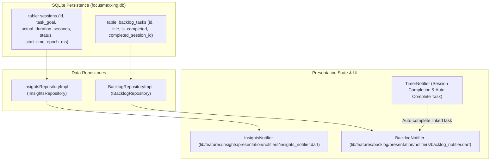
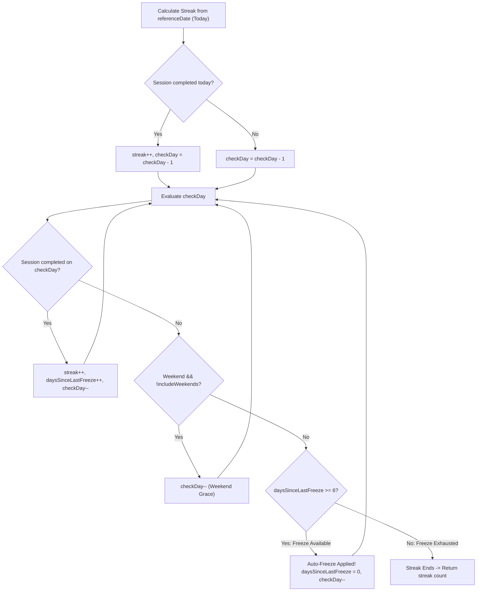
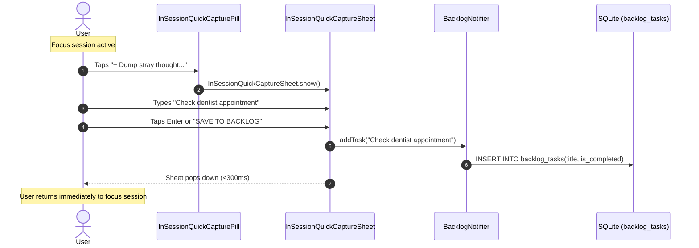

# Insights & Backlog Subsystem Specification

The Insights & Backlog subsystem provides low-shame momentum tracking and rapid cognitive offloading. Built to counteract ADHD working-memory deficits and streak despair, it combines resilience-engineered habit tracking, binary session reflection, an externalized task backlog, and in-session stray thought capture.

---

## 1. Architectural Architecture & Data Flow

Analytics and backlog persistence are backed by SQLite tables (`sessions` and `backlog_tasks`), queried through dedicated clean architecture repositories:



---

## 2. Today's Focus Metrics Aggregation

Daily accomplishments are summarized in [`DailySummaryEntity`](file:///C:/Users/darkn/IdeaProjects/focusmaxxing/lib/features/insights/domain/entities/daily_summary_entity.dart):
- `totalFocusMinutes`: Sum of `actual_duration_seconds` for all sessions where `session_type == 'focus'` and `status == 'locked_in'` between `00:00:00` and `23:59:59` of the target date.
- `completedSessionsCount`: Total number of successfully completed focus blocks today.
- `currentStreakDays`: Consecutive days of focus activity calculated with auto-freeze resilience.

---

## 3. Streak Resilience Engine (1-Day Weekly Auto-Freeze)

Traditional productivity trackers reset streaks to zero after a single missed day, triggering "streak despair" and app abandonment among ADHD users. Focusmaxxing deploys a **Streak Shield** algorithm in [`InsightsRepositoryImpl.calculateStreak`](file:///C:/Users/darkn/IdeaProjects/focusmaxxing/lib/features/insights/data/repositories/insights_repository_impl.dart#L94-L148).



### 3.1 Algorithm Invariant & Code Implementation
- **Weekend Grace:** When `includeWeekends == false` (configured via `insights_include_weekends`), Saturdays and Sundays are skipped without penalizing the streak.
- **Weekly Auto-Freeze:** A missed non-weekend day does not break the streak if at least 6 days of activity occurred since the prior freeze (`daysSinceLastFreeze >= 6`).
```dart
int daysSinceLastFreeze = 7;
while (true) {
  final isWeekend = AppDateUtils.isWeekend(checkDay);
  final hasCompleted = completedDays.contains(checkDay);

  if (hasCompleted) {
    streak++;
    daysSinceLastFreeze++;
    checkDay = DateTime(checkDay.year, checkDay.month, checkDay.day - 1);
  } else if (!includeWeekends && isWeekend) {
    checkDay = DateTime(checkDay.year, checkDay.month, checkDay.day - 1);
  } else if (daysSinceLastFreeze >= 6) {
    // Streak Shield: 1-Day Auto-Freeze allowed once per 7-day span
    daysSinceLastFreeze = 0;
    checkDay = DateTime(checkDay.year, checkDay.month, checkDay.day - 1);
  } else {
    break;
  }
}
```

---

## 4. Binary Check-In Session History

Rather than complex multi-variable rating forms, session evaluations are strictly binary:
- `LOCKED_IN` (`SessionStatus.lockedIn`): High focus achieved, momentum preserved.
- `DERAILED` (`SessionStatus.derailed`): Focus lost to distractions or fatigue. Low-shame logging records actual focused minutes without punitive failure screens.

### 4.1 SQLite Schema (`sessions` Table)
Defined in [`MigrationV1`](file:///C:/Users/darkn/IdeaProjects/focusmaxxing/lib/core/database/migrations/migration_v1.dart#L10-L22):
```sql
CREATE TABLE sessions (
  id INTEGER PRIMARY KEY AUTOINCREMENT,
  task_goal TEXT NOT NULL,
  session_type TEXT NOT NULL,
  target_duration_seconds INTEGER NOT NULL,
  actual_duration_seconds INTEGER NOT NULL,
  start_time_epoch_ms INTEGER NOT NULL,
  end_time_epoch_ms INTEGER NOT NULL,
  status TEXT NOT NULL,
  created_at TIMESTAMP DEFAULT CURRENT_TIMESTAMP
);
CREATE INDEX idx_sessions_start_time ON sessions (start_time_epoch_ms DESC);
CREATE INDEX idx_sessions_type_status_time ON sessions (session_type, status, start_time_epoch_ms DESC);
```

---

## 5. ADHD Backlog Scratchpad (`BacklogNotifier.dart`)

ADHD working memory struggles to hold multi-step todo lists. The Backlog acts as a frictionless holding pen for pending thoughts.

### 5.1 SQLite Schema (`backlog_tasks` Table)
```sql
CREATE TABLE backlog_tasks (
  id INTEGER PRIMARY KEY AUTOINCREMENT,
  title TEXT NOT NULL,
  is_completed INTEGER NOT NULL DEFAULT 0,
  completed_session_id INTEGER,
  created_at TIMESTAMP DEFAULT CURRENT_TIMESTAMP,
  completed_at TIMESTAMP,
  FOREIGN KEY(completed_session_id) REFERENCES sessions(id) ON DELETE SET NULL
);
CREATE INDEX idx_backlog_tasks_is_completed ON backlog_tasks (is_completed, id DESC);
CREATE INDEX idx_backlog_tasks_completed_session ON backlog_tasks (completed_session_id);
```

### 5.2 Task Selection as Session Goal Anchor
In [`BacklogModalSheet`](file:///C:/Users/darkn/IdeaProjects/focusmaxxing/lib/features/backlog/presentation/widgets/backlog_modal_sheet.dart), tapping a pending task invokes [`BacklogNotifier.selectTaskAsGoal(task)`](file:///C:/Users/darkn/IdeaProjects/focusmaxxing/lib/features/backlog/presentation/notifiers/backlog_notifier.dart#L45-L48) and passes the task ID to [`TimerNotifier.setTaskGoal(task.title, backlogTaskId: task.id)`](file:///C:/Users/darkn/IdeaProjects/focusmaxxing/lib/features/timer/presentation/notifiers/timer_notifier.dart#L143-L147).

---

## 6. In-Session Stray Thought Quick Capture

When ADHD users enter hyperfocus, intrusive unrelated thoughts ("Did I pay electric bill?", "Need to email Dave") threaten to derail attention. Switching apps to take notes breaks flow.

Focusmaxxing solves this with inline **Quick Capture**:



### 6.1 Automatic Task Completion Coupling
If a session was started with a linked backlog task (`_linkedBacklogTaskId != null`), completing the session with `lockedIn: true` triggers [`MarkTaskCompletedUseCase`](file:///C:/Users/darkn/IdeaProjects/focusmaxxing/lib/features/backlog/domain/usecases/mark_task_completed_usecase.dart) in [`TimerNotifier.checkInSession`](file:///C:/Users/darkn/IdeaProjects/focusmaxxing/lib/features/timer/presentation/notifiers/timer_notifier.dart#L445-L458):
```dart
if (lockedIn && taskId != null && completeTask != null) {
  await completeTask(id: taskId, sessionId: sessionId);
  unawaited(backlogNotifier?.loadPendingTasks(showLoading: false));
}
```
The task is automatically checked off in the backlog and linked to the completed session record via `completed_session_id`.
