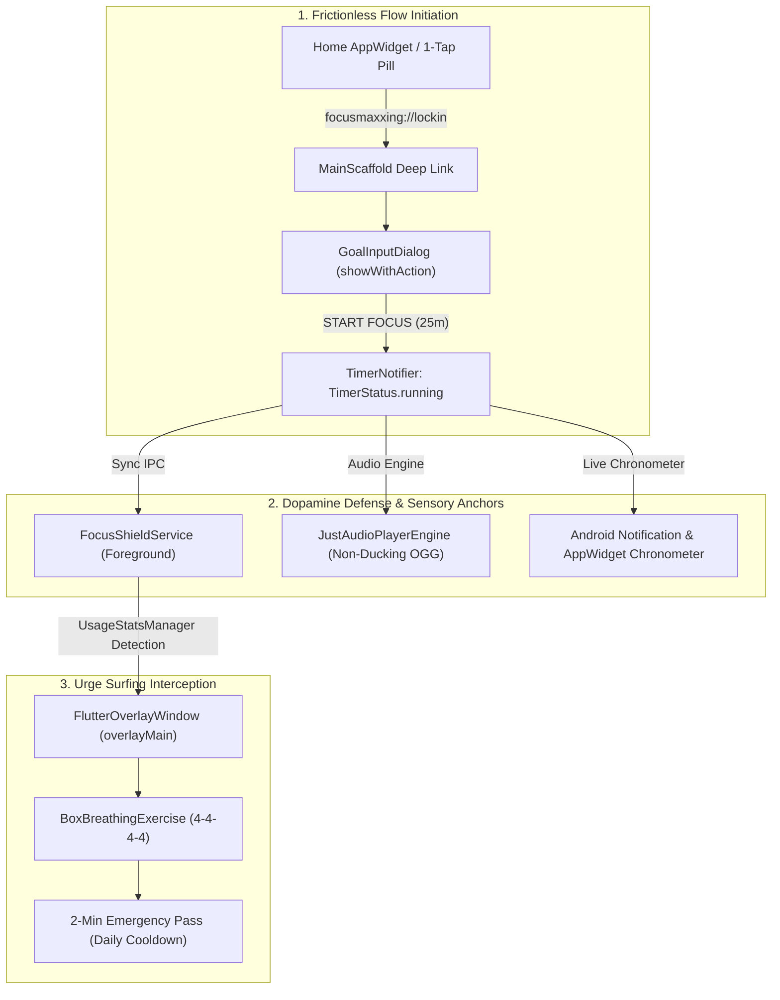
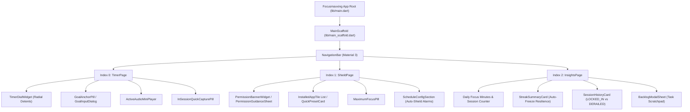

# Focusmaxxing Product & Architecture Overview

Focusmaxxing is an offline-first, ADHD-optimized focus orchestration platform built with Flutter (Dart 3.5+) and native Android (Kotlin / API 26–34+). Designed specifically for individuals prone to executive dysfunction, task paralysis, and dopamine-seeking app distraction, Focusmaxxing treats focus as an **artisanal digital instrument**: deterministic, tactile, friction-free, and resilient against user interruption.

---

## 1. Executive Summary & Design Philosophy

Traditional productivity software relies on guilt-based enforcement, repetitive confirmation steps, and complex hierarchical task setups. For neurodivergent minds, these friction points trigger cognitive fatigue and task avoidance before work begins. 

Focusmaxxing inverts this paradigm through two core principles:
1. **Zero-Friction Flow Initiation:** Reducing session startup to a single tap (via dialogs, recent goal pills, or Android home screen widgets) and eliminating post-tap idle states.
2. **Dopamine-Engineered Resistance:** Replacing abrasive failure loops with empathetic behavioural interventions ("urge surfing" box breathing), visual victory celebrations, guilt-free streak preservation, and hard OS-level distraction shielding.



---

## 2. Navigation & View Hierarchy

The top-level user experience is anchored by [`MainScaffold`](file:///C:/Users/darkn/IdeaProjects/focusmaxxing/lib/main_scaffold.dart), which coordinates the application lifecycle, deep-link routing from Android AppWidgets, and tab switching across an `IndexedStack` hosting 3 primary views:



### 2.1 Tab Index Contract

| Tab Index | View Component | File Location | Primary Responsibility |
|:---:|:---|:---|:---|
| `0` | [`TimerPage`](file:///C:/Users/darkn/IdeaProjects/focusmaxxing/lib/features/timer/presentation/pages/timer_page.dart) | [`lib/features/timer/presentation/pages/timer_page.dart`](file:///C:/Users/darkn/IdeaProjects/focusmaxxing/lib/features/timer/presentation/pages/timer_page.dart) | Focus dial scrubbing, goal anchoring, active soundscape control, hold-to-cancel safeguard, break habit cards. |
| `1` | [`ShieldPage`](file:///C:/Users/darkn/IdeaProjects/focusmaxxing/lib/features/shield/presentation/pages/shield_page.dart) | [`lib/features/shield/presentation/pages/shield_page.dart`](file:///C:/Users/darkn/IdeaProjects/focusmaxxing/lib/features/shield/presentation/pages/shield_page.dart) | App package blocking, 2-app free tier enforcement, Maximum Focus toggle, Scheduled Auto-Shield configuration. |
| `2` | [`InsightsPage`](file:///C:/Users/darkn/IdeaProjects/focusmaxxing/lib/features/insights/presentation/pages/insights_page.dart) | [`lib/features/insights/presentation/pages/insights_page.dart`](file:///C:/Users/darkn/IdeaProjects/focusmaxxing/lib/features/insights/presentation/pages/insights_page.dart) | Today's aggregate minutes, 1-day weekly auto-freeze streak engine, binary session history, ADHD backlog task sheet. |

---

## 3. Theme & Design Tokens

Focusmaxxing enforces an OLED-optimized dark theme engineered to minimize ocular strain and eliminate dopamine spikes triggered by high-luminance UI backgrounds. Tokens are defined in [`AppColors`](file:///C:/Users/darkn/IdeaProjects/focusmaxxing/lib/core/theme/app_colors.dart) and consumed systematically through [`AppTheme`](file:///C:/Users/darkn/IdeaProjects/focusmaxxing/lib/core/theme/app_theme.dart).

### 3.1 Color Token Palette

```
  Surface Palette (OLED-Black Base)
  ├── surfaceMidnight   [#090A0D] -> Deepest scaffold canvas background
  ├── surfaceRaised     [#13151B] -> Cards, dialogs, bottom sheets, search inputs
  ├── surfaceElevated   [#1B1E28] -> Elevated floating pills & active status banners
  └── surfaceHairline   [#222631] -> Thin 1px structural container borders

  Semantic Accent System
  ├── accentLockIn      [#00E676] -> Electric Emerald: Focus active, primary buttons, timer track
  ├── accentRestMode    [#38B6FF] -> Glacier Blue: Rest / break mode, eye recharge
  ├── accentHardLock    [#FF3B30] -> Crimson Alert: Hold-to-cancel, shield warnings, errors
  └── accentStreakGold  [#FFB800] -> Amber Gold: Daily streaks, momentum metrics, stars
```

### 3.2 Dynamic Pro Accent Variants

Lifetime Pro subscribers can dynamically alter the active application accent color via [`ThemeNotifier`](file:///C:/Users/darkn/IdeaProjects/focusmaxxing/lib/core/theme/theme_notifier.dart) and [`ProAccentVariant`](file:///C:/Users/darkn/IdeaProjects/focusmaxxing/lib/core/theme/pro_accent_variant.dart):

| Accent Variant | Hex Code | ID | Gating | Visual Purpose |
|:---|:---:|:---|:---:|:---|
| **Electric Emerald** | `#00E676` | `electric_emerald` | Free Standard | Default high-contrast focus state |
| **Cyber Amber** | `#FFAB00` | `cyber_amber` | Pro Only | High-intensity ADHD urgency |
| **Hyper Violet** | `#B388FF` | `hyper_violet` | Pro Only | Deep meditative and creative flow |
| **Glacier Blue** | `#38B6FF` | `glacier_blue` | Pro Only | Calm restorative focus |

---

## 4. User Personas & Core Use Cases

### 4.1 Persona 1: The ADHD Knowledge Worker (Alex, 29)
- **Profile:** Software engineer prone to context-switching. Sits down to code, opens Instagram or Reddit involuntarily while code compiles.
- **Pain Point:** Once derailed, 45 minutes evaporate before realizing focus was lost. Conventional blockers feel punitive and are easily bypassed.
- **Focusmaxxing Flow:** 
  1. Alex taps the Android home screen **Quick Lock-In** widget.
  2. Selects "Implement Auth Service" from recent goal chips.
  3. Timer starts immediately at 25 minutes; background Brown Noise begins playing through headphones without pausing IDE Spotify audio.
  4. When Alex reflexively taps Twitter, native [`FocusShieldService`](file:///C:/Users/darkn/IdeaProjects/focusmaxxing/android/app/src/main/kotlin/com/bmrkiewicz/focusmaxxing/focusmaxxing/shield/FocusShieldService.kt) intercepts the launch in <500ms and covers the screen with [`HardLockOverlayWidget`](file:///C:/Users/darkn/IdeaProjects/focusmaxxing/lib/features/shield/presentation/overlay/overlay_main.dart).
  5. Alex taps **Take a Breather (60s)**, completes 4 box breathing cycles, and returns to coding.

### 4.2 Persona 2: The Exam Crammer / Student (Maya, 21)
- **Profile:** University student preparing for finals. Suffers from task paralysis when facing large syllabi.
- **Pain Point:** Abandoning study sessions because missing a single study day resets streaks to zero, creating "streak despair".
- **Focusmaxxing Flow:**
  1. Maya uses the radial dial to dial in a quick 15-minute micro-commitment.
  2. Enables **Maximum Focus** mode, disabling all phone apps except emergency dialers.
  3. Uses **In-Session Stray Thought Quick Capture** (`+ Dump stray thought...`) whenever an unrelated idea interrupts her reading, offloading it to the Backlog.
  4. At session completion, a fanfare chime plays, celebration sparks animate, and Maya rolls immediately into the next block.
  5. Missing Saturday due to illness triggers the **1-day weekly auto-freeze**, maintaining her 12-day streak on Sunday.

---

## 5. Modular Specification Index

Detailed subsystem contracts, domain models, Kotlin native services, IPC bridges, and database schemas are documented in the following modular specifications:

| Document | Core Capabilities & Technical Topics |
|:---|:---|
| [`timer_and_lock_in.md`](file:///C:/Users/darkn/IdeaProjects/focusmaxxing/docs/product/timer_and_lock_in.md) | 1-tap direct launch (`showWithAction`), radial dial scrubbing with 5m detents, single vs continuous flow, 5s hold-to-cancel, celebration sheets, ongoing chronometer notifications, crash tombstones. |
| [`shield_and_interception.md`](file:///C:/Users/darkn/IdeaProjects/focusmaxxing/docs/product/shield_and_interception.md) | Native `FocusShieldService` loop, `UsageStatsManager` polling, 2-app free tier swap mutex, Maximum Focus phone lock, emergency dialer whitelist, 60s box breathing urge surfer, secondary Flutter overlay architecture. |
| [`audio_soundscapes.md`](file:///C:/Users/darkn/IdeaProjects/focusmaxxing/docs/product/audio_soundscapes.md) | Bundled offline OGG audio (Brown Noise, 40Hz Gamma, Rain, Chime), non-ducking audio session setup (`mixWithOthers`), active mini-player widget, Pro soundscape access gating. |
| [`billing_and_security.md`](file:///C:/Users/darkn/IdeaProjects/focusmaxxing/docs/product/billing_and_security.md) | One-time $9.99 Lifetime Pro in-app billing, HMAC-SHA256 & FNV-1a cryptographic receipt verification, XOR-obfuscated cache, Pro accent theming, entitlement stream decoupling. |
| [`scheduled_shield.md`](file:///C:/Users/darkn/IdeaProjects/focusmaxxing/docs/product/scheduled_shield.md) | Background Auto-Shield scheduling, `AutoShieldAlarmReceiver` exact RTC wakeup alarms, cross-midnight overnight schedules (22:00–06:00), priority baseline arbiter. |
| [`widgets_and_reminders.md`](file:///C:/Users/darkn/IdeaProjects/focusmaxxing/docs/product/widgets_and_reminders.md) | Android AppWidgets (`GlanceableDialWidgetProvider`, `QuickLockInWidgetProvider`), battery-neutral `RemoteViews.setChronometer`, deep linking (`focusmaxxing://lockin`), local daily reminders. |
| [`insights_and_backlog.md`](file:///C:/Users/darkn/IdeaProjects/focusmaxxing/docs/product/insights_and_backlog.md) | Daily focus metrics aggregation, 1-day weekly auto-freeze streak algorithm, binary session check-in (`LOCKED_IN` vs `DERAILED`), ADHD backlog scratchpad, in-session thought dump. |
