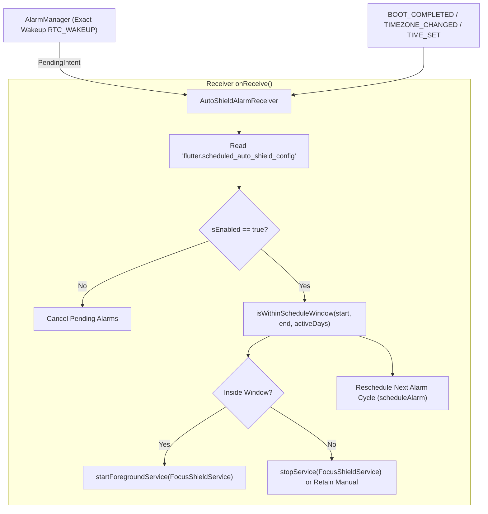
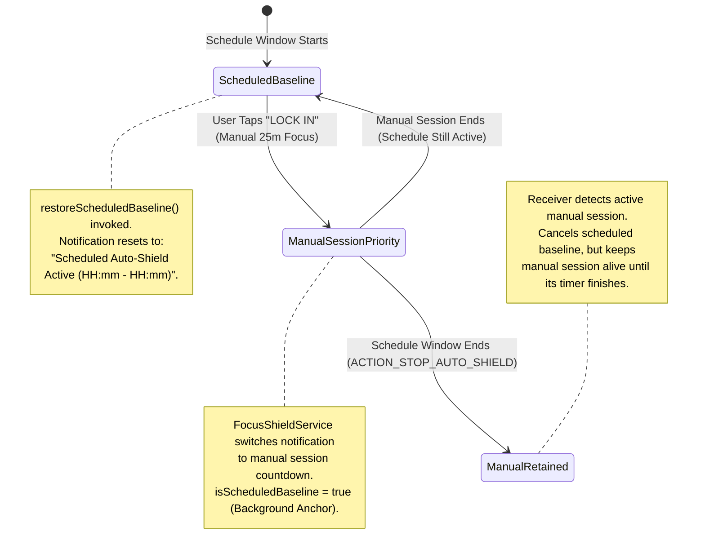

# Scheduled Auto-Shield Subsystem Specification

The Scheduled Auto-Shield engine automates recurring distraction blocking for habitual work blocks and overnight sleep protection. Without requiring manual session startup, it executes in the background via native Android `AlarmManager` exact intents, surviving device reboots, timezone adjustments, and process death.

---

## 1. Native Scheduling Engine (`AutoShieldAlarmReceiver.kt`)

Background schedule activation is managed by [`AutoShieldAlarmReceiver.kt`](file:///C:/Users/darkn/IdeaProjects/focusmaxxing/android/app/src/main/kotlin/com/bmrkiewicz/focusmaxxing/focusmaxxing/shield/AutoShieldAlarmReceiver.kt), registered in [`AndroidManifest.xml`](file:///C:/Users/darkn/IdeaProjects/focusmaxxing/android/app/src/main/AndroidManifest.xml#L82-L93) to listen for alarms, reboots, and clock updates.



### 1.1 Alarm Registration Contracts
- **Start Alarm Request Code:** `2001` (`START_ALARM_ID`).
- **End Alarm Request Code:** `2002` (`END_ALARM_ID`).
- **Alarm Actions:**
  - `com.bmrkiewicz.focusmaxxing.START_AUTO_SHIELD`
  - `com.bmrkiewicz.focusmaxxing.STOP_AUTO_SHIELD`
- **Exact Execution:** On Android 12+ (API 31+), checks `alarmManager.canScheduleExactAlarms()` and uses `setExactAndAllowWhileIdle(AlarmManager.RTC_WAKEUP, triggerTimeMs, pendingIntent)`. Falls back gracefully to `setAndAllowWhileIdle` if exact alarm permissions are restricted.

---

## 2. Overnight Bedtime Schedules (Cross-Midnight Calculation)

A critical ADHD use case is late-night doomscrolling protection (e.g., 22:00 to 06:00). Standard schedule implementations fail when the start time is greater than the end time ($T_{\text{start}} > T_{\text{end}}$).

[`AutoShieldAlarmReceiver.isWithinScheduleWindow`](file:///C:/Users/darkn/IdeaProjects/focusmaxxing/android/app/src/main/kotlin/com/bmrkiewicz/focusmaxxing/focusmaxxing/shield/AutoShieldAlarmReceiver.kt#L66-L94) implements cross-midnight window resolution:

```mermaid
graph TD
    StartCheck["Check: startHour:startMinute to endHour:endMinute"] --> Compare{"startTotalMinutes < endTotalMinutes?"}
    
    Compare -->|Intra-day (e.g. 09:00 - 17:00)| Intra["activeDays.contains(todayWeekday) && currentMinutes in start until end"]
    
    Compare -->|Cross-Midnight (e.g. 22:00 - 06:00)| SplitCheck{"currentMinutes >= startTotalMinutes?"}
    
    SplitCheck -->|Evening Window (>= 22:00)| Eve["activeDays.contains(todayWeekday)"]
    SplitCheck -->|Morning Window (< 06:00)| MorCheck{"currentMinutes < endTotalMinutes?"}
    
    MorCheck -->|Yes| PrevDay["Check activeDays.contains(prevWeekday)"]
    MorCheck -->|No (06:00 to 22:00)| Out["Outside Schedule Window -> False"]
```

### 2.1 Cross-Midnight Algorithm Formulation
Let $t = H \times 60 + M$, $t_{\text{start}} = H_{\text{start}} \times 60 + M_{\text{start}}$, and $t_{\text{end}} = H_{\text{end}} \times 60 + M_{\text{end}}$.
If $t_{\text{start}} > t_{\text{end}}$:
1. **Evening Phase ($t \ge t_{\text{start}}$):** Active if current weekday $W_{\text{today}} \in \text{activeDays}$.
2. **Morning Phase ($t < t_{\text{end}}$):** Active if the previous weekday $W_{\text{prev}} \in \text{activeDays}$, where:
   $$W_{\text{prev}} = (W_{\text{today}} == 1) \ ? \ 7 : W_{\text{today}} - 1$$
   *(Dart weekdays: 1 = Monday ... 7 = Sunday)*.

---

## 3. Priority Arbiter: Manual Sessions vs. Scheduled Baseline

When a user initiates an explicit manual focus session while Scheduled Auto-Shield is running, or when a schedule ends during a manual session, the system arbitrates priorities without interrupting flow states.



### 3.1 Priority Baseline Implementation
- **Scheduled Baseline Retention:** [`FocusShieldService.isScheduledBaseline`](file:///C:/Users/darkn/IdeaProjects/focusmaxxing/android/app/src/main/kotlin/com/bmrkiewicz/focusmaxxing/focusmaxxing/shield/FocusShieldService.kt#L85) flags that a background schedule is active.
- **Manual Cancellation Return:** If the user cancels or finishes an overlay session while a schedule is active, [`FocusShieldService.restoreScheduledBaseline()`](file:///C:/Users/darkn/IdeaProjects/focusmaxxing/android/app/src/main/kotlin/com/bmrkiewicz/focusmaxxing/focusmaxxing/shield/FocusShieldService.kt#L499-L521) restores the baseline rather than terminating the foreground service:
  ```kotlin
  fun restoreScheduledBaseline() {
      if (!isScheduledBaseline) return
      isScheduled = true
      scheduleTimeRange = scheduledBaselineRange
      currentGoal = "Scheduled Auto-Shield"
      currentRemainingSeconds = 0
      targetEndTimeEpochMs = 0L
      updateOverlaySessionState(applicationContext, currentGoal, 0, false)
      updateNotification(formatSessionNotificationText())
  }
  ```
- **Stop Alarm Conflict Arbiter:** In [`AutoShieldAlarmReceiver.kt`](file:///C:/Users/darkn/IdeaProjects/focusmaxxing/android/app/src/main/kotlin/com/bmrkiewicz/focusmaxxing/focusmaxxing/shield/AutoShieldAlarmReceiver.kt#L243-L263), when `ACTION_STOP_AUTO_SHIELD` arrives, it checks:
  ```kotlin
  val isManualSessionActive = active != null && !active.isScheduled &&
      (FocusShieldService.targetEndTimeEpochMs > System.currentTimeMillis() || FocusShieldService.currentRemainingSeconds > 0)
  ```
  If manual focus is running, it only clears `isScheduledBaseline = false` and allows the user's focus session to run to its natural completion.

---

## 4. UI Configuration Architecture (`ShieldPage.dart`)

Schedule configuration is integrated directly into [`ShieldPage`](file:///C:/Users/darkn/IdeaProjects/focusmaxxing/lib/features/shield/presentation/pages/shield_page.dart) inside `ScheduleConfigSection`:

| Preference Key | Value Structure | Purpose |
|:---|:---|:---|
| `scheduled_auto_shield_config` | `JSON: {"isEnabled": bool, "startHour": int, "startMinute": int, "endHour": int, "endMinute": int}` | Main schedule time configuration. |
| `scheduled_auto_shield_active_days` | `List<String>: ["1", "2", "3", "4", "5"]` | Active weekdays (1=Mon ... 7=Sun). |
| `scheduled_auto_shield_packages` | `List<String>: ["com.instagram.android", ...]` | Blocked packages enforced during scheduled hours. |

### 4.1 UI Controls
- **Time Window Tiles:** Material 3 `TimePicker` selectors configuring start and end boundaries.
- **Day Selector Chips:** Horizontal chip group (M, T, W, T, F, S, S) allowing granular day toggling.
- **Pro Gating:** Full schedule configuration is accessible to all users; active package restrictions adhere to the user's tier (2 apps for free tier, unlimited for Lifetime Pro).
