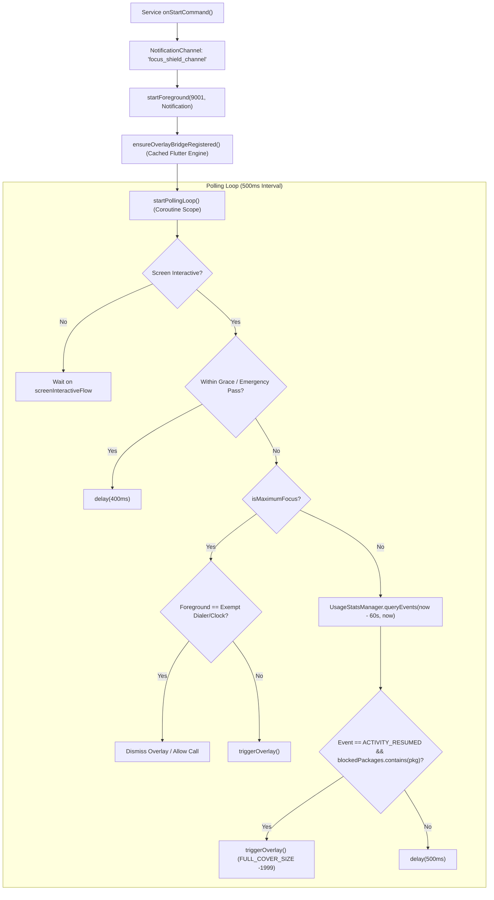
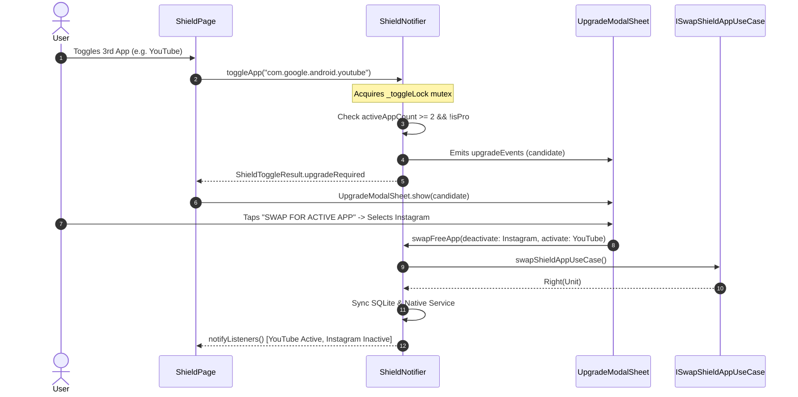
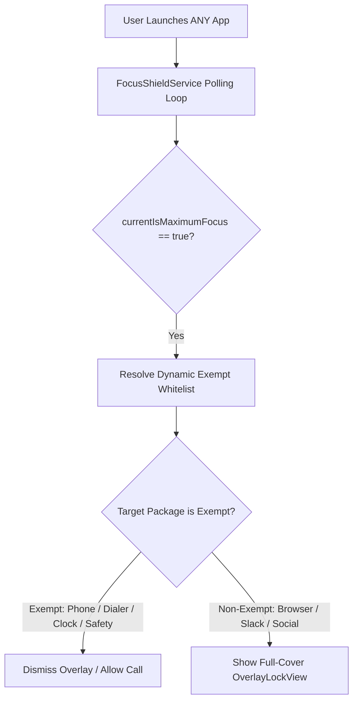
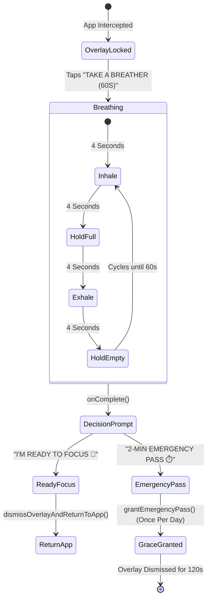
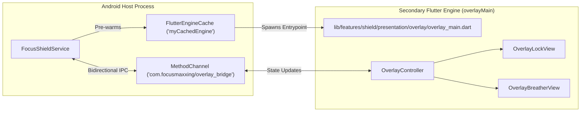
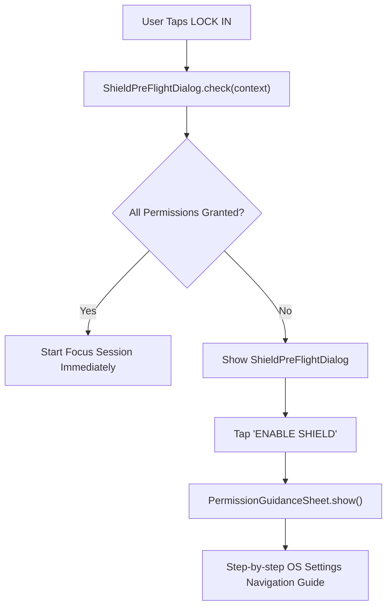

# Shield & App Interception Subsystem Specification

The Brainrot Shield subsystem is Focusmaxxing's core dopamine defense architecture. Built around a persistent Android foreground service and a secondary Flutter overlay engine, it detects distracting app launches, intercepts foreground tasks within 500ms, and replaces doomscrolling impulses with psychiatric urge-surfing interventions.

---

## 1. Native Service Architecture (`FocusShieldService.kt`)

The interception engine runs as an isolated Android foreground service ([`FocusShieldService.kt`](file:///C:/Users/darkn/IdeaProjects/focusmaxxing/android/app/src/main/kotlin/com/bmrkiewicz/focusmaxxing/focusmaxxing/shield/FocusShieldService.kt)) declared in [`AndroidManifest.xml`](file:///C:/Users/darkn/IdeaProjects/focusmaxxing/android/app/src/main/AndroidManifest.xml#L58-L64) with `foregroundServiceType="specialUse"`.



### 1.1 Foreground Interception Loop Mechanics
1. **Screen State Optimization:** When the screen turns off, [`FocusShieldService`](file:///C:/Users/darkn/IdeaProjects/focusmaxxing/android/app/src/main/kotlin/com/bmrkiewicz/focusmaxxing/focusmaxxing/shield/FocusShieldService.kt#L370-L409) catches `Intent.ACTION_SCREEN_OFF` via a dynamic `BroadcastReceiver` and pauses polling using Kotlin Coroutines `screenInteractiveFlow.first { it }`, preventing battery drain while the device sleeps.
2. **Delta Polling Strategy:** Every 500ms, the service queries `UsageStatsManager.queryEvents` looking back to `lastProcessedEventTime - 250L` (bounded by `MAX_EVENT_LOOKBACK_MS = 60_000L`).
3. **Event Extraction:** It inspects `UsageEvents.Event.ACTIVITY_RESUMED` (event type `1`). If the resumed package matches `blockedPackages`, [`triggerOverlay()`](file:///C:/Users/darkn/IdeaProjects/focusmaxxing/android/app/src/main/kotlin/com/bmrkiewicz/focusmaxxing/focusmaxxing/shield/FocusShieldService.kt#L704-L743) fires immediately.
4. **Overlay Full-Cover Configuration:** Window size is configured with `FULL_COVER_SIZE = -1999` (`MATCH_PARENT`), non-draggable, center gravity, and flag `defaultFlag`.

---

## 2. Free Tier Gating & Mutex-Protected App Swapping

Focusmaxxing enforces a strict 2-app free tier limit in [`ShieldNotifier`](file:///C:/Users/darkn/IdeaProjects/focusmaxxing/lib/features/shield/presentation/notifiers/shield_notifier.dart#L32): `static const int freeTierAppCap = 2;`.



### 2.1 Mutex Synchronization
Rapid multi-finger tapping can induce race conditions on SQLite inserts. [`ShieldNotifier.toggleApp`](file:///C:/Users/darkn/IdeaProjects/focusmaxxing/lib/features/shield/presentation/notifiers/shield_notifier.dart#L253-L274) chains operations through an asynchronous lock:
```dart
Future<ShieldToggleResult> toggleApp({...}) async {
  final previousLock = _toggleLock;
  final completer = Completer<void>();
  _toggleLock = completer.future;
  try {
    await previousLock;
    return await _toggleAppInternal(...);
  } finally {
    completer.complete();
  }
}
```

---

## 3. Maximum Focus Mode (Complete Phone Lockdown)

When users require extreme discipline, **Maximum Focus Mode** restricts the entire smartphone, preventing access to all applications except essential emergency utilities.



### 3.1 Dynamic Emergency Whitelist Resolution
Emergency calls must never be obstructed. [`FocusShieldService.isExemptPackage`](file:///C:/Users/darkn/IdeaProjects/focusmaxxing/android/app/src/main/kotlin/com/bmrkiewicz/focusmaxxing/focusmaxxing/shield/FocusShieldService.kt#L140-L162) maintains a static core and resolves dynamic OS dialers every 60 seconds:
- **Static Whitelist:**
  - `com.android.dialer`, `com.google.android.dialer`, `com.samsung.android.dialer`
  - `com.samsung.android.incallui`, `com.android.incallui`, `com.android.server.telecom`
  - `com.android.emergency`, `com.google.android.apps.safetyhub`
  - `com.android.DeskClock`, `com.google.android.deskclock`, `com.sec.android.app.clockpackage`
- **Dynamic Telecom Resolution:**
  - `TelecomManager.defaultDialerPackage`
  - `packageManager.queryIntentActivities(Intent(Intent.ACTION_DIAL))`

---

## 4. Emergency Breather & 2-Minute Grace Pass

Distraction impulses are driven by momentary dopamine cravings. Rather than an abrupt dead-end, the overlay presents **Urge Surfing**: a guided 60-second breathing exercise based on cognitive behavioral therapy.



### 4.1 4-4-4-4 Box Breathing Visualizer (`BoxBreathingExercise.dart`)
- Component: [`BoxBreathingExercise`](file:///C:/Users/darkn/IdeaProjects/focusmaxxing/lib/features/shield/presentation/widgets/box_breathing_exercise.dart)
- Mathematical scaling cycle:
  - Total duration: 60 seconds (`phaseDuration = 4s`, 4 phases = 16s per cycle, $\approx 3.75$ cycles).
  - Phases: `INHALE` (scale 0.45 to 1.0) $\rightarrow$ `HOLD` (scale 1.0) $\rightarrow$ `EXHALE` (scale 1.0 to 0.45) $\rightarrow$ `HOLD` (scale 0.45).
  - Emits `HapticFeedback.selectionClick()` on every phase boundary transition.

### 4.2 Emergency Grace Pass Cooldown
- Duration: 120,000ms (`EMERGENCY_PASS_DURATION_MS = 120_000L`).
- Cooldown: Persisted under `focusmaxxing_shield_prefs` with key `emergency_pass_last_used_date` stored as ISO date string (`LocalDate.now().toString()`). Only 1 emergency pass is permitted per calendar day.

---

## 5. Dual Flutter Engine Overlay Window Architecture

The hard-lock screen is not an Activity inside the main task stack; it is a standalone system overlay window rendered via `flutter_overlay_window`.



### 5.1 Pre-Warming & Cached Engine Lifecycle
To eliminate white-screen latency during interception:
1. [`FocusShieldService.ensureOverlayBridgeRegistered`](file:///C:/Users/darkn/IdeaProjects/focusmaxxing/android/app/src/main/kotlin/com/bmrkiewicz/focusmaxxing/focusmaxxing/shield/FocusShieldService.kt#L176-L262) spins up a secondary engine via `FlutterEngineGroup.createAndRunEngine` pointing to `@pragma('vm:entry-point') void overlayMain()` in [`overlay_main.dart`](file:///C:/Users/darkn/IdeaProjects/focusmaxxing/lib/features/shield/presentation/overlay/overlay_main.dart#L9-L18).
2. The engine is cached under ID `"myCachedEngine"`.
3. Communication flows over `MethodChannel("com.focusmaxxing/overlay_bridge")`:
   - `getInitialOverlayState`: Pulls current goal, remaining seconds, break status, Maximum Focus flag, and emergency pass availability.
   - `updateOverlayState`: Pushes live tick updates from native code into the overlay Dart runtime.
   - `grantEmergencyPass`: Invokes daily cooldown check and grants 120s pass.
   - `returnToFocusmaxxing`: Dismisses overlay and reorders `MainActivity` to the foreground with flags `FLAG_ACTIVITY_REORDER_TO_FRONT | FLAG_ACTIVITY_SINGLE_TOP`.
   - `cancelSessionFromOverlay`: Cancels active session from overlay, clears tombstones, and restores scheduled baseline if applicable.

---

## 6. Permission Pre-Flight Gate & Guidance

Interception requires two elevated Android permissions:
1. **Usage Access (`android.permission.PACKAGE_USAGE_STATS`):** Required to detect foreground package transitions.
2. **Display Over Other Apps (`android.permission.SYSTEM_ALERT_WINDOW`):** Required to draw the full-cover lock overlay.



### 6.1 Pre-Flight Gateways
- [`ShieldPreFlightDialog`](file:///C:/Users/darkn/IdeaProjects/focusmaxxing/lib/features/timer/presentation/widgets/shield_pre_flight_dialog.dart) intercepts session startup if permissions are absent, preventing unshielded sessions.
- [`PermissionGuidanceSheet`](file:///C:/Users/darkn/IdeaProjects/focusmaxxing/lib/features/shield/presentation/widgets/permission_guidance_sheet.dart) walks users through vendor-specific settings (Samsung OneUI, Xiaomi MIUI, Google Pixel) to ensure reliable background persistence.
- [`PermissionBannerWidget`](file:///C:/Users/darkn/IdeaProjects/focusmaxxing/lib/features/shield/presentation/widgets/permission_banner_widget.dart) provides persistent visual alerts at the top of the Shield tab until both permissions are active.
