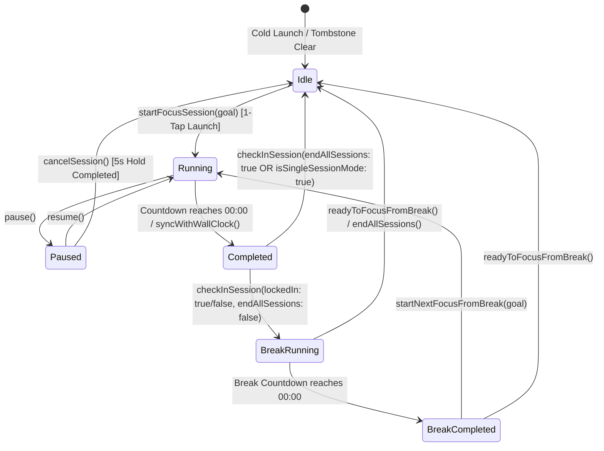
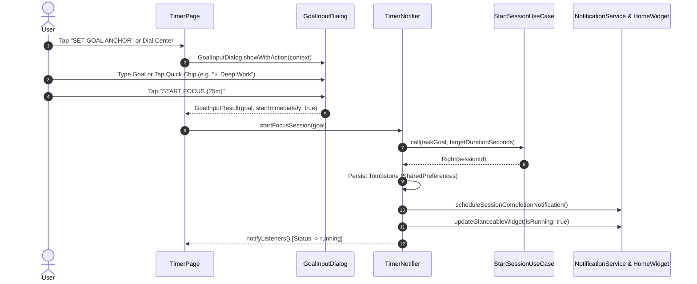
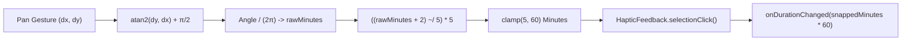
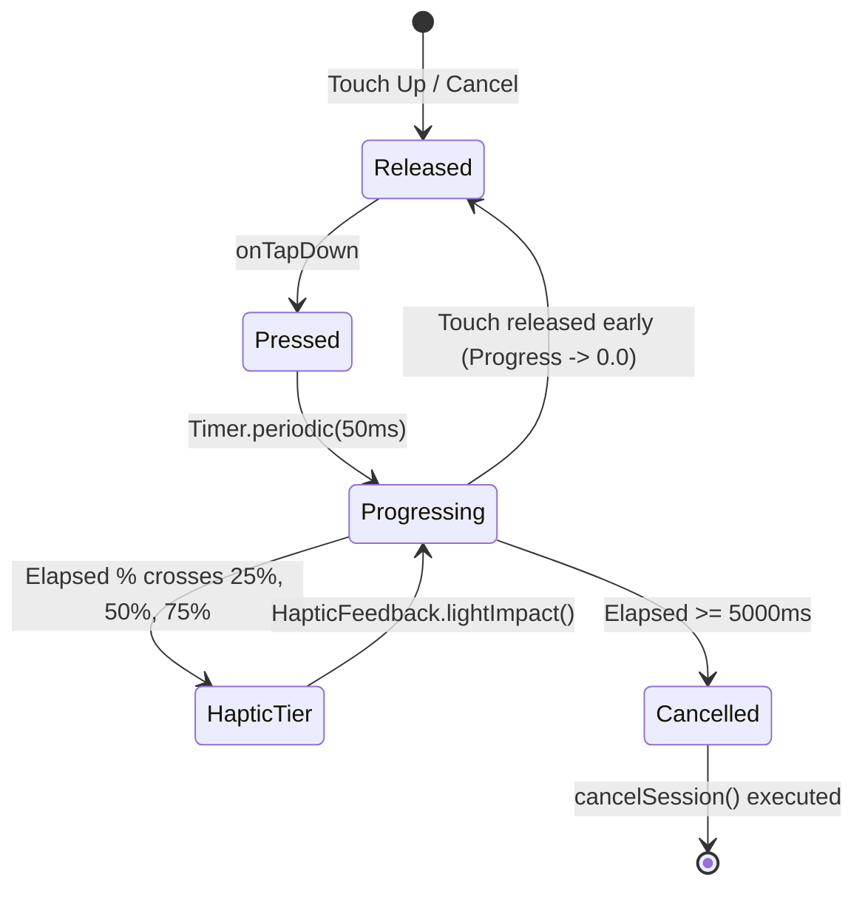
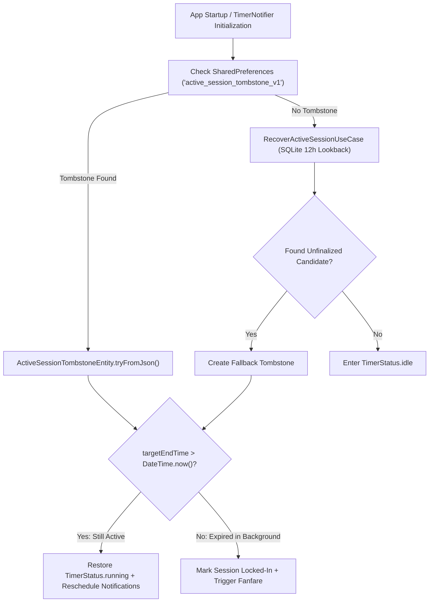

# Timer & Lock-In Subsystem Specification

The Timer & Lock-In engine orchestrates the primary focus session lifecycle in Focusmaxxing. Designed to conquer executive dysfunction, it eliminates confirmation dialogs through 1-tap session initiation, maintains hardware-accelerated dial controls, enforces a 5-second hold safeguard against impulsive cancellation, and ensures deterministic session recovery across Android OS process kills.

---

## 1. Architectural Architecture & State Flow

The timer lifecycle is managed by [`TimerNotifier`](file:///C:/Users/darkn/IdeaProjects/focusmaxxing/lib/features/timer/presentation/notifiers/timer_notifier.dart), which coordinates state transitions across clean architecture domain use cases, SQLite persistence, Android notifications, and home screen widgets.



### 1.1 State Machine Enumeration

The timer operational state is represented by [`TimerStatus`](file:///C:/Users/darkn/IdeaProjects/focusmaxxing/lib/features/timer/presentation/notifiers/timer_notifier.dart#L18-L25):
- `TimerStatus.idle`: Dial is interactive. Presets can be selected, and target durations modified.
- `TimerStatus.running`: Countdown ticker active (200ms periodic interval synchronized against wall-clock timestamp `_targetEndTime`). Ongoing silent notification and home widget chronometer are active.
- `TimerStatus.paused`: Remaining duration frozen; hold-to-cancel button visible; ongoing notification paused.
- `TimerStatus.completed`: Target duration elapsed; audio completion chime triggered; celebration sheet displayed.
- `TimerStatus.breakRunning`: 5-minute restorative interval active; rotating ADHD micro-habits displayed; social shields remain enforced.
- `TimerStatus.breakCompleted`: Rest period ended; user prompted to roll into the next block or return to idle.

---

## 2. 1-Tap Direct Session Initiation

To bypass ADHD task initiation friction, modal workflows must never terminate in an inactive idle state. Focusmaxxing provides direct execution vectors that immediately transition the engine to `TimerStatus.running`.



### 2.1 Dialog Direct Action Contract
- [`GoalInputDialog.showWithAction`](file:///C:/Users/darkn/IdeaProjects/focusmaxxing/lib/features/timer/presentation/widgets/goal_input_dialog.dart#L50-L64) returns a strongly-typed [`GoalInputResult`](file:///C:/Users/darkn/IdeaProjects/focusmaxxing/lib/features/timer/presentation/widgets/goal_input_dialog.dart#L6-L25) containing:
  ```dart
  class GoalInputResult {
    final String goal;
    final bool startImmediately;
    const GoalInputResult({required this.goal, this.startImmediately = true});
  }
  ```
- **Fallback Rule:** If the text field is empty or whitespace, the goal defaults deterministically to `"Deep Work"` ([`GoalInputDialog._submit`](file:///C:/Users/darkn/IdeaProjects/focusmaxxing/lib/features/timer/presentation/widgets/goal_input_dialog.dart#L85-L93) and [`TimerNotifier.startFocusSession`](file:///C:/Users/darkn/IdeaProjects/focusmaxxing/lib/features/timer/presentation/notifiers/timer_notifier.dart#L175-L177)).
- **Recent Goal Chips:** [`RecentGoalChips`](file:///C:/Users/darkn/IdeaProjects/focusmaxxing/lib/features/timer/presentation/widgets/recent_goal_chips.dart) renders up to 3 historically unique goals persisted under `recent_focus_goals` in `SharedPreferences`. Tapping an active chip immediately invokes `startFocusSession` without opening any dialog.

---

## 3. Interactive Radial Dial & Detent Snapping

The focus duration is manipulated via [`TimerDialWidget`](file:///C:/Users/darkn/IdeaProjects/focusmaxxing/lib/features/timer/presentation/widgets/timer_dial_widget.dart). The dial implements custom trigonometric touch resolution and haptic step detents.



### 3.1 Gestural Mechanics & Mathematical Formulations
1. **Touch Deadzone:** Gestures occurring within the inner circle (`distance < dialSize * 0.25`) are rejected ([`TimerDialWidget._handleDialGesture`](file:///C:/Users/darkn/IdeaProjects/focusmaxxing/lib/features/timer/presentation/widgets/timer_dial_widget.dart#L52)) to allow tap events on inner text without accidentally scrubbing time.
2. **Angular Normalization:**
   $$\theta = \text{atan2}(dy, dx) + \frac{\pi}{2}$$
   $$\theta_{\text{norm}} = (\theta < 0) \ ? \ \theta + 2\pi : \theta$$
3. **5-Minute Detent Quantization:**
   $$\text{rawMinutes} = \text{round}\left(\frac{\theta_{\text{norm}}}{2\pi} \times 60\right)$$
   $$\text{snappedMinutes} = \left\lfloor \frac{\text{rawMinutes} + 2}{5} \right\rfloor \times 5$$
   The resulting value is clamped to $[5, 60]$ minutes. Each discrete increment transition triggers `HapticFeedback.selectionClick()`.

### 3.2 Custom Painter Pipeline
[`_DialPainter`](file:///C:/Users/darkn/IdeaProjects/focusmaxxing/lib/features/timer/presentation/widgets/timer_dial_widget.dart#L212-L273) renders:
- Circular track with `strokeWidth = 3.0` using `AppColors.surfaceHairline` / `outlineVariant`.
- Sweep arc with `strokeCap = StrokeCap.round` and `strokeWidth = 5.0` in `accentColor`.
- Glow indicator: Outer circle with `MaskFilter.blur(BlurStyle.normal, 6)` at $0.4$ alpha, followed by an inner solid dot at radius $4.0$.

---

## 4. Single Session Mode vs. Continuous Flow

Focusmaxxing supports two pacing architectures configured via [`SingleSessionModePill`](file:///C:/Users/darkn/IdeaProjects/focusmaxxing/lib/features/timer/presentation/widgets/single_session_mode_pill.dart) and persisted under `is_single_session_mode`:

| Mode | Behavior on Session Expiry | Break Transition | Use Case |
|:---|:---|:---|:---|
| **Continuous Flow (Default)** | Transitions automatically to `TimerStatus.breakRunning` (5-minute countdown). Social shield remains locked. | Ongoing break notification with rotating habits is shown. | Standard Pomodoro cycles; multi-hour deep work sprints. |
| **Single Session Mode** | Transitions to `TimerStatus.idle`. Active session is finalized. Social shields unlock immediately. | No break phase initiated. Timer resets to default duration. | Standalone task execution; micro-commitments before meetings. |

Configured in [`TimerNotifier.checkInSession`](file:///C:/Users/darkn/IdeaProjects/focusmaxxing/lib/features/timer/presentation/notifiers/timer_notifier.dart#L504-L535):
```dart
if (endAllSessions || _isSingleSessionMode) {
  _status = TimerStatus.idle;
  _targetDurationSeconds = _focusDurationSeconds;
  _remainingSeconds = _focusDurationSeconds;
  await _clearTombstone();
  notifyListeners();
} else {
  _status = TimerStatus.breakRunning;
  _targetDurationSeconds = defaultBreakSeconds; // 300 seconds
  _targetEndTime = DateTime.now().add(_remainingDuration);
  await _persistTombstone();
  _updateBreakNotification();
  _startTicker();
  notifyListeners();
}
```

---

## 5. 5-Second Hold-to-Cancel Safeguard

To counteract impulsive task abandonment during moments of frustration, session cancellation requires a continuous 5000ms press handled by [`HoldToCancelButton`](file:///C:/Users/darkn/IdeaProjects/focusmaxxing/lib/features/timer/presentation/widgets/hold_to_cancel_button.dart).



### 5.1 Mechanics & Accessibility
- **Haptic Ramp:** The progress interval $[0.0, 1.0]$ is divided into 4 tiers (`(progress * 4).floor()`). Crossing a tier boundary emits `HapticFeedback.lightImpact()` ([`_HoldToCancelButtonState._checkHapticTier`](file:///C:/Users/darkn/IdeaProjects/focusmaxxing/lib/features/timer/presentation/widgets/hold_to_cancel_button.dart#L60-L71)).
- **Short-Tap Interception:** If released in $<600$ms with $<20\%$ progress, a floating SnackBar warns: `"Hold for 5 full seconds to cancel session"`.
- **Accessibility Fallback:** For users utilizing screen readers (TalkBack), double-tapping opens an accessible confirmation dialog ([`_showAccessibleCancelConfirmation`](file:///C:/Users/darkn/IdeaProjects/focusmaxxing/lib/features/timer/presentation/widgets/hold_to_cancel_button.dart#L116-L149)) with explicit `"KEEP FOCUSING"` and `"CONFIRM CANCEL"` buttons.

---

## 6. Victory Fanfare & Celebration Spark Sheet

Upon timer expiry (`syncWithWallClock` detects `diff <= 0`), the app triggers dopamine reinforcement:
1. Emits heavy haptic feedback: `HapticFeedback.heavyImpact()`.
2. Plays completion chime: [`PlayChimeUseCase`](file:///C:/Users/darkn/IdeaProjects/focusmaxxing/lib/features/audio/domain/usecases/play_chime_usecase.dart) (`assets/audio/chime_complete.ogg`).
3. Displays [`CelebrationSparkSheet`](file:///C:/Users/darkn/IdeaProjects/focusmaxxing/lib/features/timer/presentation/widgets/celebration_spark_sheet.dart):
   - Scaling spring icon animation: `Curves.easeOutBack` over 600ms.
   - Text banner: `"+{duration}m MOMENTUM SECURED"`.
   - Goal badge reflecting the completed task goal.
   - Primary Action: `"ROLL INTO NEXT BLOCK 🚀"` (`rollIntoNext: true`).
   - Secondary Action: `"TAKE A 5M BREATHER ☕"` (`rollIntoNext: false`).

---

## 7. Ongoing Notification Chronometer & Rest Micro-Habits

### 7.1 Android Native Chronometer Notification
Rather than waking up the Dart isolate every second to redraw notifications (which drains battery and risks OS throttling), [`NotificationService.showOngoingTimer`](file:///C:/Users/darkn/IdeaProjects/focusmaxxing/lib/core/notifications/notification_service.dart#L148-L231) utilizes native Android chronometer capabilities:
- Channel: `focusmaxxing_timer_silent_channel` (`importance: Importance.low`, `silent: true`, `playSound: false`).
- Category: `AndroidNotificationCategory.stopwatch`.
- Native countdown parameters:
  - `usesChronometer = true`
  - `chronometerCountDown = true`
  - `when = targetEndTimeEpochMs`
- Timeout safeguard: `timeoutAfter = remainingMs + 1500` ensures Android cleans up the notification if the process terminates abnormally.

### 7.2 Restorative Micro-Habits Card
During `TimerStatus.breakRunning`, the dial is replaced by [`BreakInfoCard`](file:///C:/Users/darkn/IdeaProjects/focusmaxxing/lib/features/timer/presentation/widgets/break_info_card.dart), displaying structured ADHD recovery habits:
- **20-20-20 Rule (👁️):** Look at an object 20 feet away for 20 seconds to relax ciliary eye muscles.
- **Hydration Check (💧):** Drink 1 full glass of cold water now. Dehydration degrades prefrontal focus.
- **Physical Reset (🧘):** Roll shoulders back 5 times, unclench jaw, stand up.
- **Oxygen Surge (🫁):** Inhale 4s, hold 4s, exhale 7s.
- **Mental Reset (🌿):** Step away from screens into fresh air/daylight.
Tapping the card cycles through habits using `(currentIndex + 1) % habits.length` with haptic feedback.

---

## 8. Crash Recovery Architecture (Tombstone Engine)

To guarantee that sessions survive low-memory process termination (LMK) or unexpected device restarts, Focusmaxxing deploys a dual-layer persistence recovery system.



### 8.1 ActiveSessionTombstoneEntity Data Contract
Persisted to `active_session_tombstone_v1` via [`ActiveSessionTombstoneEntity`](file:///C:/Users/darkn/IdeaProjects/focusmaxxing/lib/features/timer/domain/entities/active_session_tombstone_entity.dart):

```json
{
  "sessionId": 42,
  "status": "running",
  "taskGoal": "Refactor billing engine",
  "linkedBacklogTaskId": 15,
  "focusDurationSeconds": 1500,
  "targetDurationSeconds": 1500,
  "remainingSeconds": 850,
  "targetEndTimeEpochMs": 1730462400000,
  "savedAtEpochMs": 1730461550000
}
```

### 8.2 Recovery Resolution via SQLite Lookback
If `SharedPreferences` was wiped or corrupted, [`RecoverActiveSessionUseCase`](file:///C:/Users/darkn/IdeaProjects/focusmaxxing/lib/features/timer/domain/usecases/recover_active_session_usecase.dart) inspects local SQLite storage across a $\pm 12$-hour window:
- Criteria: `session_type == 'focus'`, `status == 'cancelled'`, `actual_duration_seconds == 0`, and `end_time_epoch_ms == start_time_epoch_ms + (target_duration_seconds * 1000)`.
- If an unfinalized session is identified, it is reconstructed and restored without losing accumulated momentum.
