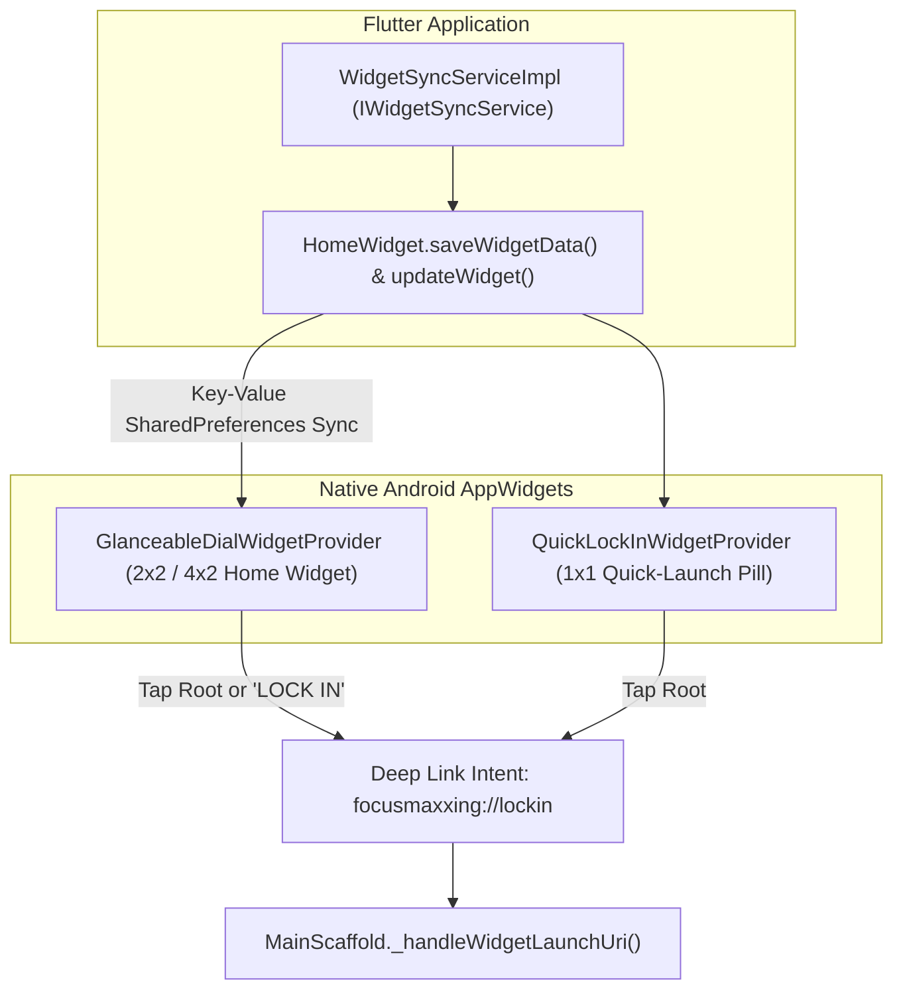
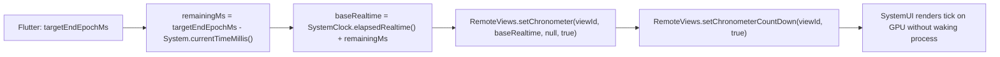
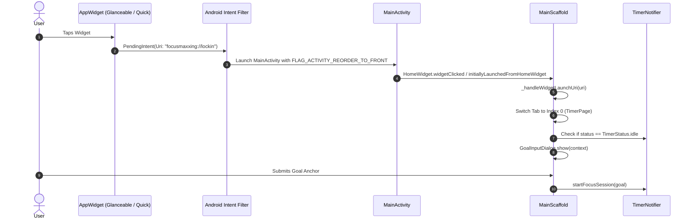
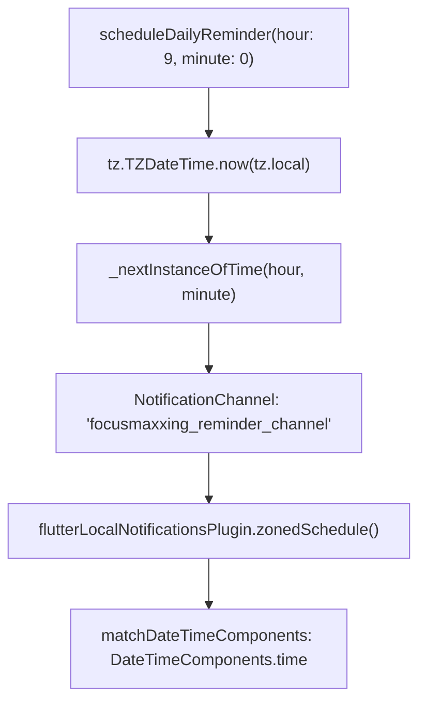

# Widgets & Reminders Subsystem Specification

The Widgets & Reminders subsystem establishes an ambient, tactile presence on the Android operating system. By utilizing native Android AppWidgets, hardware-accelerated remote chronometers, and deep-link URI dispatchers, Focusmaxxing allows users to monitor active focus blocks and initiate lock-in states directly from their home screen without battery drain.

---

## 1. Android AppWidget Architecture

Focusmaxxing ships two specialized Android AppWidgets implemented via the `home_widget` plugin and native Kotlin `HomeWidgetProvider` classes:



### 1.1 Widget Catalog

| Provider Class | Layout XML | Dimensions | Features & Purpose |
|:---|:---|:---:|:---|
| [`GlanceableDialWidgetProvider`](file:///C:/Users/darkn/IdeaProjects/focusmaxxing/android/app/src/main/kotlin/com/bmrkiewicz/focusmaxxing/focusmaxxing/widget/GlanceableDialWidgetProvider.kt) | `widget_glanceable_dial.xml` | 2x2 or 4x2 | **Dual-State Display:** When idle, displays today's total focus minutes (`Xm`), active streak count (`🔥 Xd`), and a quick "LOCK IN" button. When active, reveals a live ticking countdown chronometer, task goal string, and "FOCUSING" status. |
| [`QuickLockInWidgetProvider`](file:///C:/Users/darkn/IdeaProjects/focusmaxxing/android/app/src/main/kotlin/com/bmrkiewicz/focusmaxxing/focusmaxxing/widget/QuickLockInWidgetProvider.kt) | `widget_quick_lockin.xml` | 1x1 | **Minimalist Execution:** A compact, high-contrast launch pill targeting immediate session kickoff. |

---

## 2. Battery-Neutral Native Chronometer (`RemoteViews.setChronometer`)

Standard Flutter home-screen widgets update via periodic polling or background WorkManager jobs. However, updating an AppWidget every second consumes excessive battery and is throttled by Android power managers.

Focusmaxxing achieves second-by-second countdown rendering at **zero CPU cost** using Android's native [`RemoteViews.setChronometer`](file:///C:/Users/darkn/IdeaProjects/focusmaxxing/android/app/src/main/kotlin/com/bmrkiewicz/focusmaxxing/focusmaxxing/widget/GlanceableDialWidgetProvider.kt#L40-L42).



### 2.1 Kotlin Implementation Contract
In [`GlanceableDialWidgetProvider.kt`](file:///C:/Users/darkn/IdeaProjects/focusmaxxing/android/app/src/main/kotlin/com/bmrkiewicz/focusmaxxing/focusmaxxing/widget/GlanceableDialWidgetProvider.kt#L29-L55):
```kotlin
val remainingMs = targetEndTimeEpochMs - System.currentTimeMillis()
val isCurrentlyActive = isRunning && remainingMs > 0L

if (isCurrentlyActive) {
    views.setViewVisibility(R.id.widget_idle_container, View.GONE)
    views.setViewVisibility(R.id.widget_active_container, View.VISIBLE)

    val baseRealtime = SystemClock.elapsedRealtime() + remainingMs
    views.setChronometer(R.id.widget_chronometer, baseRealtime, null, true)
    views.setChronometerCountDown(R.id.widget_chronometer, true)
    views.setTextViewText(R.id.widget_task_goal, taskGoal)
} else {
    views.setViewVisibility(R.id.widget_idle_container, View.VISIBLE)
    views.setViewVisibility(R.id.widget_active_container, View.GONE)
    views.setChronometer(R.id.widget_chronometer, 0L, null, false)
    views.setTextViewText(R.id.widget_today_minutes, "${todayMinutes}m")
}
```

---

## 3. Deep Linking URI Dispatcher (`focusmaxxing://lockin`)

Tapping either widget dispatches an explicit PendingIntent registered in [`AndroidManifest.xml`](file:///C:/Users/darkn/IdeaProjects/focusmaxxing/android/app/src/main/AndroidManifest.xml#L39-L46) with scheme `focusmaxxing` and host `lockin`.



### 3.1 Cold vs. Warm Launch Ingestion
In [`MainScaffold._initializeWidgetDeepLinking`](file:///C:/Users/darkn/IdeaProjects/focusmaxxing/lib/main_scaffold.dart#L58-L94):
- **Cold Starts:** Evaluates `HomeWidget.initiallyLaunchedFromHomeWidget()`.
- **Warm / Foreground Starts:** Subscribes to broadcast stream `HomeWidget.widgetClicked.listen(...)`.
- **Debounce Guard:** `_isHandlingLockIn` prevents duplicate dialog presentations if the user double-taps the home screen widget.

---

## 4. Daily Scheduled Focus Reminders

To assist ADHD users with time blindness, [`NotificationService`](file:///C:/Users/darkn/IdeaProjects/focusmaxxing/lib/core/notifications/notification_service.dart) provides daily scheduled recurring reminders using `timezone` and `flutter_local_notifications`.



### 4.1 Daily Reminder Configuration
- **Notification ID:** `1002` (`dailyReminderNotificationId`).
- **Channel ID:** `focusmaxxing_reminder_channel` (`importance: Importance.defaultImportance`).
- **Scheduling Mode:** `AndroidScheduleMode.exactAllowWhileIdle`, automatically falling back to inexact scheduling if exact alarm permissions are restricted on the device.
- **Copy Rotation:** Prompts users with actionable, low-shame anchors (e.g., *"Time to lock in: What ONE thing matters most today?"*).
